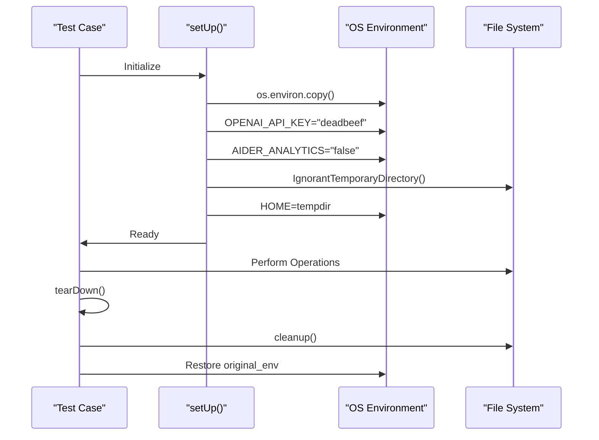

# Testing Infrastructure

<details>
<summary>Relevant source files</summary>

The following files were used as context for generating this wiki page:

- [.github/workflows/check_pypi_version.yml](.github/workflows/check_pypi_version.yml)
- [.github/workflows/ubuntu-tests.yml](.github/workflows/ubuntu-tests.yml)
- [.github/workflows/windows-tests.yml](.github/workflows/windows-tests.yml)
- [.github/workflows/windows_check_pypi_version.yml](.github/workflows/windows_check_pypi_version.yml)
- [aider/help.py](aider/help.py)
- [pytest.ini](pytest.ini)
- [requirements/pydub.in](requirements/pydub.in)
- [requirements/python-compat.in](requirements/python-compat.in)
- [scripts/issues.py](scripts/issues.py)
- [tests/basic/test_coder.py](tests/basic/test_coder.py)
- [tests/basic/test_commands.py](tests/basic/test_commands.py)
- [tests/basic/test_deprecated.py](tests/basic/test_deprecated.py)
- [tests/basic/test_main.py](tests/basic/test_main.py)
- [tests/basic/test_model_info_manager.py](tests/basic/test_model_info_manager.py)
- [tests/basic/test_sanity_check_repo.py](tests/basic/test_sanity_check_repo.py)
- [tests/basic/test_scripting.py](tests/basic/test_scripting.py)
- [tests/basic/test_ssl_verification.py](tests/basic/test_ssl_verification.py)
- [tests/help/test_help.py](tests/help/test_help.py)
- [tests/scrape/test_scrape.py](tests/scrape/test_scrape.py)

</details>


This document describes Aider's pytest-based test suite, including test organization, fixtures, mocking strategies, and coverage of core functionality. For information about performance benchmarking with polyglot exercises, see [Benchmarking System (8.1)]().

## Overview

Aider's testing infrastructure validates core systems through comprehensive unit and integration tests built on `pytest`. The test suite covers:

- **Entry Point Testing**: `TestMain` class validates the `main()` function, argument parsing, configuration loading, and initialization [tests/basic/test_main.py:21-181]().
- **Command Processing**: `TestCommands` class validates slash commands like `/add`, `/copy`, and `/drop` [tests/basic/test_commands.py:23-188]().
- **Coder Operations**: `TestCoder` class validates file tracking, edit permissions (`allowed_to_edit`), and LLM context assembly [tests/basic/test_coder.py:19-210]().
- **Repository Validation**: Functions like `sanity_check_repo` validate Git repository compatibility, including handling of detached HEAD states and index versions [tests/basic/test_sanity_check_repo.py:1-185]().
- **Integration Tests**: Coverage for web scraping via Playwright/httpx [tests/scrape/test_scrape.py:10-173]() and the RAG-based help system [aider/help.py:133-163]().
- **Maintenance Automation**: Scripts for managing GitHub issues, identifying stale issues, and handling duplicates [scripts/issues.py:1-200]().

Tests use temporary directories (`GitTemporaryDirectory`, `IgnorantTemporaryDirectory`), mocking (`unittest.mock`), and pytest fixtures to ensure isolation.

Sources: [tests/basic/test_main.py:21-181](), [tests/basic/test_commands.py:23-188](), [tests/basic/test_coder.py:19-210](), [tests/basic/test_sanity_check_repo.py:1-185](), [scripts/issues.py:1-200]()

## Test Organization

### Directory Structure

```
tests/
├── basic/               # Core functionality tests
│   ├── test_main.py    # TestMain: main() entry point, arg parsing, config loading
│   ├── test_commands.py # TestCommands: cmd_add(), cmd_copy(), cmd_drop()
│   ├── test_coder.py   # TestCoder: allowed_to_edit(), get_file_mentions()
│   ├── test_sanity_check_repo.py  # sanity_check_repo() validation
│   ├── test_ssl_verification.py   # --no-verify-ssl flag testing
│   └── test_scripting.py          # coder.run() API for scripting
├── help/               # Help system tests
│   └── test_help.py   # TestHelp: Help.ask(), URL mapping
└── scrape/             # Web content tests
    └── test_scrape.py # TestScrape: Playwright and SSL handling
```

Sources: [tests/basic/test_main.py:1-21](), [tests/basic/test_commands.py:1-23](), [tests/basic/test_coder.py:1-19](), [tests/scrape/test_scrape.py:1-10]()

### Test Classes and Code Entity Mapping

The following diagram maps test classes to the specific core entities they validate.

**Test Classes to Code Entity Space**

```mermaid
graph TB
    subgraph TestSpace["Test Classes"]
        TestMain["TestMain<br/>tests/basic/test_main.py"]
        TestCommands["TestCommands<br/>tests/basic/test_commands.py"]
        TestCoder["TestCoder<br/>tests/basic/test_coder.py"]
        TestScrape["TestScrape<br/>tests/scrape/test_scrape.py"]
        TestHelp["TestHelp<br/>tests/help/test_help.py"]
    end
    
    subgraph CodeEntitySpace["Code Entities"]
        main_py["main()<br/>aider/main.py"]
        setup_git["setup_git()<br/>aider/main.py"]
        Commands_class["Commands<br/>aider/commands.py"]
        Coder_class["Coder<br/>aider/coders/base_coder.py"]
        Scraper_class["Scraper<br/>aider/scrape.py"]
        Help_class["Help<br/>aider/help.py"]
        sanity_check_repo["sanity_check_repo()<br/>aider/main.py"]
    end
    
    TestMain --> main_py
    TestMain --> setup_git
    TestCommands --> Commands_class
    TestCoder --> Coder_class
    TestCoder --> sanity_check_repo
    TestScrape --> Scraper_class
    TestHelp --> Help_class
    
    subgraph Utils["Test Utilities"]
        GitTempDir["GitTemporaryDirectory<br/>aider/utils.py"]
        IgnorantTempDir["IgnorantTemporaryDirectory<br/>aider/utils.py"]
        make_repo_util["make_repo()<br/>aider/utils.py"]
    end
    
    TestMain -.uses.-> IgnorantTempDir
    TestCoder -.uses.-> GitTempDir
    TestCommands -.uses.-> make_repo_util
```



Sources: [tests/basic/test_main.py:17-18](), [tests/basic/test_commands.py:15-20](), [tests/basic/test_coder.py:9-16](), [tests/scrape/test_scrape.py:5-7](), [aider/help.py:133-163]()

## Test Fixtures and Setup

### Common Test Setup Pattern

Most test classes inherit from `unittest.TestCase` and use `setUp` to establish an isolated environment by overriding environment variables and mocking UI components.

**Environment Isolation Sequence**



Sources: [tests/basic/test_main.py:22-47](), [tests/basic/test_commands.py:24-33]()

| Fixture Component | Implementation | Purpose |
|-------------------|----------------|---------|
| `OPENAI_API_KEY` | `os.environ["OPENAI_API_KEY"] = "deadbeef"` | Prevents accidental real API calls [tests/basic/test_main.py:24]() |
| `HOME` | `os.environ["HOME"] = self.homedir_obj.name` | Prevents tests from reading user's real `~/.aider.conf.yml` [tests/basic/test_main.py:31-33]() |
| `input` | `patch("builtins.input", return_value=None)` | Avoids blocking on stdin [tests/basic/test_main.py:34-35]() |
| `webbrowser` | `patch("aider.io.webbrowser.open")` | Prevents tests from opening browser windows [tests/basic/test_main.py:36-37]() |

### Pytest Fixtures

The suite also utilizes modern pytest fixtures for repository state management.

- **`create_repo`**: Initializes a standard Git repository with a `README.md` and an initial commit using `tmp_path` [tests/basic/test_sanity_check_repo.py:20-32]().
- **`mock_io`**: Provides a `mock.Mock()` instance to capture tool output and errors during repo validation [tests/basic/test_sanity_check_repo.py:14-16]().

## Mocking Strategies

### LLM and Coder Mocking

To test the logic of applying edits without consuming tokens, the suite mocks the `Coder.send` method.

**Scripting API Validation**
The `TestScriptingAPI` class mocks `Coder.send` to return a canned response, allowing verification of the `coder.run()` lifecycle without an actual LLM [tests/basic/test_scripting.py:10-39]().

```python
@patch("aider.coders.base_coder.Coder.send")
def test_basic_scripting(self, mock_send):
    # Setup mock response
    def mock_send_side_effect(messages, functions=None):
        coder.partial_response_content = "Changes applied successfully."
        return "Changes applied successfully."
    mock_send.side_effect = mock_send_side_effect
    # ... test coder.run()
```
Sources: [tests/basic/test_scripting.py:11-30]()

### Git State Mocking

Tests for `sanity_check_repo` manipulate the low-level Git index to simulate edge cases like incompatible index versions [tests/basic/test_sanity_check_repo.py:35-49]().

| Scenario | Mocking Technique |
|----------|-------------------|
| **Detached HEAD** | `repo.git.checkout(current_commit.hexsha)` [tests/basic/test_sanity_check_repo.py:51-57]() |
| **Corrupt Repo** | `shutil.rmtree(os.path.join(repo_path, ".git"))` [tests/basic/test_sanity_check_repo.py:156-158]() |
| **Index Version** | Direct binary write to `.git/index` using `struct.pack("<I", version)` [tests/basic/test_sanity_check_repo.py:35-49]() |

## Integration Testing

### Web Scraping and SSL

The `TestScrape` class validates the `Scraper` component's ability to handle SSL verification and Playwright integration [tests/scrape/test_scrape.py:10-36]().

- **SSL Verification**: Tests `verify_ssl=True` vs `False` against `self-signed.badssl.com` [tests/scrape/test_scrape.py:21-35]().
- **Playwright Fallback**: Mocks Playwright errors to ensure the scraper fails gracefully or provides appropriate error feedback [tests/scrape/test_scrape.py:97-126]().

Sources: [tests/scrape/test_scrape.py:11-36](), [tests/scrape/test_scrape.py:97-126]()

### Help System and RAG

The `Help` class and associated tests validate the retrieval pipeline for the `/help` command [aider/help.py:133-163]().

- **RAG Retrieval**: `Help.ask()` uses a retriever to find the top 20 relevant documentation fragments and formats them with `<doc>` tags for the LLM [aider/help.py:145-163]().
- **URL Mapping**: `fname_to_url` converts local markdown file paths within the package into public `aider.chat` URLs [aider/help.py:42-81]().
- **Index Management**: `get_index` handles the persistence and loading of the vector index in `~/.aider/caches/help.vX` [aider/help.py:84-130]().

Sources: [aider/help.py:42-81](), [aider/help.py:84-130](), [aider/help.py:145-163]()

## CI Workflows

Aider uses GitHub Actions to run the test suite across multiple platforms and Python versions.

| Workflow | Platform | Python Versions | Key Actions |
|----------|----------|-----------------|-------------|
| `ubuntu-tests.yml` | `ubuntu-latest` | 3.10 - 3.14 | Installs `libportaudio2`, runs `pytest` [.github/workflows/ubuntu-tests.yml:25-56]() |
| `windows-tests.yml` | `windows-latest` | 3.10 - 3.14 | Runs `pytest` in Windows environment [.github/workflows/windows-tests.yml:25-51]() |
| `check_pypi_version.yml` | `ubuntu-latest` | 3.10 - 3.14 | Verifies `pip install aider-chat` installs the version matching the latest git tag [.github/workflows/check_pypi_version.yml:15-87]() |

Sources: [.github/workflows/ubuntu-tests.yml:1-57](), [.github/workflows/windows-tests.yml:1-51](), [.github/workflows/check_pypi_version.yml:1-87]()