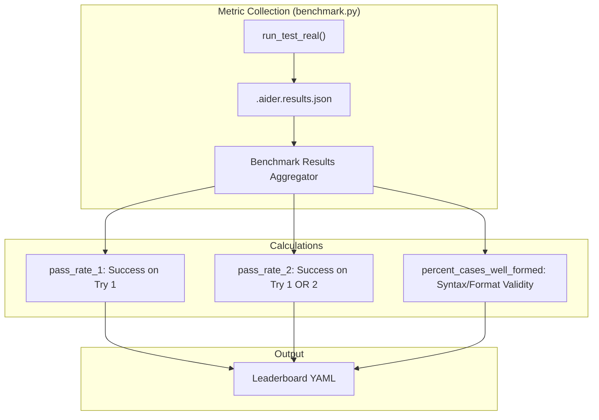
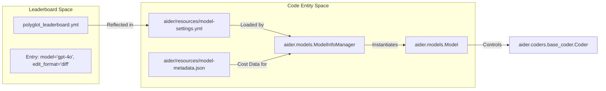
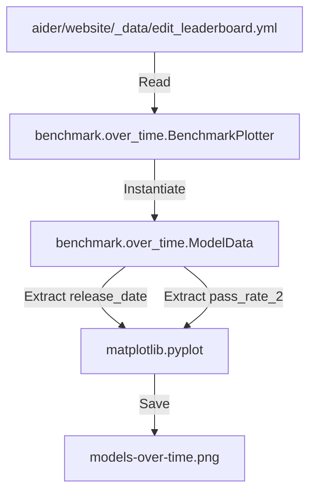

# Performance Leaderboards

<details>
<summary>Relevant source files</summary>

The following files were used as context for generating this wiki page:

- [CONTRIBUTING.md](CONTRIBUTING.md)
- [aider/resources/__init__.py](aider/resources/__init__.py)
- [aider/resources/model-metadata.json](aider/resources/model-metadata.json)
- [aider/resources/model-settings.yml](aider/resources/model-settings.yml)
- [aider/website/_data/edit_leaderboard.yml](aider/website/_data/edit_leaderboard.yml)
- [aider/website/_data/o1_polyglot_leaderboard.yml](aider/website/_data/o1_polyglot_leaderboard.yml)
- [aider/website/_data/polyglot_leaderboard.yml](aider/website/_data/polyglot_leaderboard.yml)
- [aider/website/_data/qwen3_leaderboard.yml](aider/website/_data/qwen3_leaderboard.yml)
- [aider/website/_includes/leaderboard.js](aider/website/_includes/leaderboard.js)
- [aider/website/_includes/leaderboard_graph.html](aider/website/_includes/leaderboard_graph.html)
- [aider/website/_includes/leaderboard_table.js](aider/website/_includes/leaderboard_table.js)
- [aider/website/_posts/2024-12-21-polyglot.md](aider/website/_posts/2024-12-21-polyglot.md)
- [aider/website/_posts/2025-05-08-qwen3.md](aider/website/_posts/2025-05-08-qwen3.md)
- [aider/website/assets/2025-05-08-qwen3.jpg](aider/website/assets/2025-05-08-qwen3.jpg)
- [aider/website/assets/models-over-time.png](aider/website/assets/models-over-time.png)
- [aider/website/assets/models-over-time.svg](aider/website/assets/models-over-time.svg)
- [aider/website/docs/leaderboards/contrib.md](aider/website/docs/leaderboards/contrib.md)
- [aider/website/docs/leaderboards/notes.md](aider/website/docs/leaderboards/notes.md)
- [aider/website/docs/legal/contributor-agreement.md](aider/website/docs/legal/contributor-agreement.md)
- [benchmark/README.md](benchmark/README.md)
- [benchmark/over_time.py](benchmark/over_time.py)
- [tests/basic/test_models.py](tests/basic/test_models.py)
- [tests/basic/test_reasoning.py](tests/basic/test_reasoning.py)

</details>


## Purpose and Scope

This document describes the performance leaderboard system that tracks and publishes benchmark results for LLM models in Aider. The leaderboard aggregates data from benchmark runs to provide quantitative performance comparisons across models, edit formats, and configurations. This information directly informs model recommendations in `aider/resources/model-settings.yml` and helps users select appropriate models for their use cases.

The leaderboard system consists of YAML-based data files, aggregation scripts in `benchmark/benchmark.py`, and visualization tools that generate "over-time" progress charts.

## Leaderboard Data Formats

Aider maintains several leaderboard files in `aider/website/_data/`. The two primary formats are the **Polyglot Leaderboard** and the **Edit Leaderboard**.

### Polyglot Leaderboard (`polyglot_leaderboard.yml`)

This leaderboard tracks performance across the 225-exercise polyglot suite covering 6 programming languages [aider/website/_data/polyglot_leaderboard.yml:1-2]().

```yaml
- dirname: 2025-02-25-20-23-07--gemini-pro
  test_cases: 225
  model: Gemini 2.0 Pro exp-02-05
  edit_format: whole
  commit_hash: 2fccd47
  pass_rate_1: 20.4
  pass_rate_2: 35.6
  pass_num_1: 46
  pass_num_2: 80
  percent_cases_well_formed: 100.0
  error_outputs: 430
  total_cost: 0.0000
```

### Edit Leaderboard (`edit_leaderboard.yml`)

This leaderboard focuses on code editing skill, typically using the Python Exercism suite (133 cases) [aider/website/_data/edit_leaderboard.yml:1-2](). It includes a `released` field used for over-time visualizations [aider/website/_data/edit_leaderboard.yml:4]().

```yaml
- dirname: 2024-05-01-20-05-59--direct-opus-filenames-outside-fence
  test_cases: 133
  model: claude-3-opus-20240229
  _released: 2024-02-29
  edit_format: diff
  pass_rate_2: 68.4
```

Sources: [aider/website/_data/polyglot_leaderboard.yml:1-25](), [aider/website/_data/edit_leaderboard.yml:1-23]()

## Metrics and Data Flow

The data flow from a raw benchmark run to the leaderboard involves the `benchmark.py` orchestrator and results aggregation logic.

### Metric Calculation Logic

The system tracks success across multiple "tries" (attempts to fix errors based on test feedback).



**Key Metric Definitions:**
- **pass_rate_1**: Percentage of tasks where the LLM's first code generation passed all unit tests [aider/website/_data/polyglot_leaderboard.yml:6]().
- **pass_rate_2**: Percentage of tasks that passed after the LLM was given one chance to see test errors and provide a fix [aider/website/_data/polyglot_leaderboard.yml:7]().
- **percent_cases_well_formed**: Percentage of LLM responses that correctly followed the specified `edit_format` (e.g., valid `diff` blocks or `whole` file markers) [aider/website/_data/polyglot_leaderboard.yml:10]().
- **total_cost**: The financial cost of the benchmark run based on token pricing [aider/website/_data/polyglot_leaderboard.yml:25]().

Sources: [benchmark/README.md:100-139](), [aider/website/_data/polyglot_leaderboard.yml:1-25]()

## Informing Model Recommendations

Benchmark results are the primary driver for the configurations found in `aider/resources/model-settings.yml`. When a model shows high performance with a specific `edit_format`, that format is codified as the default.

### Mapping Results to Code Entities

The following diagram bridges the "Natural Language Benchmark Space" (results) to the "Code Entity Space" (configuration classes and files).



Sources: [aider/resources/model-settings.yml:35-43](), [tests/basic/test_models.py:7-11](), [aider/resources/model-metadata.json:1-17]()

## Over-Time Visualizations

Aider includes scripts to visualize model performance improvements over time based on their release dates. This is handled by `benchmark/over_time.py`.

### Implementation Details

1.  **Data Loading**: The `BenchmarkPlotter.load_data()` function parses `edit_leaderboard.yml`, specifically looking for `released` and `pass_rate_2` fields [benchmark/over_time.py:78-91]().
2.  **Model Classification**: Models are grouped by family (OpenAI, Anthropic, Google, etc.) using color coding in the `ModelData.color` property [benchmark/over_time.py:18-38]().
3.  **Plotting**: Uses `matplotlib` to plot release dates on the X-axis and `pass_rate_2` on the Y-axis [benchmark/over_time.py:101-131]().

### Visualization Data Flow



Sources: [benchmark/over_time.py:11-64](), [benchmark/over_time.py:143-154]()

## Website Integration

The leaderboards are rendered on the Aider website using Jekyll and custom JavaScript components for interactivity.

-   **`leaderboard_table.js`**: Handles searching, filtering, and "Detail" mode vs "View" mode for the leaderboard tables [aider/website/_includes/leaderboard_table.js:1-100]().
-   **`leaderboard.js`**: Integrates `Chart.js` to render bar charts of pass rates and scatter plots of API costs [aider/website/_includes/leaderboard.js:12-41]().
-   **Cost Bars**: The UI dynamically calculates cost bars relative to a `MAX_DISPLAY_COST_CAP` to visualize expensive vs. efficient models [aider/website/_includes/leaderboard_table.js:4-5]().
-   **Reasoning Content**: For models like `o1` or `deepseek-reasoner`, the leaderboard tracks how reasoning tokens affect performance [aider/website/_data/polyglot_leaderboard.yml:131-155](), supported by `aider/reasoning_tags.py` logic [tests/basic/test_reasoning.py:8-12]().

Sources: [aider/website/_includes/leaderboard_table.js:1-72](), [aider/website/_includes/leaderboard.js:113-177](), [aider/website/_data/polyglot_leaderboard.yml:131-155]()