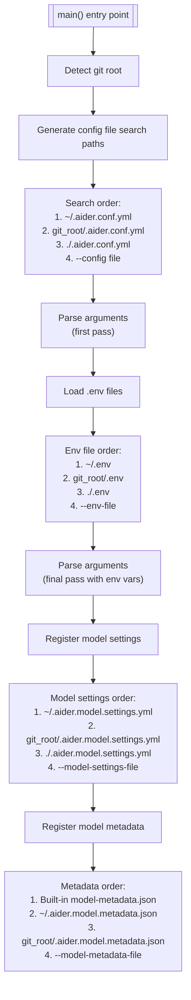
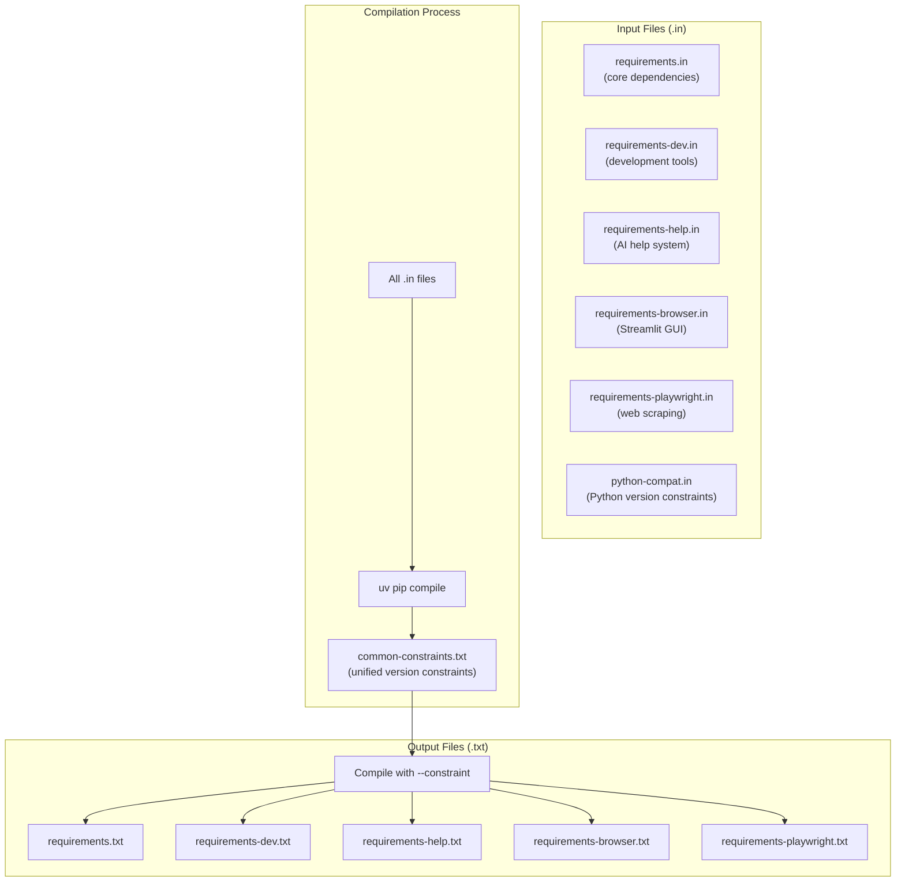

# Configuration and Deployment

Relevant source files

The following files were used as context for generating this wiki page:

- [.pre-commit-config.yaml](.pre-commit-config.yaml)
- [aider/website/assets/sample.aider.conf.yml](aider/website/assets/sample.aider.conf.yml)
- [aider/website/assets/sample.env](aider/website/assets/sample.env)
- [aider/website/docs/config/aider_conf.md](aider/website/docs/config/aider_conf.md)
- [aider/website/docs/config/dotenv.md](aider/website/docs/config/dotenv.md)
- [aider/website/docs/config/options.md](aider/website/docs/config/options.md)
- [requirements.txt](requirements.txt)
- [requirements/common-constraints.txt](requirements/common-constraints.txt)
- [requirements/requirements-browser.txt](requirements/requirements-browser.txt)
- [requirements/requirements-dev.in](requirements/requirements-dev.in)
- [requirements/requirements-dev.txt](requirements/requirements-dev.txt)
- [requirements/requirements-help.in](requirements/requirements-help.in)
- [requirements/requirements-help.txt](requirements/requirements-help.txt)
- [requirements/requirements-playwright.txt](requirements/requirements-playwright.txt)
- [requirements/requirements.in](requirements/requirements.in)
- [scripts/pip-compile.sh](scripts/pip-compile.sh)

This document covers Aider's configuration system, dependency management infrastructure, and deployment considerations. It explains how configuration is loaded from multiple sources, how dependencies are managed using `uv pip compile`, and how the build process works.

For information about model configuration specifically (model settings, metadata, and capabilities), see [Model Configuration and Capabilities](#7). For runtime behavior and initialization, see [Application Entry Point and Main Loop](#2.1).

---

## Configuration System Overview

Aider uses a layered configuration system that loads settings from multiple sources with well-defined precedence rules. Configuration can come from environment variables (`.env` files), YAML configuration files (`.aider.conf.yml`), model-specific settings files, and command-line arguments.

For details, see [Configuration System](#9.1).

### Configuration Precedence

Configuration sources are applied in the following order, with later sources overriding earlier ones:

1.  **Home directory files**: `~/.aider.conf.yml` [aider/website/docs/config/aider_conf.md:12]() and `~/.env` [aider/website/docs/config/dotenv.md:16]().
2.  **Git repository root files**: `.aider.conf.yml` [aider/website/docs/config/aider_conf.md:13]() and `.env` [aider/website/docs/config/dotenv.md:17]() located at the root of the current project.
3.  **Current working directory files**: Local overrides in the current folder [aider/website/docs/config/aider_conf.md:14](), [aider/website/docs/config/dotenv.md:18]().
4.  **Named files**: Specific paths provided via `--config` [aider/website/docs/config/aider_conf.md:18]() or `--env-file` [aider/website/docs/config/dotenv.md:19]().
5.  **Command-line arguments**: Direct flags provided to the `aider` command [aider/website/docs/config/options.md:10-11]().

### Configuration Loading Flow

The diagram below illustrates how Aider's initialization logic resolves configuration values from various file types and command-line inputs.

**Sources:** [aider/website/docs/config/aider_conf.md:9-18](), [aider/website/docs/config/dotenv.md:9-21](), [aider/website/docs/config/options.md:159-168](), [aider/website/assets/sample.aider.conf.yml:1-10]()

---

## Dependency Management

Aider uses `uv pip compile` for dependency management, with a multi-file structure that ensures version consistency across different installation profiles using a common constraints file.

For details, see [Dependency Management](#9.2).

### Dependency File Structure

The dependency architecture bridges the abstract requirement sets (e.g., "browser support") to concrete pinned versions in the `.txt` files.

**Sources:** [requirements/common-constraints.txt:1-2](), [requirements/requirements.txt:1-2](), [requirements/requirements-help.txt:1-2](), [requirements/requirements-browser.txt:1-2](), [requirements/requirements.in:32]()

### Component Requirements

Aider manages dependencies for different functional components to keep the core installation lightweight:

| Component | Key Dependencies | Purpose |
| :--- | :--- | :--- |
| **Core** | `litellm`, `GitPython`, `rich`, `prompt_toolkit` | Essential CLI and LLM logic [requirements/requirements.in:3-18]() |
| **Help** | `llama-index-core`, `torch`, `numpy` | RAG system for documentation [requirements/requirements-help.in:1-8]() |
| **Browser** | `streamlit`, `pandas`, `pydeck` | Web GUI interface [requirements/requirements-browser.txt:76-126]() |
| **Dev** | `pytest`, `flake8`, `pip-tools`, `pre-commit` | Testing and development [requirements/requirements-dev.txt:177-232](), [requirements/requirements-dev.in:1-10]() |

---

## Build and Version Management

Aider utilizes `setuptools_scm` for automatic versioning and provides scripts for release automation and branch-based installations.

For details, see [Build and Version Management](#9.3).

### Release Automation

The build process is supported by scripts that manage version bumping and dependency compilation. The `scripts/pip-compile.sh` script automates the generation of all `.txt` requirement files from their `.in` counterparts, ensuring the `common-constraints.txt` is respected across all components [requirements/common-constraints.txt:1-2]().

### Deployment Considerations

Aider can be deployed and configured for various environments:

*   **SSL Verification**: Can be toggled for corporate proxies via `--verify-ssl` or `--no-verify-ssl` [aider/website/docs/config/options.md:181-184]().
*   **API Key Management**: Supports provider-specific keys through environment variables (e.g., `OPENAI_API_KEY`) or the `--api-key` CLI argument [aider/website/docs/config/options.md:112-149]().
*   **Environment Overrides**: The `--set-env` flag allows passing arbitrary environment variables to control underlying API settings [aider/website/docs/config/options.md:140-143]().
*   **Startup Optimization**: Uses a `LazyLiteLLM` wrapper to defer the heavy import of `litellm` until an actual LLM call is made, improving CLI responsiveness [requirements/requirements.txt:184]().

**Sources:** [aider/website/docs/config/options.md:25-94](), [aider/website/docs/config/aider_conf.md:101-115](), [requirements/requirements.txt:184](), [aider/website/assets/sample.env:1-10]()