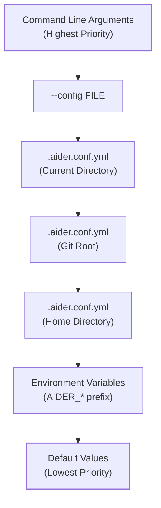
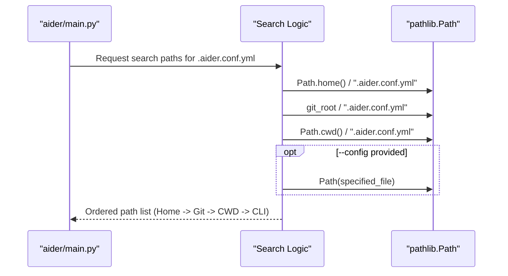
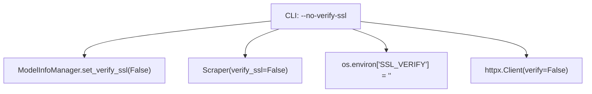

# Configuration System

Relevant source files

The following files were used as context for generating this wiki page:

- [aider/website/_includes/help-tip.md](aider/website/_includes/help-tip.md)
- [aider/website/_includes/keys.md](aider/website/_includes/keys.md)
- [aider/website/_includes/model-warnings.md](aider/website/_includes/model-warnings.md)
- [aider/website/assets/sample.aider.conf.yml](aider/website/assets/sample.aider.conf.yml)
- [aider/website/assets/sample.env](aider/website/assets/sample.env)
- [aider/website/docs/config.md](aider/website/docs/config.md)
- [aider/website/docs/config/aider_conf.md](aider/website/docs/config/aider_conf.md)
- [aider/website/docs/config/dotenv.md](aider/website/docs/config/dotenv.md)
- [aider/website/docs/config/options.md](aider/website/docs/config/options.md)
- [aider/website/docs/troubleshooting/support.md](aider/website/docs/troubleshooting/support.md)
- [pytest.ini](pytest.ini)
- [tests/basic/test_main.py](tests/basic/test_main.py)
- [tests/basic/test_model_info_manager.py](tests/basic/test_model_info_manager.py)
- [tests/basic/test_ssl_verification.py](tests/basic/test_ssl_verification.py)
- [tests/scrape/test_scrape.py](tests/scrape/test_scrape.py)

The Configuration System manages how Aider loads, merges, and applies settings from multiple sources including command-line arguments, YAML configuration files, environment variables, and model-specific settings files. This system enables flexible deployment across different environments while maintaining sensible defaults.

For information about model-specific behavioral configuration, see [Model Settings and Behavioral Configuration](7.1). For the application entry point that invokes this configuration system, see [Application Entry Point and Main Loop](2.1).

## Overview

Aider's configuration system follows a layered precedence model where settings from higher-priority sources override those from lower-priority sources. The system uses `configargparse` to unify command-line arguments, YAML configuration files, and environment variables into a single cohesive configuration.

Title: Configuration Precedence Hierarchy

**Sources:** [aider/website/docs/config/aider_conf.md:9-16](), [aider/website/docs/config/dotenv.md:21-21]()

## Configuration Sources and Precedence

### Search Path Generation

Aider looks for configuration files in specific locations relative to the user's environment and project structure. The precedence logic ensures that project-specific settings override global user settings. The `main` function in `aider/main.py` coordinates the initialization of these settings.

Title: Configuration Search Path Resolution

**Sources:** [aider/website/docs/config/aider_conf.md:9-16](), [aider/website/docs/config/dotenv.md:14-21](), [tests/basic/test_main.py:88-102]()

The precedence order from highest to lowest:

| Priority | Source | Example |
|----------|--------|---------|
| 1 | Command-line argument | `aider --model gpt-4o` |
| 2 | Named config file | `aider --config custom.yml` |
| 3 | Current directory config | `./.aider.conf.yml` |
| 4 | Git root config | `<git_root>/.aider.conf.yml` |
| 5 | Home directory config | `~/.aider.conf.yml` |
| 6 | Environment variables | `AIDER_MODEL=gpt-4o` |
| 7 | Default values | Defined in `aider/args.py` |

**Sources:** [aider/website/docs/config/aider_conf.md:9-19](), [aider/website/docs/config/options.md:104-108]()

## Configuration File Formats

### YAML Configuration Files
Most options can be set in `.aider.conf.yml`. This file supports complex types like lists (e.g., for `read`, `api-key`, or `alias`) which can be specified as bulleted lists or square-bracketed comma-separated values.

**Sources:** [aider/website/docs/config/aider_conf.md:7-37](), [aider/website/assets/sample.aider.conf.yml:1-5](), [aider/website/assets/sample.aider.conf.yml:101-115]()

### Environment Variables
General options use the `AIDER_` prefix (e.g., `AIDER_MODEL`). However, standard LLM provider variables (e.g., `OPENAI_API_KEY`, `ANTHROPIC_API_KEY`) are also respected without the prefix to maintain compatibility with standard LLM tooling.

**Sources:** [aider/website/docs/config/dotenv.md:7-13](), [aider/website/assets/sample.env:53-57]()

## Environment File Loading

### .env File Search Path
Aider loads `.env` files to populate environment variables before final argument parsing via `load_dotenv_files`. It searches the home directory, git root, and current directory in that order. Files loaded later override earlier ones.

**Sources:** [aider/website/docs/config/dotenv.md:14-21](), [aider/main.py:17-17](), [aider/website/assets/sample.env:1-5]()

### API Key Configuration
API keys can be configured via:
1. **Dedicated switches**: `--openai-api-key`, `--anthropic-api-key`.
2. **Generic provider switch**: `--api-key provider=key` (sets `PROVIDER_API_KEY`).
3. **Environment variables**: Stored in `.env` or shell.
4. **YAML**: Using the `api-key` list or dedicated entries.

**Sources:** [aider/website/docs/config/options.md:112-149](), [aider/website/assets/sample.aider.conf.yml:80-115]()

## Model Configuration System

### Model Settings and Metadata
Aider uses two primary files for model-specific behavior and technical specs:
- **Model Settings**: Controls `edit_format`, `weak_model`, and `use_repo_map`. Default is `.aider.model.settings.yml`.
- **Model Metadata**: Controls context windows and token costs. Default is `.aider.model.metadata.json`.

**Sources:** [aider/website/docs/config/options.md:159-168](), [aider/website/assets/sample.aider.conf.yml:69-73]()

### SSL Verification
The `--verify-ssl` flag (default: True) controls SSL certificate verification across multiple subsystems. When disabled via `--no-verify-ssl`, it triggers `ModelInfoManager.set_verify_ssl(False)`, configures `httpx.Client(verify=False)`, and sets the `SSL_VERIFY` environment variable to an empty string.

Title: SSL Configuration Propagation

**Sources:** [tests/basic/test_ssl_verification.py:28-68](), [tests/scrape/test_scrape.py:20-36](), [tests/basic/test_model_info_manager.py:26-42]()

## Key Configuration Parameters

### Model Roles
- `model`: The primary LLM used for the main chat and code generation. [aider/website/docs/config/options.md:106]()
- `weak-model`: Used for lightweight tasks like generating commit messages and summarizing chat history. [aider/website/docs/config/options.md:158]()
- `editor-model`: Used specifically for applying edits in architect mode. [aider/website/docs/config/options.md:161]()

### Reasoning and Thinking
- `reasoning-effort`: Sets the reasoning effort (e.g., low, medium, high) for models like OpenAI o1. [aider/website/docs/config/options.md:173]()
- `thinking-tokens`: Configures the thinking token budget for models that support it (e.g., Claude 3.7). [aider/website/docs/config/options.md:177]()

### Git Integration
- `auto-commits`: Toggles whether Aider automatically commits LLM-generated changes. [aider/website/docs/config/options.md:225]()
- `attribute-author`: Whether to attribute Aider as the author in git. [aider/website/docs/config/options.md:230]()
- `gitignore`: Controls whether Aider adds `.aider*` entries to the `.gitignore` file. [aider/website/docs/config/options.md:212]()

**Sources:** [aider/website/docs/config/options.md:104-235](), [aider/website/assets/sample.aider.conf.yml:72-162](), [tests/basic/test_main.py:129-141]()