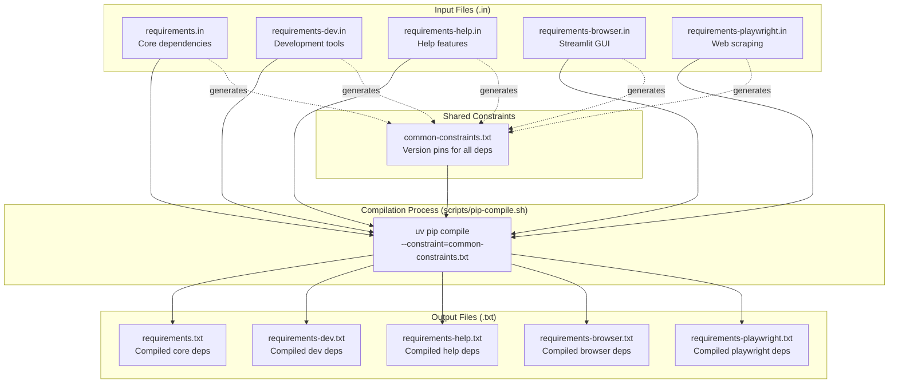
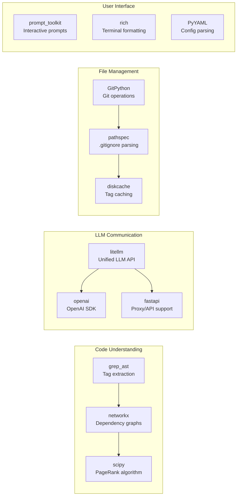
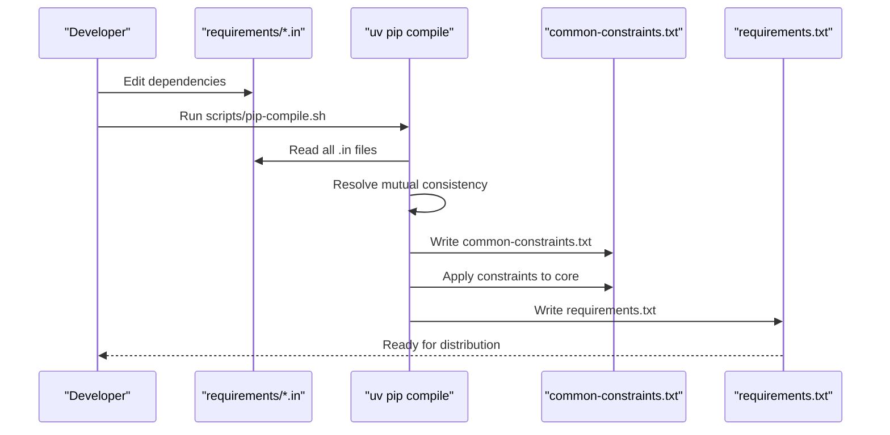
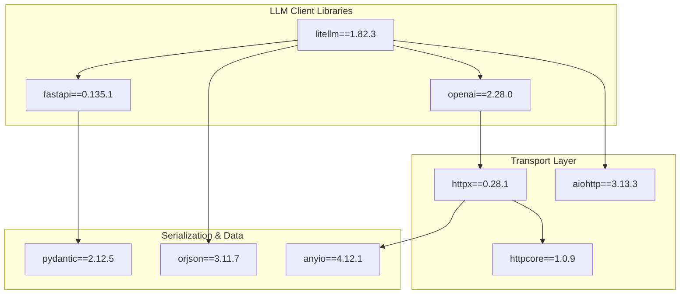

# Dependency Management

<details>
<summary>Relevant source files</summary>

The following files were used as context for generating this wiki page:

- [.pre-commit-config.yaml](.pre-commit-config.yaml)
- [requirements.txt](requirements.txt)
- [requirements/common-constraints.txt](requirements/common-constraints.txt)
- [requirements/requirements-browser.in](requirements/requirements-browser.in)
- [requirements/requirements-browser.txt](requirements/requirements-browser.txt)
- [requirements/requirements-dev.in](requirements/requirements-dev.in)
- [requirements/requirements-dev.txt](requirements/requirements-dev.txt)
- [requirements/requirements-help.in](requirements/requirements-help.in)
- [requirements/requirements-help.txt](requirements/requirements-help.txt)
- [requirements/requirements-playwright.in](requirements/requirements-playwright.in)
- [requirements/requirements-playwright.txt](requirements/requirements-playwright.txt)
- [requirements/requirements.in](requirements/requirements.in)
- [scripts/pip-compile.sh](scripts/pip-compile.sh)

</details>


## Purpose and Scope

This document explains how aider manages its Python dependencies, including the structure of requirement files, the compilation process using `uv`, version constraints, and optional dependency sets. The architecture is designed to ensure version consistency across multiple optional feature sets while maintaining a minimal core installation footprint.

## Dependency File Structure

Aider uses a hierarchical dependency management system with separate input files (`.in`) and compiled output files (`.txt`). All compiled files are generated using the `uv` package manager and share common version constraints.



**Sources:** [requirements.txt:1-2](), [requirements/requirements-dev.txt:1-2](), [requirements/requirements-help.txt:1-2](), [requirements/requirements-browser.txt:1-2](), [requirements/requirements-playwright.txt:1-2](), [requirements/common-constraints.txt:1-2](), [scripts/pip-compile.sh:11-43]()

## Core Dependencies

The main dependency file is [requirements/requirements.in](), which defines the essential packages needed to run aider. These are compiled into [requirements.txt]().

### Primary Dependency Categories

| Category | Key Packages | Purpose |
|----------|-------------|---------|
| **LLM Integration** | `litellm`, `openai`, `fastapi` | Communication with language model APIs [requirements/requirements.in:18,49](), [requirements.txt:184,226,87]() |
| **Code Analysis** | `grep-ast`, `networkx` | Parsing and analyzing code structure [requirements/requirements.in:10,40](), [requirements.txt:120,217]() |
| **Version Control** | `GitPython` | Git repository management [requirements/requirements.in:3](), [requirements.txt:116]() |
| **Terminal UI** | `prompt_toolkit`, `rich` | Interactive command-line interface [requirements/requirements.in:5-6](), [requirements.txt:260,270]() |
| **Caching** | `diskcache` | Tag and context caching [requirements/requirements.in:9](), [requirements.txt:78]() |
| **Audio** | `sounddevice`, `soundfile`, `pydub` | Voice input features [requirements/requirements.in:1,12-13]() |
| **Web Scraping** | `beautifulsoup4`, `pypandoc` | URL content extraction [requirements/requirements.in:14,17](), [requirements.txt:46]() |
| **Analytics** | `posthog`, `mixpanel` | Usage telemetry [requirements/requirements.in:22-23](), [requirements.txt:256,204]() |
| **Utilities** | `PyYAML`, `jsonschema`, `pathspec` | Configuration and file handling [requirements/requirements.in:4,8,15](), [requirements.txt:243,175]() |

**Sources:** [requirements/requirements.in:1-51](), [requirements.txt:3-540]()

### Critical Dependencies

The following dependencies are essential for aider's core functionality, particularly the repository mapping and LLM communication layers.



**Sources:** [requirements/requirements.in:1-51](), [requirements.txt:120, 217, 184, 226, 87, 116, 243, 78, 260, 270]()

## Optional Dependency Sets

Aider provides several optional feature sets that can be installed separately to minimize the base installation footprint.

### Help Feature Dependencies

The help feature uses local embeddings for semantic search over documentation via `llama-index`.

| Package | Version Constraint | Purpose |
|---------|-------------------|---------|
| `llama-index-embeddings-huggingface` | - | HuggingFace embeddings integration [requirements/requirements-help.in:1]() |
| `torch` | `>=2.3.0` | ML framework for embeddings [requirements/requirements-help.in:8]() |
| `numpy` | `<2` or `>=2.3,<2.5` | Numerical operations (Python version dependent) [requirements/requirements-help.in:4-5]() |
| `scikit-learn` | `1.7.2` or `1.8.0` | Machine learning utilities [requirements/requirements-help.in:12-13]() |

**Sources:** [requirements/requirements-help.in:1-14](), [requirements/requirements-help.txt:151-158, 209-217, 276-281]()

### Browser Feature Dependencies

Provides the Streamlit-based web GUI.

| Package | Purpose |
|---------|---------|
| `streamlit` | Web application framework [requirements/requirements-browser.in:1](), [requirements/requirements-browser.txt:126]() |

**Sources:** [requirements/requirements-browser.in:1](), [requirements/requirements-browser.txt:126-133]()

### Playwright Feature Dependencies

Enables JavaScript-rendered web page scraping.

| Package | Purpose |
|---------|---------|
| `playwright` | Browser automation [requirements/requirements-playwright.in:1](), [requirements/requirements-playwright.txt:7]() |

**Sources:** [requirements/requirements-playwright.in:1](), [requirements/requirements-playwright.txt:7-10]()

### Development Dependencies

Tools for developing and testing aider.

| Category | Packages |
|----------|----------|
| **Testing** | `pytest`, `pytest-cov`, `pytest-env` [requirements/requirements-dev.in:1-3]() |
| **Dependency Management** | `pip-tools`, `uv` [requirements/requirements-dev.in:4,14]() |
| **Code Quality** | `pre-commit`, `codespell`, `flake8` [requirements/requirements-dev.in:10,13,19]() |
| **Data Analysis** | `pandas`, `matplotlib` [requirements/requirements-dev.in:6-7]() |
| **Cloud Integration** | `google-cloud-bigquery` [requirements/requirements-dev.in:15]() |

**Sources:** [requirements/requirements-dev.in:1-20](), [requirements/requirements-dev.txt:232, 238, 177, 191]()

## Compilation Process with UV

Aider uses the `uv` package manager to compile dependency files via the `scripts/pip-compile.sh` orchestrator.



### Compilation Workflow

The workflow involves a multi-pass compilation to ensure consistency across all extras:

1. **Constraint Generation**: Compiles all `.in` files together to create a master constraint list [scripts/pip-compile.sh:11-17]().
2. **Base Compilation**: Compiles `requirements.in` against the generated constraints [scripts/pip-compile.sh:20-26]().
3. **Platform Shimming**: Filters out specific packages like `tree-sitter`, `numpy`, and `scipy` from the compiled base to apply platform-specific shims [scripts/pip-compile.sh:28-30]().
4. **Extras Compilation**: Iterates through `dev`, `help`, `browser`, and `playwright` suffixes to compile specific extra files [scripts/pip-compile.sh:33-43]().

**Sources:** [scripts/pip-compile.sh:1-44](), [requirements.txt:1-2]()

## Version Constraints System

The [requirements/common-constraints.txt]() file serves as the single source of truth for package versions across all optional feature sets.

### Critical Version Pins

Certain packages have explicit version constraints to maintain compatibility or fix environment-specific issues:

| Package | Constraint | Reason |
|---------|-----------|--------|
| `networkx` | `<3.5` | Python 3.10 compatibility [requirements/requirements.in:40]() |
| `importlib-metadata` | `<8.0.0` | GitHub Release action compatibility [requirements/requirements.in:45]() |
| `numpy` | `<2` | Compatibility for Python < 3.11 [requirements/requirements-help.in:4]() |
| `scikit-learn` | `1.7.2` / `1.8.0` | Fixes test_help in CI [requirements/requirements-help.in:12-13]() |
| `contourpy` | `1.3.2` / `1.3.3` | Python 3.11 compatibility [requirements/requirements-dev.in:18-19]() |

**Sources:** [requirements/requirements.in:34-51](), [requirements/requirements-help.in:3-14](), [requirements/requirements-dev.in:17-19]()

### Platform Shimming

Aider uses a custom shimming process in `scripts/pip-compile.sh` to handle dependencies that require different versions or additional packages on specific platforms or Python versions. This is achieved by grepping out core packages and appending platform-specific `.in` files like `python-compat.in` and `pydub.in` [scripts/pip-compile.sh:28-30]().

## Key Dependency Details

### LLM Integration Stack



**Sources:** [requirements.txt:7, 87, 136, 184, 226, 230, 238](), [requirements/common-constraints.txt:5, 106, 186, 241, 318, 335]()

### Code Analysis and Mapping Stack

| Layer | Packages | Purpose |
|-------|----------|---------|
| **Tag Extraction** | `grep-ast==0.9.0` | Extract code tags for context [requirements.txt:120]() |
| **Graph Analysis** | `networkx==3.4.2` | Symbol ranking and LOI calculation [requirements.txt:217]() |
| **Data Structures** | `numpy==2.4.3` | Numerical support for ranking [requirements.txt:304]() |
| **Persistence** | `diskcache==5.6.3` | Persistent storage for repo-map tags [requirements.txt:78]() |

**Sources:** [requirements.txt:78, 120, 217, 304](), [requirements/common-constraints.txt:98, 164, 281, 290]()

## Installation Scenarios

### Standard Installation
```bash
pip install aider-chat
```
Installs core dependencies defined in [requirements.txt]().

### Development Installation
```bash
pip install -e .
pip install -r requirements/requirements-dev.txt
```
Installs development tools including `pytest` and `pre-commit` [requirements/requirements-dev.in:1,10]().

### Feature-Specific Installation
Users can install specific extras which correspond to the compiled `.txt` files in the `requirements/` directory:
- `aider-chat[help]` -> [requirements/requirements-help.txt]()
- `aider-chat[browser]` -> [requirements/requirements-browser.txt]()
- `aider-chat[playwright]` -> [requirements/requirements-playwright.txt]()

**Sources:** [requirements/requirements-help.txt:1-2](), [requirements/requirements-browser.txt:1-2](), [requirements/requirements-playwright.txt:1-2]()