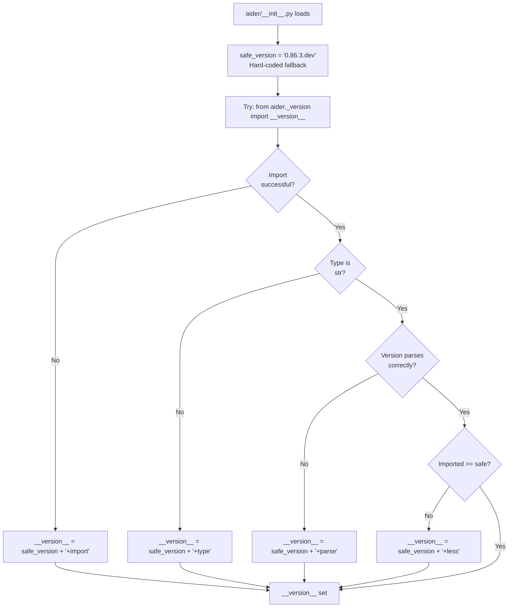
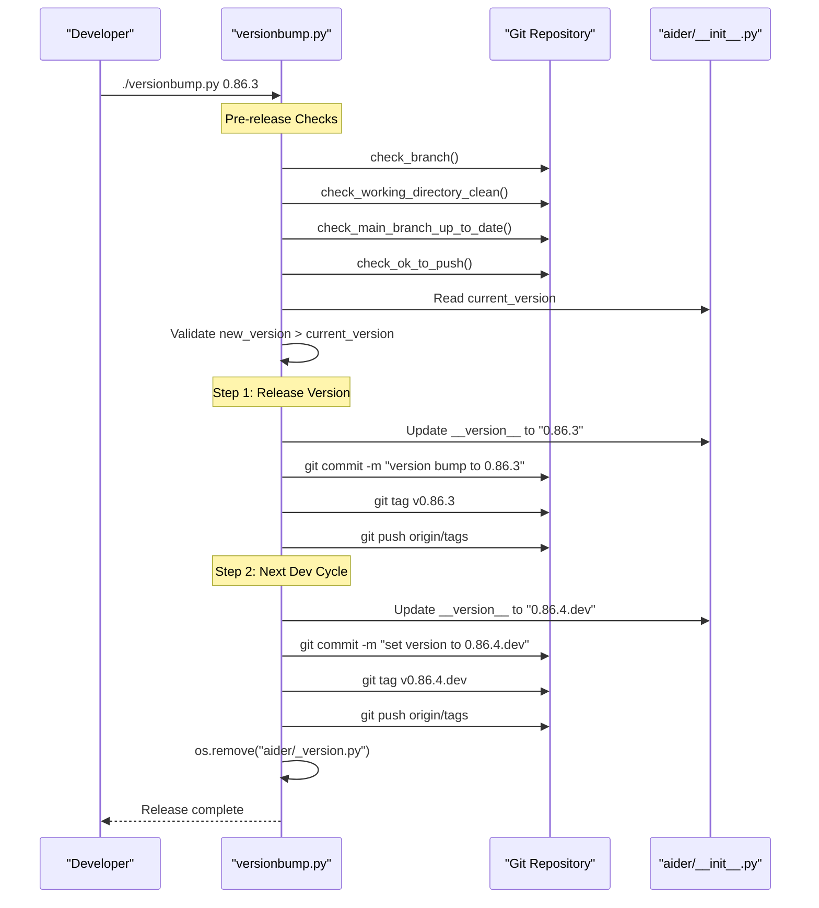

# Build and Version Management

<details>
<summary>Relevant source files</summary>

The following files were used as context for generating this wiki page:

- [.github/workflows/check_pypi_version.yml](.github/workflows/check_pypi_version.yml)
- [.github/workflows/docker-build-test.yml](.github/workflows/docker-build-test.yml)
- [.github/workflows/docker-release.yml](.github/workflows/docker-release.yml)
- [.github/workflows/pages.yml](.github/workflows/pages.yml)
- [.github/workflows/release.yml](.github/workflows/release.yml)
- [.github/workflows/ubuntu-tests.yml](.github/workflows/ubuntu-tests.yml)
- [.github/workflows/windows-tests.yml](.github/workflows/windows-tests.yml)
- [.github/workflows/windows_check_pypi_version.yml](.github/workflows/windows_check_pypi_version.yml)
- [MANIFEST.in](MANIFEST.in)
- [aider/__init__.py](aider/__init__.py)
- [aider/help_pats.py](aider/help_pats.py)
- [aider/llm.py](aider/llm.py)
- [aider/website/docs/leaderboards/by-release-date.md](aider/website/docs/leaderboards/by-release-date.md)
- [docker/Dockerfile](docker/Dockerfile)
- [pyproject.toml](pyproject.toml)
- [requirements/pydub.in](requirements/pydub.in)
- [requirements/python-compat.in](requirements/python-compat.in)
- [scripts/versionbump.py](scripts/versionbump.py)
- [scripts/yank-old-versions.py](scripts/yank-old-versions.py)

</details>


This page documents Aider's build system, version management strategy, and release workflow. It covers version resolution logic, the automated version bumping process, `setuptools_scm` integration, distribution packaging, Docker image construction, and CI/CD pipelines.

---

## Version Resolution System

Aider uses a multi-layered version resolution mechanism with automatic fallbacks to ensure a valid version string is always available, even when the build environment is incomplete or the generated `_version.py` is missing.

### Version Resolution Flow

The resolution logic prioritizes the dynamic version generated by the build system but provides robust error handling for development and edge-case environments.



**Sources:** [aider/__init__.py:1-20]()

### Version String Components

The version resolution system relies on two key components:

| Component | Source | Purpose |
|-----------|--------|---------|
| `safe_version` | Hard-coded in `__init__.py` | Fallback version when all else fails [aider/__init__.py:3-4]() |
| `aider._version.__version__` | Generated by `setuptools_scm` | Git-derived version from tags [pyproject.toml:49-49]() |

The `safe_version` is manually maintained and represents the current development version. It follows the pattern `major.minor.micro.dev` during development cycles. Diagnostic suffixes (e.g., `+import`, `+parse`) are appended if the dynamic resolution fails [aider/__init__.py:6-18]().

---

## setuptools_scm Integration

Aider uses `setuptools_scm` to automatically derive version numbers from git tags, eliminating manual version tracking in multiple locations.

### Build Configuration

The `pyproject.toml` configuration enables `setuptools_scm` as a build requirement and specifies the output file for the derived version [pyproject.toml:44-49]().

```toml
[build-system]
requires = ["setuptools>=68", "setuptools_scm[toml]>=8"]
build-backend = "setuptools.build_meta"

[tool.setuptools_scm]
write_to = "aider/_version.py"
```

**Sources:** [pyproject.toml:44-49]()

---

## Version Bumping Workflow

The `scripts/versionbump.py` script automates the release process, ensuring consistency and preventing common errors like releasing from a dirty branch or skipping tags.

### Version Bump Process Flow

The script coordinates updates to the source code and git state in a specific sequence to maintain release integrity.



**Sources:** [scripts/versionbump.py:1-176]()

### Pre-Release Safety Checks

The script performs mandatory checks before allowing version bumps to prevent broken releases [scripts/versionbump.py:91-95]():

| Check Function | Purpose |
|----------------|---------|
| `check_branch()` | Ensures the user is on the `main` branch [scripts/versionbump.py:14-20]() |
| `check_working_directory_clean()` | Ensures no uncommitted changes exist [scripts/versionbump.py:24-28]() |
| `check_main_branch_up_to_date()` | Compares local `main` with `origin/main` using commit hashes and timestamps [scripts/versionbump.py:32-63]() |
| `check_ok_to_push()` | Performs a `git push --dry-run` to verify permissions [scripts/versionbump.py:67-76]() |

---

## CI/CD Pipelines

Aider utilizes GitHub Actions for automated testing, Docker image construction, and PyPI releases.

### Test Matrix

Aider runs tests across multiple platforms and Python versions (3.10 through 3.14).

*   **Ubuntu Tests:** Installs `libportaudio2` and runs `pytest` [.github/workflows/ubuntu-tests.yml:23-56]().
*   **Windows Tests:** Runs `pytest` on `windows-latest` [.github/workflows/windows-tests.yml:24-51]().
*   **PyPI Version Check:** A scheduled job ensures that `pip install aider-chat` actually installs the version corresponding to the latest git tag [.github/workflows/check_pypi_version.yml:7-87]().

### Docker Build Strategy

The `docker/Dockerfile` uses a multi-stage build to produce two images: `aider` and `aider-full`.

| Image | Stage | Extras Installed |
|-------|-------|------------------|
| `aider` | `aider` | `[playwright]`, `boto3`, `google-cloud-aiplatform` [docker/Dockerfile:59-80]() |
| `aider-full` | `aider-full` | `[help,browser,playwright]`, `boto3` [docker/Dockerfile:35-56]() |

Both images include Playwright and Chromium dependencies [docker/Dockerfile:48, 72](). The Docker build pipeline (`docker-build-test.yml`) builds for `linux/amd64` and `linux/arm64` [.github/workflows/docker-build-test.yml:45-85]().

### Release Workflow

The PyPI release is triggered by pushing a version tag (e.g., `v0.86.3`). The workflow builds the package using `python -m build` and uploads it via `twine` [.github/workflows/release.yml:3-34]().

---

## Performance Optimization: Lazy Loading

Aider optimizes startup time by deferring the import of heavy libraries.

### LazyLiteLLM Implementation

The `litellm` library takes approximately 1.5 seconds to import. Aider wraps it in a `LazyLiteLLM` class that uses `importlib` to load the module only when an attribute is first accessed [aider/llm.py:16-45]().

```python
class LazyLiteLLM:
    _lazy_module = None

    def __getattr__(self, name):
        if name == "_lazy_module":
            return super()
        self._load_litellm()
        return getattr(self._lazy_module, name)

    def _load_litellm(self):
        if self._lazy_module is not None:
            return
        self._lazy_module = importlib.import_module("litellm")
        # Configure litellm after loading
        self._lazy_module.suppress_debug_info = True
        self._lazy_module.set_verbose = False
        self._lazy_module.drop_params = True
```

**Sources:** [aider/llm.py:21-45]()

---

## Distribution Configuration

### Project Metadata and Extras

The `pyproject.toml` file defines dynamic dependencies and optional extras:

| Extra | Purpose | Source File |
|-------|---------|-------------|
| `dev` | Development and testing | `requirements/requirements-dev.txt` [pyproject.toml:33]() |
| `help` | RAG-based help system | `requirements/requirements-help.txt` [pyproject.toml:34]() |
| `browser` | Web scraping capabilities | `requirements/requirements-browser.txt` [pyproject.toml:35]() |
| `playwright` | Headless browser support | `requirements/requirements-playwright.txt` [pyproject.toml:36]() |

### MANIFEST.in Filtering

The `MANIFEST.in` file ensures that large or irrelevant files (like website assets, examples, and benchmark docs) are excluded from the PyPI package to keep the distribution size small [MANIFEST.in:1-21]().

**Sources:** [pyproject.toml:29-36](), [MANIFEST.in:1-21]()