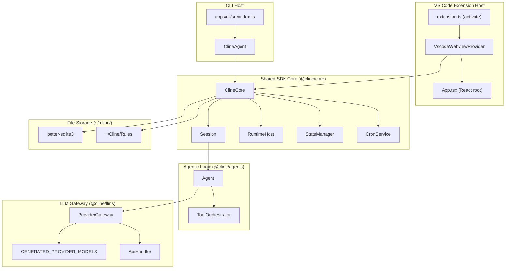
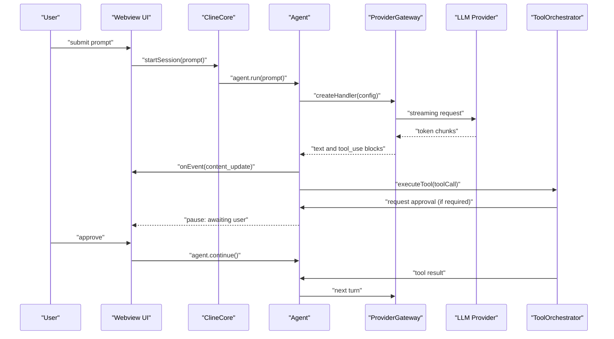

# Overview

Relevant source files

The following files were used as context for generating this wiki page:

- [.github/ISSUE_TEMPLATE/bug_report.yml](.github/ISSUE_TEMPLATE/bug_report.yml)
- [.github/ISSUE_TEMPLATE/config.yml](.github/ISSUE_TEMPLATE/config.yml)
- [.github/pull_request_template.md](.github/pull_request_template.md)
- [CHANGELOG.md](CHANGELOG.md)
- [CODE_OF_CONDUCT.md](CODE_OF_CONDUCT.md)
- [CONTRIBUTING.md](CONTRIBUTING.md)
- [README.md](README.md)
- [apps/cli/CHANGELOG.md](apps/cli/CHANGELOG.md)
- [apps/cli/package.json](apps/cli/package.json)
- [apps/vscode/README.marketplace.md](apps/vscode/README.marketplace.md)
- [apps/vscode/package.json](apps/vscode/package.json)
- [apps/vscode/src/core/storage/utils/state-helpers.test.ts](apps/vscode/src/core/storage/utils/state-helpers.test.ts)
- [apps/vscode/webview-ui/src/components/settings/sections/TerminalSettingsSection.tsx](apps/vscode/webview-ui/src/components/settings/sections/TerminalSettingsSection.tsx)
- [bun.lock](bun.lock)
- [docs/assets/free-models/free-models-cli-cline-provider.png](docs/assets/free-models/free-models-cli-cline-provider.png)
- [docs/assets/free-models/free-models-cli-clinepass-provider.png](docs/assets/free-models/free-models-cli-clinepass-provider.png)
- [docs/assets/free-models/free-models-vscode-cline-provider.png](docs/assets/free-models/free-models-vscode-cline-provider.png)
- [docs/assets/free-models/free-models-vscode-clinepass-provider.png](docs/assets/free-models/free-models-vscode-clinepass-provider.png)
- [docs/docs.json](docs/docs.json)
- [docs/getting-started/free-models.mdx](docs/getting-started/free-models.mdx)
- [docs/usage/cloud-agents.mdx](docs/usage/cloud-agents.mdx)
- [package.json](package.json)
- [sdk/CHANGELOG.md](sdk/CHANGELOG.md)
- [sdk/README.md](sdk/README.md)
- [sdk/packages/agents/package.json](sdk/packages/agents/package.json)
- [sdk/packages/core/package.json](sdk/packages/core/package.json)
- [sdk/packages/llms/package.json](sdk/packages/llms/package.json)
- [sdk/packages/llms/src/catalog/catalog.generated.ts](sdk/packages/llms/src/catalog/catalog.generated.ts)
- [sdk/packages/llms/src/catalog/cline-recommended.generated.ts](sdk/packages/llms/src/catalog/cline-recommended.generated.ts)
- [sdk/packages/llms/src/providers/provider-ids.generated.ts](sdk/packages/llms/src/providers/provider-ids.generated.ts)
- [sdk/packages/llms/src/providers/providers.generated.ts](sdk/packages/llms/src/providers/providers.generated.ts)
- [sdk/packages/sdk/package.json](sdk/packages/sdk/package.json)
- [sdk/packages/shared/package.json](sdk/packages/shared/package.json)

This page introduces the Cline monorepo: its identity as an autonomous coding agent, its foundational human-in-the-loop safety model, and its multiple delivery surfaces (VS Code extension, CLI/TUI, Desktop app, Cline Hub, and SDK). 

For a detailed subsystem map, see [Architecture Overview](#1.1). For installation steps across environments, see [Installation and Setup](#1.2). For running your first task in various hosts, see [Quick Start Guide](#1.3). For workspace layout and monorepo tooling, see [Repository Layout and Monorepo Tooling](#1.4).

Sources: [README.md:1-123](), [package.json:1-14](), [apps/vscode/package.json:1-10]()

---

## What is Cline

Cline is an open-source autonomous coding agent distributed across several primary delivery surfaces:

- **VS Code Extension** — Integrates directly into the IDE editor (`@cline/vscode`) [apps/vscode/package.json:2-5]().
- **Standalone CLI / TUI** — Terminal interface and headless mode for scripting and CI/CD (`cline`) [apps/cli/package.json:2-6]().
- **Desktop App & Cline Hub** — Tauri native application and dashboard for parallel agent management and Kanban task boards [README.md:60-70](), [apps/cline-hub/package.json:1-3]().
- **Cline SDK** — A standalone TypeScript framework (`@cline/sdk`) for embedding agentic capabilities into custom applications [README.md:105-115](), [sdk/packages/sdk/package.json:1-5]().

The agent accepts natural-language prompts and executes multi-step tasks by combining LLM reasoning with a concrete set of host-environment tools: file creation and editing, terminal execution, browser automation, and external service calls via the Model Context Protocol (MCP) [README.md:134-148]().

The core defining characteristic is the **human-in-the-loop safety model**: every consequential action (such as writing files or running terminal commands) is presented to the user for explicit review and approval before execution [README.md:148]().

Sources: [README.md:1-123](), [package.json:1-14](), [apps/vscode/package.json:1-10]()

---

## Runtime Components

**Diagram: Runtime Components Mapped to Code Entities**

Sources: [sdk/packages/core/package.json:2-3](), [sdk/packages/agents/package.json:22-25](), [sdk/packages/llms/src/catalog/catalog.generated.ts:1-5](), [package.json:87-90]()

---

## The Agent Loop

Tasks are managed via `ClineCore` and executed by the stateless `Agent` loop [sdk/packages/core/package.json:2-5](), [sdk/packages/agents/package.json:2-5]().

**Diagram: Agent Loop — Natural Language Steps to Code Entities**

The execution loop follows these primary phases:
1. **Session Initialization** — `ClineCore` prepares workspace parameters and establishes a stateful session [sdk/packages/core/package.json:15-22]().
2. **LLM Interaction** — The `Agent` interacts with model providers via streaming request handlers [sdk/packages/agents/package.json:20-25]().
3. **Tool Execution** — Requested actions are dispatched through the `ToolOrchestrator` [sdk/packages/agents/package.json:28-32]().
4. **Human-in-the-Loop Control** — Sensitive tools pause execution until explicit user verification is received [README.md:148]().
5. **Turn Continuation** — Tool outputs are fed back into the agent context for subsequent reasoning steps [apps/cli/CHANGELOG.md:10-15]().

Sources: [README.md:146-149](), [sdk/packages/agents/package.json:10-14](), [sdk/packages/core/package.json:50-55]()

---

## Human-in-the-Loop Safety Model

Cline incorporates rigorous safety mechanisms to keep developers in full control of workspace modifications:

| Mechanism | Implementation Detail | Effect |
|---|---|---|
| Approval prompts | `ask()` flow | Suspends agent loop and blocks execution until user grants permission [README.md:148](). |
| Diff view | `DiffViewProvider` | Displays file alterations visually before applying modifications [apps/vscode/package.json:1-10](). |
| Checkpoints | Git-backed snapshots | Tracks changes automatically to allow session rollback and diff inspection [README.md:140](). |
| Rules & .clineignore | `.clinerules` / `.clineignore` | Enforces project constraints and restricts path access [README.md:150-152](). |
| Command Permissions | `CLINE_COMMAND_PERMISSIONS` | Restricts shell execution based on security policies [apps/cli/CHANGELOG.md:40-47](). |
| Plan Mode Restrictions | Mode coordinator | Prevents mutating tool execution during architecture planning phases [README.md:148](). |
| YOLO Mode | Auto-approval settings | Bypasses manual verification prompts for selected tool classes when configured [README.md:148](). |

Sources: [README.md:138-152](), [CHANGELOG.md:13-30](), [apps/cli/CHANGELOG.md:40-47]()

---

## LLM Provider Support

Backend connectivity is managed through the `@cline/llms` package, offering unified provider routing and model catalogs [sdk/packages/llms/package.json:2-10]().

| Provider | Integration Package | Key Capabilities |
|---|---|---|
| Anthropic | `@ai-sdk/anthropic` | Native tool calling, Claude models [sdk/packages/llms/package.json:50-55](). |
| OpenAI | `@ai-sdk/openai` | GPT series and advanced reasoning models [sdk/packages/llms/package.json:55-60](). |
| Google Gemini | `@ai-sdk/google` | High-context windows via Gemini models [sdk/packages/llms/package.json:55-60](). |
| OpenRouter | `@openrouter/ai-sdk-provider` | Access to 200+ models through a single gateway [sdk/packages/llms/package.json:70-75](). |
| AWS Bedrock | `@ai-sdk/amazon-bedrock` | Enterprise-managed hosting for Claude and Llama [sdk/packages/llms/package.json:50-55](). |
| Cline Provider | Managed Gateway | Curated subscription models and usage billing [CHANGELOG.md:10-15](). |
| Local Models | `ollama-ai-provider-v2` | Local execution via Ollama and LM Studio [sdk/packages/llms/package.json:75-80](). |

Sources: [README.md:154-170](), [sdk/packages/llms/package.json:50-80](), [sdk/packages/llms/src/catalog/catalog.generated.ts:1-5]()

---

## Delivery Surfaces & Child Pages

Explore the child pages for complete technical specifications:
- **Architecture Overview** — See [Architecture Overview](#1.1) for subsystem mappings across hosts and SDK packages.
- **Installation and Setup** — See [Installation and Setup](#1.2) for package installation and Bun workspace setup.
- **Quick Start Guide** — See [Quick Start Guide](#1.3) for running first tasks in IDE, TUI, and SDK environments.
- **Repository Layout and Monorepo Tooling** — See [Repository Layout and Monorepo Tooling](#1.4) for monorepo directory structures, changesets, and agent rules.

Sources: [package.json:4-14](), [sdk/packages/sdk/package.json:1-5](), [sdk/packages/core/package.json:20-40]()