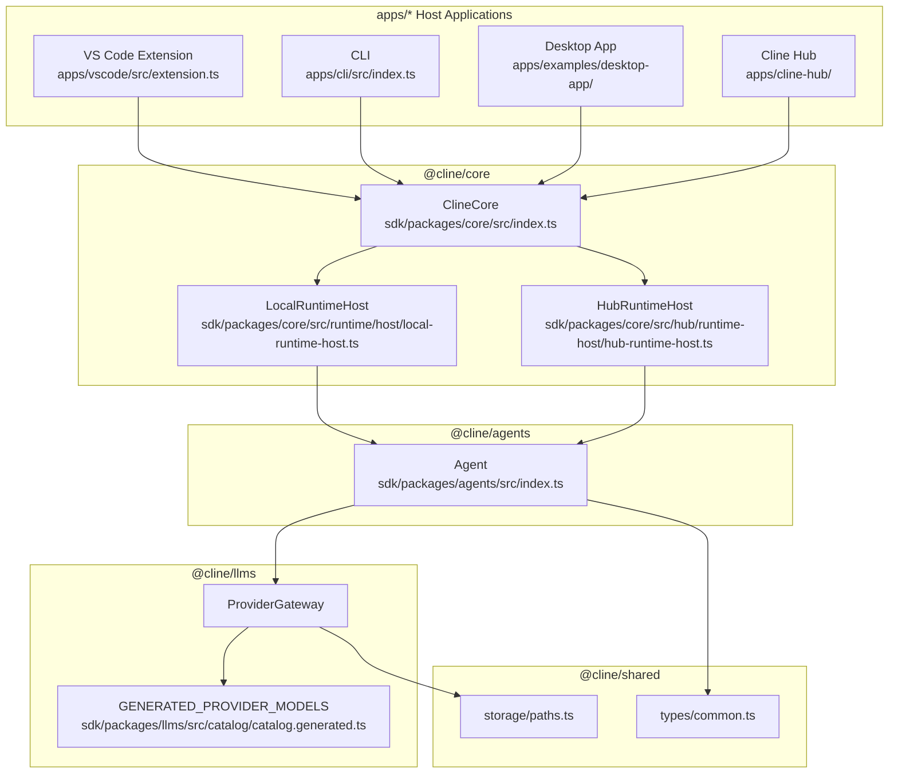
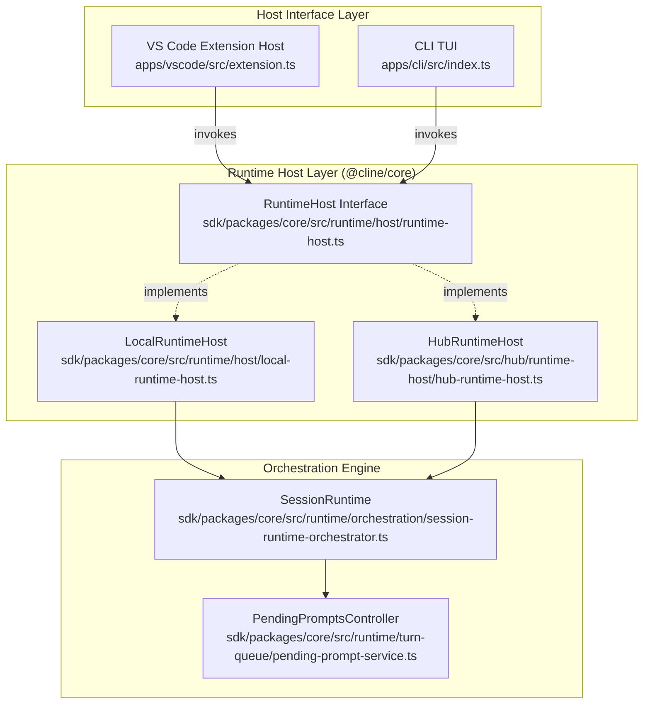

# Architecture Overview

Relevant source files

The following files were used as context for generating this wiki page:

- [apps/cli/CHANGELOG.md](apps/cli/CHANGELOG.md)
- [apps/cli/package.json](apps/cli/package.json)
- [bun.lock](bun.lock)
- [sdk/AGENTS.md](sdk/AGENTS.md)
- [sdk/ARCHITECTURE.md](sdk/ARCHITECTURE.md)
- [sdk/CHANGELOG.md](sdk/CHANGELOG.md)
- [sdk/DOC.md](sdk/DOC.md)
- [sdk/packages/agents/package.json](sdk/packages/agents/package.json)
- [sdk/packages/core/package.json](sdk/packages/core/package.json)
- [sdk/packages/core/src/cloud/controller.test.ts](sdk/packages/core/src/cloud/controller.test.ts)
- [sdk/packages/core/src/cloud/controller.ts](sdk/packages/core/src/cloud/controller.ts)
- [sdk/packages/core/src/extensions/composio/composio-meta-tools.test.ts](sdk/packages/core/src/extensions/composio/composio-meta-tools.test.ts)
- [sdk/packages/core/src/extensions/composio/composio-meta-tools.ts](sdk/packages/core/src/extensions/composio/composio-meta-tools.ts)
- [sdk/packages/core/src/extensions/composio/composio-tools-extension.test.ts](sdk/packages/core/src/extensions/composio/composio-tools-extension.test.ts)
- [sdk/packages/core/src/extensions/composio/composio-tools-extension.ts](sdk/packages/core/src/extensions/composio/composio-tools-extension.ts)
- [sdk/packages/core/src/hub/runtime-host/hub-runtime-host.test.ts](sdk/packages/core/src/hub/runtime-host/hub-runtime-host.test.ts)
- [sdk/packages/core/src/hub/runtime-host/hub-runtime-host.ts](sdk/packages/core/src/hub/runtime-host/hub-runtime-host.ts)
- [sdk/packages/core/src/hub/server/boundary.test.ts](sdk/packages/core/src/hub/server/boundary.test.ts)
- [sdk/packages/core/src/hub/server/handlers/connector-handlers.test.ts](sdk/packages/core/src/hub/server/handlers/connector-handlers.test.ts)
- [sdk/packages/core/src/hub/server/handlers/context.ts](sdk/packages/core/src/hub/server/handlers/context.ts)
- [sdk/packages/core/src/hub/server/handlers/run-handlers.test.ts](sdk/packages/core/src/hub/server/handlers/run-handlers.test.ts)
- [sdk/packages/core/src/hub/server/handlers/run-handlers.ts](sdk/packages/core/src/hub/server/handlers/run-handlers.ts)
- [sdk/packages/core/src/hub/server/handlers/session-event-projector.ts](sdk/packages/core/src/hub/server/handlers/session-event-projector.ts)
- [sdk/packages/core/src/hub/server/handlers/session-handlers.ts](sdk/packages/core/src/hub/server/handlers/session-handlers.ts)
- [sdk/packages/core/src/index.ts](sdk/packages/core/src/index.ts)
- [sdk/packages/core/src/runtime/host/local-runtime-host.test.ts](sdk/packages/core/src/runtime/host/local-runtime-host.test.ts)
- [sdk/packages/core/src/runtime/host/local-runtime-host.ts](sdk/packages/core/src/runtime/host/local-runtime-host.ts)
- [sdk/packages/core/src/runtime/host/runtime-host.ts](sdk/packages/core/src/runtime/host/runtime-host.ts)
- [sdk/packages/core/src/runtime/turn-queue/pending-prompt-service.ts](sdk/packages/core/src/runtime/turn-queue/pending-prompt-service.ts)
- [sdk/packages/core/src/services/local-runtime-bootstrap.test.ts](sdk/packages/core/src/services/local-runtime-bootstrap.test.ts)
- [sdk/packages/core/src/services/local-runtime-bootstrap.ts](sdk/packages/core/src/services/local-runtime-bootstrap.ts)
- [sdk/packages/core/src/types/session.ts](sdk/packages/core/src/types/session.ts)
- [sdk/packages/llms/package.json](sdk/packages/llms/package.json)
- [sdk/packages/llms/src/catalog/catalog.generated.ts](sdk/packages/llms/src/catalog/catalog.generated.ts)
- [sdk/packages/llms/src/catalog/cline-recommended.generated.ts](sdk/packages/llms/src/catalog/cline-recommended.generated.ts)
- [sdk/packages/llms/src/providers/provider-ids.generated.ts](sdk/packages/llms/src/providers/provider-ids.generated.ts)
- [sdk/packages/llms/src/providers/providers.generated.ts](sdk/packages/llms/src/providers/providers.generated.ts)
- [sdk/packages/sdk/package.json](sdk/packages/sdk/package.json)
- [sdk/packages/shared/package.json](sdk/packages/shared/package.json)

## Purpose and Scope

This page maps the major subsystems of the Cline monorepo, detailing how the foundational SDK packages (`@cline/shared`, `@cline/llms`, `@cline/agents`, `@cline/core`, `@cline/sdk`), runtime hosts, the Hub daemon, and the host applications (`apps/*` including `vscode`, `cli`, `cline-hub`, and `examples/desktop-app`) interrelate. 

The repository follows an SDK-first architecture governed by Bun workspaces [bun.lock:4-14](). Lower-level packages provide decoupled utilities, model catalogs, and stateless agent loops, while `@cline/core` and host-specific wrappers orchestrate state persistence, user interfaces, and external tool integrations.

Sources: [bun.lock:4-14](), [sdk/packages/core/package.json:2-3]()

---

## Monorepo Subsystem Architecture

The architecture enforces a strict one-way dependency flow: `@cline/shared` -> `@cline/llms` -> `@cline/agents` -> `@cline/core` -> host applications (`apps/*`) [sdk/ARCHITECTURE.md:27-41]().

### Diagram: Monorepo Package Dependencies and Code Entities

Sources: [sdk/packages/shared/package.json:10-48](), [sdk/packages/llms/package.json:10-28](), [sdk/packages/agents/package.json:9-20](), [sdk/packages/core/package.json:17-46](), [sdk/ARCHITECTURE.md:27-41]()

---

## Package Responsibilities

Each package in the layered stack has strict boundaries:
- **`@cline/shared`**: Owns reusable low-level contracts, shared types, schemas, and storage path resolution helpers [sdk/ARCHITECTURE.md:45-56]().
- **`@cline/llms`**: Owns model and provider runtime concerns, model catalogs (`GENERATED_PROVIDER_MODELS` in [sdk/packages/llms/src/catalog/catalog.generated.ts:13-16]()), and AI SDK-backed provider execution code [sdk/ARCHITECTURE.md:61-70]().
- **`@cline/agents`**: Owns the stateless agent iteration loop, tool orchestration, and turn preparation before provider calls [sdk/ARCHITECTURE.md:102-112]().
- **`@cline/core`**: Owns stateful orchestration, session lifecycle, storage persistence, and hub server services under `src/hub/` [sdk/ARCHITECTURE.md:117-134]().

Sources: [sdk/ARCHITECTURE.md:45-134](), [sdk/packages/llms/src/catalog/catalog.generated.ts:13-16]()

---

## Runtime Hosts and Hub Daemon

Execution environments are abstracted through the `RuntimeHost` interface. Depending on the host application context, sessions are managed via local processes or offloaded to a background daemon.

### Runtime Host Implementations

| Subsystem Component | Code Symbol / File Path | Role |
|---------------------|-------------------------|------|
| `RuntimeHost` Interface | `RuntimeHost` [sdk/packages/core/src/runtime/host/runtime-host.ts:1-30]() | Defines contract for starting, restoring, and sending input to sessions. |
| `LocalRuntimeHost` | `LocalRuntimeHost` [sdk/packages/core/src/runtime/host/local-runtime-host.ts:135-143]() | Manages in-process agent loops, file tools, state snapshots, and prompt queues. |
| `HubRuntimeHost` | `HubRuntimeHost` [sdk/packages/core/src/hub/runtime-host/hub-runtime-host.ts:1-30]() | Connects over WebSockets to proxy tasks through the Hub daemon. |
| `Hub Daemon` | `daemon/entry.ts` [sdk/packages/core/package.json:26-29]() | Background WebSocket daemon providing multi-client orchestration and scheduling. |

### Diagram: Runtime Host Execution Flow to Code Objects

Sources: [sdk/packages/core/src/runtime/host/local-runtime-host.ts:135-150](), [sdk/packages/core/package.json:22-29](), [sdk/packages/core/src/runtime/host/runtime-host.ts:1-30]()

---

## Host Applications (`apps/*`)

Cline provides multiple delivery surfaces built on top of the shared core and SDK packages:

| Application | Location | Primary Technologies | Description |
|-------------|----------|----------------------|-------------|
| **VS Code Extension** | `apps/vscode/` [apps/vscode/package.json:1-128]() | VS Code API, Webview UI, gRPC | IDE integration providing side-panel chat, checkpoints, and code diff views. |
| **CLI** | `apps/cli/` [bun.lock:20-64]() | Commander, OpenTUI, React Reconciler | Terminal interface supporting interactive TUI, headless pipelines, and ACP mode. |
| **Cline Hub** | `apps/cline-hub/` [sdk/packages/core/package.json:9-14]() | Next.js, WebSockets, Tailwind | Centralized hub dashboard server and webview for managing routines and tasks. |
| **Desktop App** | `apps/examples/desktop-app/` [bun.lock:166-176]() | Tauri, Rust, Bun Sidecar, Next.js | Native desktop application shell for macOS and Windows. |

Sources: [bun.lock:4-176](), [sdk/packages/core/package.json:9-14]()