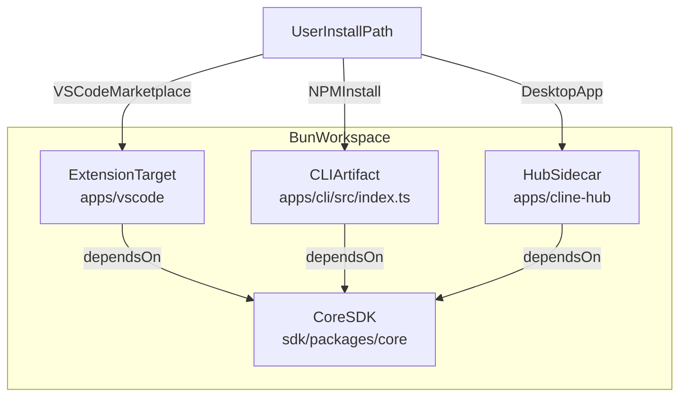
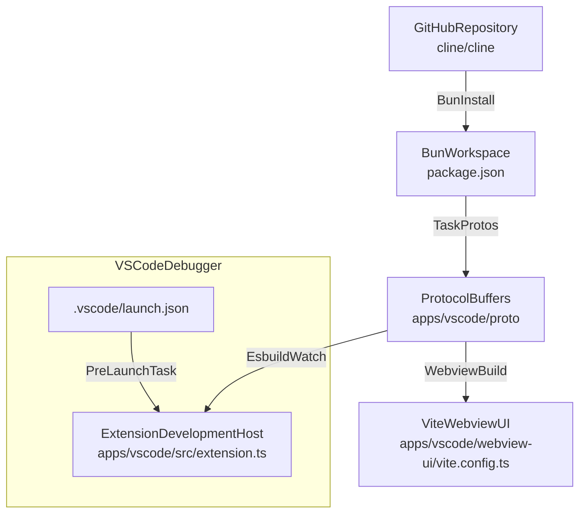

# Installation and Setup

<details>
<summary>Relevant source files</summary>

The following files were used as context for generating this wiki page:

- [.github/ISSUE_TEMPLATE/bug_report.yml](.github/ISSUE_TEMPLATE/bug_report.yml)
- [.github/ISSUE_TEMPLATE/config.yml](.github/ISSUE_TEMPLATE/config.yml)
- [.github/pull_request_template.md](.github/pull_request_template.md)
- [.gitignore](.gitignore)
- [.nvmrc](.nvmrc)
- [.tool-versions](.tool-versions)
- [.vscode/extensions.json](.vscode/extensions.json)
- [.vscode/launch.json](.vscode/launch.json)
- [.vscode/settings.json](.vscode/settings.json)
- [.vscode/tasks.json](.vscode/tasks.json)
- [CHANGELOG.md](CHANGELOG.md)
- [CODE_OF_CONDUCT.md](CODE_OF_CONDUCT.md)
- [CONTRIBUTING.md](CONTRIBUTING.md)
- [README.md](README.md)
- [apps/vscode/package.json](apps/vscode/package.json)
- [apps/vscode/scripts/clean-webview-vite-cache.mjs](apps/vscode/scripts/clean-webview-vite-cache.mjs)
- [apps/vscode/src/core/webview/WebviewProvider.ts](apps/vscode/src/core/webview/WebviewProvider.ts)
- [apps/vscode/webview-ui/src/utils/__tests__/hooks.spec.ts](apps/vscode/webview-ui/src/utils/__tests__/hooks.spec.ts)
- [apps/vscode/webview-ui/src/utils/__tests__/platformUtils.spec.ts](apps/vscode/webview-ui/src/utils/__tests__/platformUtils.spec.ts)
- [apps/vscode/webview-ui/src/utils/platformUtils.ts](apps/vscode/webview-ui/src/utils/platformUtils.ts)
- [apps/vscode/webview-ui/vite.config.ts](apps/vscode/webview-ui/vite.config.ts)
- [docs/api/models.mdx](docs/api/models.mdx)
- [docs/assets/clinepass/clinepass-cli.png](docs/assets/clinepass/clinepass-cli.png)
- [docs/assets/clinepass/clinepass-ide-extension.png](docs/assets/clinepass/clinepass-ide-extension.png)
- [docs/cline-overview.mdx](docs/cline-overview.mdx)
- [docs/core-workflows/task-management.mdx](docs/core-workflows/task-management.mdx)
- [docs/customization/clineignore.mdx](docs/customization/clineignore.mdx)
- [docs/customization/hooks.mdx](docs/customization/hooks.mdx)
- [docs/features/multiroot-workspace.mdx](docs/features/multiroot-workspace.mdx)
- [docs/getting-started/authorizing-with-cline.mdx](docs/getting-started/authorizing-with-cline.mdx)
- [docs/getting-started/cline-provider.mdx](docs/getting-started/cline-provider.mdx)
- [docs/getting-started/clinepass.mdx](docs/getting-started/clinepass.mdx)
- [docs/getting-started/installing-cline.mdx](docs/getting-started/installing-cline.mdx)
- [docs/provider-config/minimax.mdx](docs/provider-config/minimax.mdx)
- [docs/usage/ide.mdx](docs/usage/ide.mdx)
- [package.json](package.json)
- [sdk/examples/hooks/PreToolUse_ClineignoreGuard.sh](sdk/examples/hooks/PreToolUse_ClineignoreGuard.sh)
- [sdk/examples/hooks/README.md](sdk/examples/hooks/README.md)

</details>


This page details the installation procedures for Cline across its primary delivery surfaces—the VS Code extension, the standalone CLI via npm, and the desktop application—alongside the complete Bun workspace development environment setup, build prerequisites, and debugging infrastructure.

---

## Deployment Artifacts and Package Surfaces

Cline is distributed across multiple host environments, sharing core monorepo packages managed via Bun workspaces [package.json:2-6](). 

| Target Surface | Package Name / Identifier | Distribution Channel | Primary Entry / Bin |
|---|---|---|---|
| VS Code Extension | `saoudrizwan.claude-dev` | VS Code Marketplace / Open VSX | `apps/vscode/src/extension.ts` [apps/vscode/package.json:2-47]() |
| CLI Tool | `@cline/cli` (`cline`) | npm Registry | `apps/cli/src/index.ts` |
| Desktop App / Hub | `@cline/cline-hub` | Tauri Sidecar / Web App | `apps/cline-hub` [package.json:9-9]() |
| Programmatic SDK | `@cline/sdk` | npm Registry | `sdk/packages/core` [package.json:5-5]() |

Title: "Workspace Package and Distribution Mapping"

Sources: [package.json:2-14](), [apps/vscode/package.json:2-47](), [docs/getting-started/installing-cline.mdx:6-12]()

---

## End-User Installation Paths

### VS Code Extension
Users can install the extension directly from the marketplace or compatible editor interfaces (Cursor, Windsurf, VSCodium) [docs/getting-started/installing-cline.mdx:8-18]().
1. Open the Extensions Marketplace (`Ctrl/Cmd + Shift + X`) [docs/getting-started/installing-cline.mdx:21-21]().
2. Search for `Cline` and click **Install** [docs/getting-started/installing-cline.mdx:23-27]().
3. Complete authorization via the Cline settings panel or set up custom provider API keys [docs/getting-started/installing-cline.mdx:32-36]().

### CLI via npm
The standalone CLI (`@cline/cli`) enables terminal-based interactive chat (`cline`) and headless task execution [docs/getting-started/installing-cline.mdx:68-89]().
```bash
npm install -g cline
cline auth
cline "your task description"
```
The package targets Node.js `>=22` [package.json:54-55]().

### Desktop App
The Tauri-based desktop application provides a standalone window running the Cline Hub sidecar server. It packages local runtime host services, allowing multi-agent Kanban management and off-IDE execution.

Sources: [package.json:54-55](), [docs/getting-started/installing-cline.mdx:13-111]()

---

## Bun Workspace Development Environment Setup

To contribute to or run Cline from source, developers must configure a Bun-driven workspace environment defined in the root `package.json` [package.json:1-14]().

### Prerequisites
* **Bun**: Version `1.4.2` (serves as the primary package manager and task runner) [package.json:53-53]().
* **Node.js**: Version `>=22` [package.json:54-55]().
* **Git LFS**: Required for cloning large assets and test fixtures [CONTRIBUTING.md:37-37]().

### Environment Bootstrap
1. **Clone Repository & Install Dependencies**:
   ```bash
   git clone https://github.com/cline/cline.git
   cd cline
   bun install
   ```
2. **Protocol Buffer Compilation**:
   Communication between the VS Code extension host and the React webview relies on gRPC over postMessage. Protocol buffers must be compiled before launching builds [/.vscode/tasks.json:20-34]().
   ```bash
   cd apps/vscode
   bun run protos
   ```
3. **Configure Workspace Settings**:
   The workspace uses Biome for linting and formatting as defined in `package.json` scripts (`bun run biome`, `bun run check`) [package.json:32-36]().

Title: "Development Lifecycle and Build Pipeline Flow"

Sources: [package.json:15-39](), [/.vscode/tasks.json:7-51](), [/.vscode/launch.json:8-32]()

---

## Build Tasks, Debugging, and Launch Configurations

The repository provides pre-configured VS Code tasks and launch profiles to streamline debugging and hot-reloading.

### Launch Configurations (`.vscode/launch.json`)
Developers can launch the extension inside a dedicated Extension Development Host with isolated user data directories or specific development flags [/.vscode/launch.json:8-112](). Key configurations include:
* **`Run Extension (production)`**: Compiles and runs the production target bundle inside a fresh extension host context [/.vscode/launch.json:8-32]().
* **`Run Extension (Fresh Install Mode)`**: Cleans temporary user directories (`apps/vscode/dist/tmp/user`) and launches with a temporary profile [/.vscode/launch.json:84-112]().
* **`Debug Test Standalone Core Api Server (test:sca-server)`**: Launches the standalone core gRPC/API server via Bun [/.vscode/launch.json:114-143]().

### Build and Watch Tasks (`.vscode/tasks.json`)
The monorepo defines background compilation tasks for live development [/.vscode/tasks.json:36-65]().
* **`compile-standalone`**: Triggers standalone builds [/.vscode/tasks.json:7-18]().
* **`npm: protos`**: Compiles `.proto` schemas into executable TypeScript definitions [/.vscode/tasks.json:20-34]().
* **`watch`**: Composite task orchestrating proto generation, webview builds (`npm: dev:webview`), TypeScript type-checking (`npm: watch:tsc`), and esbuild bundling (`npm: watch:esbuild`) [/.vscode/tasks.json:36-51]().

Sources: [/.vscode/launch.json:8-143](), [/.vscode/tasks.json:7-244]()