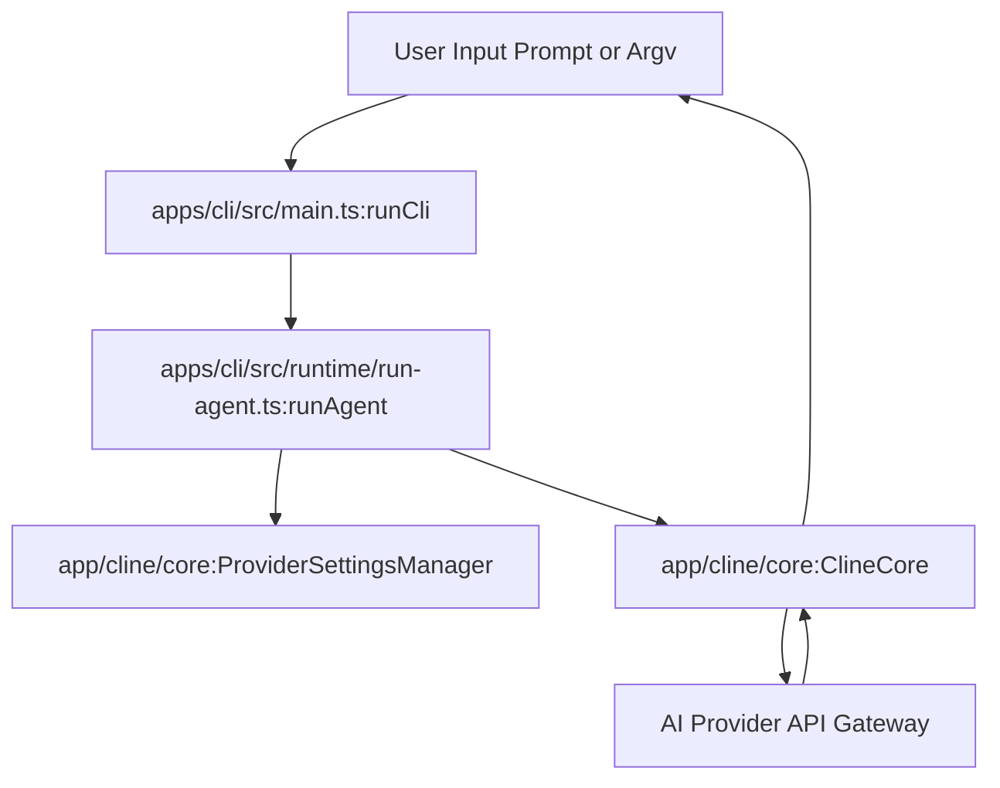
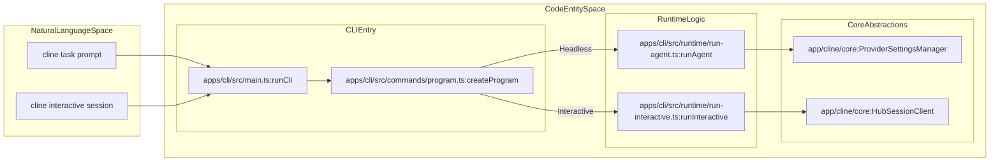

# Quick Start Guide

<details>
<summary>Relevant source files</summary>

The following files were used as context for generating this wiki page:

- [docs/api/authentication.mdx](docs/api/authentication.mdx)
- [docs/api/chat-completions.mdx](docs/api/chat-completions.mdx)
- [docs/api/errors.mdx](docs/api/errors.mdx)
- [docs/api/getting-started.mdx](docs/api/getting-started.mdx)
- [docs/api/models.mdx](docs/api/models.mdx)
- [docs/api/overview.mdx](docs/api/overview.mdx)
- [docs/api/sdk-examples.mdx](docs/api/sdk-examples.mdx)
- [docs/assets/clinepass/clinepass-cli.png](docs/assets/clinepass/clinepass-cli.png)
- [docs/assets/clinepass/clinepass-ide-extension.png](docs/assets/clinepass/clinepass-ide-extension.png)
- [docs/cli/cli-reference.mdx](docs/cli/cli-reference.mdx)
- [docs/cline-overview.mdx](docs/cline-overview.mdx)
- [docs/core-workflows/task-management.mdx](docs/core-workflows/task-management.mdx)
- [docs/customization/clineignore.mdx](docs/customization/clineignore.mdx)
- [docs/customization/hooks.mdx](docs/customization/hooks.mdx)
- [docs/enterprise-solutions/api-reference.mdx](docs/enterprise-solutions/api-reference.mdx)
- [docs/features/multiroot-workspace.mdx](docs/features/multiroot-workspace.mdx)
- [docs/getting-started/authorizing-with-cline.mdx](docs/getting-started/authorizing-with-cline.mdx)
- [docs/getting-started/cline-provider.mdx](docs/getting-started/cline-provider.mdx)
- [docs/getting-started/clinepass.mdx](docs/getting-started/clinepass.mdx)
- [docs/getting-started/installing-cline.mdx](docs/getting-started/installing-cline.mdx)
- [docs/mcp/mcp-overview.mdx](docs/mcp/mcp-overview.mdx)
- [docs/provider-config/minimax.mdx](docs/provider-config/minimax.mdx)
- [docs/sdk/architecture/hub-spoke.mdx](docs/sdk/architecture/hub-spoke.mdx)
- [docs/tools-reference/all-cline-tools.mdx](docs/tools-reference/all-cline-tools.mdx)
- [docs/usage/cli-overview.mdx](docs/usage/cli-overview.mdx)
- [docs/usage/ide.mdx](docs/usage/ide.mdx)
- [sdk/examples/hooks/PreToolUse_ClineignoreGuard.sh](sdk/examples/hooks/PreToolUse_ClineignoreGuard.sh)
- [sdk/examples/hooks/README.md](sdk/examples/hooks/README.md)

</details>


This guide walks a new user through installing Cline, configuring an AI provider, and executing their first task across multiple delivery surfaces: the IDE extension, the standalone CLI/TUI, and programmatic SDK examples [docs/getting-started/installing-cline.mdx:2-4](), [docs/usage/cli-overview.mdx:2-5]().

---

## Installation

Cline supports multiple installation paths depending on your workflow requirements [docs/getting-started/installing-cline.mdx:6-13]().

### IDE Extension
The Cline extension is available for VS Code, Cursor, Windsurf, VSCodium, Antigravity, and JetBrains IDEs [docs/getting-started/installing-cline.mdx:8-9]().
1. **Search & Install:** Open the Extensions view (`Ctrl/Cmd + Shift + X`), search for `Cline`, and click **Install** [docs/getting-started/installing-cline.mdx:39-47]().
2. **Open:** Locate the Cline icon in the extension sidebar to launch the panel [docs/getting-started/installing-cline.mdx:48-50]().

### CLI
For terminal-based workflows and automation [docs/getting-started/installing-cline.mdx:10]():
1. **Prerequisites:** Ensure Node.js 20+ (22 recommended) is installed [docs/getting-started/installing-cline.mdx:90-91]().
2. **Install:** Run `npm install -g cline` [docs/getting-started/installing-cline.mdx:93-96]().

### SDK
To build custom agents or embed Cline programmatically [docs/getting-started/installing-cline.mdx:12]():
1. Initialize a project (`npm init -y`) [docs/getting-started/installing-cline.mdx:136-140]().
2. Install the package via `npm install @cline/sdk` [docs/getting-started/installing-cline.mdx:142-145]().

Sources: [docs/getting-started/installing-cline.mdx:1-152]()

---

## Initial Configuration

### 1. Provider Setup
Cline connects to AI models via a **provider** configuration [docs/getting-started/authorizing-with-cline.mdx:6-10]().
* **Cline (usage-billing):** Pay-as-you-go access via Google/GitHub/email OAuth [docs/getting-started/authorizing-with-cline.mdx:8](), [docs/getting-started/authorizing-with-cline.mdx:42-49]().
* **ClinePass:** A flat-rate subscription offering enhanced usage on open coding models [docs/getting-started/clinepass.mdx:6-12]().
* **BYOK (Bring Your Own Key):** Direct integration with Anthropic, OpenAI, Google Gemini, or local runtimes (Ollama, LM Studio) [docs/getting-started/authorizing-with-cline.mdx:10](), [docs/getting-started/authorizing-with-cline.mdx:58-81]().

**In VS Code:** Open settings via the gear icon in the Cline panel, select your **API Provider**, and complete authentication [docs/getting-started/authorizing-with-cline.mdx:20-33]().  
**In CLI:** Run `cline auth` to launch the interactive setup flow handled by `runAuthCommand` and `ensureOAuthProviderApiKey` [docs/getting-started/authorizing-with-cline.mdx:86-88](), [apps/cli/src/main.ts:189-191](), [apps/cli/src/utils/provider-auth.ts:43-47]().

Sources: [docs/getting-started/authorizing-with-cline.mdx:1-102](), [docs/getting-started/clinepass.mdx:1-130](), [apps/cli/src/main.ts:189-203]()

---

## Running Your First Task

### VS Code Workflow
Type prompts directly into the chat input at the bottom of the Cline panel [docs/cline-overview.mdx:7-9](). Use `@` mentions to pass files or workspace context. Multi-root workspaces are supported via explicit `@workspace:path` syntax [docs/features/multiroot-workspace.mdx:6-7](), [docs/features/multiroot-workspace.mdx:137-144]().

### CLI / TUI Workflow
* **Interactive Mode (TUI):** Launch an OpenTUI session using `cline` [docs/usage/cli-overview.mdx:15-16](), [apps/cli/src/tui/root.tsx:1-12](). Internally, `runCli` invokes `runInteractive` to boot the TUI runtime loop [apps/cli/src/main.ts:91-94](), [apps/cli/src/main.ts:182-183]().
* **Headless Automation:** Execute tasks directly with flags like `--json` or `--auto-approve true` [docs/usage/cli-overview.mdx:25-56]().

```bash
cline "Summarize the README.md" --json | jq -r '.text'
```

### SDK Quickstart Example
Developers can initialize programmatic sessions using `@cline/core`:

```typescript
import { ClineCore, ProviderSettingsManager } from "@cline/core";

// Initialize provider settings and session configuration
const providerManager = new ProviderSettingsManager();
const settings = providerManager.getProviderConfig("cline");
```

**Diagram: Task Execution Data Flow**


Sources: [docs/usage/cli-overview.mdx:1-147](), [apps/cli/src/main.ts:78-183](), [apps/cli/src/main.test.ts:190-204]()

---

## Core Operational Modes

* **Plan Mode:** Activated via `-p` or `--plan`. The agent analyzes the workspace and proposes an execution strategy without executing mutating tools [docs/usage/cli-overview.mdx:57-61](), [docs/usage/cli-overview.mdx:96]().
* **Act Mode:** Default mode. Executes tools (file edits, shell commands) under human-in-the-loop policy control [docs/usage/cli-overview.mdx:63-65](), [docs/cli/cli-reference.mdx:27]().
* **ACP Mode:** Run as an Agent Client Protocol server for editor integrations in Zed, Neovim, or JetBrains via `cline --acp` [docs/usage/cli-overview.mdx:147-147](), [docs/cli/cli-reference.mdx:46]().

**Diagram: CLI Component Mapping**


Sources: [docs/usage/cli-overview.mdx:1-147](), [apps/cli/src/main.ts:73-183](), [apps/cli/src/main.test.ts:190-204]()