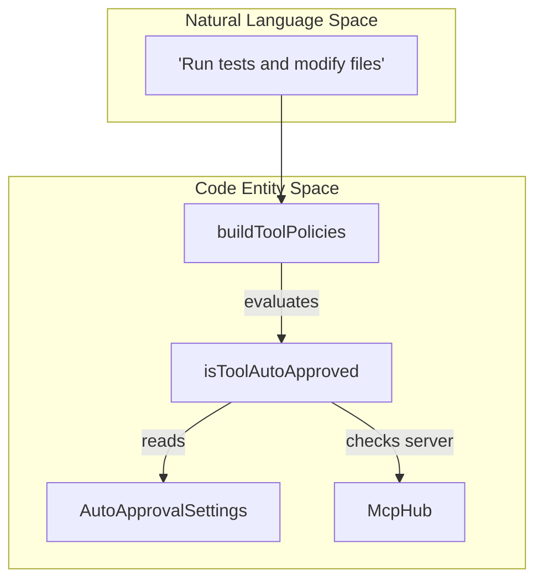
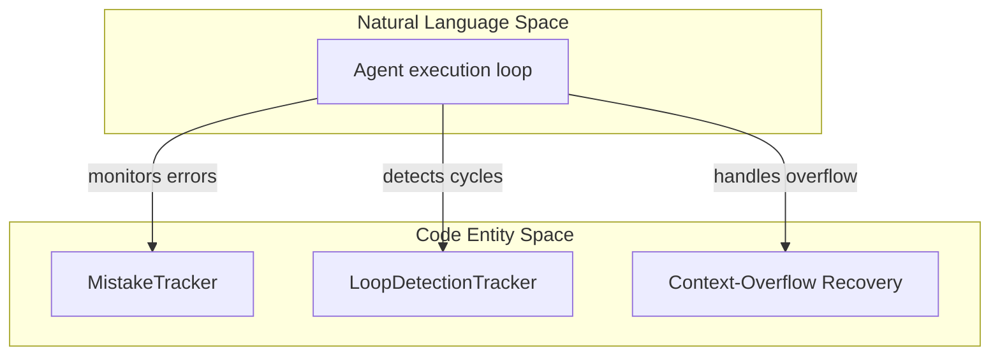

# Safety and Control

Relevant source files

The following files were used as context for generating this wiki page:

- [apps/vscode/src/sdk/sdk-tool-policies.test.ts](apps/vscode/src/sdk/sdk-tool-policies.test.ts)
- [apps/vscode/src/sdk/sdk-tool-policies.ts](apps/vscode/src/sdk/sdk-tool-policies.ts)
- [apps/vscode/src/shared/AutoApprovalSettings.ts](apps/vscode/src/shared/AutoApprovalSettings.ts)
- [apps/vscode/src/test/e2e/file-edit.test.ts](apps/vscode/src/test/e2e/file-edit.test.ts)
- [apps/vscode/src/test/e2e/fixtures/server/api.ts](apps/vscode/src/test/e2e/fixtures/server/api.ts)
- [apps/vscode/src/test/e2e/fixtures/server/index.ts](apps/vscode/src/test/e2e/fixtures/server/index.ts)
- [apps/vscode/src/test/e2e/fixtures/workspace-hooks/.clinerules/hooks/UserPromptSubmit](apps/vscode/src/test/e2e/fixtures/workspace-hooks/.clinerules/hooks/UserPromptSubmit)
- [apps/vscode/src/test/e2e/fixtures/workspace-hooks/.clinerules/hooks/UserPromptSubmit.ps1](apps/vscode/src/test/e2e/fixtures/workspace-hooks/.clinerules/hooks/UserPromptSubmit.ps1)
- [apps/vscode/src/test/e2e/hooks.test.ts](apps/vscode/src/test/e2e/hooks.test.ts)
- [apps/vscode/src/test/e2e/powershell-background.test.ts](apps/vscode/src/test/e2e/powershell-background.test.ts)
- [apps/vscode/webview-ui/src/components/chat/auto-approve-menu/constants.ts](apps/vscode/webview-ui/src/components/chat/auto-approve-menu/constants.ts)

This page provides an overview of the safety and control mechanisms in Cline that ensure the user retains complete authority over agent actions, workspace modifications, and execution flows. Cline implements a human-in-the-loop governance model paired with automated runtime guards to prevent unauthorized edits, destructive command execution, and infinite loops.

---

## Approvals and Tool Policies

Cline operates on an explicit "request and approve" model for sensitive operations. Through the settings defined in `AutoApprovalSettings` [apps/vscode/src/shared/AutoApprovalSettings.ts:1-26](), users can configure which tool categories require manual confirmation and which are pre-approved. The core policy evaluation engine (`isToolAutoApproved`) and policy builder (`buildToolPolicies`) evaluate incoming tool requests against these user-defined action permissions and external Model Context Protocol (MCP) server statuses [apps/vscode/src/sdk/sdk-tool-policies.ts:13-68]().

Title: Tool Approval and Policy Evaluation Flow

For details on the approval controller flow in CLI and extension, auto-approval settings, YOLO mode, and ACP auto-approve, see [Approvals and Tool Policies](#10.1).

**Sources:** [apps/vscode/src/shared/AutoApprovalSettings.ts:1-26](), [apps/vscode/src/sdk/sdk-tool-policies.ts:13-68]()

---

## Runtime Safeguards and Error Recovery

Beyond human approvals, Cline incorporates automated safeguards to detect anomalous agent behaviors, such as repeated identical tool calls or execution mistakes. It also handles transient provider failures via retry/backoff mechanisms and manages context-window overflows to keep long-running tasks stable.

Title: Runtime Safeguard Subsystems

For details on `MistakeTracker`, `LoopDetectionTracker`, retry/backoff logic on transient provider errors, context-overflow recovery, and sandbox boundaries, see [Runtime Safeguards and Error Recovery](#10.2).

**Sources:** [apps/vscode/src/sdk/sdk-tool-policies.ts:13-40]()