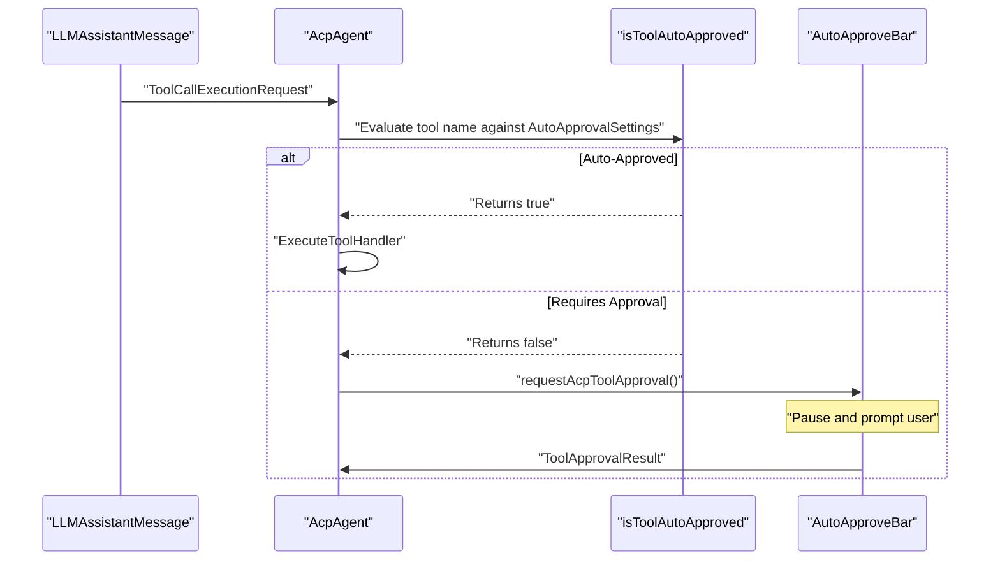
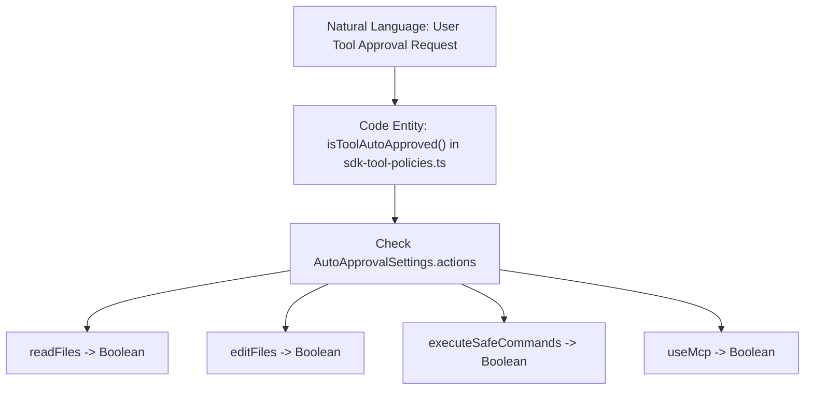
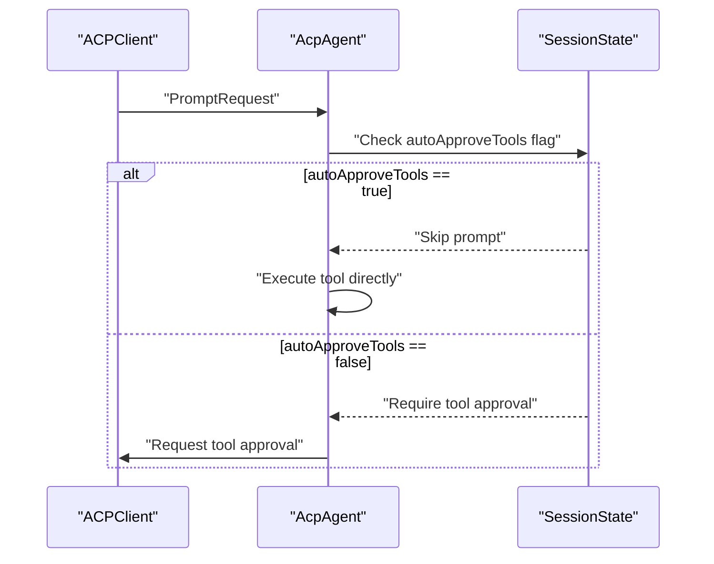

# Approvals and Tool Policies

Relevant source files

The following files were used as context for generating this wiki page:

- [apps/cli/src/acp/acpAgent.ts](apps/cli/src/acp/acpAgent.ts)
- [apps/cli/src/acp/auth.ts](apps/cli/src/acp/auth.ts)
- [apps/cli/src/acp/auto-approve.test.ts](apps/cli/src/acp/auto-approve.test.ts)
- [apps/cli/src/acp/auto-approve.ts](apps/cli/src/acp/auto-approve.ts)
- [apps/cli/src/acp/index.ts](apps/cli/src/acp/index.ts)
- [apps/cli/src/acp/organizations.test.ts](apps/cli/src/acp/organizations.test.ts)
- [apps/cli/src/acp/organizations.ts](apps/cli/src/acp/organizations.ts)
- [apps/cli/src/acp/reasoning.test.ts](apps/cli/src/acp/reasoning.test.ts)
- [apps/cli/src/acp/session-load.test.ts](apps/cli/src/acp/session-load.test.ts)
- [apps/cli/src/acp/session-load.ts](apps/cli/src/acp/session-load.ts)
- [apps/cli/src/utils/cline-client-identity.ts](apps/cli/src/utils/cline-client-identity.ts)
- [apps/cli/src/utils/free-model-cost.test.ts](apps/cli/src/utils/free-model-cost.test.ts)
- [apps/cli/src/utils/free-model-cost.ts](apps/cli/src/utils/free-model-cost.ts)
- [apps/cline-hub/src/server/session-mapping.test.ts](apps/cline-hub/src/server/session-mapping.test.ts)
- [apps/cline-hub/src/webview/src/components/views/page-layout.tsx](apps/cline-hub/src/webview/src/components/views/page-layout.tsx)
- [apps/cline-hub/src/webview/src/components/views/settings/provider-list-view.tsx](apps/cline-hub/src/webview/src/components/views/settings/provider-list-view.tsx)
- [apps/vscode/src/sdk/sdk-tool-policies.test.ts](apps/vscode/src/sdk/sdk-tool-policies.test.ts)
- [apps/vscode/src/sdk/sdk-tool-policies.ts](apps/vscode/src/sdk/sdk-tool-policies.ts)
- [apps/vscode/src/services/ClineClientIdentity.test.ts](apps/vscode/src/services/ClineClientIdentity.test.ts)
- [apps/vscode/src/services/ClineClientIdentity.ts](apps/vscode/src/services/ClineClientIdentity.ts)
- [apps/vscode/src/shared/AutoApprovalSettings.ts](apps/vscode/src/shared/AutoApprovalSettings.ts)
- [apps/vscode/src/test/e2e/file-edit.test.ts](apps/vscode/src/test/e2e/file-edit.test.ts)
- [apps/vscode/src/test/e2e/fixtures/server/api.ts](apps/vscode/src/test/e2e/fixtures/server/api.ts)
- [apps/vscode/src/test/e2e/fixtures/server/index.ts](apps/vscode/src/test/e2e/fixtures/server/index.ts)
- [apps/vscode/src/test/e2e/fixtures/workspace-hooks/.clinerules/hooks/UserPromptSubmit](apps/vscode/src/test/e2e/fixtures/workspace-hooks/.clinerules/hooks/UserPromptSubmit)
- [apps/vscode/src/test/e2e/fixtures/workspace-hooks/.clinerules/hooks/UserPromptSubmit.ps1](apps/vscode/src/test/e2e/fixtures/workspace-hooks/.clinerules/hooks/UserPromptSubmit.ps1)
- [apps/vscode/src/test/e2e/hooks.test.ts](apps/vscode/src/test/e2e/hooks.test.ts)
- [apps/vscode/src/test/e2e/powershell-background.test.ts](apps/vscode/src/test/e2e/powershell-background.test.ts)
- [apps/vscode/webview-ui/src/components/chat/auto-approve-menu/AutoApproveBar.test.tsx](apps/vscode/webview-ui/src/components/chat/auto-approve-menu/AutoApproveBar.test.tsx)
- [apps/vscode/webview-ui/src/components/chat/auto-approve-menu/AutoApproveBar.tsx](apps/vscode/webview-ui/src/components/chat/auto-approve-menu/AutoApproveBar.tsx)
- [apps/vscode/webview-ui/src/components/chat/auto-approve-menu/constants.ts](apps/vscode/webview-ui/src/components/chat/auto-approve-menu/constants.ts)
- [apps/vscode/webview-ui/src/components/cloud/CloudGitHubCard.tsx](apps/vscode/webview-ui/src/components/cloud/CloudGitHubCard.tsx)
- [apps/vscode/webview-ui/src/components/cloud/CloudOnboardingCard.tsx](apps/vscode/webview-ui/src/components/cloud/CloudOnboardingCard.tsx)
- [apps/vscode/webview-ui/src/components/cloud/TaskTargetPanel.test.tsx](apps/vscode/webview-ui/src/components/cloud/TaskTargetPanel.test.tsx)
- [apps/vscode/webview-ui/src/components/cloud/TaskTargetPanel.tsx](apps/vscode/webview-ui/src/components/cloud/TaskTargetPanel.tsx)
- [apps/vscode/webview-ui/src/utils/__tests__/editorName.spec.ts](apps/vscode/webview-ui/src/utils/__tests__/editorName.spec.ts)
- [apps/vscode/webview-ui/src/utils/editorName.ts](apps/vscode/webview-ui/src/utils/editorName.ts)
- [docs/usage/acp.mdx](docs/usage/acp.mdx)

This page documents the mechanism by which Cline pauses execution to obtain user consent before performing potentially destructive or sensitive actions, along with the settings that allow those pauses to be bypassed. The scope includes the `ask()` approval flow, the `AutoApprovalSettings` data structure, extension and CLI approval controllers, YOLO mode, and ACP auto-approve.

---

## The Approval Flow and Controller Architecture

Every potentially side-effecting action Cline can take is gated through a request for approval. This is orchestrated by the agent task lifecycle and the `ToolExecutor` / approval controller.

### The `ask()` / `say()` Cycle
When the agent needs to perform a tool call or ask a question, it uses the `ask()` method to suspend the task:

1. **Tool Request**: The agent loop parses a tool block and dispatches it to the tool execution subsystem [apps/cli/src/acp/acpAgent.ts:88-95]().
2. **State Suspension**: If the tool is not auto-approved, the task emits an approval request via tool permission handlers [apps/cli/src/acp/acpAgent.ts:64]().
3. **UI Update**: The message is surfaced to the user interface (such as the TUI dialog or the VS Code webview via `AutoApproveBar`) [apps/vscode/webview-ui/src/components/chat/auto-approve-menu/AutoApproveBar.tsx:18-126]().
4. **User Response**: The user interacts with the approval buttons or command-line prompt.
5. **Resolution**: The task resumes execution based on the approval boolean result.

**Diagram: Approval Controller & Tool Policy Flow**

Sources: `[apps/cli/src/acp/acpAgent.ts:88-95]()`, `[apps/vscode/src/sdk/sdk-tool-policies.ts:3-39]()`, `[apps/vscode/webview-ui/src/components/chat/auto-approve-menu/AutoApproveBar.tsx:18-126]()`

---

## Auto-Approval Settings and Tool Policies

To minimize prompt fatigue, Cline includes an auto-approval mechanism that evaluates whether an action requires a manual pause based on user configurations defined in `@shared/AutoApprovalSettings`.

### `AutoApprovalSettings`
The `AutoApprovalSettings` interface defines which action categories bypass the approval prompt [apps/vscode/src/shared/AutoApprovalSettings.ts:1-26]().

| Action Key | Description | Default Value |
|---|---|---|
| `readFiles` | Read files and directories | `true` |
| `editFiles` | Edit files (write/replace) | `true` |
| `executeSafeCommands` | Execute terminal commands | `false` |
| `useBrowser` | Use browser automation | `true` |
| `useMcp` | Use MCP servers | `true` |

Sources: `[apps/vscode/src/shared/AutoApprovalSettings.ts:1-44]()`, `[apps/vscode/src/sdk/sdk-tool-policies.ts:3-39]()`

### Tool Policy Logic
The mapping between tool names and user settings is handled by `sdk-tool-policies.ts` and evaluated during tool execution [apps/vscode/src/sdk/sdk-tool-policies.ts:3-39]().

* **`isToolAutoApproved`**: The core predicate checking if a specific tool name (e.g., `run_commands`, `firecrawl__scrape`) is allowed to bypass the prompt based on active `AutoApprovalSettings` [apps/vscode/src/sdk/sdk-tool-policies.ts:3-39]().
* **MCP Tools**: All Model Context Protocol tools follow the `useMcp` toggle. Tools registered by servers are formatted as `serverName__toolName` and evaluated against the global MCP setting [apps/vscode/src/sdk/sdk-tool-policies.test.ts:23-39]().

**Diagram: Natural Language to Code Entity Mapping for Tool Policies**

Sources: `[apps/vscode/src/sdk/sdk-tool-policies.ts:3-39]()`, `[apps/vscode/src/shared/AutoApprovalSettings.ts:1-26]()`, `[apps/vscode/src/sdk/sdk-tool-policies.test.ts:3-39]()`

---

## YOLO Mode and Autonomous Execution

For fully unattended workflows, Cline supports YOLO mode and global auto-approval flags.

### CLI YOLO Mode and Flags
In the CLI, YOLO mode (invoked via `--auto-approve` options) forces all tool actions to be treated as auto-approved, allowing agents to execute headlessly without manual interruptions.

When initializing session state in `AcpAgent`, `autoApproveTools` is configured through options passed by `runAcpMode` [apps/cli/src/acp/acpAgent.ts:111-128](), `[apps/cli/src/acp/index.ts:6-11]()`.

Sources: `[apps/cli/src/acp/acpAgent.ts:111-128]`, `[apps/cli/src/acp/index.ts:6-11]()`

---

## ACP Auto-Approve (Agent Client Protocol)

When running through the Agent Client Protocol (`--acp`), tool execution requests pass through ACP-specific negotiation layers implemented in `AcpAgent` [apps/cli/src/acp/acpAgent.ts:111-128](). 

### Session State and Auto-Approval
The `SessionState` interface maintains the `autoApproveTools` flag per session, which determines whether tool execution bypasses client prompts [apps/cli/src/acp/acpAgent.ts:78-109]().

**Diagram: ACP Session Auto-Approve Flow**

Sources: `[apps/cli/src/acp/acpAgent.ts:78-109]`, `[apps/cli/src/acp/index.ts:11-35]()`

---

## UI Auto-Approval Controls

The VS Code extension provides visual feedback and management of auto-approval settings via `AutoApproveBar` and `AutoApproveModal` [apps/vscode/webview-ui/src/components/chat/auto-approve-menu/AutoApproveBar.tsx:18-126]().

* **`AutoApproveBar`**: Renders currently enabled actions from `autoApprovalSettings.actions` directly above the chat input box [apps/vscode/webview-ui/src/components/chat/auto-approve-menu/AutoApproveBar.tsx:18-65]().
* **Cloud Auto-Approve**: Cloud sessions automatically enable all action permissions to allow background execution when the IDE is closed [apps/vscode/webview-ui/src/components/chat/auto-approve-menu/AutoApproveBar.tsx:28-32]().

Sources: `[apps/vscode/webview-ui/src/components/chat/auto-approve-menu/AutoApproveBar.tsx:18-126]()`