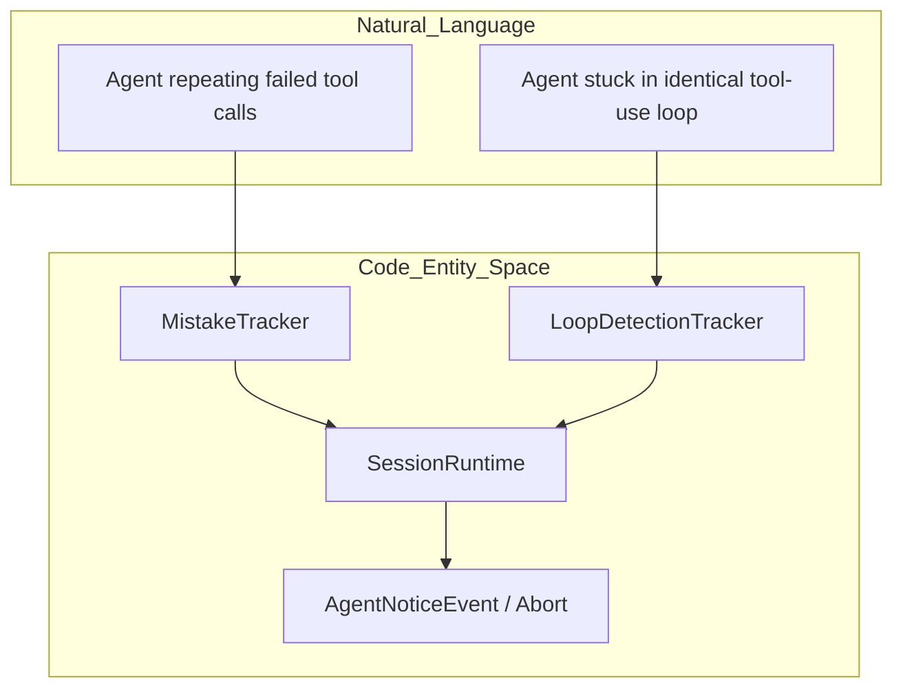

# Runtime Safeguards and Error Recovery

<details>
<summary>Relevant source files</summary>

The following files were used as context for generating this wiki page:

- [apps/vscode/src/sdk/free-promotion-ended.test.ts](apps/vscode/src/sdk/free-promotion-ended.test.ts)
- [apps/vscode/src/services/error/ClineError.ts](apps/vscode/src/services/error/ClineError.ts)
- [apps/vscode/src/services/error/__tests__/ClineError.test.ts](apps/vscode/src/services/error/__tests__/ClineError.test.ts)
- [apps/vscode/webview-ui/src/components/chat/ClineFreePromotionEndedError.tsx](apps/vscode/webview-ui/src/components/chat/ClineFreePromotionEndedError.tsx)
- [apps/vscode/webview-ui/src/components/chat/ErrorRow.stories.tsx](apps/vscode/webview-ui/src/components/chat/ErrorRow.stories.tsx)
- [apps/vscode/webview-ui/src/components/chat/ErrorRow.test.tsx](apps/vscode/webview-ui/src/components/chat/ErrorRow.test.tsx)
- [apps/vscode/webview-ui/src/components/chat/ErrorRow.tsx](apps/vscode/webview-ui/src/components/chat/ErrorRow.tsx)
- [sdk/packages/agents/src/agent-runtime.test.ts](sdk/packages/agents/src/agent-runtime.test.ts)
- [sdk/packages/agents/src/agent-runtime.ts](sdk/packages/agents/src/agent-runtime.ts)
- [sdk/packages/core/src/runtime/orchestration/session-runtime-orchestrator.test.ts](sdk/packages/core/src/runtime/orchestration/session-runtime-orchestrator.test.ts)
- [sdk/packages/core/src/runtime/orchestration/session-runtime-orchestrator.ts](sdk/packages/core/src/runtime/orchestration/session-runtime-orchestrator.ts)
- [sdk/packages/core/src/services/llms/apihandler-agent-model-adapter.test.ts](sdk/packages/core/src/services/llms/apihandler-agent-model-adapter.test.ts)
- [sdk/packages/core/src/services/llms/apihandler-agent-model-adapter.ts](sdk/packages/core/src/services/llms/apihandler-agent-model-adapter.ts)
- [sdk/packages/core/src/services/telemetry/core-events.test.ts](sdk/packages/core/src/services/telemetry/core-events.test.ts)
- [sdk/packages/core/src/services/telemetry/core-events.ts](sdk/packages/core/src/services/telemetry/core-events.ts)
- [sdk/packages/llms/src/providers/ai-sdk.retry-empty-response.test.ts](sdk/packages/llms/src/providers/ai-sdk.retry-empty-response.test.ts)
- [sdk/packages/llms/src/providers/ai-sdk.test.ts](sdk/packages/llms/src/providers/ai-sdk.test.ts)
- [sdk/packages/llms/src/providers/ai-sdk.ts](sdk/packages/llms/src/providers/ai-sdk.ts)
- [sdk/packages/llms/src/providers/compat.test.ts](sdk/packages/llms/src/providers/compat.test.ts)
- [sdk/packages/llms/src/providers/compat.ts](sdk/packages/llms/src/providers/compat.ts)
- [sdk/packages/llms/src/providers/gateway.test.ts](sdk/packages/llms/src/providers/gateway.test.ts)
- [sdk/packages/llms/src/providers/gateway.ts](sdk/packages/llms/src/providers/gateway.ts)
- [sdk/packages/llms/src/providers/middleware/retry-empty-response.test.ts](sdk/packages/llms/src/providers/middleware/retry-empty-response.test.ts)
- [sdk/packages/llms/src/providers/middleware/retry-empty-response.ts](sdk/packages/llms/src/providers/middleware/retry-empty-response.ts)
- [sdk/packages/llms/src/providers/vendors/types.ts](sdk/packages/llms/src/providers/vendors/types.ts)
- [sdk/packages/shared/src/agent.ts](sdk/packages/shared/src/agent.ts)
- [sdk/packages/shared/src/agents/types.ts](sdk/packages/shared/src/agents/types.ts)
- [sdk/packages/shared/src/services/telemetry.test.ts](sdk/packages/shared/src/services/telemetry.test.ts)
- [sdk/packages/shared/src/services/telemetry.ts](sdk/packages/shared/src/services/telemetry.ts)

</details>


## Purpose and Scope

This page documents the runtime safety, error handling, and recovery subsystems of the Cline core agent engine (`@cline/core` and `@cline/agents`). These mechanisms protect active sessions against infinite tool-use loops, consecutive agent mistakes, transient LLM provider failures, context-window exhaustion, and unsafe tool execution bounds.

---

## 1. Mistake and Loop Detection

Cline maintains per-session state trackers inside `SessionRuntime` to prevent agents from falling into unproductive loops or repeating malformed tool calls [sdk/packages/core/src/runtime/orchestration/session-runtime-orchestrator.ts:4-8]().

*   **`MistakeTracker`**: Monitors consecutive tool failures, invalid JSON inputs, or empty responses. When the mistake counter crosses the threshold defined by session configurations, the engine emits a recovery notice or halts the run to prevent wasted token expenditure [sdk/packages/core/src/runtime/safety/mistake-tracker.ts]().
*   **`LoopDetectionTracker`**: Analyzes historical tool calls within the session transcript to detect repetitive patterns (e.g., executing the exact same file read or search query consecutively without progress) [sdk/packages/core/src/runtime/safety/loop-detection.ts]().

### Detection and Intervention Flow



Sources: [sdk/packages/core/src/runtime/orchestration/session-runtime-orchestrator.ts:4-8](), [sdk/packages/core/src/runtime/safety/mistake-tracker.ts](), [sdk/packages/core/src/runtime/safety/loop-detection.ts]()

---

## 2. Transient Provider Error Retry and Backoff

When communicating with LLM provider endpoints, network partitions, rate limits, HTTP 5xx server errors, or gateway provider glitches (such as OpenRouter's generic stream failures) can occur. `AgentRuntime` implements an automatic retry loop for transient errors [sdk/packages/agents/src/agent-runtime.ts:56-70]().

### Backoff Configuration Constants
*   `PROVIDER_ERROR_MAX_RETRIES`: Set to `3` retries (up to 4 total attempts per turn) [sdk/packages/agents/src/agent-runtime.ts:87]()
*   `PROVIDER_ERROR_RETRY_BASE_DELAY_MS`: Base delay of `1,000` ms, doubled on each subsequent attempt [sdk/packages/agents/src/agent-runtime.ts:89]()
*   `PROVIDER_ERROR_RETRY_MAX_DELAY_MS`: Upper ceiling of `15,000` ms on single backoff waits [sdk/packages/agents/src/agent-runtime.ts:91]()

Errors are inspected using `classifyProviderError` and `isRetryableProviderError`. Client-side errors, authentication failures (`isLikelyAuthError`), and context overflows are explicitly excluded from retries to prevent looping on permanent request rejections [sdk/packages/agents/src/agent-runtime.ts:2-6]().

### Retry and Error Classification Pipeline

```mermaid
graph LR
    subgraph "Natural_Language"
        ProviderDrop[""API Stream Dropped / HTTP 5xx / Rate Limit""]
        AuthError[""Invalid API Key / Auth Error""]
    end

    subgraph "Code_Entity_Space"
        AgentRuntime[""AgentRuntime.run()""]
        Classify[""classifyProviderError()""]
        RetryCheck[""isRetryableProviderError()""]
        Backoff[""Exponential Backoff Wait""]
        ThrowError[""Terminal Error Propagation""]
    end

    ProviderDrop --> AgentRuntime
    AuthError --> AgentRuntime
    AgentRuntime --> Classify
    Classify --> RetryCheck
    
    RetryCheck -->|"true (Transient)"| Backoff
    Backoff -->|"Attempt < 3"| AgentRuntime
    
    RetryCheck -->|"false (Permanent)"| ThrowError
```

Sources: [sdk/packages/agents/src/agent-runtime.ts:56-92](), [sdk/packages/llms/src/providers/error-classification.ts]()

---

## 3. Context-Overflow Recovery and Compaction

When a conversation transcript grows larger than the target model's maximum input capacity, providers reject the request with a context-window overflow. Cline manages this through a context compaction pipeline (`compaction.ts`) and terminal error boundaries [sdk/packages/core/src/extensions/context/compaction.ts:35-54]().

### Recovery Flow
1.  **Detection**: If a provider rejects a payload due to context size, or token metrics breach threshold limits, the runtime initiates compaction [sdk/packages/core/src/extensions/context/compaction-shared.ts:17]().
2.  **Overflow Recovery Mode**: Setting `overflowRecovery?: boolean` forces immediate, deterministic basic compaction (`runBasicCompaction`) rather than relying on an LLM-driven summarizer, ensuring recovery does not require another large request [sdk/packages/core/src/extensions/context/compaction.ts:47-51]().
3.  **Terminal Errors**: If compaction cannot reduce the prompt size or no conversation history remains to be pruned, `ContextWindowOverflowError` is raised with descriptive messages such as `CONTEXT_WINDOW_OVERFLOW_NOTHING_TO_COMPACT_MESSAGE` or `CONTEXT_WINDOW_OVERFLOW_RECOVERY_FAILED_MESSAGE` [sdk/packages/agents/src/agent-runtime.ts:106-133]().

### Context Overflow Management Architecture

```mermaid
graph TB
    subgraph "Natural_Language"
        OverflowNotice[""Model Context Window Exceeded""]
    end

    subgraph "Code_Entity_Space"
        PrepTurn[""ContextPipelinePrepareTurnInput""]
        OverflowFlag[""overflowRecovery = true""]
        BasicCompaction[""runBasicCompaction()""]
        OverflowError[""ContextWindowOverflowError""]
    end

    OverflowNotice --> PrepTurn
    PrepTurn --> OverflowFlag
    OverflowFlag --> BasicCompaction
    BasicCompaction -->|"Success"| TrimmedTranscript[""Truncated Transcript Sent to Model""]
    BasicCompaction -->|"Failed / Nothing Left"| OverflowError
```

Sources: [sdk/packages/agents/src/agent-runtime.ts:106-133](), [sdk/packages/core/src/extensions/context/compaction.ts:35-64](), [sdk/packages/core/src/extensions/context/compaction-shared.ts:17]()

---

## 4. Sandbox and Isolation Boundaries

To prevent unauthorized file modifications or system tampering during task execution, Cline enforces strict operational boundaries:
*   **Path Access Restrictions**: File access tools validate target paths against `.clineignore` and workspace root boundaries before execution.
*   **Subprocess Execution Control**: Shell executors run in managed subprocess boundaries with strict output truncation limits and watchdog timeout enforcement to prevent runaway processes [sdk/packages/core/src/extensions/tools/executors/bash.ts]().
*   **Tool Policies**: Execution of high-privilege tool categories is governed by `AgentConfig["toolPolicies"]`, allowing hosts to disable or require manual confirmation for specific capabilities [sdk/packages/core/src/runtime/orchestration/session-runtime-orchestrator.ts:153-174]().

Sources: [sdk/packages/core/src/runtime/orchestration/session-runtime-orchestrator.ts:153-174](), [sdk/packages/core/src/extensions/tools/executors/bash.ts]()