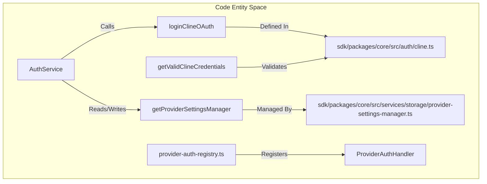

# Authentication, Accounts, and Enterprise

<details>
<summary>Relevant source files</summary>

The following files were used as context for generating this wiki page:

- [apps/cli/src/utils/provider-catalog.test.ts](apps/cli/src/utils/provider-catalog.test.ts)
- [apps/vscode/src/sdk/auth-service.test.ts](apps/vscode/src/sdk/auth-service.test.ts)
- [apps/vscode/src/sdk/auth-service.ts](apps/vscode/src/sdk/auth-service.ts)
- [apps/vscode/src/services/auth/types.ts](apps/vscode/src/services/auth/types.ts)
- [apps/vscode/src/utils/path.ts](apps/vscode/src/utils/path.ts)
- [apps/vscode/webview-ui/src/CustomPostHogProvider.tsx](apps/vscode/webview-ui/src/CustomPostHogProvider.tsx)
- [sdk/packages/core/src/auth/cline.test.ts](sdk/packages/core/src/auth/cline.test.ts)
- [sdk/packages/core/src/auth/cline.ts](sdk/packages/core/src/auth/cline.ts)
- [sdk/packages/core/src/auth/provider-auth-registry.test.ts](sdk/packages/core/src/auth/provider-auth-registry.test.ts)
- [sdk/packages/core/src/auth/provider-auth-registry.ts](sdk/packages/core/src/auth/provider-auth-registry.ts)
- [sdk/packages/core/src/runtime/orchestration/runtime-oauth-token-manager.test.ts](sdk/packages/core/src/runtime/orchestration/runtime-oauth-token-manager.test.ts)

</details>


This page provides a high-level overview of authentication, account management, credit tracking, remote configuration, telemetry policies, and feature flags within the Cline monorepo. These subsystems are closely coupled: user authentication provides the bearer tokens required by account and billing APIs, while auth state and identity drive feature flag evaluation, remote policy enforcement, and telemetry enrichment.

---

## Architecture Overview

The authentication and enterprise subsystem spans the core SDK packages (`@cline/core`), the VS Code extension (`apps/vscode`), the CLI (`apps/cli`), and the desktop application (`apps/desktop`). Secrets and tokens are managed via provider settings managers and persisted safely across host boundaries.

```mermaid
graph TD
    subgraph "Extension Layer [apps/vscode/src/sdk/auth-service.ts]"
        [AuthService] --> [provider-migration.ts]
    end

    subgraph "Core SDK [sdk/packages/core/src/]"
        [cline.ts] --> [server.ts]
        [provider-auth-registry.ts] --> [cline.ts]
        [ProviderSettingsManager] --> ["providers.json"]
    end

    subgraph "Storage & Remote APIs"
        ["providers.json"] -->|Persists| ["WorkOS Tokens"]
        [cline.ts] -->|OAuth Loopback| ["WorkOS API"]
        [ClineAccountService] -->|REST Calls| ["Cline API"]
    end

    [AuthService] -->|"Delegates"| [cline.ts]
    [AuthService] -->|"Reads/Writes"| [ProviderSettingsManager]
```
Sources: [apps/vscode/src/sdk/auth-service.ts:1-40](), [sdk/packages/core/src/auth/cline.ts:1-24](), [sdk/packages/core/src/services/storage/provider-settings-manager.ts:132-156]()

Below is a code entity mapping diagram illustrating how token resolution and credential storage map to specific functions and modules across the SDK and extension packages:


Sources: [apps/vscode/src/sdk/auth-service.ts:10-43](), [sdk/packages/core/src/auth/cline.ts:1-24](), [sdk/packages/core/src/auth/provider-auth-registry.ts:42-54]()

---

## Authentication System

The authentication subsystem standardizes OAuth flows, credential parsing, and token rotation across all distribution surfaces. It uses WorkOS for identity federation and supports multiple provider configurations via registry handlers (`provider-auth-registry.ts`), handling secure local loopback servers for credential receipt.

For details, see [Authentication System](#11.1).

Sources: [sdk/packages/core/src/auth/cline.ts:1-30](), [sdk/packages/core/src/auth/provider-auth-registry.ts:42-54](), [apps/vscode/src/sdk/auth-service.ts:3-22]()

---

## Account Service, Credits, and ClinePass

Account management handles user profile retrieval, multi-organization membership, and credit/billing balances. It integrates closely with the ClinePass subscription model (`cline-pass`) and provides consistent account status views across the CLI, desktop app, and IDE extensions.

For details, see [Account Service, Credits, and ClinePass](#11.2).

Sources: [sdk/packages/core/src/auth/provider-auth-registry.ts:37-40](), [sdk/packages/core/src/auth/cline.ts:56-75]()

---

## Remote Configuration and Enterprise Policy

Enterprise governance is driven by remote configuration schemas that dictate provider availability, MCP tool restrictions, OpenTelemetry (OTEL) parameters, and prompt storage policies. These policies are enforced centrally and synced across host runtimes.

For details, see [Remote Configuration and Enterprise Policy](#11.3).

Sources: [sdk/packages/core/src/services/storage/provider-settings-manager.ts:1-26]()

---

## Feature Flags and Banners

Feature flags and promotional or operational banners are managed through shared flag definitions and cached polling services (`FeatureFlagsService`). They dynamically adapt extension capabilities, UI components, and sidecar behavior based on user cohort and organizational settings, integrating with telemetry controls via PostHog providers (`CustomPostHogProvider.tsx`).

For details, see [Feature Flags and Banners](#11.4).

Sources: [apps/vscode/src/sdk/auth-service.ts:34-36](), [apps/vscode/webview-ui/src/CustomPostHogProvider.tsx:28-34]()