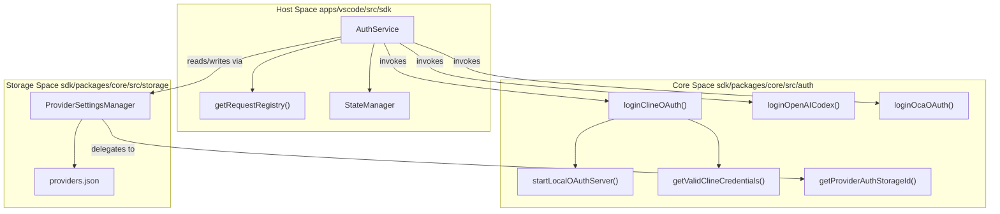
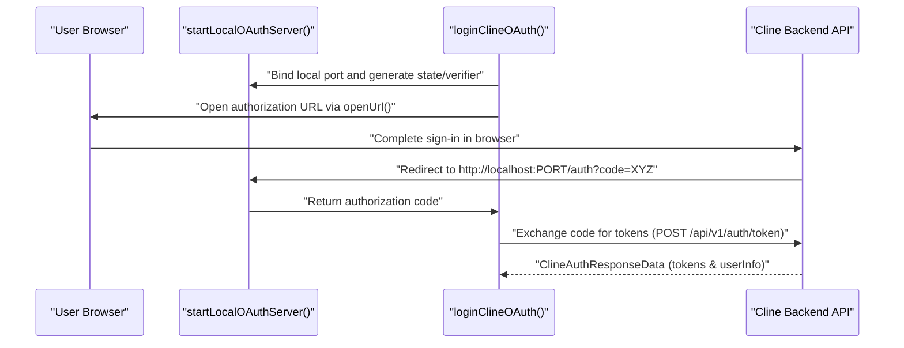

# Authentication System

Relevant source files

The following files were used as context for generating this wiki page:

- [apps/cli/src/utils/provider-catalog.test.ts](apps/cli/src/utils/provider-catalog.test.ts)
- [apps/vscode/src/core/controller/account/openAiCodexSignIn.ts](apps/vscode/src/core/controller/account/openAiCodexSignIn.ts)
- [apps/vscode/src/sdk/auth-service.test.ts](apps/vscode/src/sdk/auth-service.test.ts)
- [apps/vscode/src/sdk/auth-service.ts](apps/vscode/src/sdk/auth-service.ts)
- [apps/vscode/src/services/auth/types.ts](apps/vscode/src/services/auth/types.ts)
- [apps/vscode/src/test/e2e/codex-oauth.test.ts](apps/vscode/src/test/e2e/codex-oauth.test.ts)
- [apps/vscode/src/utils/path.ts](apps/vscode/src/utils/path.ts)
- [apps/vscode/webview-ui/src/CustomPostHogProvider.tsx](apps/vscode/webview-ui/src/CustomPostHogProvider.tsx)
- [sdk/packages/core/src/auth/client.test.ts](sdk/packages/core/src/auth/client.test.ts)
- [sdk/packages/core/src/auth/client.ts](sdk/packages/core/src/auth/client.ts)
- [sdk/packages/core/src/auth/cline.test.ts](sdk/packages/core/src/auth/cline.test.ts)
- [sdk/packages/core/src/auth/cline.ts](sdk/packages/core/src/auth/cline.ts)
- [sdk/packages/core/src/auth/codex.test.ts](sdk/packages/core/src/auth/codex.test.ts)
- [sdk/packages/core/src/auth/codex.ts](sdk/packages/core/src/auth/codex.ts)
- [sdk/packages/core/src/auth/oca.test.ts](sdk/packages/core/src/auth/oca.test.ts)
- [sdk/packages/core/src/auth/oca.ts](sdk/packages/core/src/auth/oca.ts)
- [sdk/packages/core/src/auth/provider-auth-registry.test.ts](sdk/packages/core/src/auth/provider-auth-registry.test.ts)
- [sdk/packages/core/src/auth/provider-auth-registry.ts](sdk/packages/core/src/auth/provider-auth-registry.ts)
- [sdk/packages/core/src/auth/server.test.ts](sdk/packages/core/src/auth/server.test.ts)
- [sdk/packages/core/src/auth/server.ts](sdk/packages/core/src/auth/server.ts)
- [sdk/packages/core/src/auth/types.ts](sdk/packages/core/src/auth/types.ts)
- [sdk/packages/core/src/auth/utils.test.ts](sdk/packages/core/src/auth/utils.test.ts)
- [sdk/packages/core/src/auth/utils.ts](sdk/packages/core/src/auth/utils.ts)
- [sdk/packages/core/src/runtime/orchestration/runtime-oauth-token-manager.test.ts](sdk/packages/core/src/runtime/orchestration/runtime-oauth-token-manager.test.ts)

## Purpose and Scope

This page documents the authentication system in the Cline monorepo, covering both the Software Development Kit (SDK) core authentication modules (`sdk/packages/core/src/auth/cline.ts`, `sdk/packages/core/src/auth/server.ts`, `sdk/packages/core/src/auth/provider-auth-registry.ts`, `sdk/packages/core/src/auth/codex.ts`, and `sdk/packages/core/src/auth/oca.ts`) and the VS Code extension's wrapper service (`apps/vscode/src/sdk/auth-service.ts`). It details client/server OAuth loopback flows, token persistence via `ProviderSettingsManager`, token refresh strategies, alternative providers (OpenAI Codex and Oracle Cloud Infrastructure / OCA), and state propagation to host interfaces.

Sources: [apps/vscode/src/sdk/auth-service.ts:1-42](), [sdk/packages/core/src/auth/cline.ts:1-24](), [sdk/packages/core/src/services/storage/provider-settings-manager.ts:1-33]()

---

## Architecture and Data Flow

The authentication system bridges host environments (such as VS Code or the CLI) with the authentication primitives in `@cline/core`. Credentials and session metadata are managed centrally through `ProviderSettingsManager` and persisted atomically to disk, while user profile state is cached in memory within `AuthService`.

Title: Auth Architecture and Code Entity Mapping

Sources: [apps/vscode/src/sdk/auth-service.ts:11-42](), [sdk/packages/core/src/auth/cline.ts:15-23](), [sdk/packages/core/src/services/storage/provider-settings-manager.ts:132-156]()

---

## Key Data Structures and Persistence

Credentials are stored securely using `ProviderSettingsManager`, which writes structured configuration to `providers.json` with strict POSIX file permissions (`0o600`) where supported [sdk/packages/core/src/services/storage/provider-settings-manager.ts:132-210](). Cline-specific OAuth tokens are prefixed with `workos:` in storage to distinguish them from standard provider API keys, and stripped via `stripClineApiKeyPrefix` or normalized via `formatClineApiKey` in `sdk/packages/core/src/auth/provider-auth-registry.ts` [apps/vscode/src/sdk/auth-service.ts:84-146](), [sdk/packages/core/src/auth/provider-auth-registry.ts:55-67]().

| Type / Interface | Source File | Description |
|---|---|---|
| `ClineAuthInfo` | `apps/vscode/src/sdk/auth-service.ts` | In-memory cache holding `idToken`, `refreshToken`, `expiresAt`, and `userInfo` [apps/vscode/src/sdk/auth-service.ts:49-56]() |
| `OAuthCredentials` | `sdk/packages/core/src/auth/types.ts` | Standard SDK shape containing `access`, `refresh`, `expires` (epoch ms), and `accountId` [sdk/packages/core/src/auth/cline.ts:104-111]() |
| `ClineAuthResponseData` | `sdk/packages/core/src/auth/cline.ts` | Raw token payload structure returned by the Cline API endpoint [sdk/packages/core/src/auth/cline.ts:63-69]() |
| `ProviderAuthHandler` | `sdk/packages/core/src/auth/provider-auth-registry.ts` | Interface defining provider-specific login, refresh, persistence, and validation hooks [sdk/packages/core/src/auth/provider-auth-registry.ts:42-53]() |

Sources: [apps/vscode/src/sdk/auth-service.ts:49-74](), [sdk/packages/core/src/auth/cline.ts:63-111](), [sdk/packages/core/src/auth/provider-auth-registry.ts:42-53](), [sdk/packages/core/src/services/storage/provider-settings-manager.ts:162-184]()

---

## SDK OAuth Implementation and Loopback Servers

The SDK coordinates OAuth flows via `loginClineOAuth()` in `sdk/packages/core/src/auth/cline.ts`. It spins up an ephemeral HTTP loopback server using `startLocalOAuthServer()` in `sdk/packages/core/src/auth/server.ts` across a range of default callback ports (`48801` to `48811`) to capture the authorization callback code. Client callbacks are configured via `createOAuthClientCallbacks()` in `sdk/packages/core/src/auth/client.ts`.

Title: Client/Server OAuth Loopback Flow

Sources: [sdk/packages/core/src/auth/cline.ts:15-23](), [sdk/packages/core/src/auth/server.ts:1-80](), [sdk/packages/core/src/auth/client.ts:1-30]()

---

## Token Lifecycle and Refresh Matrix

To keep background agent sessions running without interruption, `getValidClineCredentials()` in `sdk/packages/core/src/auth/cline.ts` evaluates whether cached tokens are expired or approaching their expiration window, executing automated refreshes when necessary.

| Condition | Action Taken | Telemetry Event Emitted |
|---|---|---|
| `expires > now + buffer` | Return current credentials without network calls | None [sdk/packages/core/src/auth/cline.test.ts:45-55]() |
| `expires <= now + buffer` | Send refresh request to backend token endpoint | `user.auth_run_retry` [sdk/packages/core/src/services/telemetry/core-events.ts:63]() |
| Refresh Success | Persist new tokens to storage and update metadata | `user.auth_succeeded` [sdk/packages/core/src/services/telemetry/core-events.ts:59]() |
| `invalid_grant` / Revoked | Clear credentials and log out session | `user.auth_logged_out` (reason: `token_invalid`) [sdk/packages/core/src/auth/cline.test.ts:172-184]() |
| Transient Network Error | Retain stale token if within grace period | `user.auth_refresh_soft_failure` [sdk/packages/core/src/auth/cline.test.ts:142-151]() |

Sources: [sdk/packages/core/src/auth/cline.ts:43-53, 129-186](), [sdk/packages/core/src/auth/cline.test.ts:45-214](), [sdk/packages/core/src/services/telemetry/core-events.ts:57-63]()

---

## Alternative Providers: Codex and OCA

In addition to Cline's primary WorkOS flow, the SDK includes dedicated modules for third-party enterprise identity providers through `provider-auth-registry.ts`:

- **OpenAI Codex (`sdk/packages/core/src/auth/codex.ts`)**: Implements ChatGPT OAuth flow using PKCE (`getProofKey()`), custom token endpoints (`OPENAI_CODEX_OAUTH_CONFIG`), and handling of `https://api.openai.com/auth` chatgpt account ID claims in JWT payloads via `getValidOpenAICodexCredentials` and `loginOpenAICodex` [sdk/packages/core/src/auth/codex.ts:1-62]().
- **Oracle Cloud Infrastructure / OCA (`sdk/packages/core/src/auth/oca.ts`)**: Manages OCI Identity Cloud Service (IDCS) authentication supporting both internal and external authorization modes (`OcaMode`), OpenID discovery caching via `BoundedTtlCache`, and LiteLLM gateway base URL resolution via `loginOcaOAuth` and `getValidOcaCredentials` [sdk/packages/core/src/auth/oca.ts:1-122]().

Sources: [sdk/packages/core/src/auth/codex.ts:1-62](), [sdk/packages/core/src/auth/oca.ts:1-122](), [sdk/packages/core/src/auth/provider-auth-registry.ts:1-53]()

---

## Extension Auth Service and State Management

In the VS Code extension (`apps/vscode/src/sdk/auth-service.ts`), `AuthService` coordinates login actions, token read/write cycles against `ProviderSettingsManager`, and real-time state broadcasting [apps/vscode/src/sdk/auth-service.ts:1-42](). 

Key characteristics of the extension service include:
- **In-Memory User Profile Caching**: User details (`email`, `displayName`, `organizations`) are fetched from the Cline API upon activation and held in memory rather than written to disk [apps/vscode/src/sdk/auth-service.ts:7-9]().
- **gRPC and Webview Integration**: Authentication status updates are registered via `getRequestRegistry()` and streamed to the React webview interface [apps/vscode/src/sdk/auth-service.ts:23-29]().
- **Lifecycle Hooks**: Successful logins or logouts trigger telemetry identification (`identifyAccount()`), feature flag re-evaluations via `featureFlagsService`, and banner updates via `BannerService` [apps/vscode/src/sdk/auth-service.ts:34-37]().

Sources: [apps/vscode/src/sdk/auth-service.ts:1-42](), [sdk/packages/core/src/services/telemetry/core-events.ts:13-16]()