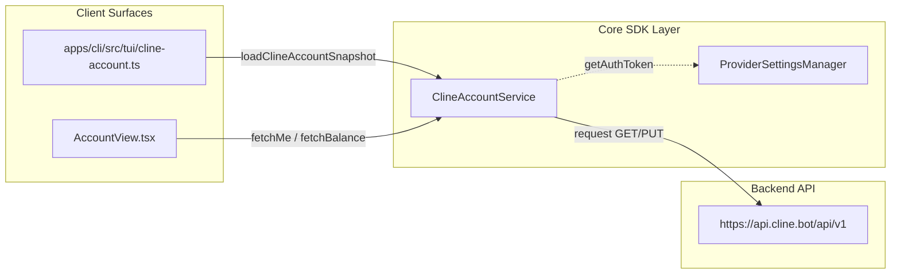
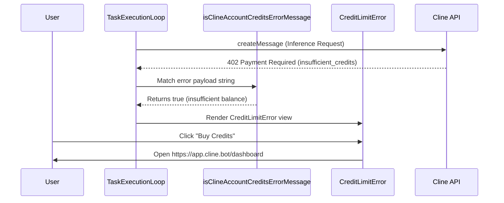

# Account Service, Credits, and ClinePass

Relevant source files

The following files were used as context for generating this wiki page:

- [apps/cli/src/commands/auth.ts](apps/cli/src/commands/auth.ts)
- [apps/cli/src/commands/dashboard.ts](apps/cli/src/commands/dashboard.ts)
- [apps/cli/src/tui/cline-account.test.ts](apps/cli/src/tui/cline-account.test.ts)
- [apps/cli/src/tui/cline-account.ts](apps/cli/src/tui/cline-account.ts)
- [apps/cli/src/tui/components/dialogs/provider-picker.tsx](apps/cli/src/tui/components/dialogs/provider-picker.tsx)
- [apps/cli/src/tui/hooks/use-account-dialog.tsx](apps/cli/src/tui/hooks/use-account-dialog.tsx)
- [apps/cli/src/tui/views/onboarding/auth.test.ts](apps/cli/src/tui/views/onboarding/auth.test.ts)
- [apps/cli/src/tui/views/onboarding/auth.ts](apps/cli/src/tui/views/onboarding/auth.ts)
- [apps/cli/src/wizards/mcp/oauth.ts](apps/cli/src/wizards/mcp/oauth.ts)
- [docs/api/models.mdx](docs/api/models.mdx)
- [docs/assets/clinepass/clinepass-cli.png](docs/assets/clinepass/clinepass-cli.png)
- [docs/assets/clinepass/clinepass-ide-extension.png](docs/assets/clinepass/clinepass-ide-extension.png)
- [docs/cline-overview.mdx](docs/cline-overview.mdx)
- [docs/core-workflows/task-management.mdx](docs/core-workflows/task-management.mdx)
- [docs/customization/clineignore.mdx](docs/customization/clineignore.mdx)
- [docs/customization/hooks.mdx](docs/customization/hooks.mdx)
- [docs/features/multiroot-workspace.mdx](docs/features/multiroot-workspace.mdx)
- [docs/getting-started/authorizing-with-cline.mdx](docs/getting-started/authorizing-with-cline.mdx)
- [docs/getting-started/cline-provider.mdx](docs/getting-started/cline-provider.mdx)
- [docs/getting-started/clinepass.mdx](docs/getting-started/clinepass.mdx)
- [docs/getting-started/installing-cline.mdx](docs/getting-started/installing-cline.mdx)
- [docs/provider-config/minimax.mdx](docs/provider-config/minimax.mdx)
- [docs/usage/ide.mdx](docs/usage/ide.mdx)
- [sdk/examples/hooks/PreToolUse_ClineignoreGuard.sh](sdk/examples/hooks/PreToolUse_ClineignoreGuard.sh)
- [sdk/examples/hooks/README.md](sdk/examples/hooks/README.md)
- [sdk/packages/core/src/account/cline-account-service.test.ts](sdk/packages/core/src/account/cline-account-service.test.ts)
- [sdk/packages/core/src/account/cline-account-service.ts](sdk/packages/core/src/account/cline-account-service.ts)
- [sdk/packages/core/src/account/featurebase-token.test.ts](sdk/packages/core/src/account/featurebase-token.test.ts)
- [sdk/packages/core/src/account/index.ts](sdk/packages/core/src/account/index.ts)
- [sdk/packages/core/src/account/rpc.test.ts](sdk/packages/core/src/account/rpc.test.ts)
- [sdk/packages/core/src/account/rpc.ts](sdk/packages/core/src/account/rpc.ts)
- [sdk/packages/core/src/account/types.ts](sdk/packages/core/src/account/types.ts)

This page documents the technical implementation of the Cline account service, credit and usage tracking systems, organizations, and the ClinePass subscription model. It details how credit balances, usage transactions, payment transactions, and organization contexts are fetched from the backend via `ClineAccountService`, managed within application states across the SDK, CLI, and desktop surfaces, and displayed to users.

For the authentication flow that establishes the user session required by these features, see [11.1 Authentication System](). For the remote configuration logic and feature flags, see [11.3 Remote Configuration]() and [11.4 Feature Flags and Banners]().

---

## Purpose and Scope

The account subsystem provides the foundational plumbing for cloud-backed authentication, credit-based billing (Cline credits), and subscription flat-rate tiers (ClinePass). Its responsibilities include:
- Managing REST requests against the Cline backend API via `ClineAccountService` defined in `sdk/packages/core/src/account/cline-account-service.ts` [sdk/packages/core/src/account/cline-account-service.ts:70-92]().
- Supporting multi-tenant organization contexts and member ID resolution [sdk/packages/core/src/account/cline-account-service.ts:188-207]().
- Normalizing and displaying credit balances, payment histories, and usage transactions [apps/cli/src/tui/cline-account.ts:31-42]().
- Enforcing subscription plan states and surfacing usage quotas for ClinePass models [docs/getting-started/clinepass.mdx:1-125]().

Sources: [sdk/packages/core/src/account/cline-account-service.ts:70-207](), [apps/cli/src/tui/cline-account.ts:31-42](), [docs/getting-started/clinepass.mdx:1-125]()

---

## Core Architecture & `ClineAccountService`

The canonical gateway for account and billing interactions is the `ClineAccountService` class defined in `sdk/packages/core/src/account/cline-account-service.ts`. It wraps standard `fetch` calls, handles JSON envelope parsing, automatically appends Bearer tokens via `getAuthToken`, and extracts structured errors [sdk/packages/core/src/account/cline-account-service.ts:70-92]().

### Key Methods and Endpoints

| Method | Endpoint | Purpose |
|---|---|---|
| `fetchMe()` | `/api/v1/users/me` | Fetches the current authenticated user profile and their associated organizations [sdk/packages/core/src/account/cline-account-service.ts:94-96](). |
| `fetchBalance(userId)` | `/api/v1/users/${uid}/balance` | Fetches the personal credit balance for a user [sdk/packages/core/src/account/cline-account-service.ts:116-121](). |
| `fetchUsageTransactions(userId)` | `/api/v1/users/${uid}/usages` | Retrieves historical token consumption and credit deduction logs [sdk/packages/core/src/account/cline-account-service.ts:123-131](). |
| `fetchPaymentTransactions(userId)` | `/api/v1/users/${uid}/payments` | Retrieves credit purchase and fiat transaction history [sdk/packages/core/src/account/cline-account-service.ts:133-141](). |
| `fetchAvailableSubscriptionPlans(input)` | `/api/v1/plans` | Queries available individual or teams subscription plans [sdk/packages/core/src/account/cline-account-service.ts:148-158](). |
| `fetchCurrentUserPlan()` | `/api/v1/users/me/plan` | Fetches the active subscription plan (e.g., ClinePass) [sdk/packages/core/src/account/cline-account-service.ts:160-162](). |
| `fetchOrganization(orgId)` | `/api/v1/organizations/${orgId}` | Fetches organization details and settings [sdk/packages/core/src/account/cline-account-service.ts:164-174](). |
| `fetchOrganizationBalance(orgId)` | `/api/v1/organizations/${orgId}/balance` | Fetches the shared credit balance for an organization [sdk/packages/core/src/account/cline-account-service.ts:176-186](). |
| `switchAccount(orgId)` | `/api/v1/users/active-account` | Updates the active organization context via a `PUT` request [sdk/packages/core/src/account/cline-account-service.ts:209-213](). |

Title: "Account Data Flow (Code Entity Space)"

Sources: [sdk/packages/core/src/account/cline-account-service.ts:70-213](), [apps/cli/src/tui/cline-account.ts:165-215]()

---

## Organizations and Multi-Tenant Account Switching

Users may belong to multiple organizations or teams alongside their personal accounts. The system tracks tenant metadata through typed interfaces defined in `sdk/packages/core/src/account/types.ts` [sdk/packages/core/src/account/types.ts:1-17]().

### Account Entities and Types

| Interface | Key Fields | Description |
|---|---|---|
| `ClineAccountOrganization` | `organizationId`, `memberId`, `name`, `active`, `roles` | Association between user and an organization with assigned roles (`admin`, `member`, `owner`) [sdk/packages/core/src/account/types.ts:1-7](). |
| `ClineOrganization` | `id`, `name`, `remoteConfigEnabled`, `memberCount` | Detailed organization resource record [sdk/packages/core/src/account/types.ts:65-75](). |
| `ClineAccountOrganizationBalance` | `balance`, `organizationId` | Shared pool balance for team billing [sdk/packages/core/src/account/types.ts:77-80](). |

### Member ID Resolution
When fetching organization usage transactions via `fetchOrganizationUsageTransactions`, if a specific member ID is omitted, `ClineAccountService` automatically resolves the current member ID from `/users/me` [sdk/packages/core/src/account/cline-account-service.ts:188-207]().

Sources: [sdk/packages/core/src/account/types.ts:1-80](), [sdk/packages/core/src/account/cline-account-service.ts:188-207]()

---

## Credit and Usage APIs

Usage tracking differentiates between pay-as-you-go credit consumption (`ClineAccountUsageTransaction`) and fiat top-ups (`ClineAccountPaymentTransaction`) [sdk/packages/core/src/account/types.ts:36-63]().

### Transaction Interfaces

- `ClineAccountUsageTransaction`: Records individual inference executions, tracking `promptTokens`, `completionTokens`, `totalTokens`, `creditsUsed`, `costUsd`, and associated `aiModelName` [sdk/packages/core/src/account/types.ts:36-56]().
- `ClineAccountPaymentTransaction`: Records credit purchases with `amountCents`, `credits`, and `paidAt` timestamps [sdk/packages/core/src/account/types.ts:58-63]().

### Credit Limit Error Handling
When an API request fails due to exhausted funds, the backend returns an HTTP `402` status code with `insufficient_credits`. The CLI and extension intercept these errors using specific helper matchers defined in `apps/cli/src/tui/cline-account.ts` [apps/cli/src/tui/cline-account.ts:54-67]().

| Error Matcher | Target String / Code | Action |
|---|---|---|
| `isClineAccountCreditsErrorMessage` | `insufficient_credits`, `not enough credits` | Surfaces credit replenishment dialog linking to `app.cline.bot/dashboard` [apps/cli/src/tui/cline-account.ts:54-67](). |
| `isClineAccountAuthErrorMessage` | `no cline account auth token found`, `requires re-authentication` | Triggers the local OAuth refresh sequence [apps/cli/src/tui/cline-account.ts:46-52](). |

Title: "Credit Error Resolution (Natural Language to Code Space)"

Sources: [sdk/packages/core/src/account/types.ts:36-63](), [apps/cli/src/tui/cline-account.ts:44-67]()

---

## ClinePass Subscription Flows and Model Quotas

ClinePass is a flat-rate monthly subscription ($9.99/month) providing 2-5x the usage on curated open coding models compared to standard API rates [docs/getting-started/clinepass.mdx:1-12]().

### Included Models
ClinePass models operate under standard OpenAI-compatible endpoints using dedicated model slugs:

| Model | Model Slug ID |
|---|---|
| GLM-5.3 | `cline-pass/glm-5.3` [docs/getting-started/clinepass.mdx:52]() |
| Kimi K3 | `cline-pass/kimi-k3` [docs/getting-started/clinepass.mdx:54]() |
| DeepSeek V4 Pro | `cline-pass/deepseek-v4-pro` [docs/getting-started/clinepass.mdx:55]() |
| Qwen3.7 Max | `cline-pass/qwen3.7-max` [docs/getting-started/clinepass.mdx:62]() |

### Quota Tracking Windows
ClinePass evaluates consumption quotas across three rolling windows:
1. **5-hour rolling window**: Immediate traffic regulation.
2. **Weekly**: Calendar-week aggregate limit.
3. **Monthly**: Billing cycle cap [docs/getting-started/clinepass.mdx:116-125]().

Sources: [docs/getting-started/clinepass.mdx:1-125]()

---

## CLI and Desktop Account Integration

Account state is rendered in terminal environments through the CLI TUI module (`apps/cli/src/tui/cline-account.ts`) and desktop sidecar dashboards [apps/cli/src/tui/cline-account.ts:1-292]().

### Snapshot Aggregation
`loadClineAccountSnapshot` unifies profile data, organizations, and active balances [apps/cli/src/tui/cline-account.ts:163-201]() while validating OAuth credentials via `resolveValidClineAccountAuthToken` [apps/cli/src/tui/cline-account.ts:97-132]() and syncing telemetry identities via `identifyTelemetryAccount` [apps/cli/src/tui/cline-account.ts:186-191]().

Sources: [apps/cli/src/tui/cline-account.ts:97-201]()