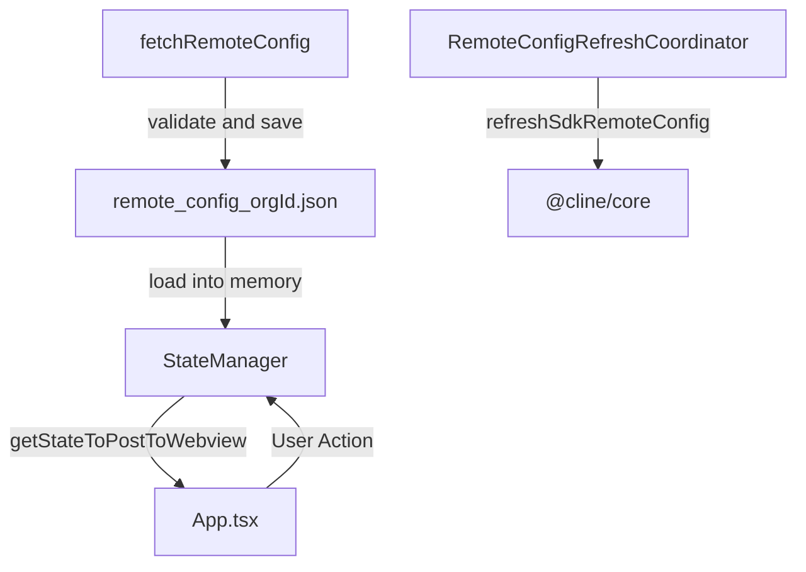
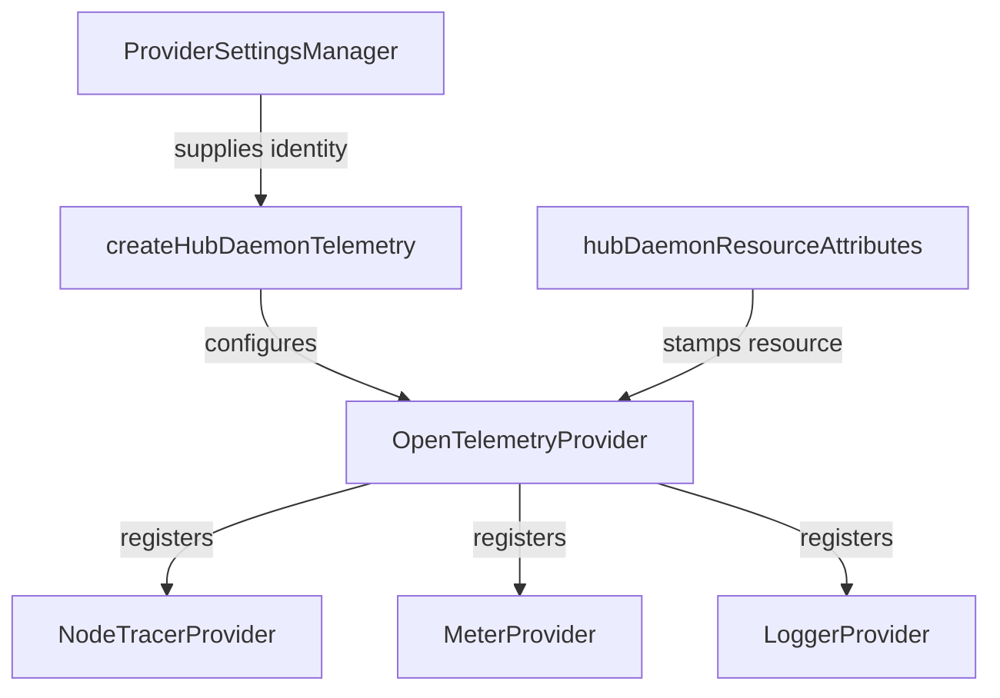
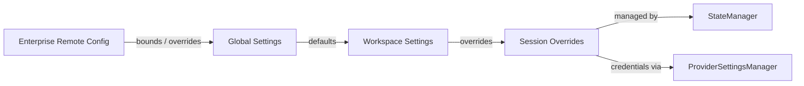
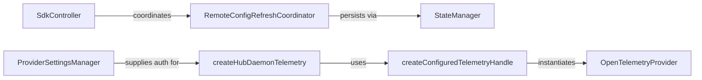

# Remote Configuration and Enterprise Policy

Relevant source files

The following files were used as context for generating this wiki page:

- [apps/examples/desktop-app/scripts/telemetry-define-args.test.ts](apps/examples/desktop-app/scripts/telemetry-define-args.test.ts)
- [apps/examples/desktop-app/scripts/telemetry-define-args.ts](apps/examples/desktop-app/scripts/telemetry-define-args.ts)
- [docs/api/authentication.mdx](docs/api/authentication.mdx)
- [docs/api/chat-completions.mdx](docs/api/chat-completions.mdx)
- [docs/api/errors.mdx](docs/api/errors.mdx)
- [docs/api/getting-started.mdx](docs/api/getting-started.mdx)
- [docs/api/overview.mdx](docs/api/overview.mdx)
- [docs/api/sdk-examples.mdx](docs/api/sdk-examples.mdx)
- [docs/cli/cli-reference.mdx](docs/cli/cli-reference.mdx)
- [docs/enterprise-solutions/api-reference.mdx](docs/enterprise-solutions/api-reference.mdx)
- [docs/mcp/mcp-overview.mdx](docs/mcp/mcp-overview.mdx)
- [docs/sdk/architecture/hub-spoke.mdx](docs/sdk/architecture/hub-spoke.mdx)
- [docs/tools-reference/all-cline-tools.mdx](docs/tools-reference/all-cline-tools.mdx)
- [docs/usage/cli-overview.mdx](docs/usage/cli-overview.mdx)
- [sdk/packages/core/src/hub/client/connection-headers.test.ts](sdk/packages/core/src/hub/client/connection-headers.test.ts)
- [sdk/packages/core/src/hub/daemon/__fixtures__/shutdown-daemon.ts](sdk/packages/core/src/hub/daemon/__fixtures__/shutdown-daemon.ts)
- [sdk/packages/core/src/hub/daemon/bind-diagnostics.test.ts](sdk/packages/core/src/hub/daemon/bind-diagnostics.test.ts)
- [sdk/packages/core/src/hub/daemon/bind-diagnostics.ts](sdk/packages/core/src/hub/daemon/bind-diagnostics.ts)
- [sdk/packages/core/src/hub/daemon/shutdown-coordinator.test.ts](sdk/packages/core/src/hub/daemon/shutdown-coordinator.test.ts)
- [sdk/packages/core/src/hub/daemon/shutdown-coordinator.ts](sdk/packages/core/src/hub/daemon/shutdown-coordinator.ts)
- [sdk/packages/core/src/hub/daemon/shutdown.e2e.test.ts](sdk/packages/core/src/hub/daemon/shutdown.e2e.test.ts)
- [sdk/packages/core/src/hub/daemon/singleton.e2e.test.ts](sdk/packages/core/src/hub/daemon/singleton.e2e.test.ts)
- [sdk/packages/core/src/hub/daemon/telemetry.test.ts](sdk/packages/core/src/hub/daemon/telemetry.test.ts)
- [sdk/packages/core/src/hub/daemon/telemetry.ts](sdk/packages/core/src/hub/daemon/telemetry.ts)
- [sdk/packages/core/src/hub/server/hub-server-options.ts](sdk/packages/core/src/hub/server/hub-server-options.ts)
- [sdk/packages/core/src/hub/server/hub-websocket-server.ts](sdk/packages/core/src/hub/server/hub-websocket-server.ts)
- [sdk/packages/core/src/services/telemetry/OpenTelemetryProvider.ts](sdk/packages/core/src/services/telemetry/OpenTelemetryProvider.ts)
- [sdk/packages/core/vitest.config.ts](sdk/packages/core/vitest.config.ts)
- [sdk/packages/core/vitest.e2e.config.ts](sdk/packages/core/vitest.e2e.config.ts)
- [sdk/packages/shared/src/remote-config/constants.ts](sdk/packages/shared/src/remote-config/constants.ts)
- [sdk/packages/shared/vitest.config.ts](sdk/packages/shared/vitest.config.ts)

Remote configuration is an enterprise-grade mechanism in Cline that enables centralized management of provider settings, model catalogs, MCP policies, telemetry pipelines, and global instructions (rules and workflows) across a deployment. This configuration is fetched from remote enterprise endpoints, validated against strict schemas, and applied via core storage and state managers to enforce uniform security and operational policies across VS Code extensions, CLI tools, and desktop applications.

---

## Remote Configuration Architecture and Data Flow

The remote configuration subsystem coordinates asynchronous retrieval, schema validation, persistence, and downstream propagation to the runtime engine. The architecture ensures that policy updates flow seamlessly from enterprise control servers down to local state stores and execution managers.

### Remote Configuration Data Flow

Sources: [apps/vscode/src/sdk/SdkController.ts:22-104]()

---

## Schema and Configuration Components

Enterprise policies are structured around several core domains, defined within shared configuration schemas and enforced by runtime coordinators.

### 1. Provider and Model Catalogs
Administrators define enterprise-approved models and vendor integrations. The core management layers utilize registries such as `ProviderSettingsManager` to govern allowed models and authentication scopes [sdk/packages/core/src/hub/daemon/telemetry.ts:104-113](). Recommended model catalogues are refreshed dynamically via backend synchronization helpers [apps/vscode/src/core/controller/models/refreshClineRecommendedModels.ts:1-70]().

### 2. MCP Policies and Server Whitelists
Enterprise control policies restrict or mandate specific Model Context Protocol (MCP) servers.
- **Allowed Servers**: Whitelists are validated through MCP coordinators [apps/vscode/src/sdk/SdkController.ts:79-79]().
- **Server Lifecycle**: The `McpHub` manages server instances, enforcing configuration rules defined in enterprise policy files [apps/vscode/src/sdk/SdkController.ts:45-45]().

### 3. Global Rules, Workflows, and Prompts
Remote policies can inject mandatory global rules, skills, and disabled workflow configurations. The extension controller utilizes command expansion routines and workflow filters to apply these rules across chat sessions and agent loops [apps/vscode/src/sdk/SdkController.ts:101-101]().

Sources: [apps/vscode/src/sdk/SdkController.ts:45-104](), [apps/vscode/src/core/controller/models/refreshClineRecommendedModels.ts:1-70]()

---

## OpenTelemetry (OTEL) Configuration and Telemetry Services

Enterprise observability is driven by OpenTelemetry integration, allowing centralized logging, tracing, and metric collection across background daemons and client execution hosts.

### OpenTelemetry Provider and Daemon Telemetry

The telemetry infrastructure is initialized via `OpenTelemetryProvider` and tailored for background daemons using `createHubDaemonTelemetry` and `hubDaemonResourceAttributes` [sdk/packages/core/src/hub/daemon/telemetry.ts:39-100](), [sdk/packages/core/src/services/telemetry/OpenTelemetryProvider.ts:165-194]().

### Observability Architecture and Code Entity Mapping

Sources: [sdk/packages/core/src/hub/daemon/telemetry.ts:39-177](), [sdk/packages/core/src/services/telemetry/OpenTelemetryProvider.ts:165-194]()

### Build-Time Inlining and Environment Controls

For packaged enterprise builds (such as desktop applications and sidecar binaries), OTEL variables and API keys are injected at build time using definition scripts like `telemetryDefineArgs` [apps/examples/desktop-app/scripts/telemetry-define-args.ts:47-67](). This ensures that telemetry endpoints and collection protocols remain strictly configured without exposing credentials in repository source files.

Sources: [apps/examples/desktop-app/scripts/telemetry-define-args.ts:30-67]()

---

## State Management, Storage, and Precedence

Enterprise configurations integrate directly with the layered settings model. Settings precedence dictates that session overrides take priority over workspace configurations, which override global user settings, which in turn are bounded by enterprise remote configuration mandates.

### Core Storage and Precedence Hierarchy

Sources: [apps/vscode/src/sdk/SdkController.ts:36-68](), [sdk/packages/core/src/hub/daemon/telemetry.ts:104-113]()

---

## Code Entity Map

### Enterprise Policy & Configuration Code Associations

Sources: [apps/vscode/src/sdk/SdkController.ts:22-68](), [sdk/packages/core/src/hub/daemon/telemetry.ts:72-100](), [sdk/packages/core/src/services/telemetry/OpenTelemetryProvider.ts:165-194]()