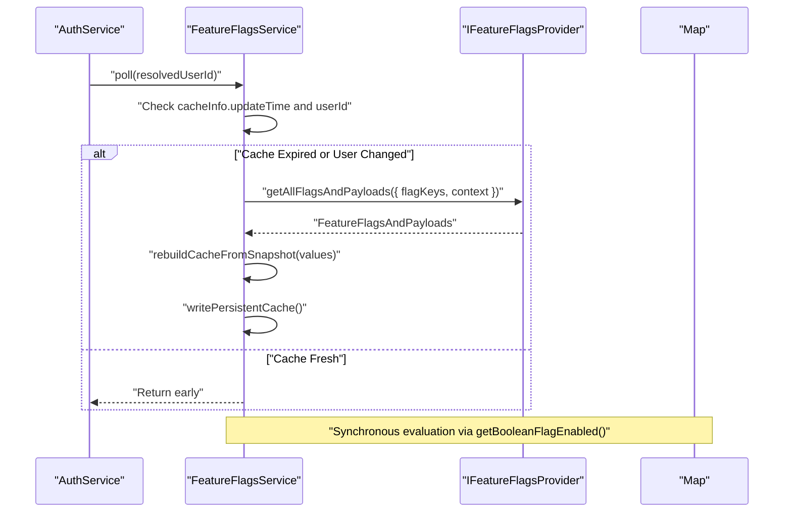
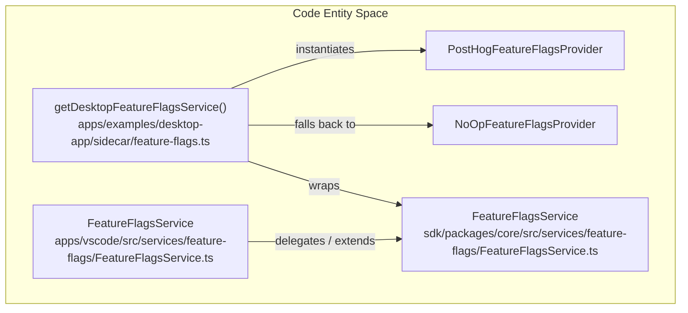
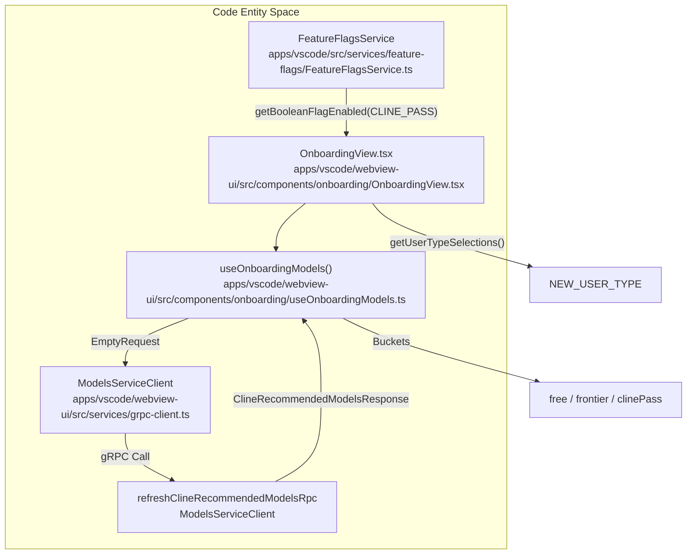

# Feature Flags and Banners

Relevant source files

The following files were used as context for generating this wiki page:

- [apps/cli/src/session/session.test.ts](apps/cli/src/session/session.test.ts)
- [apps/cli/src/session/session.ts](apps/cli/src/session/session.ts)
- [apps/examples/desktop-app/sidecar/ARCHITECTURE.md](apps/examples/desktop-app/sidecar/ARCHITECTURE.md)
- [apps/examples/desktop-app/sidecar/commands-settings.test.ts](apps/examples/desktop-app/sidecar/commands-settings.test.ts)
- [apps/examples/desktop-app/sidecar/diagnostics.test.ts](apps/examples/desktop-app/sidecar/diagnostics.test.ts)
- [apps/examples/desktop-app/sidecar/diagnostics.ts](apps/examples/desktop-app/sidecar/diagnostics.ts)
- [apps/examples/desktop-app/sidecar/feature-flags.test.ts](apps/examples/desktop-app/sidecar/feature-flags.test.ts)
- [apps/examples/desktop-app/sidecar/feature-flags.ts](apps/examples/desktop-app/sidecar/feature-flags.ts)
- [apps/examples/desktop-app/webview/components/views/settings/export-diagnostics-dialog.tsx](apps/examples/desktop-app/webview/components/views/settings/export-diagnostics-dialog.tsx)
- [apps/examples/desktop-app/webview/components/views/settings/settings-view.test.tsx](apps/examples/desktop-app/webview/components/views/settings/settings-view.test.tsx)
- [apps/vscode/src/core/controller/index.ts](apps/vscode/src/core/controller/index.ts)
- [apps/vscode/src/services/feature-flags/FeatureFlagsService.ts](apps/vscode/src/services/feature-flags/FeatureFlagsService.ts)
- [apps/vscode/webview-ui/src/App.tsx](apps/vscode/webview-ui/src/App.tsx)
- [apps/vscode/webview-ui/src/components/onboarding/OnboardingView.tsx](apps/vscode/webview-ui/src/components/onboarding/OnboardingView.tsx)
- [apps/vscode/webview-ui/src/components/onboarding/__tests__/data-models.test.ts](apps/vscode/webview-ui/src/components/onboarding/__tests__/data-models.test.ts)
- [apps/vscode/webview-ui/src/components/onboarding/__tests__/data-steps.test.ts](apps/vscode/webview-ui/src/components/onboarding/__tests__/data-steps.test.ts)
- [apps/vscode/webview-ui/src/components/onboarding/data-models.ts](apps/vscode/webview-ui/src/components/onboarding/data-models.ts)
- [apps/vscode/webview-ui/src/components/onboarding/data-steps.ts](apps/vscode/webview-ui/src/components/onboarding/data-steps.ts)
- [apps/vscode/webview-ui/src/components/onboarding/useOnboardingModels.ts](apps/vscode/webview-ui/src/components/onboarding/useOnboardingModels.ts)
- [sdk/packages/core/src/services/feature-flags/FeatureFlagsService.test.ts](sdk/packages/core/src/services/feature-flags/FeatureFlagsService.test.ts)
- [sdk/packages/core/src/services/feature-flags/FeatureFlagsService.ts](sdk/packages/core/src/services/feature-flags/FeatureFlagsService.ts)
- [sdk/packages/shared/src/feature-flags.ts](sdk/packages/shared/src/feature-flags.ts)

This page describes the technical implementation of Cline's shared feature flag system (`FeatureFlagsService`), its multi-host polling and persistent caching across the SDK, VS Code extension, and desktop sidecar, as well as the dynamic banner system and model onboarding gating.

---

## Shared Feature Flags and Definitions

Feature flags control experimental features, UI components, and backend behaviors across all delivery surfaces. The canonical flag definitions and types are maintained in shared packages.

| Flag Enum Value | String Key | Purpose |
|---|---|---|
| `CLINE_PASS` | `"ext-cline-pass"` | Enables ClinePass provider and curated model list exposure in supported clients [sdk/packages/shared/src/feature-flags.ts:1-3]() |
| `CODE_CLOUD_AGENTS` | `"code-cloud-agents"` | Makes Cloud sessions opt-in visible in the Cline Code desktop app [sdk/packages/shared/src/feature-flags.ts:4-5]() |
| `CODE_ONBOARDING_GITHUB` | `"code-onboarding-github"` | Shows the GitHub integration step in the desktop app [sdk/packages/shared/src/feature-flags.ts:6-7]() |
| `CLINE_COMPOSIO_BETA` | `"CLINE_COMPOSIO_BETA"` | Enables Composio connectors for the signed-in Cline account [sdk/packages/shared/src/feature-flags.ts:8-9]() |

The `FeatureFlagDefaultValue` dictionary maps each flag to a safe fallback value (typically `false`) when network evaluation fails or before initial polling completes [sdk/packages/shared/src/feature-flags.ts:71-78]().

Sources: [sdk/packages/shared/src/feature-flags.ts:1-80]()

---

## FeatureFlagsService Implementation and Caching

`FeatureFlagsService` manages the lifecycle of remote flags across runtimes [sdk/packages/core/src/services/feature-flags/FeatureFlagsService.ts:47-57](). It maintains an in-memory `cache` (`Map<FeatureFlag, FeatureFlagPayload | undefined>`) allowing synchronous flag evaluations in performance-sensitive paths such as UI render loops or agent execution logic.

### Polling and Identity Invalidation

The `poll(userId)` method evaluates freshness against a time-to-live (`DEFAULT_CACHE_TTL_MS`, defaulting to 1 hour). If identity changes (`userId` mismatch), the cache is purged immediately regardless of TTL [sdk/packages/core/src/services/feature-flags/FeatureFlagsService.ts:70-77]().

Sources: [sdk/packages/core/src/services/feature-flags/FeatureFlagsService.ts:47-134]()

### Persistent Cache and Hydration

To avoid gating delays during startup before network connectivity or account resolution finishes, `FeatureFlagsService` supports local disk persistence (`cacheFilePath`). When initialized, it reads the persisted snapshot, validating version compatibility and identity alignment [sdk/packages/core/src/services/feature-flags/FeatureFlagsService.ts:136-196]().

Sources: [sdk/packages/core/src/services/feature-flags/FeatureFlagsService.ts:1-216]()

---

## Runtime Deployments: SDK, VS Code, and Desktop Sidecar

Feature flag services are tailored across the different host environments in the monorepo:

### VS Code Extension Wrapper

The VS Code extension instantiates its own wrapper of `FeatureFlagsService` (`apps/vscode/src/services/feature-flags/FeatureFlagsService.ts`) which hooks into telemetry events (`$feature_flag_called`) and triggers onboarding model cache invalidation (`getClineOnboardingModels()`) whenever flags update [apps/vscode/src/services/feature-flags/FeatureFlagsService.ts:23-70]().

### Desktop Sidecar Integration

The Tauri desktop application manages feature flags via its sidecar service (`apps/examples/desktop-app/sidecar/feature-flags.ts`). It configures either a `PostHogFeatureFlagsProvider` (using `buildClinePostHogClient`) or falls back to a `NoOpFeatureFlagsProvider` when testing or when API keys are missing [apps/examples/desktop-app/sidecar/feature-flags.ts:134-163]().

Account context persistence stores user identifiers in `feature-flags-account.cline-code.json` so that flag evaluation preserves user cohorts across application restarts [apps/examples/desktop-app/sidecar/feature-flags.ts:47-116]().

Sources: [apps/vscode/src/services/feature-flags/FeatureFlagsService.ts:23-70](), [apps/examples/desktop-app/sidecar/feature-flags.ts:32-232]()

---

## Banner System

The `BannerService` fetches and evaluates dynamic in-app notification banners from the Cline backend.

* **State Integration**: Banner dismissals are persisted in `StateManager` under the `dismissedBanners` key, tracking `bannerId` and `dismissedAt` timestamps.
* **Telemetry & Context**: The service supplies hardware and IDE execution context via `HostRegistryInfo` (including `extensionVersion`, `platform`, and `ide`) to scope delivery of targeted notifications.

Sources: [apps/vscode/src/services/banner/__tests__/BannerService.test.ts:19-174]()

---

## Model Recommendations and Onboarding Gating

Model discovery and onboarding flows depend heavily on feature flags and RPC services to curate available models.

### Onboarding Flow Selection

`OnboardingView` inspects user type selections via `NEW_USER_TYPE` and `getUserTypeSelections()` to configure the setup path [apps/vscode/webview-ui/src/components/onboarding/OnboardingView.tsx:41-55](), [apps/vscode/webview-ui/src/components/onboarding/data-steps.ts:1-79]():
* `FREE`: Directs to the free model selection step [apps/vscode/webview-ui/src/components/onboarding/OnboardingView.tsx:54]().
* `POWER`: Directs to frontier model selection [apps/vscode/webview-ui/src/components/onboarding/OnboardingView.tsx:48-50]().
* `CLINE_PASS`: Triggers the ClinePass subscription and model provisioning workflow [apps/vscode/webview-ui/src/components/onboarding/OnboardingView.tsx:83-84]().

Sources: [apps/vscode/webview-ui/src/components/onboarding/OnboardingView.tsx:41-84](), [apps/vscode/webview-ui/src/components/onboarding/useOnboardingModels.ts:52-110](), [apps/vscode/webview-ui/src/components/onboarding/data-steps.ts:1-79]()

---

## Technical Reference

| Category | Constant / Symbol | Value / Purpose |
|---|---|---|
| **Feature Flags** | `DEFAULT_CACHE_TTL_MS` | `3600000` (1 Hour cache duration) [sdk/packages/core/src/services/feature-flags/FeatureFlagsService.ts:18-19]() |
| **Desktop Cache** | `DESKTOP_FEATURE_FLAGS_CACHE_MAX_AGE_MS` | `2592000000` (30 Days persistent cache age) [apps/examples/desktop-app/sidecar/feature-flags.ts:28]() |
| **Onboarding** | `CLINEPASS_GROUP` | `"cline-pass"` model group key [apps/vscode/webview-ui/src/components/onboarding/data-models.ts:22]() |
| **Storage** | `FEATURE_FLAGS_CACHE_FILE_VERSION` | `2` (Persistent cache schema version) [sdk/packages/core/src/services/feature-flags/FeatureFlagsService.ts:20]() |

Sources: [sdk/packages/core/src/services/feature-flags/FeatureFlagsService.ts:18-20](), [apps/examples/desktop-app/sidecar/feature-flags.ts:27-30](), [apps/vscode/webview-ui/src/components/onboarding/data-models.ts:1-25]()