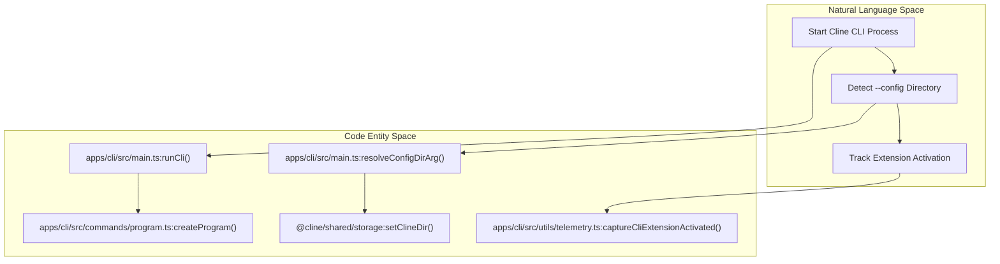
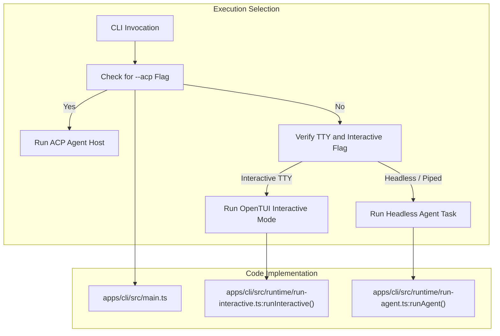

# CLI Tool

Relevant source files

The following files were used as context for generating this wiki page:

- [apps/cli/README.md](apps/cli/README.md)
- [apps/cli/src/cli.e2e.test.ts](apps/cli/src/cli.e2e.test.ts)
- [apps/cli/src/commands/dashboard-command.ts](apps/cli/src/commands/dashboard-command.ts)
- [apps/cli/src/commands/doctor.test.ts](apps/cli/src/commands/doctor.test.ts)
- [apps/cli/src/commands/doctor.ts](apps/cli/src/commands/doctor.ts)
- [apps/cli/src/commands/hub.test.ts](apps/cli/src/commands/hub.test.ts)
- [apps/cli/src/commands/hub.ts](apps/cli/src/commands/hub.ts)
- [apps/cli/src/commands/program.test.ts](apps/cli/src/commands/program.test.ts)
- [apps/cli/src/commands/program.ts](apps/cli/src/commands/program.ts)
- [apps/cli/src/kanban-migration/notice-dialog.tsx](apps/cli/src/kanban-migration/notice-dialog.tsx)
- [apps/cli/src/kanban-migration/notice.test.ts](apps/cli/src/kanban-migration/notice.test.ts)
- [apps/cli/src/kanban-migration/notice.ts](apps/cli/src/kanban-migration/notice.ts)
- [apps/cli/src/main.test.ts](apps/cli/src/main.test.ts)
- [apps/cli/src/main.ts](apps/cli/src/main.ts)
- [apps/cli/src/runtime/defaults.ts](apps/cli/src/runtime/defaults.ts)
- [apps/cli/src/runtime/interactive/chat-command-runner.test.ts](apps/cli/src/runtime/interactive/chat-command-runner.test.ts)
- [apps/cli/src/runtime/interactive/chat-command-runner.ts](apps/cli/src/runtime/interactive/chat-command-runner.ts)
- [apps/cli/src/tests/cli/history.test.ts](apps/cli/src/tests/cli/history.test.ts)
- [apps/cli/src/tests/flags.test.ts](apps/cli/src/tests/flags.test.ts)
- [apps/cli/src/tests/help.test.ts](apps/cli/src/tests/help.test.ts)
- [apps/cli/src/tests/helpers/env.ts](apps/cli/src/tests/helpers/env.ts)
- [apps/cli/src/utils/plugin-chat-commands.test.ts](apps/cli/src/utils/plugin-chat-commands.test.ts)
- [apps/cli/src/utils/team-command.ts](apps/cli/src/utils/team-command.ts)
- [apps/cline-hub/README.md](apps/cline-hub/README.md)

This section covers the standalone `cline` command-line interface published as the `@cline/cli` npm package [apps/cli/package.json:2](). The CLI provides autonomous coding agent capabilities, file creation/editing, command execution, and interactive terminal UIs [apps/cli/package.json:3-5](), sharing the underlying core engine with the VS Code extension [apps/cli/src/main.ts:75-78]().

For detailed information on individual subsystems, see the child pages:
- [CLI Architecture and Commands](#12.1) — Explain CLI bootstrap (`index.ts`/`main.ts`), command registration (`config`, `auth`, `doctor`, `hub`, `dashboard`, `plugin`, `mcp`, `team`), build via `bun.mts`, and env vars.
- [Interactive TUI](#12.2) — Describe the OpenTUI-based interactive mode: `runInteractive`, session runtime, chat entries, dialogs, config view, and slash commands.
- [CLI Onboarding and Model Selection](#12.3) — Document the onboarding controller/screens/keyboard flow, auth step, and model selector components.
- [Headless and Non-Interactive Modes](#12.4) — Document plain-text/agent runs, JSON output, stdin piping, CI usage, timeouts, and the kanban migration notice path.
- [Agent Client Protocol (ACP)](#12.5) — Explain `--acp` mode: `acpAgent`, session load/updates, auth, organizations, tool utils, and auto-approve.
- [Chat Platform Connectors](#12.6) — Document the connector host and adapters (Slack, Discord, Telegram, WhatsApp, Google Chat, Linear) and their session runtime.

---

## Overview and Architecture

The CLI is housed in `apps/cli` [apps/cli/package.json:13]() and entry points through `src/index.ts`. It utilizes `commander` via `createProgram()` in `src/main.ts` to manage subcommands and options [apps/cli/src/main.ts:175-184](). Initialization uses `@cline/shared/storage` to set configuration directories via `resolveConfigDirArg()` and launches telemetry tracking with `captureCliExtensionActivated()` [apps/cli/src/main.ts:154-174]().

Title: CLI Bootstrap and Initialization Architecture

Sources: [apps/cli/src/main.ts:108-166](), [apps/cli/src/commands/program.ts:13]()

For deep dives into command routing, bootstrap flow, and compilation scripts, see [CLI Architecture and Commands](#12.1).

---

## Execution Modes

Depending on whether a TTY is present, flags like `--acp` are passed, or arguments are supplied, the CLI selects between an interactive terminal UI, headless execution, or Agent Client Protocol (ACP) mode.

Title: CLI Execution Mode Selection Flow

Sources: [apps/cli/src/main.ts:91-96](), [apps/cli/src/runtime/run-interactive.ts]()

For detailed documentation on headless scripts, JSON outputs, and CI usage, see [Headless and Non-Interactive Modes](#12.4). For OpenTUI runtime specifics, see [Interactive TUI](#12.2).

---

## Subcommands and Options

The CLI supports administrative and operational commands such as `auth`, `config`, `history`, `connect`, and `update`. Command definitions leverage `commander` definitions [apps/cli/src/commands/program.ts:1-125]() and background daemons like the local hub [apps/cli/src/commands/hub.ts:1-149]().

| Command | Role & Code Reference |
| :--- | :--- |
| `cline auth` | Authenticates providers and saves keys [apps/cli/src/main.ts:189-204]() |
| `cline history` | Manages and lists saved past task sessions [apps/cli/src/main.test.ts:101-106]() |
| `cline config` | Adjusts stored configuration properties interactively [apps/cli/src/main.ts:200-203]() |
| `cline update` | Triggers startup checks for updates [apps/cli/src/commands/update.ts:1-18]() |

For full command routing architecture and parameter registration details, see [CLI Architecture and Commands](#12.1).

---

## Connectors and Protocols

The CLI includes built-in bridges to platforms like Slack, Discord, and Telegram [apps/cli/package.json]() via chat adapters, allowing Cline to operate as a chat bot. It also supports the Agent Client Protocol (`--acp`) [apps/cli/src/main.ts:172-174]() to interact seamlessly with external development environments.

- For details on chat connectors and their session runtimes, see [Chat Platform Connectors](#12.6).
- For details on the ACP integration, see [Agent Client Protocol (ACP)](#12.5).
- For onboarding flows and authentication wizards, see [CLI Onboarding and Model Selection](#12.3).

Sources: [apps/cli/src/main.ts:1-204](), [apps/cli/src/commands/program.ts:1-126](), [apps/cli/src/commands/hub.ts:1-55]()