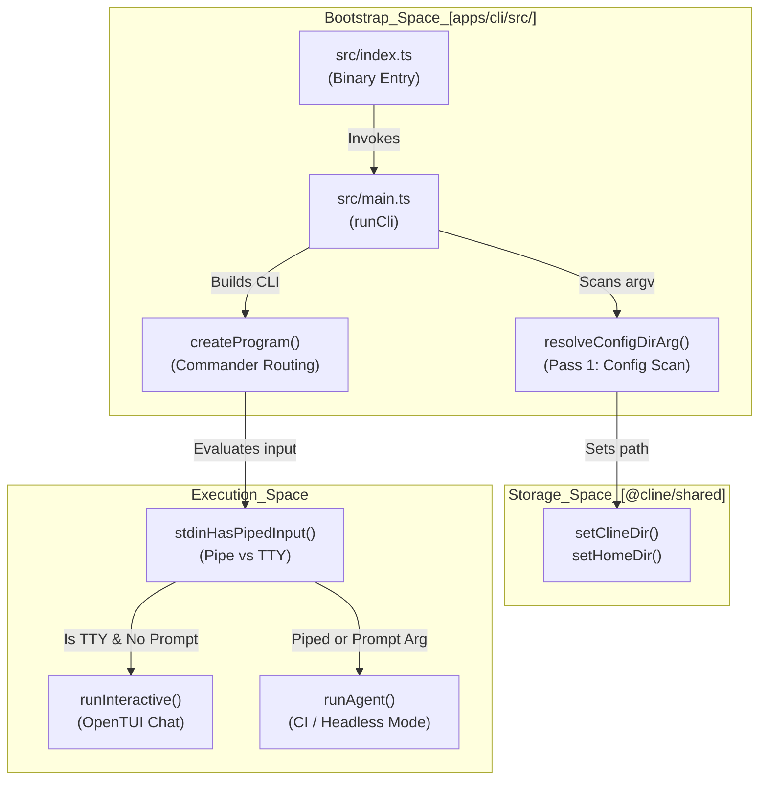
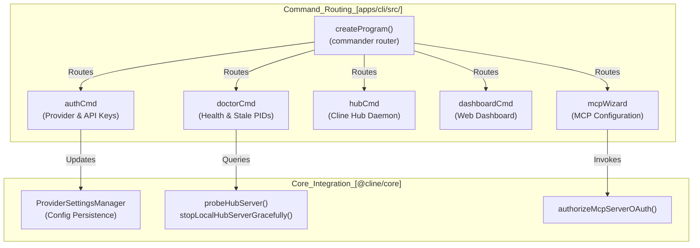

# CLI Architecture and Commands

Relevant source files

The following files were used as context for generating this wiki page:

- [apps/cli/README.md](apps/cli/README.md)
- [apps/cli/script/build.ts](apps/cli/script/build.ts)
- [apps/cli/script/compile-binary.ts](apps/cli/script/compile-binary.ts)
- [apps/cli/src/cli.e2e.test.ts](apps/cli/src/cli.e2e.test.ts)
- [apps/cli/src/commands/dashboard-command.ts](apps/cli/src/commands/dashboard-command.ts)
- [apps/cli/src/commands/doctor.test.ts](apps/cli/src/commands/doctor.test.ts)
- [apps/cli/src/commands/doctor.ts](apps/cli/src/commands/doctor.ts)
- [apps/cli/src/commands/history-command.test.ts](apps/cli/src/commands/history-command.test.ts)
- [apps/cli/src/commands/history-command.ts](apps/cli/src/commands/history-command.ts)
- [apps/cli/src/commands/hub.test.ts](apps/cli/src/commands/hub.test.ts)
- [apps/cli/src/commands/hub.ts](apps/cli/src/commands/hub.ts)
- [apps/cli/src/commands/program.test.ts](apps/cli/src/commands/program.test.ts)
- [apps/cli/src/commands/program.ts](apps/cli/src/commands/program.ts)
- [apps/cli/src/commands/schedule.test.ts](apps/cli/src/commands/schedule.test.ts)
- [apps/cli/src/commands/schedule/common.ts](apps/cli/src/commands/schedule/common.ts)
- [apps/cli/src/commands/schedule/delivery-input.test.ts](apps/cli/src/commands/schedule/delivery-input.test.ts)
- [apps/cli/src/commands/schedule/delivery-input.ts](apps/cli/src/commands/schedule/delivery-input.ts)
- [apps/cli/src/commands/schedule/handlers.ts](apps/cli/src/commands/schedule/handlers.ts)
- [apps/cli/src/commands/schedule/import-export.ts](apps/cli/src/commands/schedule/import-export.ts)
- [apps/cli/src/connectors/connector-host.ts](apps/cli/src/connectors/connector-host.ts)
- [apps/cli/src/connectors/schedule-delivery.test.ts](apps/cli/src/connectors/schedule-delivery.test.ts)
- [apps/cli/src/connectors/schedule-delivery.ts](apps/cli/src/connectors/schedule-delivery.ts)
- [apps/cli/src/kanban-migration/notice-dialog.tsx](apps/cli/src/kanban-migration/notice-dialog.tsx)
- [apps/cli/src/kanban-migration/notice.test.ts](apps/cli/src/kanban-migration/notice.test.ts)
- [apps/cli/src/kanban-migration/notice.ts](apps/cli/src/kanban-migration/notice.ts)
- [apps/cli/src/main.test.ts](apps/cli/src/main.test.ts)
- [apps/cli/src/main.ts](apps/cli/src/main.ts)
- [apps/cli/src/runtime/defaults.ts](apps/cli/src/runtime/defaults.ts)
- [apps/cli/src/runtime/interactive/chat-command-runner.test.ts](apps/cli/src/runtime/interactive/chat-command-runner.test.ts)
- [apps/cli/src/runtime/interactive/chat-command-runner.ts](apps/cli/src/runtime/interactive/chat-command-runner.ts)
- [apps/cli/src/tests/cli/history.test.ts](apps/cli/src/tests/cli/history.test.ts)
- [apps/cli/src/tests/flags.test.ts](apps/cli/src/tests/flags.test.ts)
- [apps/cli/src/tests/help.test.ts](apps/cli/src/tests/help.test.ts)
- [apps/cli/src/tests/helpers/env.ts](apps/cli/src/tests/helpers/env.ts)
- [apps/cli/src/utils/plugin-chat-commands.test.ts](apps/cli/src/utils/plugin-chat-commands.test.ts)
- [apps/cli/src/utils/team-command.ts](apps/cli/src/utils/team-command.ts)
- [apps/cline-hub/README.md](apps/cline-hub/README.md)
- [apps/examples/desktop-app/scripts/build-desktop-runtime.ts](apps/examples/desktop-app/scripts/build-desktop-runtime.ts)

This document provides a comprehensive technical reference for the Cline CLI (`@cline/cli`) [apps/cli/package.json:2-2](). It covers the application bootstrap sequence, command registration (`config`, `auth`, `doctor`, `hub`, `dashboard`, `plugin`, `mcp`, `team`), build pipeline via `bun.mts` (or `script/build.ts`), environment variables, and execution routing.

---

## CLI Bootstrap and Initialization (`index.ts` / `main.ts`)

The CLI execution flow begins at the package binary entry point defined in `apps/cli/package.json` pointing to `src/index.ts`, which invokes `runCli()` exported from `src/main.ts` [apps/cli/src/main.ts:146-203](). 

Because storage subsystems rely on the correct configuration directory (`~/.cline` or a custom override), the CLI implements a **two-pass argument scan** via `resolveConfigDirArg()` before loading storage modules or initializing global singletons [apps/cli/src/main.ts:98-123]().

Sources: [apps/cli/package.json:38-40](), [apps/cli/src/main.ts:63-71](), [apps/cli/src/main.ts:98-123](), [apps/cli/src/main.ts:146-160]()

---

## Command Registration and Subcommands

Command-line parsing and subcommand dispatch are handled using the `commander` library inside `src/commands/program.ts` [apps/cli/src/main.ts:7-13](). Each subcommand defines isolated option scopes and delegates to underlying core modules or workspace wizards.

### Core Subcommands

| Subcommand | Implementation Module | Description |
|------------|-----------------------|-------------|
| `auth` | `src/main.ts` / `src/tui/views/onboarding/auth.ts` | Authenticates AI providers, saves API keys, or launches OAuth/device-code flows [apps/cli/src/main.ts:188-203](), [apps/cli/src/tui/views/onboarding/auth.ts:26-151](). |
| `doctor` | `src/commands/doctor.ts` | Scans for stale background PIDs, active connectors, hub server health, and cleans up lock files [apps/cli/src/commands/doctor.ts:55-73](). |
| `hub` | `src/commands/hub.ts` | Manages the local Cline Hub daemon singleton and transport connections [apps/cli/src/commands/hub.ts:1-50](). |
| `dashboard` | `src/commands/dashboard-command.ts` | Launches the Cline Hub web dashboard interface [apps/cli/src/commands/dashboard-command.ts:1-49](). |
| `mcp` | `src/wizards/mcp/` | Provides interactive wizards for configuring Model Context Protocol (MCP) servers and OAuth [apps/cli/src/wizards/mcp/oauth.ts:1-45](). |
| `team` | `src/utils/team-command.ts` | Rewrites or executes multi-agent team prompts [apps/cli/src/main.ts:55-55](). |

Sources: [apps/cli/src/main.ts:188-203](), [apps/cli/src/commands/doctor.ts:1-30](), [apps/cli/src/wizards/mcp/oauth.ts:1-45]()

---

## Build System via `bun.mts` (`script/build.ts`)

The package build pipeline is orchestrated by Bun scripts defined in `apps/cli/package.json` [apps/cli/script/build.ts:1-28](). 

- **`bun run build`**: Executes `script/build.ts` to bundle application outputs and compile platform native binaries [apps/cli/script/build.ts:1-75]().
- **`bun run build:platforms`**: Compiles native executable variants across multiple operating systems and architectures (`linux`, `darwin`, `win32` for `arm64` and `x64`) via `script/build.ts` [apps/cli/script/build.ts:30-46]().
- **`bun run dev`**: Sets `CLINE_BUILD_ENV=development` and runs source files directly using Bun execution conditions.

Sources: [apps/cli/script/build.ts:1-75]()

---

## Global Options and Environment Variables

### Global Flags

The CLI accepts several top-level options that apply across subcommands or influence global initialization:

| Flag | Type | Description |
|------|------|-------------|
| `--config <dir>` | String | Overrides the default configuration directory (scanned in pass 1) [apps/cli/src/main.ts:108-121](). |
| `--data-dir <dir>` | String | Uses isolated local state at `<dir>` instead of `~/.cline` [apps/cli/src/main.ts:201-203](). |
| `-c, --cwd <path>` | String | Sets the working directory for the task session [apps/cli/src/main.ts:198-198](). |
| `-p, --provider <id>` | String | Provider ID shorthand for authentication or session config [apps/cli/src/main.ts:192-193](). |
| `-k, --apikey <key>` | String | API key supplied directly via CLI arguments [apps/cli/src/main.ts:194-194](). |
| `-m, --modelid <id>` | String | Model ID to use for the session execution [apps/cli/src/main.ts:195-195](). |
| `-b, --baseurl <url>` | String | Base URL override for custom or local LLM providers [apps/cli/src/main.ts:196-196](). |

### Environment Variables

| Variable | Description | Implementation Detail |
|----------|-------------|-----------------------|
| `CLINE_DIR` | Overrides default data storage directory path. | Applied via `setClineDir()` during bootstrap [apps/cli/src/main.ts:156-157](). |
| `CLINE_WRAPPER_PATH` | Path to CLI wrapper script. | Referenced during update checks to locate package binaries [apps/cli/src/commands/update.ts:91-93](). |
| `CLINE_GLOBAL_SETTINGS_PATH` | Path to global settings JSON file. | Loaded by core settings services for configuration persistence [apps/cli/src/main.test.ts:23-23](). |
| `CLINE_NO_AUTO_UPDATE` | Disables startup update checks. | Bypasses `autoUpdateOnStartup()` when set [apps/cli/src/commands/update.test.ts:195-195](). |
| `CLINE_FORCE_CLINE_PASS_NOTICE` | Forces display of the ClinePass startup notice. | Bypasses suppression logic in `getClineCliMigrationNotice()` [apps/cli/src/kanban-migration/notice.ts:8-10](). |
| `CLINE_DISABLE_CLINE_PASS_NOTICE` | Suppresses startup notices. | Checked by `getClineCliMigrationNotice()` [apps/cli/src/kanban-migration/notice.ts:10-10](). |

Sources: [apps/cli/src/main.ts:108-121](), [apps/cli/src/main.ts:156-157](), [apps/cli/src/main.ts:192-203](), [apps/cli/src/kanban-migration/notice.ts:8-10]()