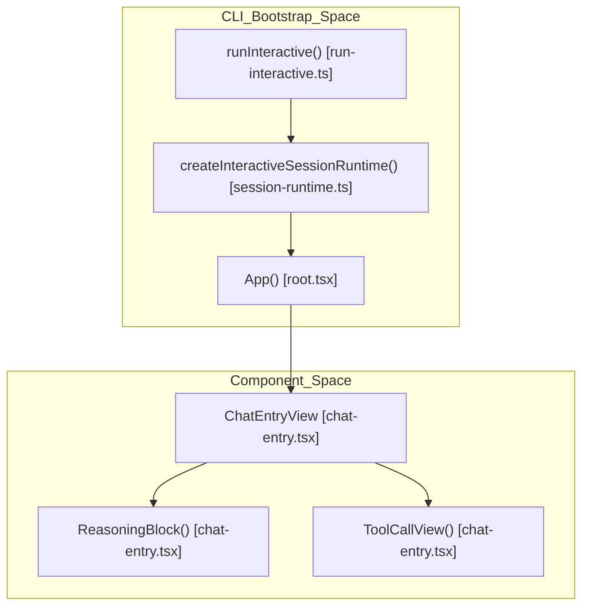
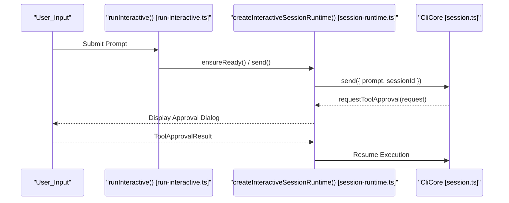

# Interactive TUI

Relevant source files

The following files were used as context for generating this wiki page:

- [apps/cli/src/cli.tuistory.e2e.test.ts](apps/cli/src/cli.tuistory.e2e.test.ts)
- [apps/cli/src/kanban-migration/notice-dialog.test.ts](apps/cli/src/kanban-migration/notice-dialog.test.ts)
- [apps/cli/src/runtime/interactive/session-runtime.test.ts](apps/cli/src/runtime/interactive/session-runtime.test.ts)
- [apps/cli/src/runtime/interactive/session-runtime.ts](apps/cli/src/runtime/interactive/session-runtime.ts)
- [apps/cli/src/runtime/run-agent.test.ts](apps/cli/src/runtime/run-agent.test.ts)
- [apps/cli/src/runtime/run-agent.ts](apps/cli/src/runtime/run-agent.ts)
- [apps/cli/src/runtime/run-interactive.ts](apps/cli/src/runtime/run-interactive.ts)
- [apps/cli/src/tui/components/chat-entry.tsx](apps/cli/src/tui/components/chat-entry.tsx)
- [apps/cli/src/tui/components/chat-message-list.tsx](apps/cli/src/tui/components/chat-message-list.tsx)
- [apps/cli/src/tui/components/dialogs/provider-picker-helpers.ts](apps/cli/src/tui/components/dialogs/provider-picker-helpers.ts)
- [apps/cli/src/tui/components/dialogs/provider-picker.test.ts](apps/cli/src/tui/components/dialogs/provider-picker.test.ts)
- [apps/cli/src/tui/hooks/local-command-actions.ts](apps/cli/src/tui/hooks/local-command-actions.ts)
- [apps/cli/src/tui/hooks/use-local-command-actions.test.ts](apps/cli/src/tui/hooks/use-local-command-actions.test.ts)
- [apps/cli/src/tui/hooks/use-local-command-actions.tsx](apps/cli/src/tui/hooks/use-local-command-actions.tsx)
- [apps/cli/src/tui/root.tsx](apps/cli/src/tui/root.tsx)
- [apps/cli/src/tui/types.ts](apps/cli/src/tui/types.ts)
- [apps/cli/src/tui/utils/compaction-status.test.ts](apps/cli/src/tui/utils/compaction-status.test.ts)
- [apps/cli/src/tui/utils/dialog-keys.test.ts](apps/cli/src/tui/utils/dialog-keys.test.ts)
- [apps/cli/src/tui/utils/dialog-keys.ts](apps/cli/src/tui/utils/dialog-keys.ts)
- [apps/cli/src/tui/utils/syntax-style.test.ts](apps/cli/src/tui/utils/syntax-style.test.ts)
- [apps/cli/src/tui/utils/syntax-style.ts](apps/cli/src/tui/utils/syntax-style.ts)
- [apps/cli/src/tui/views/chat-view.tsx](apps/cli/src/tui/views/chat-view.tsx)
- [apps/cli/src/tui/views/home-view.tsx](apps/cli/src/tui/views/home-view.tsx)
- [apps/cli/src/utils/chat-commands.ts](apps/cli/src/utils/chat-commands.ts)
- [apps/cli/src/utils/cline-pass-errors.test.ts](apps/cli/src/utils/cline-pass-errors.test.ts)
- [apps/cli/src/utils/cline-pass-errors.ts](apps/cli/src/utils/cline-pass-errors.ts)
- [sdk/packages/llms/src/providers.browser.ts](sdk/packages/llms/src/providers.browser.ts)
- [sdk/packages/llms/src/providers.ts](sdk/packages/llms/src/providers.ts)
- [sdk/packages/llms/src/providers/errors.ts](sdk/packages/llms/src/providers/errors.ts)
- [sdk/packages/llms/src/providers/format.test.ts](sdk/packages/llms/src/providers/format.test.ts)
- [sdk/packages/llms/src/providers/format.ts](sdk/packages/llms/src/providers/format.ts)

CLI Interactive Mode provides a terminal user interface (TUI) for real-time collaboration with Cline. Built using the **OpenTUI** framework (`@opentui/react`), it offers streaming message display, fuzzy file search for mentions, slash commands, and an interactive settings panel [apps/cli/src/runtime/run-interactive.ts:177-198]().

## TUI Architecture and Rendering

The TUI runs as a React application leveraging `@opentui/react` to render directly into terminal buffers with low latency [apps/cli/src/tui/components/chat-entry.tsx:1-8]().

### Rendering Strategy and Core Hooks
The rendering engine coordinates chat transcripts, tool executions, and state synchronization via several dedicated hooks and components:
1. **Event Bridge**: Subscriptions like `subscribeToAgentEvents` and `subscribeToPendingPromptEvents` translate backend `AgentEvent` and `TeamEvent` objects into UI state updates [apps/cli/src/runtime/interactive/session-runtime.ts:110-113]().
2. **Session Context**: The `createInteractiveSessionRuntime` manages session lifecycle, active session identification, and transcript recovery [apps/cli/src/runtime/interactive/session-runtime.ts:97-114]().
3. **Syntax Highlighting**: The `getSyntaxStyle` utility styles markdown and code blocks according to active terminal themes [apps/cli/src/tui/components/chat-entry.tsx:28]().
4. **Reasoning Blocks**: The `ReasoningBlock` component renders streaming "Thinking" output with collapsible states via `useState` [apps/cli/src/tui/components/chat-entry.tsx:55-128]().

Title: "CLI_TUI_Component_Hierarchy"

Sources: [apps/cli/src/runtime/run-interactive.ts:177-198](), [apps/cli/src/runtime/interactive/session-runtime.ts:97-114](), [apps/cli/src/tui/components/chat-entry.tsx:55-230](), [apps/cli/src/tui/root.tsx:93-117]()

## Input and Navigation

The interactive mode supports advanced input processing, shortcut bindings, and modal dialogs.

### Slash Commands and Mentions
- **Slash Commands**: Typing `/` invokes autocomplete via `useSlashCommands` and `useAutocomplete` [apps/cli/src/tui/root.tsx:64-73](). Workflow commands are listed via `listInteractiveSlashCommands` [apps/cli/src/runtime/run-interactive.ts:193-195]().
- **Mentions**: Typing `@` surfaces workspace file indexing for context injection.
- **Local Commands**: Actions such as `/quit`, `/clear`, and `/model` route through chat command handlers [apps/cli/src/runtime/run-interactive.ts:101-144]().

### Interactive Dialogs
Modal dialogs manage complex parameter inputs:
- **Model Selector**: Invoked via `/model`, executing `applyInteractiveModelChange` to update provider configurations [apps/cli/src/runtime/run-interactive.ts:101-144]().
- **Checkpoint Picker**: Renders git-backed checkpoints for restoration workflows.
- **Account Dialog**: Manages user subscriptions and credits via `loadClineAccountSnapshot` and `switchClineAccount` [apps/cli/src/runtime/run-interactive.ts:16-20]().
- **Manual API Key Fallback**: Managed via `saveManualProviderApiKey` when OAuth flows require explicit credential entry [apps/cli/src/tui/components/dialogs/provider-picker-helpers.ts:26-49]().

Sources: [apps/cli/src/runtime/run-interactive.ts:16-144](), [apps/cli/src/runtime/run-interactive.ts:177-198](), [apps/cli/src/tui/root.tsx:64-73](), [apps/cli/src/tui/components/dialogs/provider-picker-helpers.ts:26-49]()

## Task Execution Mapping

The CLI Interactive Mode binds its TUI state to the `CliCore` backend engine via `createInteractiveSessionRuntime` [apps/cli/src/runtime/interactive/session-runtime.ts:97-114]().

### Runtime Integration
The `sessionRuntime` instantiates `createCliCore`, administers tool approvals, and applies policy hooks (`withInteractiveApprovalPolicyHook`) [apps/cli/src/runtime/interactive/session-runtime.ts:74-95]().

Title: "CLI_Interactive_Execution_Flow"

Sources: [apps/cli/src/runtime/run-interactive.ts:177-198](), [apps/cli/src/runtime/interactive/session-runtime.ts:74-114]()

## Visual Feedback and Error Handling

- **Streaming**: Token increments stream in real-time, displaying placeholder states via `ReasoningBlock` [apps/cli/src/tui/components/chat-entry.tsx:55-128]().
- **Tool Parameter Parsing**: The `formatToolParams` function extracts and formats arguments for tools like `read_files`, `run_commands`, and `editor` [apps/cli/src/tui/components/chat-entry.tsx:130-216]().
- **Error Formatting**: The `formatCliErrorMessage` function translates backend errors into user-facing prompts with corrective actions [apps/cli/src/utils/cline-pass-errors.ts:189-216]().

### Error Display Mapping

| Error Type / Helper | Code Entity / Behavior |
| :--- | :--- |
| `ClinePassLimitError` | `isClinePassLimitErrorMessage()` / `getCliClinePassLimitMessage()` [apps/cli/src/utils/cline-pass-errors.ts:131-142]() |
| `ClineFreeModelLimit` | `isClineFreeModelLimitErrorMessage()` / `getCliClineFreeModelLimitMessage()` [apps/cli/src/utils/cline-pass-errors.ts:170-187]() |
| `ClineNotSubscribed` | `isClinePassSubscriptionError()` / `getCliNotSubscribedMessage()` [apps/cli/src/utils/cline-pass-errors.ts:85-101]() |
| `FreePromotionEnded` | `isClineFreePromotionEndedErrorMessage()` / `getCliClineFreePromotionEndedMessage()` [apps/cli/src/utils/cline-pass-errors.ts:147-168]() |

Sources: [apps/cli/src/tui/components/chat-entry.tsx:130-216](), [apps/cli/src/utils/cline-pass-errors.ts:85-216]()