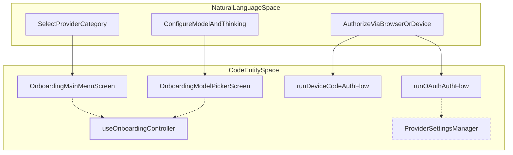
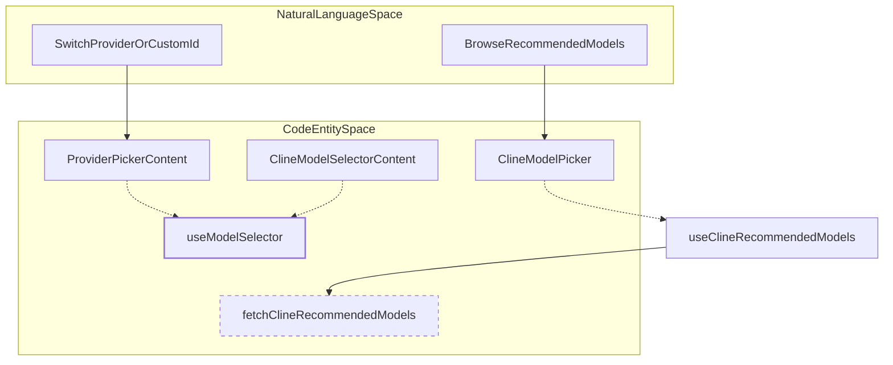

# CLI Onboarding and Model Selection

Relevant source files

The following files were used as context for generating this wiki page:

- [apps/cli/src/commands/auth.ts](apps/cli/src/commands/auth.ts)
- [apps/cli/src/commands/dashboard.ts](apps/cli/src/commands/dashboard.ts)
- [apps/cli/src/tui/components/dialogs/provider-picker.tsx](apps/cli/src/tui/components/dialogs/provider-picker.tsx)
- [apps/cli/src/tui/components/model-selector/cline-model-picker.test.ts](apps/cli/src/tui/components/model-selector/cline-model-picker.test.ts)
- [apps/cli/src/tui/components/model-selector/cline-model-picker.tsx](apps/cli/src/tui/components/model-selector/cline-model-picker.tsx)
- [apps/cli/src/tui/components/model-selector/cline-model-selector.tsx](apps/cli/src/tui/components/model-selector/cline-model-selector.tsx)
- [apps/cli/src/tui/components/model-selector/model-selector.tsx](apps/cli/src/tui/components/model-selector/model-selector.tsx)
- [apps/cli/src/tui/hooks/use-account-dialog.tsx](apps/cli/src/tui/hooks/use-account-dialog.tsx)
- [apps/cli/src/tui/hooks/use-model-selector.tsx](apps/cli/src/tui/hooks/use-model-selector.tsx)
- [apps/cli/src/tui/views/onboarding/auth.test.ts](apps/cli/src/tui/views/onboarding/auth.test.ts)
- [apps/cli/src/tui/views/onboarding/auth.ts](apps/cli/src/tui/views/onboarding/auth.ts)
- [apps/cli/src/tui/views/onboarding/controller.ts](apps/cli/src/tui/views/onboarding/controller.ts)
- [apps/cli/src/tui/views/onboarding/keyboard.ts](apps/cli/src/tui/views/onboarding/keyboard.ts)
- [apps/cli/src/tui/views/onboarding/model.test.ts](apps/cli/src/tui/views/onboarding/model.test.ts)
- [apps/cli/src/tui/views/onboarding/model.ts](apps/cli/src/tui/views/onboarding/model.ts)
- [apps/cli/src/tui/views/onboarding/screens.tsx](apps/cli/src/tui/views/onboarding/screens.tsx)
- [apps/cli/src/tui/views/onboarding/view.tsx](apps/cli/src/tui/views/onboarding/view.tsx)
- [apps/cli/src/wizards/mcp/oauth.ts](apps/cli/src/wizards/mcp/oauth.ts)
- [sdk/packages/core/src/services/llms/cline-recommended-models.test.ts](sdk/packages/core/src/services/llms/cline-recommended-models.test.ts)
- [sdk/packages/core/src/services/llms/cline-recommended-models.ts](sdk/packages/core/src/services/llms/cline-recommended-models.ts)

This page documents the architecture, component hierarchy, authentication loops, and model selection workflows of the standalone Cline CLI terminal user interface (TUI). It covers `useOnboardingController`, screen routing via `OnboardingView`, OAuth and device-code authentication flows, the `useModelSelector` hook, and curated model picker components powered by OpenTUI and `@cline/core`.

---

## 1. Onboarding Controller and State Machine

The CLI onboarding process is structured as a state machine managed by `useOnboardingController` [apps/cli/src/tui/views/onboarding/controller.ts:87-110](). It handles local provider catalogs, configuration input state, asynchronous authentication handshakes, and model resolution.

The active wizard step is typed as `OnboardingStep`, governing which screen is rendered [apps/cli/src/tui/views/onboarding/model.ts:16-28]():
* `menu`: Initial provider category selection (`OnboardingMainMenuScreen`) [apps/cli/src/tui/views/onboarding/model.ts:67-92]().
* `oauth_pending` / `device_code`: Browser-based OAuth or terminal device code authorization flows.
* `byo_provider` / `byo_apikey`: Bring-your-own-key provider search and credential entry.
* `local_cli_setup`: Local executable detection for specialized providers.
* `cline_model` / `model_picker` / `custom_model_id`: Model tier selection and custom endpoint binding.
* `thinking_level`: Extended reasoning configuration (`ThinkingLevel`) [apps/cli/src/tui/views/onboarding/model.ts:30-43]().
* `done`: Terminal success state.

### Natural Language to Code Entity Mapping: Onboarding Flow

Sources: [apps/cli/src/tui/views/onboarding/controller.ts:87-110](), [apps/cli/src/tui/views/onboarding/model.ts:16-92](), [apps/cli/src/tui/views/onboarding/auth.ts:26-151]()

---

## 2. Screen Hierarchy and Rendering

The view layer is centralized in `OnboardingView`, which reads the controller state and renders the appropriate OpenTUI-backed screen component [apps/cli/src/tui/views/onboarding/view.tsx:28-193]().

| Step State | Screen Component | Key Props / Responsibilities |
| :--- | :--- | :--- |
| `menu` | `OnboardingMainMenuScreen` | Renders `MAIN_MENU` options (`cline`, `cline-pass`, `openai-codex`, `byo`) [apps/cli/src/tui/views/onboarding/model.ts:67-92]() |
| `oauth_pending` | `OnboardingOAuthPendingScreen` | Displays spinner, status message, and direct URL fallback [apps/cli/src/tui/views/onboarding/screens.tsx:113-171]() |
| `device_code` | `OnboardingDeviceCodeScreen` | Renders device user code and verification URI [apps/cli/src/tui/views/onboarding/screens.tsx:173-245]() |
| `byo_apikey` | `OnboardingProviderConfigScreen` | Renders dynamic configuration fields via `FIELD_ORDER` |
| `model_picker` | `OnboardingModelPickerScreen` | Filterable model list utilizing `useSearchableList` |
| `thinking_level` | `OnboardingThinkingLevelScreen` | Prompt for reasoning effort selection (`none`, `low`, `medium`, `high`, `xhigh`) |

Sources: [apps/cli/src/tui/views/onboarding/view.tsx:28-193](), [apps/cli/src/tui/views/onboarding/screens.tsx:113-245](), [apps/cli/src/tui/views/onboarding/model.ts:30-43]()

---

## 3. Authentication Flows

Authentication for OAuth and device-code providers is decoupled into specialized handlers within `apps/cli/src/tui/views/onboarding/auth.ts` [apps/cli/src/tui/views/onboarding/auth.ts:26-151]().

* **`runOAuthAuthFlow`**: Invokes `loginLocalProvider` from `@cline/core` with a callback to capture the generated authorization URL, opens the browser using `open(url)`, and saves credentials via `saveLocalProviderOAuthCredentials` upon success [apps/cli/src/tui/views/onboarding/auth.ts:26-77](). For Cline accounts, it also registers the account with feature flags via `identifyFeatureFlagsAccount` [apps/cli/src/tui/views/onboarding/auth.ts:64-69]().
* **`runDeviceCodeAuthFlow`**: Executes `startClineDeviceAuth` to retrieve the device code and verification URI, displays them in `OnboardingDeviceCodeScreen`, and polls via `completeClineDeviceAuth` [apps/cli/src/tui/views/onboarding/auth.ts:79-151]().

Sources: [apps/cli/src/tui/views/onboarding/auth.ts:26-151](), [apps/cli/src/tui/views/onboarding/auth.test.ts:47-209]()

---

## 4. Model Selector Components and Recommendation Logic

Model selection in the CLI is handled through curated recommendations and searchable picker dialogs.

* **`useClineRecommendedModels`**: Fetches curated model metadata asynchronously using `fetchClineRecommendedModels` from `@cline/core` [apps/cli/src/tui/components/model-selector/cline-model-picker.tsx:34-53]().
* **`ClineModelPicker`**: Renders hierarchical model tiers (e.g., free, best, act) with tag styling (`tagColor`) and current model indicators [apps/cli/src/tui/components/model-selector/cline-model-picker.tsx:55-159]().
* **`ClineModelSelectorContent`**: Manages keyboard events (`up`, `down`, `tab`, `enter`, `escape`) within the model selection dialog, allowing users to toggle focus to the provider row or browse all models [apps/cli/src/tui/components/model-selector/cline-model-selector.tsx:28-136]().
* **`useModelSelector`**: Orchestrates interactive provider switching (`runProviderChange`), model list refreshing (`refreshCurrentProviderModels`), and custom model ID dialog entry for OpenAI-compatible endpoints [apps/cli/src/tui/hooks/use-model-selector.tsx:48-215]().

### Natural Language to Code Entity Mapping: Model Selection

Sources: [apps/cli/src/tui/hooks/use-model-selector.tsx:48-215](), [apps/cli/src/tui/components/model-selector/cline-model-picker.tsx:34-159](), [apps/cli/src/tui/components/model-selector/cline-model-selector.tsx:28-136]()

---

## 5. Keyboard Navigation and Interaction

TUI navigation across onboarding screens and dialogs relies on `useDialogKeyboard` and `useOnboardingKeyboard`. These hooks translate terminal key codes (`escape`, `return`, `up`, `down`, `tab`) into state mutations, enabling smooth mouse and keyboard traversal across input fields, lists, and confirmation buttons without blocking the event loop [apps/cli/src/tui/components/dialogs/provider-picker.tsx:116-137](), [apps/cli/src/tui/components/model-selector/cline-model-selector.tsx:99-136]().

Sources: [apps/cli/src/tui/components/dialogs/provider-picker.tsx:116-137](), [apps/cli/src/tui/components/model-selector/cline-model-selector.tsx:99-136]()