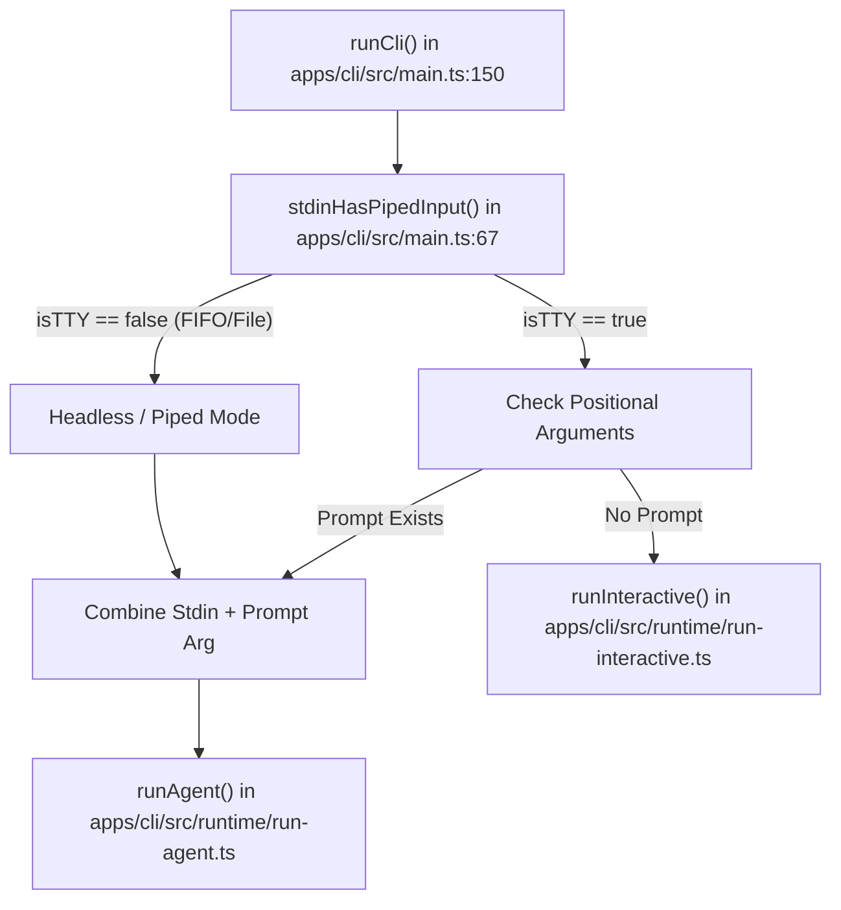
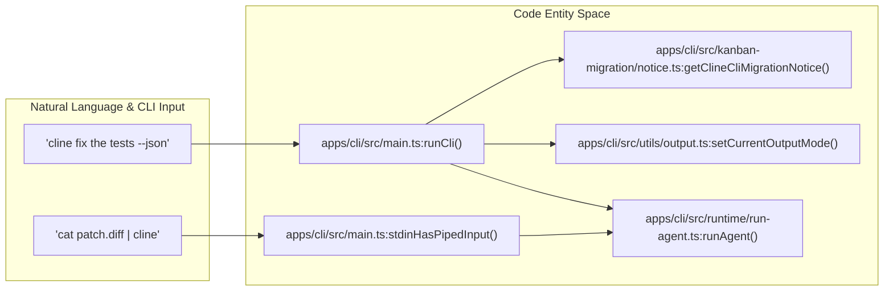
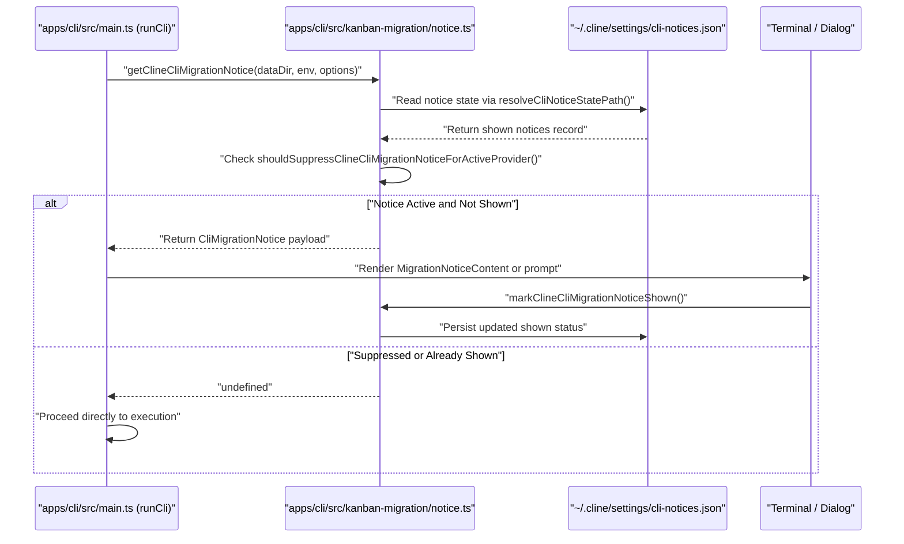

# Headless and Non-Interactive Modes

Relevant source files

The following files were used as context for generating this wiki page:

- [apps/cli/README.md](apps/cli/README.md)
- [apps/cli/src/cli.e2e.test.ts](apps/cli/src/cli.e2e.test.ts)
- [apps/cli/src/commands/dashboard-command.ts](apps/cli/src/commands/dashboard-command.ts)
- [apps/cli/src/commands/doctor.test.ts](apps/cli/src/commands/doctor.test.ts)
- [apps/cli/src/commands/doctor.ts](apps/cli/src/commands/doctor.ts)
- [apps/cli/src/commands/hub.test.ts](apps/cli/src/commands/hub.test.ts)
- [apps/cli/src/commands/hub.ts](apps/cli/src/commands/hub.ts)
- [apps/cli/src/commands/program.test.ts](apps/cli/src/commands/program.test.ts)
- [apps/cli/src/commands/program.ts](apps/cli/src/commands/program.ts)
- [apps/cli/src/kanban-migration/notice-dialog.tsx](apps/cli/src/kanban-migration/notice-dialog.tsx)
- [apps/cli/src/kanban-migration/notice.test.ts](apps/cli/src/kanban-migration/notice.test.ts)
- [apps/cli/src/kanban-migration/notice.ts](apps/cli/src/kanban-migration/notice.ts)
- [apps/cli/src/main.test.ts](apps/cli/src/main.test.ts)
- [apps/cli/src/main.ts](apps/cli/src/main.ts)
- [apps/cli/src/runtime/defaults.ts](apps/cli/src/runtime/defaults.ts)
- [apps/cli/src/runtime/interactive/chat-command-runner.test.ts](apps/cli/src/runtime/interactive/chat-command-runner.test.ts)
- [apps/cli/src/runtime/interactive/chat-command-runner.ts](apps/cli/src/runtime/interactive/chat-command-runner.ts)
- [apps/cli/src/runtime/run-agent.test.ts](apps/cli/src/runtime/run-agent.test.ts)
- [apps/cli/src/runtime/run-agent.ts](apps/cli/src/runtime/run-agent.ts)
- [apps/cli/src/tests/cli/history.test.ts](apps/cli/src/tests/cli/history.test.ts)
- [apps/cli/src/tests/flags.test.ts](apps/cli/src/tests/flags.test.ts)
- [apps/cli/src/tests/help.test.ts](apps/cli/src/tests/help.test.ts)
- [apps/cli/src/tests/helpers/env.ts](apps/cli/src/tests/helpers/env.ts)
- [apps/cli/src/tui/components/chat-entry.tsx](apps/cli/src/tui/components/chat-entry.tsx)
- [apps/cli/src/utils/cline-pass-errors.test.ts](apps/cli/src/utils/cline-pass-errors.test.ts)
- [apps/cli/src/utils/cline-pass-errors.ts](apps/cli/src/utils/cline-pass-errors.ts)
- [apps/cli/src/utils/plugin-chat-commands.test.ts](apps/cli/src/utils/plugin-chat-commands.test.ts)
- [apps/cli/src/utils/team-command.ts](apps/cli/src/utils/team-command.ts)
- [apps/cline-hub/README.md](apps/cline-hub/README.md)
- [sdk/packages/llms/src/providers.browser.ts](sdk/packages/llms/src/providers.browser.ts)
- [sdk/packages/llms/src/providers.ts](sdk/packages/llms/src/providers.ts)
- [sdk/packages/llms/src/providers/errors.ts](sdk/packages/llms/src/providers/errors.ts)
- [sdk/packages/llms/src/providers/format.test.ts](sdk/packages/llms/src/providers/format.test.ts)
- [sdk/packages/llms/src/providers/format.ts](sdk/packages/llms/src/providers/format.ts)

## Purpose and Scope

This document describes the non-interactive (headless) execution mode of the Cline CLI (`apps/cli`), designed for automation, continuous integration (CI/CD), scripting environments, and programmatic piped execution. Headless mode allows Cline to execute tasks without requiring a terminal UI or user interaction, leveraging the underlying agent infrastructure through `runAgent()` [apps/cli/src/main.ts:87](). 

This page also documents stream protection guards, output mode serialization (such as NDJSON), timeout handling, and the Kanban / CLI migration notice path (`getClineCliMigrationNotice`) [apps/cli/src/kanban-migration/notice.ts:109-136]() that manages promotional and migration prompts across CLI startups.

For information about the CLI's interactive terminal UI, see [CLI Interactive Mode](). For overall CLI architecture and host provider implementation, see [CLI Architecture]().

Sources: [apps/cli/src/main.ts:87](), [apps/cli/src/kanban-migration/notice.ts:109-136]()

---

## Overview and Execution Modes

The Cline CLI operates in several distinct modes depending on environment detection, flags, and `stdin` streams as defined in option parsing routines [apps/cli/src/commands/program.ts:128-143]():

| Mode | Use Case | UI / Output Channel | Interaction |
|------|----------|-----|-------------|
| **Interactive** | Local development | Ink/OpenTUI-based TUI via `runInteractive()` [apps/cli/src/main.ts:95-98]() | Full (Slash commands, mentions) |
| **Headless (One-shot)** | Scripting, CLI piping | Plain text output to `stdout` via `runAgent()` [apps/cli/src/main.ts:87]() | Optional tool approvals / auto-approve |
| **YOLO** | Autonomous automation | Plain text / JSON output | None (`--auto-approve` / YOLO flag) [apps/cli/src/commands/program.ts:28-31]() |
| **JSON** | Downstream tool piping | NDJSON events via `emitJsonLine` | None [apps/cli/src/commands/program.ts:32]() |

Headless mode is engaged when a prompt is provided as a positional argument [apps/cli/src/commands/program.ts:118-121]() or when input is piped directly from `stdin` [apps/cli/src/main.ts:67-75]().

Sources: [apps/cli/src/main.ts:67-75](), [apps/cli/src/main.ts:87](), [apps/cli/src/main.ts:95-98](), [apps/cli/src/commands/program.ts:28-47](), [apps/cli/src/commands/program.ts:118-143]()

---

## TTY Detection and Input Handling

The CLI determines whether to treat input as an interactive session or a headless execution by inspecting the TTY status of `process.stdin`.

Title: CLI Input Resolution Logic Bridging Code Entities
Sources: [apps/cli/src/main.ts:67-75](), [apps/cli/src/main.ts:87](), [apps/cli/src/main.ts:95-98](), [apps/cli/src/main.ts:150-164]()

### TTY Check Implementation
The function `stdinHasPipedInput()` uses `fstatSync(0)` to inspect file descriptor `0` (`stdin`) to check if it represents a FIFO pipe or a regular file [apps/cli/src/main.ts:67-75](). This behavior is verified in unit tests by stubbing `fstatSync` [apps/cli/src/main.test.ts:14-18]().

Sources: [apps/cli/src/main.ts:67-75](), [apps/cli/src/main.test.ts:14-18]()

---

## Headless Task Execution and Code Entity Mapping

The mapping between user invocation intents, configuration resolution, and execution functions bridges natural language requirements to specific runtime code modules.

Title: Natural Language to Code Entity Mapping for Headless Runs
Sources: [apps/cli/src/main.ts:67-75](), [apps/cli/src/main.ts:87](), [apps/cli/src/main.ts:150-164](), [apps/cli/src/kanban-migration/notice.ts:109-136]()

---

## Output Modes, JSON Serialization, and Timeouts

### Plain Text vs JSON Output
Output formatting is controlled via `setCurrentOutputMode()` [apps/cli/src/main.ts:41-46]().
- **Plain Text**: Standard human-readable output written to `stdout`.
- **JSON Output**: Enabled via flags (such as `--json`), triggering NDJSON (Newline Delimited JSON) emission using `emitJsonLine` for programmatic parsing by CI runners and external wrappers [apps/cli/README.md:105-107]().

### Stream Guard and Error Handling
The CLI installs stream error guards via `installStreamErrorGuards()` during bootstrap to prevent unhandled background stream rejections from crashing headless execution [apps/cli/src/main.ts:41-46](). Errors encountered during headless execution (such as model limit breaches or subscription blocks) are formatted using `formatCliErrorMessage()` in `apps/cli/src/utils/cline-pass-errors.ts` [apps/cli/src/utils/cline-pass-errors.ts:189-216]().

Validation of headless parameters—such as rejecting `--json` without prompts or piped input [apps/cli/src/cli.e2e.test.ts:181-194]() and validating timeout arguments [apps/cli/src/cli.e2e.test.ts:173-179]—is enforced at startup through `commanderToParsedArgs()` [apps/cli/src/commands/program.ts:128-172]().

Sources: [apps/cli/src/main.ts:41-46](), [apps/cli/src/commands/program.ts:128-172](), [apps/cli/src/utils/cline-pass-errors.ts:189-216](), [apps/cli/src/cli.e2e.test.ts:173-194]()

---

## Kanban and CLI Migration Notice Path

When starting the CLI (both interactive and headless), the initialization sequence checks whether to display migration or promotional notices (such as the ClinePass introduction or the Cline Desktop launch announcement) [apps/cli/src/kanban-migration/notice.ts:109-136]().

Title: CLI Migration Notice Resolution Flow
Sources: [apps/cli/src/kanban-migration/notice.ts:94-152](), [apps/cli/src/kanban-migration/notice-dialog.tsx:31-89]()

### Key Migration Notice Functions
- `getClineCliMigrationNotice(...)`: Evaluates environment variables (`CLINE_FORCE_CLINE_PASS_NOTICE`, `CLINE_DISABLE_CLINE_PASS_NOTICE`) and persisted state to select at most one unshown notice per launch [apps/cli/src/kanban-migration/notice.ts:109-136]().
- `shouldSuppressClineCliMigrationNoticeForActiveProvider(...)`: Suppresses the ClinePass promo notice if the active provider is already `cline-pass` and no override flag is set [apps/cli/src/kanban-migration/notice.ts:94-101]().
- `markClineCliMigrationNoticeShown(...)`: Records notice acknowledgment in `cli-notices.json` under the user configuration directory [apps/cli/src/kanban-migration/notice.ts:138-152]().

Sources: [apps/cli/src/kanban-migration/notice.ts:94-152](), [apps/cli/src/kanban-migration/notice-dialog.tsx:31-89]()

---

## CI/CD Integration Patterns

### Stdin Piping and Automation
Headless mode supports piping context or patch data directly into `stdin`. The CLI captures this data and concatenates it with positional arguments [apps/cli/src/main.ts:67-75]().

### Checkpoints and Worktrees
For automated CI pipelines, Cline can manage isolated git worktrees via `createTaskWorktree` to ensure changes do not collide with concurrent pipeline steps [apps/cli/src/main.test.ts:98-100]().

Sources: [apps/cli/src/main.ts:67-75](), [apps/cli/src/main.test.ts:98-100]()