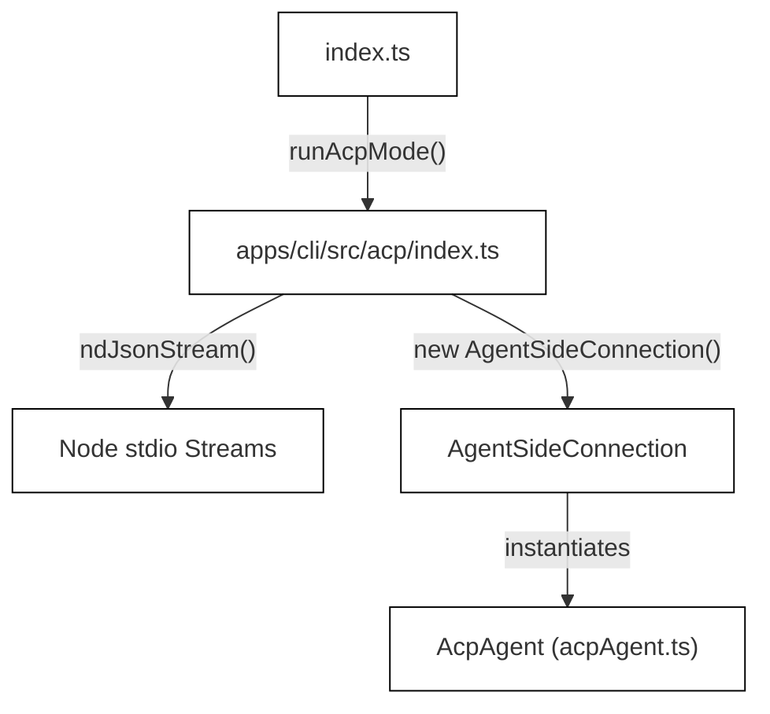
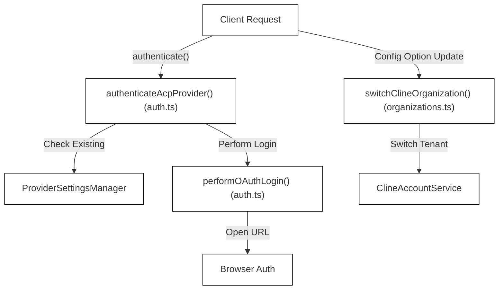

# Agent Client Protocol (ACP)

Relevant source files

The following files were used as context for generating this wiki page:

- [apps/cli/src/acp/acpAgent.ts](apps/cli/src/acp/acpAgent.ts)
- [apps/cli/src/acp/auth.ts](apps/cli/src/acp/auth.ts)
- [apps/cli/src/acp/auto-approve.test.ts](apps/cli/src/acp/auto-approve.test.ts)
- [apps/cli/src/acp/auto-approve.ts](apps/cli/src/acp/auto-approve.ts)
- [apps/cli/src/acp/index.ts](apps/cli/src/acp/index.ts)
- [apps/cli/src/acp/organizations.test.ts](apps/cli/src/acp/organizations.test.ts)
- [apps/cli/src/acp/organizations.ts](apps/cli/src/acp/organizations.ts)
- [apps/cli/src/acp/reasoning.test.ts](apps/cli/src/acp/reasoning.test.ts)
- [apps/cli/src/acp/session-load.test.ts](apps/cli/src/acp/session-load.test.ts)
- [apps/cli/src/acp/session-load.ts](apps/cli/src/acp/session-load.ts)
- [apps/cli/src/utils/cline-client-identity.ts](apps/cli/src/utils/cline-client-identity.ts)
- [apps/cli/src/utils/free-model-cost.test.ts](apps/cli/src/utils/free-model-cost.test.ts)
- [apps/cli/src/utils/free-model-cost.ts](apps/cli/src/utils/free-model-cost.ts)
- [apps/cline-hub/src/server/session-mapping.test.ts](apps/cline-hub/src/server/session-mapping.test.ts)
- [apps/cline-hub/src/webview/src/components/views/page-layout.tsx](apps/cline-hub/src/webview/src/components/views/page-layout.tsx)
- [apps/cline-hub/src/webview/src/components/views/settings/provider-list-view.tsx](apps/cline-hub/src/webview/src/components/views/settings/provider-list-view.tsx)
- [apps/vscode/src/services/ClineClientIdentity.test.ts](apps/vscode/src/services/ClineClientIdentity.test.ts)
- [apps/vscode/src/services/ClineClientIdentity.ts](apps/vscode/src/services/ClineClientIdentity.ts)
- [docs/usage/acp.mdx](docs/usage/acp.mdx)

This page covers the Agent Client Protocol (ACP) integration in the Cline CLI (`apps/cli/src/acp/`) [apps/cli/src/acp/index.ts:11-35](). It details how `--acp` mode is initialized, how `AcpAgent` implements the ACP `Agent` interface [apps/cli/src/acp/acpAgent.ts:111-128](), session loading and updates, authentication, organization billing, tool utilities, and auto-approval mechanisms.

For standard CLI interactive mode, see [12.3](). For headless/non-interactive mode, see [12.4](). For general CLI architecture, see [12.1]().

---

## 1. Overview and Activation

ACP mode allows the Cline CLI to operate as an embedded agent server driven by external editors (such as Zed, JetBrains IDEs, Neovim, and Emacs) via the Agent Client Protocol [docs/usage/acp.mdx:4-8](). Rather than rendering an interactive terminal UI (TUI) via Ink, Cline exposes a structured JSON-RPC request/response interface over `stdio` using NDJSON streams [apps/cli/src/acp/index.ts:11-35]().

### Bootstrap and Entry Point

The ACP runner is invoked via `runAcpMode()` in `apps/cli/src/acp/index.ts` [apps/cli/src/acp/index.ts:11-35](). It registers the client identity as `cline-acp`, creates an `ndJsonStream` over `process.stdout` and `process.stdin`, and initializes an `AgentSideConnection` wrapping an `AcpAgent` instance [apps/cli/src/acp/index.ts:17-31]().

*Diagram: Natural Language Space to Code Entity Space mapping for ACP initialization.*

Sources: [apps/cli/src/acp/index.ts:11-35]()

---

## 2. AcpAgent and Session Management

The `AcpAgent` class (defined in `apps/cli/src/acp/acpAgent.ts`) implements the `@agentclientprotocol/sdk` `Agent` interface [apps/cli/src/acp/acpAgent.ts:111-128](). It tracks conversation sessions via an internal `Map<string, SessionState>` [apps/cli/src/acp/acpAgent.ts:78-112]().

### SessionState Interface
Each active session maintains state in `SessionState` [apps/cli/src/acp/acpAgent.ts:78-109]():
- `id`: Unique session identifier string [apps/cli/src/acp/acpAgent.ts:79-79]().
- `cwd`: Current working directory for tool execution [apps/cli/src/acp/acpAgent.ts:80-80]().
- `currentMode`: `"plan"` (read-only exploration) or `"act"` (full modification) [apps/cli/src/acp/acpAgent.ts:82-83]().
- `currentProviderId` & `currentModelId`: Scoped LLM provider and model [apps/cli/src/acp/acpAgent.ts:84-87]().
- `autoApproveTools`: Boolean flag bypassing client confirmation prompts when `true` [apps/cli/src/acp/acpAgent.ts:88-89]().
- `sessionManager`: Active `ClineCore` instance managing the runtime loop [apps/cli/src/acp/acpAgent.ts:90-93]().
- `abortController`: Controls cancellation of in-flight prompts [apps/cli/src/acp/acpAgent.ts:94-95]().

### Lifecycle Methods
- `initialize(_params)`: Returns protocol version, agent capabilities (`loadSession`, image input support), agent info from `getCliBuildInfo()`, and supported auth methods [apps/cli/src/acp/acpAgent.ts:130-152]().
- `isSessionReady()`: Validates authentication state, attempting credential restoration via `tryRestoreAuth()` before throwing `RequestError.authRequired` [apps/cli/src/acp/acpAgent.ts:154-168]().
- `newSession(params)`: Allocates a session ID via `randomSessionId()`, resolves provider models, selects the default model, and registers the `SessionState` [apps/cli/src/acp/acpAgent.ts:186-217]().
- `loadSession`: Loads persisted conversation histories and invokes `replaySessionHistory` to transmit historical entries as `SessionUpdate` notifications [apps/cli/src/acp/acpAgent.ts:257-268](), [apps/cli/src/acp/session-load.ts:33-43]().

Sources: [apps/cli/src/acp/acpAgent.ts:78-168](), [apps/cli/src/acp/acpAgent.ts:186-217](), [apps/cli/src/acp/session-load.ts:33-43]()

---

## 3. Authentication and Organizations

Authentication is required prior to starting sessions unless `CLINE_API_KEY` is set in the environment [apps/cli/src/acp/acpAgent.ts:154-168]().

### OAuth Flow (`auth.ts`)
Supported ACP authentication methods are defined in `ACP_AUTH_METHODS`: `cline` ("Sign in with Cline"), `cline-pass` ("Sign in with ClinePass"), and `openai-codex` ("Sign in with ChatGPT Subscription") [apps/cli/src/acp/auth.ts:12-16]().
- `authenticateAcpProvider(methodId, providerSettingsManager)` checks for existing persisted API keys using `getPersistedProviderApiKey()` [apps/cli/src/acp/auth.ts:85-96]().
- If missing, `performOAuthLogin` invokes `loginAndSaveProviderOAuthCredentials` with non-interactive callbacks that open authorization URLs using the `open` package while redirecting UI logs to `stderr` via `writeDiagnostic` [apps/cli/src/acp/auth.ts:32-72]().

### Organization Management (`organizations.ts`)
For Cline and ClinePass accounts, organizations can be queried and switched:
- `fetchClineOrganizations` utilizes `ClineAccountService` to retrieve user organizations and active subscription tiers [apps/cli/src/acp/organizations.ts:69-86]().
- `buildOrganizationConfigOption` generates ACP `SessionConfigOption` entries presenting personal and organization account options [apps/cli/src/acp/organizations.ts:88-107]().
- `switchClineOrganization` switches server-side tenancy and re-persists organization metadata via `ProviderSettingsManager` [apps/cli/src/acp/organizations.ts:109-146]().

*Diagram: Mapping between ACP authentication protocol calls and internal `@cline/core` classes.*

Sources: [apps/cli/src/acp/auth.ts:12-106](), [apps/cli/src/acp/organizations.ts:69-146]()

---

## 4. Tool Permissions, Auto-Approval, and Utilities

Tool execution (such as running shell commands or modifying files) requires authorization.

### Auto-Approval Configuration (`auto-approve.ts`)
Sessions support an auto-approval configuration option (`AUTO_APPROVE_CONFIG_ID`) [apps/cli/src/acp/auto-approve.ts](). When enabled via the client's session settings or launched with `--auto-approve true`, `autoApproveTools` is set to `true` in `SessionState`, bypassing individual permission prompts via `requestAcpToolApproval` [apps/cli/src/acp/acpAgent.ts:88-89](), [docs/usage/acp.mdx:101-124]().

### Tool Utilities (`tool-utils.ts`)
- `buildToolTitle(name, input)` formats human-readable titles for tool calls (e.g., summarizing file paths or query arguments) for display in the client IDE [apps/cli/src/acp/session-load.ts:16]().
- `mapToolKind(name)` categorizes internal tool names into ACP-standard kinds such as `read`, `edit`, `search`, and `execute` [apps/cli/src/acp/session-load.ts:16]().

Sources: [apps/cli/src/acp/acpAgent.ts:88-89](), [apps/cli/src/acp/session-load.ts:16](), [docs/usage/acp.mdx:101-124]()

---

## 5. Message and State Translation

Cline maps internal agent events and historical session messages to ACP `SessionUpdate` notifications.

### Event Forwarding (`session-updates.ts`)
`forwardAgentEvent` translates `AgentEvent` emissions from `ClineCore` into ACP protocol notifications [apps/cli/src/acp/acpAgent.ts:68-68]():
- `content_start` (text) $\rightarrow$ `agent_message_chunk`
- `content_start` (reasoning) $\rightarrow$ `agent_thought_chunk`
- `content_start` (tool) $\rightarrow$ `tool_call` (with status `pending`)
- `content_end` (tool) $\rightarrow$ `tool_call_update` (completed or failed)

### History Replay (`session-load.ts`)
When restoring a session via `loadSession`, `replaySessionHistory` processes stored `MessageWithMetadata` arrays using `translateHistoricalMessage` [apps/cli/src/acp/session-load.ts:33-51]().
- Strips runtime-generated wrappers (`<user_input mode="...">` and `<mode_notice>`) from user prompts to prevent markup leaks in client UIs [apps/cli/src/acp/session-load.ts:77-89]().
- Filters out synthetic continuation prompts like `ACT_MODE_CONTINUATION_PROMPT` [apps/cli/src/acp/session-load.ts:23-25]().
- Flattens structured tool results into string representations suitable for ACP `rawOutput` [apps/cli/src/acp/session-load.ts:165-189]().

Sources: [apps/cli/src/acp/acpAgent.ts:68-68](), [apps/cli/src/acp/session-load.ts:33-189]()