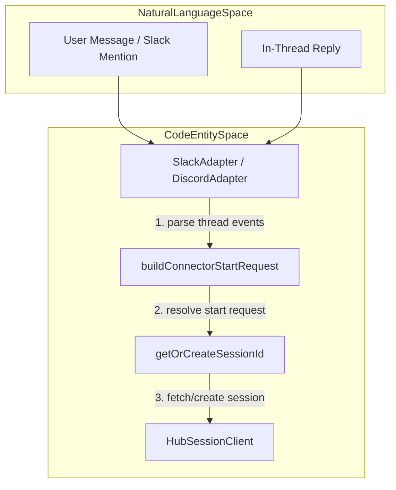
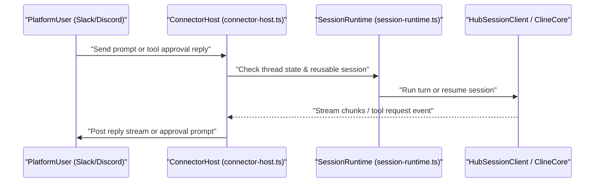

# Chat Platform Connectors

Relevant source files

The following files were used as context for generating this wiki page:

- [apps/cli/src/connectors/adapters/discord.ts](apps/cli/src/connectors/adapters/discord.ts)
- [apps/cli/src/connectors/adapters/gchat.ts](apps/cli/src/connectors/adapters/gchat.ts)
- [apps/cli/src/connectors/adapters/linear.ts](apps/cli/src/connectors/adapters/linear.ts)
- [apps/cli/src/connectors/adapters/slack.test.ts](apps/cli/src/connectors/adapters/slack.test.ts)
- [apps/cli/src/connectors/adapters/slack.ts](apps/cli/src/connectors/adapters/slack.ts)
- [apps/cli/src/connectors/adapters/telegram.test.ts](apps/cli/src/connectors/adapters/telegram.test.ts)
- [apps/cli/src/connectors/adapters/telegram.ts](apps/cli/src/connectors/adapters/telegram.ts)
- [apps/cli/src/connectors/adapters/whatsapp.ts](apps/cli/src/connectors/adapters/whatsapp.ts)
- [apps/cli/src/connectors/base.ts](apps/cli/src/connectors/base.ts)
- [apps/cli/src/connectors/common.test.ts](apps/cli/src/connectors/common.test.ts)
- [apps/cli/src/connectors/common.ts](apps/cli/src/connectors/common.ts)
- [apps/cli/src/connectors/connector-host.test.ts](apps/cli/src/connectors/connector-host.test.ts)
- [apps/cli/src/connectors/session-runtime.test.ts](apps/cli/src/connectors/session-runtime.test.ts)
- [apps/cli/src/connectors/session-runtime.ts](apps/cli/src/connectors/session-runtime.ts)
- [apps/cli/src/connectors/thread-bindings.ts](apps/cli/src/connectors/thread-bindings.ts)
- [apps/vscode/src/shared/storage/__tests__/provider-keys.test.ts](apps/vscode/src/shared/storage/__tests__/provider-keys.test.ts)
- [apps/vscode/src/shared/storage/provider-keys.ts](apps/vscode/src/shared/storage/provider-keys.ts)
- [apps/vscode/webview-ui/src/components/chat/chat-view/components/layout/WelcomeSection.tsx](apps/vscode/webview-ui/src/components/chat/chat-view/components/layout/WelcomeSection.tsx)
- [docs/cli/agent-teams.mdx](docs/cli/agent-teams.mdx)
- [docs/cli/connectors.mdx](docs/cli/connectors.mdx)
- [docs/cli/samples/github-integration.mdx](docs/cli/samples/github-integration.mdx)
- [docs/cli/samples/github-issue-rca.mdx](docs/cli/samples/github-issue-rca.mdx)
- [docs/cli/samples/github-pr-review.mdx](docs/cli/samples/github-pr-review.mdx)
- [docs/cli/samples/model-orchestration.mdx](docs/cli/samples/model-orchestration.mdx)
- [docs/cli/samples/supply-chain-alerts.mdx](docs/cli/samples/supply-chain-alerts.mdx)
- [docs/cli/scheduling.mdx](docs/cli/scheduling.mdx)
- [docs/features/subagents.mdx](docs/features/subagents.mdx)
- [docs/sdk/guides/multi-agent-teams.mdx](docs/sdk/guides/multi-agent-teams.mdx)
- [docs/sdk/guides/scheduled-agents.mdx](docs/sdk/guides/scheduled-agents.mdx)
- [sdk/packages/core/src/hub/server/handlers/capability-handlers.ts](sdk/packages/core/src/hub/server/handlers/capability-handlers.ts)
- [sdk/packages/shared/src/connectors/options.ts](sdk/packages/shared/src/connectors/options.ts)
- [sdk/packages/shared/src/providers/defaults.ts](sdk/packages/shared/src/providers/defaults.ts)

The chat platform connector system enables Cline to act as a backend conversational agent across third-party chat and collaboration networks (Slack, Discord, Telegram, WhatsApp, Google Chat, and Linear). Connectors run as background daemon processes or interactive command-line sessions, translating platform-specific message events into Cline SDK sessions via the local hub daemon and `HubSessionClient`.

Sources: [apps/cli/src/connectors/adapters/slack.ts:1-30](), [apps/cli/src/connectors/session-runtime.ts:1-16]()

---

## 1. Connector Host and Session Runtime

Connectors derive from `ConnectorBase` [apps/cli/src/connectors/base.ts]() and coordinate through `ConnectorHost` [apps/cli/src/connectors/connector-host.ts](). The lifecycle begins with option parsing and environment validation, followed by session establishment through `buildConnectorStartRequest` and `getOrCreateSessionId` [apps/cli/src/connectors/session-runtime.ts:49-229]().

Long-lived connectors run as detached background processes spawned via `spawnDetachedConnector`, maintaining an append-only log file in the local Cline data directory with automatic size rotation [apps/cli/src/connectors/common.ts:173-256]().

### Diagram: Natural Language to Code Entity (Message Ingress)
This diagram bridges natural language events on chat platforms to internal session runtime entities.

Sources: [apps/cli/src/connectors/adapters/slack.ts:1-70](), [apps/cli/src/connectors/session-runtime.ts:49-131](), [apps/cli/src/connectors/session-runtime.ts:174-229]()

---

## 2. Platform Adapters and Configuration Options

Each platform adapter defines configuration schemas in `@cline/shared` and implements specific platform parsing rules, authentication checks, and formatting conventions [sdk/packages/shared/src/connectors/options.ts:1-192]().

### Supported Platform Adapters
*   **Slack**: Supports both Socket Mode and Webhook Mode (inferred via `inferSlackConnectionMode`) [apps/cli/src/connectors/adapters/slack.ts:79-85](). Automatically strips leading bot self-mentions to prevent echo feedback loops [apps/cli/src/connectors/adapters/slack.ts:216-222]().
*   **Discord**: Manages guild, channel, and DM scopes [apps/cli/src/connectors/adapters/discord.ts:74-83](). Handles special control commands such as `/idle`, `/mute`, and `/unmute` [apps/cli/src/connectors/adapters/discord.ts:79-81]().
*   **Telegram**: Validates bot tokens, resolves bot usernames via Telegram's `getMe` API [apps/cli/src/connectors/adapters/telegram.ts:135-160](), and supports `--allowed-user-id` restriction hooks [apps/cli/src/connectors/adapters/telegram.test.ts:81-94]().
*   **WhatsApp**: Uses phone number identifiers and instance keys to bind inbound webhooks to active sessions [sdk/packages/shared/src/connectors/options.ts:1-34]().
*   **Google Chat**: Maps sender emails and service accounts to persistent thread contexts [sdk/packages/shared/src/connectors/options.ts:131-160]().
*   **Linear**: Optimizes prompt system instructions for issue comments and integrates webhook event verification [sdk/packages/shared/src/connectors/options.ts:162-192](), [apps/cli/src/connectors/adapters/linear.ts:60-64]().

Sources: [sdk/packages/shared/src/connectors/options.ts:1-192](), [apps/cli/src/connectors/adapters/slack.ts:79-222](), [apps/cli/src/connectors/adapters/telegram.ts:135-160]()

---

## 3. Thread Bindings and Session Continuity

Connectors maintain persistent associations between external platform thread IDs (or participant keys) and internal Cline session identifiers via `thread-bindings.ts`. 

When a user posts a message, `loadThreadState` reads the local binding store [apps/cli/src/connectors/session-runtime.ts:190-194](). If the hub reports that the mapped session has terminated or become invalid (`isReusableConnectorSession`), the runtime discards the dead session mapping and provisions a new session via `getOrCreateSessionId` without dropping the user's thread context [apps/cli/src/connectors/session-runtime.ts:158-229](). Stale bindings are cleared or re-mapped using `forgetStaleThreadSession` [apps/cli/src/connectors/connector-host.ts:225-235]().

Sources: [apps/cli/src/connectors/session-runtime.ts:133-239](), [apps/cli/src/connectors/connector-host.ts:225-235]()

---

## 4. Event Handling, Approvals, and Runtime Replies

Inbound turns are processed by `handleConnectorUserTurn` [apps/cli/src/connectors/connector-host.ts](). The connector streams assistant output back to the platform thread using `postConnectorRuntimeReply` [apps/cli/src/connectors/connector-host.ts:123-157]().

### Diagram: Natural Language to Code Entity (Approval & Execution Flow)
This second diagram bridges natural language events to internal approval and execution code entities in the connector runtime.

Sources: [apps/cli/src/connectors/connector-host.ts:1-157](), [apps/cli/src/connectors/session-runtime.ts:148-219]()

### Safeguards and Muting
*   **Turn Queueing**: Concurrent messages within the same thread are serialized using per-thread turn queues (`enqueueThreadTurn`) [apps/cli/src/connectors/chat-runtime.ts]().
*   **Mute Commands**: Connectors parse `/mute` and `/unmute` instructions to ignore bot loops or unrelated conversation chatter in shared channels [apps/cli/src/connectors/adapters/discord.ts:79-81]().
*   **Hooks**: Custom shell scripts or `jq` expressions can be executed via `dispatchConnectorHook` to enforce participation allowlists [apps/cli/src/connectors/hooks.ts](), [apps/cli/src/connectors/adapters/telegram.ts:104-106]().

Sources: [apps/cli/src/connectors/connector-host.ts](), [apps/cli/src/connectors/adapters/discord.ts:79-81](), [apps/cli/src/connectors/adapters/telegram.ts:104-106]()