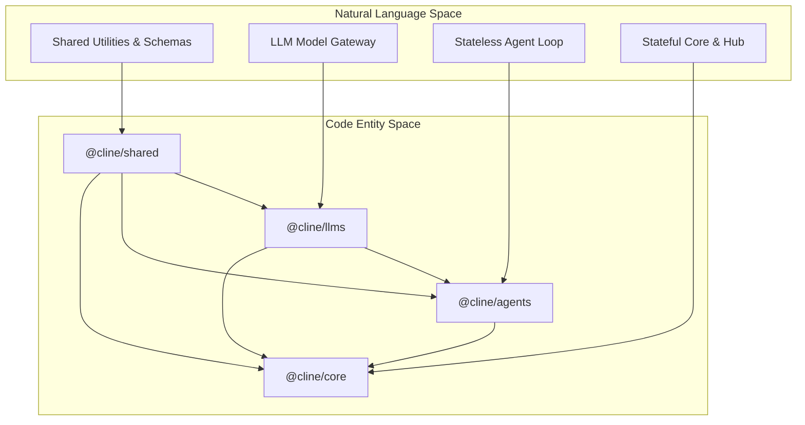
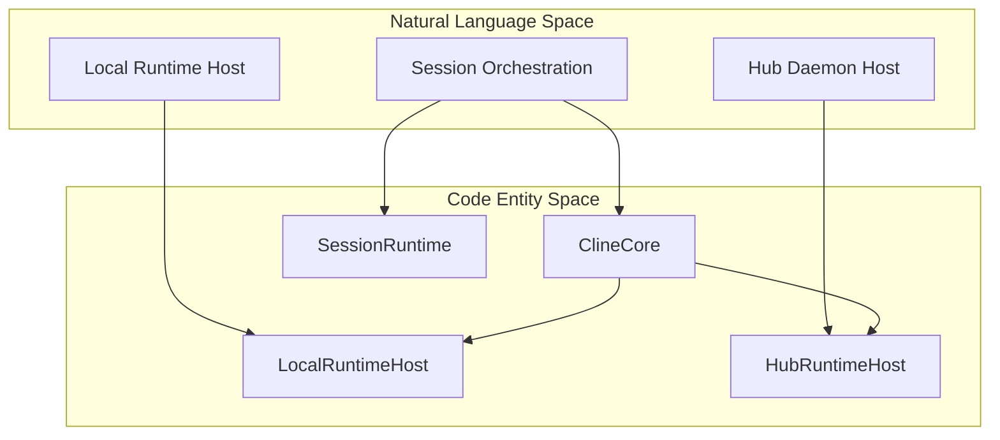

# Cline SDK

Relevant source files

The following files were used as context for generating this wiki page:

- [apps/cli/CHANGELOG.md](apps/cli/CHANGELOG.md)
- [apps/cli/package.json](apps/cli/package.json)
- [bun.lock](bun.lock)
- [sdk/AGENTS.md](sdk/AGENTS.md)
- [sdk/ARCHITECTURE.md](sdk/ARCHITECTURE.md)
- [sdk/CHANGELOG.md](sdk/CHANGELOG.md)
- [sdk/DOC.md](sdk/DOC.md)
- [sdk/packages/agents/package.json](sdk/packages/agents/package.json)
- [sdk/packages/core/package.json](sdk/packages/core/package.json)
- [sdk/packages/core/src/extensions/composio/composio-meta-tools.test.ts](sdk/packages/core/src/extensions/composio/composio-meta-tools.test.ts)
- [sdk/packages/core/src/extensions/composio/composio-meta-tools.ts](sdk/packages/core/src/extensions/composio/composio-meta-tools.ts)
- [sdk/packages/core/src/extensions/composio/composio-tools-extension.test.ts](sdk/packages/core/src/extensions/composio/composio-tools-extension.test.ts)
- [sdk/packages/core/src/extensions/composio/composio-tools-extension.ts](sdk/packages/core/src/extensions/composio/composio-tools-extension.ts)
- [sdk/packages/core/src/index.ts](sdk/packages/core/src/index.ts)
- [sdk/packages/core/src/services/local-runtime-bootstrap.test.ts](sdk/packages/core/src/services/local-runtime-bootstrap.test.ts)
- [sdk/packages/core/src/services/local-runtime-bootstrap.ts](sdk/packages/core/src/services/local-runtime-bootstrap.ts)
- [sdk/packages/llms/package.json](sdk/packages/llms/package.json)
- [sdk/packages/llms/src/catalog/catalog.generated.ts](sdk/packages/llms/src/catalog/catalog.generated.ts)
- [sdk/packages/llms/src/catalog/cline-recommended.generated.ts](sdk/packages/llms/src/catalog/cline-recommended.generated.ts)
- [sdk/packages/llms/src/providers/provider-ids.generated.ts](sdk/packages/llms/src/providers/provider-ids.generated.ts)
- [sdk/packages/llms/src/providers/providers.generated.ts](sdk/packages/llms/src/providers/providers.generated.ts)
- [sdk/packages/sdk/package.json](sdk/packages/sdk/package.json)
- [sdk/packages/shared/package.json](sdk/packages/shared/package.json)

The Cline SDK (`@cline/sdk`) framework is a standalone TypeScript framework designed for building autonomous agentic applications. It decouples the core agentic reasoning and tool-execution capabilities of Cline from the VS Code extension, allowing developers to embed Cline's reasoning engine into any environment—including CLIs, web servers, desktop apps, and automated background services [sdk/README.md:21-21]().

This page provides a high-level overview of the package layering, execution models, runtimes, automation features, and UI kits comprising the framework. For detailed technical specifications, refer to the child pages linked throughout.

## SDK Architecture and Packages

The framework follows a strict layered architecture adhering to a one-way dependency rule. Low-level components like type definitions and storage schemas remain entirely decoupled from stateful orchestration or platform hosts.

*   `@cline/shared`: Reusable low-level contracts, storage path helpers, database schemas, and configuration utilities [sdk/packages/shared/package.json:2-4]().
*   `@cline/llms`: The model and provider gateway, typed provider configurations, and Vercel AI SDK integrations [sdk/packages/llms/package.json:2-4]().
*   `@cline/agents`: The stateless agent iteration loop, prompt handling, and tool execution routines [sdk/packages/agents/package.json:2-3](), [sdk/packages/agents/package.json:22-22]().
*   `@cline/core`: Stateful session orchestration, configuration watching, background daemon services, and runtime host implementations [sdk/packages/core/package.json:2-3]().

For detailed architecture rules, package exports, and build setups, see [SDK Architecture and Packages](#13.1).

### SDK Package Layering

Sources: [sdk/packages/core/package.json:59-62](), [sdk/packages/shared/package.json:2-4]()

## Agent Runtime and Session Orchestration

The SDK manages execution granularity through discrete runtime primitives. The stateless iteration layer is driven by `AgentRuntime`, which processes turns, tool invocations, and stream chunks without maintaining persistent session storage. Stateful multi-turn tasks are handled by `SessionRuntime` and tracked inside a `ConversationStore`.

For detailed documentation on runtimes, event adapters, turn queues, and pending prompts, see [Agent Runtime and Session Orchestration](#13.2).

Sources: [sdk/packages/agents/package.json:2-3](), [sdk/packages/core/package.json:2-3]()

## ClineCore and Runtime Hosts

`ClineCore` serves as the primary orchestration entry point for embedding applications. It manages session lifecycles, configuration precedence, and history persistence. Execution targets are isolated via the `RuntimeHost` interface, with concrete implementations like `LocalRuntimeHost` for direct filesystem access and `HubRuntimeHost` for remote proxying.

For further details on session lifecycle, local bootstrapping, and runtime builders, see [ClineCore and Runtime Hosts](#13.3).

### Runtime Hosts and Orchestration

Sources: [sdk/packages/core/package.json:2-3](), [sdk/packages/sdk/package.json:2-4]()

## Hub Daemon and Transport

To support long-running tasks, multi-client session sharing, and background automation, the SDK provides the Hub daemon. Managed via `daemon-entry`, the hub exposes a WebSocket server that handles client connections, discovery records, authentication tokens, and real-time event logs [sdk/packages/core/package.json:26-29]().

For details on server handlers, capability contributions, and client adapters, see [Hub Daemon and Transport](#13.4).

Sources: [sdk/packages/core/package.json:26-29](), [sdk/CHANGELOG.md:8-8]()

## Automation, Cron, and Scheduled Agents

Scheduled and event-driven automation in the SDK is managed by the `CronService`. It relies on a SQLite-backed cron store, a task reconciler, and background runners to evaluate automation specs defined via Markdown with YAML frontmatter.

For details on event ingress, schedule services, and execution policies, see [Automation, Cron, and Scheduled Agents](#13.5).

Sources: [sdk/packages/core/package.json:48-48](), [sdk/CHANGELOG.md:19-19]()

## @cline/ui Component Library

The `@cline/ui` package provides a shared React component library for host applications and webview interfaces. It supplies theme design tokens, validation scripts, agent-chat primitives, tool summary views, diff renderers, and search comboboxes.

For design token definitions, storybook configurations, and component APIs, see [@cline/ui Component Library](#13.6).

Sources: [bun.lock:80-80](), [bun.lock:174-174]()

## SDK Examples

The monorepo includes reference applications demonstrating how to consume the SDK across different deployment targets. These include standalone CLI agents, automated code review bots, multi-agent workspaces, and Tauri-backed desktop apps.

For complete code walkthroughs of the examples, see [SDK Examples](#13.7).

Sources: [sdk/README.md:83-93]()

## SDK Telemetry and Observability

Observability across SDK components is coordinated via OpenTelemetry providers, core telemetry event dispatchers, and Langfuse integrations within `@cline/llms`. Additionally, deterministic test suites use VCR-based record/replay mechanisms to capture upstream model interactions.

For configuration instructions and testing guidelines, see [SDK Telemetry and Observability](#13.8).

Sources: [sdk/packages/llms/package.json:61-70](), [sdk/packages/core/package.json:30-33]()