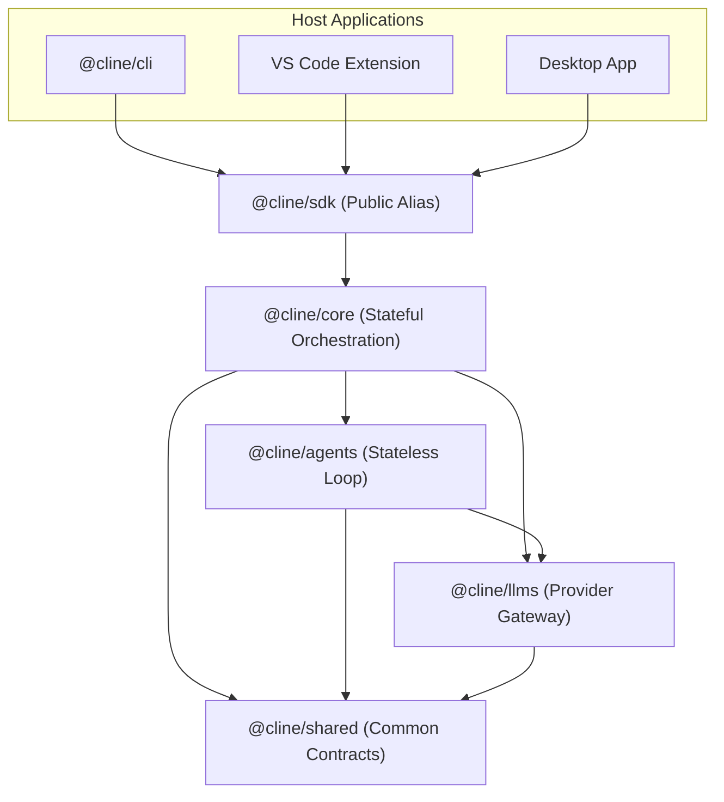
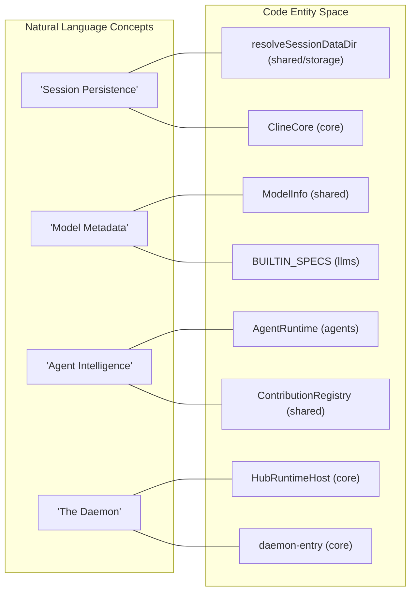
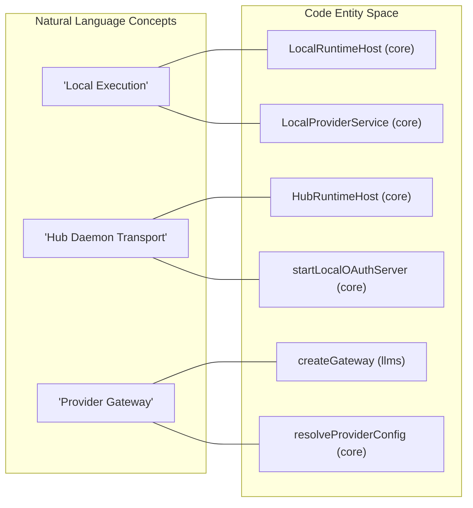

# SDK Architecture and Packages

Relevant source files

The following files were used as context for generating this wiki page:

- [apps/examples/desktop-app/webview/lib/provider-schema.ts](apps/examples/desktop-app/webview/lib/provider-schema.ts)
- [sdk/AGENTS.md](sdk/AGENTS.md)
- [sdk/ARCHITECTURE.md](sdk/ARCHITECTURE.md)
- [sdk/DOC.md](sdk/DOC.md)
- [sdk/packages/agents/bun.mts](sdk/packages/agents/bun.mts)
- [sdk/packages/core/bun.mts](sdk/packages/core/bun.mts)
- [sdk/packages/core/src/extensions/composio/composio-meta-tools.test.ts](sdk/packages/core/src/extensions/composio/composio-meta-tools.test.ts)
- [sdk/packages/core/src/extensions/composio/composio-meta-tools.ts](sdk/packages/core/src/extensions/composio/composio-meta-tools.ts)
- [sdk/packages/core/src/extensions/composio/composio-tools-extension.test.ts](sdk/packages/core/src/extensions/composio/composio-tools-extension.test.ts)
- [sdk/packages/core/src/extensions/composio/composio-tools-extension.ts](sdk/packages/core/src/extensions/composio/composio-tools-extension.ts)
- [sdk/packages/core/src/index.ts](sdk/packages/core/src/index.ts)
- [sdk/packages/core/src/services/llms/provider-defaults.test.ts](sdk/packages/core/src/services/llms/provider-defaults.test.ts)
- [sdk/packages/core/src/services/llms/provider-defaults.ts](sdk/packages/core/src/services/llms/provider-defaults.ts)
- [sdk/packages/core/src/services/local-runtime-bootstrap.test.ts](sdk/packages/core/src/services/local-runtime-bootstrap.test.ts)
- [sdk/packages/core/src/services/local-runtime-bootstrap.ts](sdk/packages/core/src/services/local-runtime-bootstrap.ts)
- [sdk/packages/core/src/services/providers/local-provider-registry.ts](sdk/packages/core/src/services/providers/local-provider-registry.ts)
- [sdk/packages/core/src/services/providers/local-provider-service.test.ts](sdk/packages/core/src/services/providers/local-provider-service.test.ts)
- [sdk/packages/core/src/services/providers/local-provider-service.ts](sdk/packages/core/src/services/providers/local-provider-service.ts)
- [sdk/packages/core/tsconfig.build.json](sdk/packages/core/tsconfig.build.json)
- [sdk/packages/core/tsconfig.dev.json](sdk/packages/core/tsconfig.dev.json)
- [sdk/packages/core/tsconfig.json](sdk/packages/core/tsconfig.json)
- [sdk/packages/llms/bun.mts](sdk/packages/llms/bun.mts)
- [sdk/packages/llms/src/index.browser.ts](sdk/packages/llms/src/index.browser.ts)
- [sdk/packages/llms/src/index.ts](sdk/packages/llms/src/index.ts)
- [sdk/packages/llms/src/models.ts](sdk/packages/llms/src/models.ts)
- [sdk/packages/llms/src/providers/builtins.test.ts](sdk/packages/llms/src/providers/builtins.test.ts)
- [sdk/packages/llms/src/providers/builtins.ts](sdk/packages/llms/src/providers/builtins.ts)
- [sdk/packages/shared/bun.mts](sdk/packages/shared/bun.mts)
- [sdk/packages/shared/src/index.browser.ts](sdk/packages/shared/src/index.browser.ts)
- [sdk/packages/shared/src/index.ts](sdk/packages/shared/src/index.ts)
- [sdk/packages/shared/src/llms/gateway.ts](sdk/packages/shared/src/llms/gateway.ts)
- [sdk/packages/shared/src/rpc/runtime.ts](sdk/packages/shared/src/rpc/runtime.ts)
- [sdk/packages/tsconfig.base.json](sdk/packages/tsconfig.base.json)
- [sdk/tsconfig.json](sdk/tsconfig.json)

### Purpose and Scope
This page documents the architecture, package layering, dependency rules, build configurations, and public surface of the Cline SDK (`@cline/sdk`) and its constituent monorepo packages. It outlines how responsibilities are partitioned across `@cline/shared`, `@cline/llms`, `@cline/agents`, `@cline/core`, and runtime host environments.

Sources: [sdk/packages/core/src/index.ts:1-123](), [sdk/packages/shared/src/index.ts:1-251]()

### Layered Architecture
The Cline SDK is a modular, layered framework designed to build autonomous agentic applications. It decouples core agent logic from specific host environments, structured into five primary packages plus host layers.

1. **`@cline/shared`**: Foundation layer containing universal contracts, Zod schemas, path resolution helpers, and base types (`ClineMessage`, `ModelInfo`). It is platform-agnostic and runs in both Node.js and browser environments [sdk/packages/shared/src/index.ts:1-251]().
2. **`@cline/llms`**: Provider gateway and model management layer. It handles configuration-driven selection, model catalogs, pricing metadata, and Vercel AI SDK handler wrappers [sdk/packages/llms/src/index.ts:1-166]().
3. **`@cline/agents`**: Stateless agent runtime implementing the core loop, tool orchestration, and turn preparation. It is stateless and does not handle session persistence directly [sdk/AGENTS.md:17-25]().
4. **`@cline/core`**: Stateful orchestration layer for Node.js runtime services, managing session lifecycles, durable storage, Hub daemons, plugin loading, and cron services [sdk/packages/core/src/index.ts:1-123](), [sdk/ARCHITECTURE.md:117-134]().
5. **Runtime Hosts & Apps**: Environments such as VS Code extension, CLI (`@cline/cli`), desktop app, or Hub daemon that host the SDK [sdk/ARCHITECTURE.md:22-41]().

Sources: [sdk/ARCHITECTURE.md:26-41](), [sdk/AGENTS.md:28-35]()

### One-Way Dependency Rule
The architecture enforces a strict downward dependency rule: higher-level packages depend on lower-level packages, but lower-level packages must never import from higher layers.
- `@cline/shared` depends on no other workspace packages [sdk/AGENTS.md:36-38]().
- `@cline/llms` depends only on `@cline/shared` [sdk/ARCHITECTURE.md:34]().
- `@cline/agents` depends on `@cline/llms` and `@cline/shared` [sdk/ARCHITECTURE.md:35-36]().
- `@cline/core` depends on `@cline/agents`, `@cline/llms`, and `@cline/shared` [sdk/ARCHITECTURE.md:37-39]().

**Bridge: Natural Language to Code Entities (Layering & Contracts)**

Sources: [sdk/packages/core/src/index.ts:1-247](), [sdk/packages/shared/src/index.ts:1-251](), [sdk/packages/llms/src/providers/builtins.ts:1-32]()

### The Public Surface: `@cline/sdk`
The `@cline/sdk` package acts as a transparent user-facing alias for `@cline/core`. It re-exports core orchestration primitives, session management, telemetry services, and hub daemons [sdk/packages/core/src/index.ts:1-123]().
- Re-exports core settings, storage paths, authentication managers, and runtime handlers [sdk/packages/core/src/index.ts:1-247]().

Sources: [sdk/packages/core/src/index.ts:1-123]()

### Build and `tsconfig` Setup
Each package in the SDK workspace manages its compilation using Bun build scripts (`bun.mts`) paired with TypeScript configuration files (`tsconfig.json`, `tsconfig.build.json`, `tsconfig.dev.json`).
- **Bundling**: Packages use custom `bun.mts` build scripts leveraging `Bun.build()` to generate ESM distribution bundles targeting Node.js, while marking declared dependencies and peer dependencies as external.
- **Type Checking**: Strict type checking is enforced across all packages via shared base configs and package-specific tsconfigs.

Sources: [sdk/packages/tsconfig.base.json:1-1](), [sdk/packages/core/tsconfig.json:1-1]()

### RuntimeHost Abstraction
The SDK abstracts execution environments using the `RuntimeHost` interface, enabling agent sessions to run locally within a process or remotely via a managed daemon.

| Host Type | Package | Description |
| :--- | :--- | :--- |
| **LocalRuntimeHost** | `@cline/core` | Executes agent loop and tool executors directly inside the host process. |
| **HubRuntimeHost** | `@cline/core` | Connects to a detached Hub daemon via WebSockets for offloaded or shared sessions. |

**Bridge: Natural Language to Code Entities (Runtime Hosts & Gateway)**

Sources: [sdk/packages/core/src/index.ts:1-123](), [sdk/packages/llms/src/index.ts:1-166]()