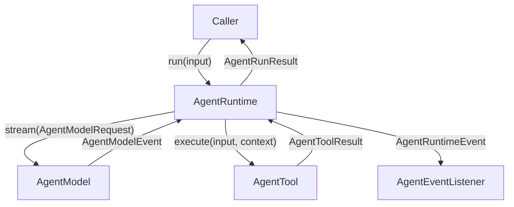
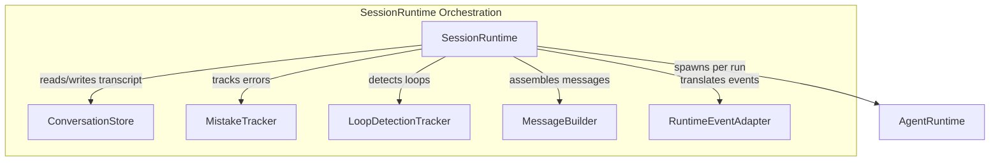

# Agent Runtime and Session Orchestration

Relevant source files

The following files were used as context for generating this wiki page:

- [apps/cli/src/tui/interactive-config.test.ts](apps/cli/src/tui/interactive-config.test.ts)
- [apps/vscode/src/core/hooks/HookProcess.ts](apps/vscode/src/core/hooks/HookProcess.ts)
- [apps/vscode/src/core/hooks/__tests__/hookprocess.test.ts](apps/vscode/src/core/hooks/__tests__/hookprocess.test.ts)
- [sdk/packages/agents/src/agent-runtime.test.ts](sdk/packages/agents/src/agent-runtime.test.ts)
- [sdk/packages/agents/src/agent-runtime.ts](sdk/packages/agents/src/agent-runtime.ts)
- [sdk/packages/core/src/extensions/mcp/client.test.ts](sdk/packages/core/src/extensions/mcp/client.test.ts)
- [sdk/packages/core/src/extensions/tools/team/delegated-agent.ts](sdk/packages/core/src/extensions/tools/team/delegated-agent.ts)
- [sdk/packages/core/src/runtime/config/agent-runtime-config-builder.test.ts](sdk/packages/core/src/runtime/config/agent-runtime-config-builder.test.ts)
- [sdk/packages/core/src/runtime/config/agent-runtime-config-builder.ts](sdk/packages/core/src/runtime/config/agent-runtime-config-builder.ts)
- [sdk/packages/core/src/runtime/orchestration/runtime-builder.test.ts](sdk/packages/core/src/runtime/orchestration/runtime-builder.test.ts)
- [sdk/packages/core/src/runtime/orchestration/runtime-builder.ts](sdk/packages/core/src/runtime/orchestration/runtime-builder.ts)
- [sdk/packages/core/src/runtime/orchestration/session-runtime-orchestrator.test.ts](sdk/packages/core/src/runtime/orchestration/session-runtime-orchestrator.test.ts)
- [sdk/packages/core/src/runtime/orchestration/session-runtime-orchestrator.ts](sdk/packages/core/src/runtime/orchestration/session-runtime-orchestrator.ts)
- [sdk/packages/core/src/runtime/orchestration/session-runtime.ts](sdk/packages/core/src/runtime/orchestration/session-runtime.ts)
- [sdk/packages/core/src/services/telemetry/core-events.test.ts](sdk/packages/core/src/services/telemetry/core-events.test.ts)
- [sdk/packages/core/src/services/telemetry/core-events.ts](sdk/packages/core/src/services/telemetry/core-events.ts)
- [sdk/packages/llms/src/providers/ai-sdk.test.ts](sdk/packages/llms/src/providers/ai-sdk.test.ts)
- [sdk/packages/llms/src/providers/ai-sdk.ts](sdk/packages/llms/src/providers/ai-sdk.ts)
- [sdk/packages/llms/src/providers/gateway.test.ts](sdk/packages/llms/src/providers/gateway.test.ts)
- [sdk/packages/llms/src/providers/vendors/community.process-hygiene-failure.test.ts](sdk/packages/llms/src/providers/vendors/community.process-hygiene-failure.test.ts)
- [sdk/packages/llms/src/providers/vendors/community.process-hygiene.helpers.ts](sdk/packages/llms/src/providers/vendors/community.process-hygiene.helpers.ts)
- [sdk/packages/llms/src/providers/vendors/community.process-hygiene.test.ts](sdk/packages/llms/src/providers/vendors/community.process-hygiene.test.ts)
- [sdk/packages/shared/src/agent.ts](sdk/packages/shared/src/agent.ts)
- [sdk/packages/shared/src/agents/types.ts](sdk/packages/shared/src/agents/types.ts)
- [sdk/packages/shared/src/services/telemetry.test.ts](sdk/packages/shared/src/services/telemetry.test.ts)
- [sdk/packages/shared/src/services/telemetry.ts](sdk/packages/shared/src/services/telemetry.ts)

This section documents the low-level stateless execution engine (`AgentRuntime`) and the stateful multi-turn orchestration layer (`SessionRuntime`) within the Cline SDK (`@cline/agents` and `@cline/core`). These subsystems manage prompt turns, tool dispatch, event streaming, transcript storage, error tracking, and pending prompt queues.

---

## AgentRuntime (run, continue, abort, subscribe)

The `AgentRuntime` class in `@cline/agents` provides the stateless execution loop for interacting with Large Language Models via `@cline/llms`. A single run or continuation executes a sequence of model requests and tool interactions until completion, failure, or cancellation.

### Core Methods

- **`run(input)`**: Initializes a new agent execution run with user input (`AgentRunInput`), supporting strings, single `AgentMessage` objects, or arrays of messages [sdk/packages/agents/src/agent-runtime.ts:115](), [sdk/packages/agents/src/agent-runtime.ts:311]().
- **`continue(input)`**: Resumes an existing agent execution loop, typically invoked after tool results are gathered or when processing steered instructions [sdk/packages/agents/src/agent-runtime.ts:404]().
- **`abort(reason)`**: Signals cancellation to the active model request and tool execution stream [sdk/packages/agents/src/agent-runtime.ts:124]().
- **`subscribe(listener)`**: Registers an `AgentEventListener` callback to receive `AgentRuntimeEvent` items during execution [sdk/packages/agents/src/agent-runtime.ts:99](), [sdk/packages/agents/src/agent-runtime.ts:285]().

### Execution Flow and Safeguards

The runtime processes turns using a plan-and-act loop equipped with automatic recovery and retry mechanisms:
1. **Model Request Building**: Assembles system prompts, transcript messages, and tool definitions into an `AgentModelRequest` [sdk/packages/shared/src/agent.ts:219](), [sdk/packages/agents/src/agent-runtime.ts:494]().
2. **Stream Processing**: Streams chunks from `AgentModel`, parsing text deltas, reasoning deltas, and tool-call deltas [sdk/packages/agents/src/agent-runtime.ts:634](). Transient provider errors trigger bounded retries via `PROVIDER_ERROR_MAX_RETRIES` [sdk/packages/agents/src/agent-runtime.ts:87]().
3. **Tool Dispatch**: Executes registered `AgentTool` instances asynchronously or sequentially based on configuration [sdk/packages/agents/src/agent-runtime.ts:749]().
4. **Max-Tokens Recovery**: Bounded automatic retries (`MAX_TOKENS_RECOVERY_LIMIT`) occur when output token limits are hit without a tool call [sdk/packages/agents/src/agent-runtime.ts:72]().

### Diagram: Stateless Agent Execution Loop (Code Entity Bridge)

Sources:
- `sdk/packages/agents/src/agent-runtime.ts`
- `sdk/packages/shared/src/agent.ts`

---

## SessionRuntime Orchestration

`SessionRuntime` (`sdk/packages/core/src/runtime/orchestration/session-runtime-orchestrator.ts`) wraps stateless `AgentRuntime` execution with stateful cross-turn management for a logical agent session.

### Responsibilities and State Owners

- **Conversation Transcript Management**: Maintains active conversation state via `ConversationStore` [sdk/packages/core/src/runtime/orchestration/session-runtime-orchestrator.ts:6]().
- **Mistake & Loop Safeguards**: Employs `MistakeTracker` and `LoopDetectionTracker` to monitor consecutive tool errors or repeated identical calls [sdk/packages/core/src/runtime/orchestration/session-runtime-orchestrator.ts:7-8]().
- **Provider Message Assembly**: Utilizes `MessageBuilder` to cache and construct model input payloads [sdk/packages/core/src/runtime/orchestration/session-runtime-orchestrator.ts:9]().
- **Runtime Hooks & Extensions**: Combines user configuration, hooks (`AgentRuntimeHooks`), and contribution registries [sdk/packages/core/src/runtime/orchestration/session-runtime-orchestrator.ts:10]().

### Diagram: Stateful Session Orchestration (Code Entity Bridge)

Sources:
- `sdk/packages/core/src/runtime/orchestration/session-runtime-orchestrator.ts`
- `sdk/packages/core/src/session/stores/conversation-store.ts`
- `sdk/packages/core/src/runtime/safety/loop-detection.ts`
- `sdk/packages/core/src/runtime/safety/mistake-tracker.ts`

---

## ConversationStore

The `ConversationStore` component maintains the canonical message transcript for a session. It guarantees transactional consistency when appending new user prompts, assistant responses, or tool execution results, while managing state gates that determine whether a session has started.

Sources:
- `sdk/packages/core/src/session/stores/conversation-store.ts`

---

## Event Adapters

`RuntimeEventAdapter` (`sdk/packages/core/src/runtime/orchestration/runtime-event-adapter.ts`) bridges the modular `AgentRuntimeEvent` schema from `@cline/agents` to legacy `AgentEvent` payloads (`sdk/packages/shared/src/agents/types.ts`) consumed by older host surfaces and webviews. It normalizes streaming tokens, tool activity notifications, and completion metrics into backwards-compatible event structures.

Sources:
- `sdk/packages/core/src/runtime/orchestration/runtime-event-adapter.ts`
- `sdk/packages/shared/src/agents/types.ts`

---

## Turn Queue and Pending Prompts

`PendingPromptsController` manages incoming user prompts received while an agent turn is actively executing. 

### Delivery Modes

- **Queue (`queue`)**: Appends subsequent user inputs to a pending list, executing them sequentially after the current turn completes.
- **Steer (`steer`)**: Interrupts the active model stream or tool execution phase to immediately inject user instructions into the current run context.

Sources:
- `sdk/packages/core/src/runtime/turn-queue/pending-prompt-service.ts`
- `sdk/packages/core/src/runtime/host/local-runtime-host.ts`