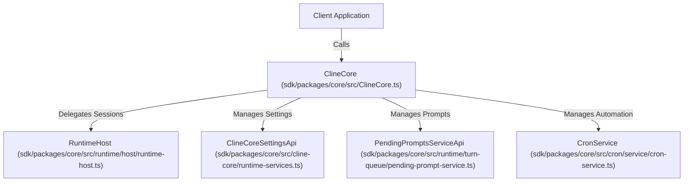
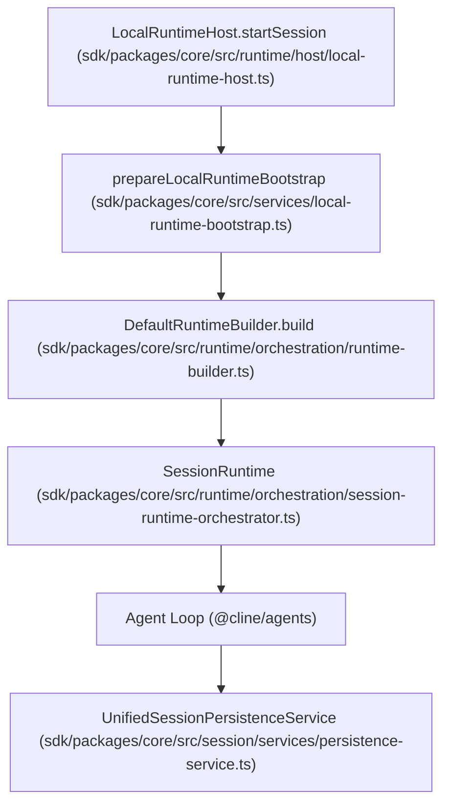
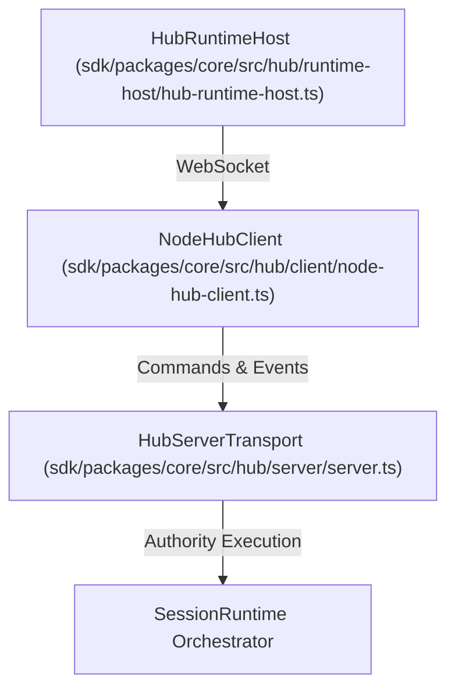

# ClineCore and Runtime Hosts

Relevant source files

The following files were used as context for generating this wiki page:

- [sdk/packages/core/src/ClineCore.test.ts](sdk/packages/core/src/ClineCore.test.ts)
- [sdk/packages/core/src/ClineCore.ts](sdk/packages/core/src/ClineCore.ts)
- [sdk/packages/core/src/cline-core/types.ts](sdk/packages/core/src/cline-core/types.ts)
- [sdk/packages/core/src/cloud/controller.test.ts](sdk/packages/core/src/cloud/controller.test.ts)
- [sdk/packages/core/src/cloud/controller.ts](sdk/packages/core/src/cloud/controller.ts)
- [sdk/packages/core/src/hub/runtime-host/hub-runtime-host.test.ts](sdk/packages/core/src/hub/runtime-host/hub-runtime-host.test.ts)
- [sdk/packages/core/src/hub/runtime-host/hub-runtime-host.ts](sdk/packages/core/src/hub/runtime-host/hub-runtime-host.ts)
- [sdk/packages/core/src/hub/server/boundary.test.ts](sdk/packages/core/src/hub/server/boundary.test.ts)
- [sdk/packages/core/src/hub/server/handlers/connector-handlers.test.ts](sdk/packages/core/src/hub/server/handlers/connector-handlers.test.ts)
- [sdk/packages/core/src/hub/server/handlers/context.ts](sdk/packages/core/src/hub/server/handlers/context.ts)
- [sdk/packages/core/src/hub/server/handlers/run-handlers.test.ts](sdk/packages/core/src/hub/server/handlers/run-handlers.test.ts)
- [sdk/packages/core/src/hub/server/handlers/run-handlers.ts](sdk/packages/core/src/hub/server/handlers/run-handlers.ts)
- [sdk/packages/core/src/hub/server/handlers/session-event-projector.ts](sdk/packages/core/src/hub/server/handlers/session-event-projector.ts)
- [sdk/packages/core/src/hub/server/handlers/session-handlers.ts](sdk/packages/core/src/hub/server/handlers/session-handlers.ts)
- [sdk/packages/core/src/runtime/host/history.test.ts](sdk/packages/core/src/runtime/host/history.test.ts)
- [sdk/packages/core/src/runtime/host/history.ts](sdk/packages/core/src/runtime/host/history.ts)
- [sdk/packages/core/src/runtime/host/local-runtime-host.test.ts](sdk/packages/core/src/runtime/host/local-runtime-host.test.ts)
- [sdk/packages/core/src/runtime/host/local-runtime-host.ts](sdk/packages/core/src/runtime/host/local-runtime-host.ts)
- [sdk/packages/core/src/runtime/host/runtime-host.ts](sdk/packages/core/src/runtime/host/runtime-host.ts)
- [sdk/packages/core/src/runtime/turn-queue/pending-prompt-service.ts](sdk/packages/core/src/runtime/turn-queue/pending-prompt-service.ts)
- [sdk/packages/core/src/services/feature-flags/index.ts](sdk/packages/core/src/services/feature-flags/index.ts)
- [sdk/packages/core/src/services/feature-flags/providers.ts](sdk/packages/core/src/services/feature-flags/providers.ts)
- [sdk/packages/core/src/session/services/file-session-service.ts](sdk/packages/core/src/session/services/file-session-service.ts)
- [sdk/packages/core/src/session/services/persistence-service.test.ts](sdk/packages/core/src/session/services/persistence-service.test.ts)
- [sdk/packages/core/src/session/services/persistence-service.ts](sdk/packages/core/src/session/services/persistence-service.ts)
- [sdk/packages/core/src/session/services/session-service.ts](sdk/packages/core/src/session/services/session-service.ts)
- [sdk/packages/core/src/session/stores/session-manifest-store.ts](sdk/packages/core/src/session/stores/session-manifest-store.ts)
- [sdk/packages/core/src/types/session.ts](sdk/packages/core/src/types/session.ts)

## Purpose and Scope
This document covers the stateful orchestration layer of the Cline SDK, focusing on the `ClineCore` facade, the `RuntimeHost` abstraction, concrete host implementations (`LocalRuntimeHost` and `HubRuntimeHost`), runtime composition via `DefaultRuntimeBuilder`, and initialization bootstrapping through `local-runtime-bootstrap`.

Sources: [sdk/packages/core/src/ClineCore.ts:88-140](), [sdk/packages/core/src/runtime/host/runtime-host.ts:1-52]()

---

## 1. ClineCore Orchestration Entrypoint
`ClineCore` is the primary public entry point for the `@cline/core` package [sdk/packages/core/src/ClineCore.ts:88-100](). It provides application-facing APIs for starting sessions, managing settings, querying prompt queues, and running automation tasks [sdk/packages/core/src/ClineCore.ts:101-118]().

*Figure 1: ClineCore Subsystem Relationships with Code Entities*

Sources: [sdk/packages/core/src/ClineCore.ts:99-188](), [sdk/packages/core/src/runtime/host/runtime-host.ts:1-47]()

---

## 2. The RuntimeHost Interface and Core Contracts
The `RuntimeHost` interface defines the operational contract for executing, listing, restoring, and terminating agent sessions across different execution topologies [sdk/packages/core/src/runtime/host/runtime-host.ts:137-145]().

Key methods exposed by `RuntimeHost`:
- `startSession(input: StartSessionInput): Promise<StartSessionResult>` [sdk/packages/core/src/runtime/host/runtime-host.ts:143-144]()
- `restoreSession(input: RestoreSessionInput): Promise<RestoreSessionResult>` [sdk/packages/core/src/runtime/host/runtime-host.ts:135-136]()
- `listSessions(options?: ListSessionsOptions): Promise<SessionRecord[]>` [sdk/packages/core/src/runtime/host/runtime-host.ts:132-132]()
- `subscribe(listener: (event: CoreSessionEvent) => void, options?: RuntimeHostSubscribeOptions): () => void` [sdk/packages/core/src/runtime/host/runtime-host.ts:138-141]()

Sources: [sdk/packages/core/src/runtime/host/runtime-host.ts:132-146](), [sdk/packages/core/src/runtime/host/local-runtime-host.ts:130-144]()

---

## 3. LocalRuntimeHost Implementation
`LocalRuntimeHost` executes agent sessions in-process [sdk/packages/core/src/runtime/host/local-runtime-host.ts:135-144](). It coordinates the `SessionRuntime` lifecycle [sdk/packages/core/src/runtime/host/local-runtime-host.ts:112-112](), manages file-based session persistence via `UnifiedSessionPersistenceService` [sdk/packages/core/src/session/services/persistence-service.ts:43-50](), tracks tool executions, and emits telemetry events [sdk/packages/core/src/runtime/host/local-runtime-host.ts:47-53]().

*Figure 2: Local Runtime Execution Flow with Code Entities*

Sources: [sdk/packages/core/src/runtime/host/local-runtime-host.ts:34-112](), [sdk/packages/core/src/session/services/persistence-service.ts:43-68]()

---

## 4. HubRuntimeHost Implementation
`HubRuntimeHost` implements `RuntimeHost` by forwarding session commands and event subscriptions over a WebSocket transport to a shared background daemon via `NodeHubClient` [sdk/packages/core/src/hub/runtime-host/hub-runtime-host.ts:38-46](), [sdk/packages/core/src/hub/client/node-hub-client.ts]().

*Figure 3: Hub-Backed Runtime Architecture with Code Entities*

Sources: [sdk/packages/core/src/hub/runtime-host/hub-runtime-host.ts:1-84](), [sdk/packages/core/src/hub/server/server.ts]()

---

## 5. Runtime Builder and Tool Composition
`DefaultRuntimeBuilder` assembles the concrete tool environment for a session [sdk/packages/core/src/runtime/orchestration/runtime-builder.ts](). It resolves built-in tools based on mode and tool policies, discovers configured subagents, integrates Model Context Protocol (MCP) servers, and sets up execution controllers.

Sources: [sdk/packages/core/src/runtime/orchestration/runtime-builder.ts:1-62]()

---

## 6. Local Runtime Bootstrap
`prepareLocalRuntimeBootstrap` transforms broad configuration inputs into fully resolved runtime creation arguments [sdk/packages/core/src/services/local-runtime-bootstrap.ts](). It handles system prompt construction, provider credential resolution, workspace state scanning, and extension loading.

Sources: [sdk/packages/core/src/services/local-runtime-bootstrap.ts:1-55]()