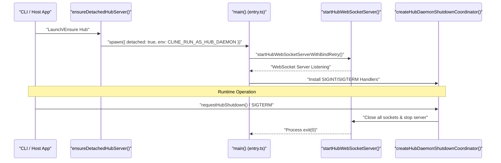
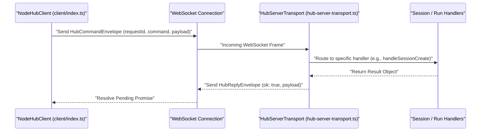

# Hub Daemon and Transport

Relevant source files

The following files were used as context for generating this wiki page:

- [apps/cli/src/index.ts](apps/cli/src/index.ts)
- [apps/examples/desktop-app/scripts/desktop-startup.test.ts](apps/examples/desktop-app/scripts/desktop-startup.test.ts)
- [apps/examples/desktop-app/sidecar/index.ts](apps/examples/desktop-app/sidecar/index.ts)
- [apps/vscode/src/hosts/vscode/__tests__/commit-message-generator.test.ts](apps/vscode/src/hosts/vscode/__tests__/commit-message-generator.test.ts)
- [apps/vscode/src/hosts/vscode/commit-message-generator.ts](apps/vscode/src/hosts/vscode/commit-message-generator.ts)
- [apps/vscode/src/sdk/legacy-task-handling.test.ts](apps/vscode/src/sdk/legacy-task-handling.test.ts)
- [apps/vscode/src/sdk/legacy-task-handling.ts](apps/vscode/src/sdk/legacy-task-handling.ts)
- [apps/vscode/src/sdk/slash-command-expansion.test.ts](apps/vscode/src/sdk/slash-command-expansion.test.ts)
- [apps/vscode/src/sdk/slash-command-expansion.ts](apps/vscode/src/sdk/slash-command-expansion.ts)
- [apps/vscode/src/test/cline-core-vitest-stub.ts](apps/vscode/src/test/cline-core-vitest-stub.ts)
- [sdk/packages/core/src/extensions/config/runtime-commands.test.ts](sdk/packages/core/src/extensions/config/runtime-commands.test.ts)
- [sdk/packages/core/src/extensions/config/runtime-commands.ts](sdk/packages/core/src/extensions/config/runtime-commands.ts)
- [sdk/packages/core/src/extensions/config/user-instruction-plugin.ts](sdk/packages/core/src/extensions/config/user-instruction-plugin.ts)
- [sdk/packages/core/src/extensions/config/user-instruction-service.ts](sdk/packages/core/src/extensions/config/user-instruction-service.ts)
- [sdk/packages/core/src/hub/client/connection-headers.test.ts](sdk/packages/core/src/hub/client/connection-headers.test.ts)
- [sdk/packages/core/src/hub/client/index.test.ts](sdk/packages/core/src/hub/client/index.test.ts)
- [sdk/packages/core/src/hub/client/index.ts](sdk/packages/core/src/hub/client/index.ts)
- [sdk/packages/core/src/hub/daemon/__fixtures__/shutdown-daemon.ts](sdk/packages/core/src/hub/daemon/__fixtures__/shutdown-daemon.ts)
- [sdk/packages/core/src/hub/daemon/bind-diagnostics.test.ts](sdk/packages/core/src/hub/daemon/bind-diagnostics.test.ts)
- [sdk/packages/core/src/hub/daemon/bind-diagnostics.ts](sdk/packages/core/src/hub/daemon/bind-diagnostics.ts)
- [sdk/packages/core/src/hub/daemon/entry.test.ts](sdk/packages/core/src/hub/daemon/entry.test.ts)
- [sdk/packages/core/src/hub/daemon/entry.ts](sdk/packages/core/src/hub/daemon/entry.ts)
- [sdk/packages/core/src/hub/daemon/index.test.ts](sdk/packages/core/src/hub/daemon/index.test.ts)
- [sdk/packages/core/src/hub/daemon/index.ts](sdk/packages/core/src/hub/daemon/index.ts)
- [sdk/packages/core/src/hub/daemon/shutdown-coordinator.test.ts](sdk/packages/core/src/hub/daemon/shutdown-coordinator.test.ts)
- [sdk/packages/core/src/hub/daemon/shutdown-coordinator.ts](sdk/packages/core/src/hub/daemon/shutdown-coordinator.ts)
- [sdk/packages/core/src/hub/daemon/shutdown.e2e.test.ts](sdk/packages/core/src/hub/daemon/shutdown.e2e.test.ts)
- [sdk/packages/core/src/hub/daemon/singleton.e2e.test.ts](sdk/packages/core/src/hub/daemon/singleton.e2e.test.ts)
- [sdk/packages/core/src/hub/discovery/index.test.ts](sdk/packages/core/src/hub/discovery/index.test.ts)
- [sdk/packages/core/src/hub/discovery/index.ts](sdk/packages/core/src/hub/discovery/index.ts)
- [sdk/packages/core/src/hub/runtime-host/remote-runtime-host.ts](sdk/packages/core/src/hub/runtime-host/remote-runtime-host.ts)
- [sdk/packages/core/src/hub/server/hub-capability-tool-executors.test.ts](sdk/packages/core/src/hub/server/hub-capability-tool-executors.test.ts)
- [sdk/packages/core/src/hub/server/hub-client-contributions.ts](sdk/packages/core/src/hub/server/hub-client-contributions.ts)
- [sdk/packages/core/src/hub/server/hub-event-log.test.ts](sdk/packages/core/src/hub/server/hub-event-log.test.ts)
- [sdk/packages/core/src/hub/server/hub-event-log.ts](sdk/packages/core/src/hub/server/hub-event-log.ts)
- [sdk/packages/core/src/hub/server/hub-server-options.ts](sdk/packages/core/src/hub/server/hub-server-options.ts)
- [sdk/packages/core/src/hub/server/hub-user-instruction-rules.test.ts](sdk/packages/core/src/hub/server/hub-user-instruction-rules.test.ts)
- [sdk/packages/core/src/hub/server/hub-websocket-server.ts](sdk/packages/core/src/hub/server/hub-websocket-server.ts)
- [sdk/packages/core/src/hub/server/index.test.ts](sdk/packages/core/src/hub/server/index.test.ts)
- [sdk/packages/core/src/runtime/host/host.test.ts](sdk/packages/core/src/runtime/host/host.test.ts)
- [sdk/packages/core/src/runtime/host/host.ts](sdk/packages/core/src/runtime/host/host.ts)
- [sdk/packages/core/src/runtime/safety/rules.test.ts](sdk/packages/core/src/runtime/safety/rules.test.ts)
- [sdk/packages/core/src/runtime/safety/rules.ts](sdk/packages/core/src/runtime/safety/rules.ts)
- [sdk/packages/core/vitest.config.ts](sdk/packages/core/vitest.config.ts)
- [sdk/packages/core/vitest.e2e.config.ts](sdk/packages/core/vitest.e2e.config.ts)
- [sdk/packages/shared/src/remote-config/constants.ts](sdk/packages/shared/src/remote-config/constants.ts)
- [sdk/packages/shared/vitest.config.ts](sdk/packages/shared/vitest.config.ts)

## Purpose and Scope
This page details the implementation of the Hub Daemon, WebSocket transport layer, discovery mechanism, authentication tokens, server handlers, client adapters, and capability contributions within the Cline SDK (`sdk/packages/core/src/hub/`). The hub architecture allows agents to execute tasks asynchronously across processes, survive host application closures, and coordinate multiple client connections.

---

## 1. Hub Daemon Entry, Singleton, and Shutdown

The Hub Daemon runs as an autonomous background process or a managed singleton instance. The entry point is defined in `sdk/packages/core/src/hub/daemon/entry.ts`, which parses command-line flags (`--host`, `--port`, `--pathname`, `--no-connectors`, `--cwd`) and initializes the WebSocket server with automatic bind retry capabilities for handling retiring predecessors [sdk/packages/core/src/hub/daemon/entry.ts:54-136]().

To prevent orphan daemons and resource leaks, the daemon implements a shutdown coordinator and strict signal handling (`SIGINT`, `SIGTERM`). It also filters non-fatal abort rejections (such as `AgentRuntimeAbortError` or fetch `AbortError`) so that user-cancelled turns do not crash the daemon process and terminate unrelated resident sessions [sdk/packages/core/src/hub/daemon/entry.ts:138-161]().

The detached lifecycle manager (`sdk/packages/core/src/hub/daemon/index.ts`) handles spawning the detached node process, redirecting output to `hub-daemon.log`, and executing retirement flows via `requestHubDrain` and `requestHubShutdown` [sdk/packages/core/src/hub/daemon/index.ts:1-117]().

### Natural Language to Code Entity Space: Daemon Lifecycle and Shutdown

Sources: `sdk/packages/core/src/hub/daemon/entry.ts:54-213]`, `[sdk/packages/core/src/hub/daemon/index.ts:1-117]()`

---

## 2. Discovery Records and Authentication Tokens

Clients locate and connect to a running Hub instance through disk-based discovery records and token-based authentication.

*   **Discovery Record (`hub-discovery.json`):** Created upon successful startup, this record contains the server's WebSocket URL, process ID (`pid`), build epoch, and authentication token (`authToken`) [sdk/packages/core/src/hub/discovery/index.ts:1-42]().
*   **Authentication Mechanism:** Access to the Hub is restricted by an `authToken`. When establishing a WebSocket connection, clients pass this token via the subprotocol header format `cline-hub-auth.<token>` [sdk/packages/core/src/hub/client/index.ts:200-212]().

Sources: `[sdk/packages/core/src/hub/discovery/index.ts:1-42]`, `[sdk/packages/core/src/hub/client/index.ts:200-212]()`

---

## 3. WebSocket Server and Transport Architecture

Communication between the Hub and its connected clients relies on a JSON-serialized envelope protocol defined in the shared package and server transports. The transport framework defines three core envelope types:
1.  `HubCommandEnvelope`: Client-to-server RPC requests (e.g., `session.create`, `session.run`).
2.  `HubReplyEnvelope`: Server-to-client responses containing success flags, error codes, and result payloads.
3.  `HubEventEnvelope`: Server-to-client broadcasts for streaming agent events and runtime notifications.

### Natural Language to Code Entity Space: WebSocket Message Flow

Sources: `[sdk/packages/core/src/hub/client/index.ts:1-124]`, `[sdk/packages/core/src/hub/server/hub-websocket-server.ts:1-118]()`

---

## 4. Server Handlers and Request Routing

Incoming commands are routed through `HubServerTransport` to modular subsystem handlers:
*   **Client Handlers (`client-handlers.ts`):** Manage client registrations (`client.register`), listings (`client.list`), and metadata updates [sdk/packages/core/src/hub/client/index.ts:174-190]().
*   **Session Handlers (`session-handlers.ts`):** Handle creation, listing, retrieval, deletion, and message querying for agent sessions.
*   **Run Handlers (`run-handlers.ts`):** Oversee turn execution, input injection (`handleSessionInput`), abort signals (`handleRunAbort`), and hooks.
*   **Approval & Capability Handlers:** Coordinate human-in-the-loop tool approvals (`approval-handlers.ts`) and client-side capability forwarding (`capability-handlers.ts`).

Sources: `[sdk/packages/core/src/hub/client/index.ts:174-190]`, `[sdk/packages/core/src/hub/server/hub-websocket-server.ts:1-100]()`

---

## 5. Capability Contributions

Clients connected to the Hub can register custom local capabilities that the agent can invoke during task execution. This is parsed and managed via `sdk/packages/core/src/hub/server/hub-client-contributions.ts`.

Supported contribution kinds include:
*   `tool`: Custom agent tools with schemas (`inputSchema`) that route execution back to the client [sdk/packages/core/src/hub/server/hub-client-contributions.ts:108-140]().
*   `toolExecutor`: Overrides for built-in tool executors [sdk/packages/core/src/hub/server/hub-client-contributions.ts:164-174]().
*   `hook`: Lifecycle hooks such as `beforeRun`, `afterRun`, and `beforeTool` [sdk/packages/core/src/hub/server/hub-client-contributions.ts:176-182]().
*   `compaction` & `checkpoint`: Custom compaction strategies and git-backed checkpointing routines [sdk/packages/core/src/hub/server/hub-client-contributions.ts:184-206]().

Sources: `[sdk/packages/core/src/hub/server/hub-client-contributions.ts:108-220]()`

---

## 6. Event Log and Client Adapters

*   **`HubEventLogStore`:** Maintains an ordered log of hub events for replay, auditing, and state recovery [sdk/packages/core/src/hub/server/hub-event-log.ts:1-50]().
*   **`NodeHubClient`:** A Node.js WebSocket client implementation that handles connection establishment, automatic reconnection with exponential backoff and jitter, and event listener subscription multiplexing [sdk/packages/core/src/hub/client/index.ts:1-218]().

Sources: `[sdk/packages/core/src/hub/client/index.ts:1-218]`, `[sdk/packages/core/src/hub/server/hub-event-log.ts:1-50]()`