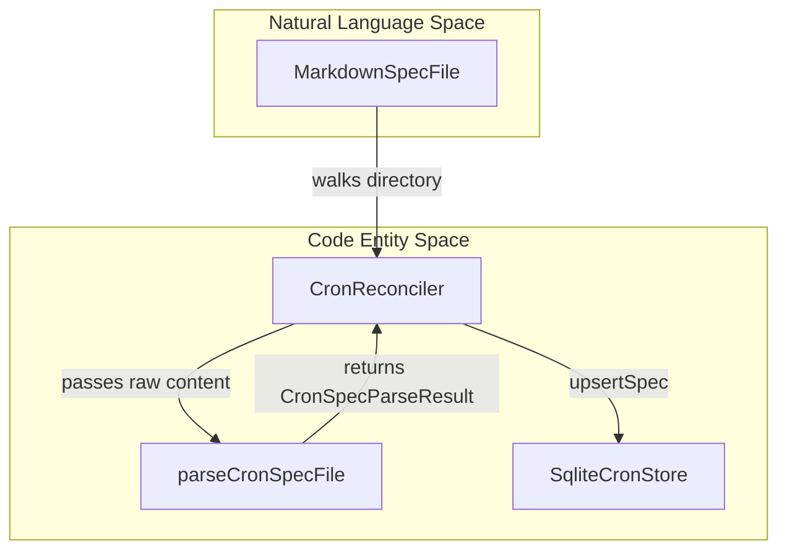
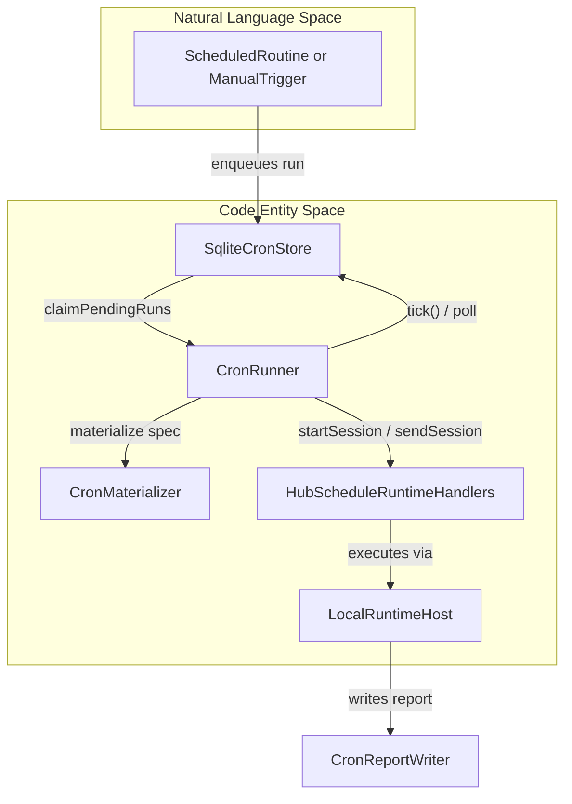

# Automation, Cron, and Scheduled Agents

Relevant source files

The following files were used as context for generating this wiki page:

- [apps/cli/src/commands/history-command.test.ts](apps/cli/src/commands/history-command.test.ts)
- [apps/cli/src/commands/history-command.ts](apps/cli/src/commands/history-command.ts)
- [apps/cli/src/commands/schedule.test.ts](apps/cli/src/commands/schedule.test.ts)
- [apps/cli/src/commands/schedule/common.ts](apps/cli/src/commands/schedule/common.ts)
- [apps/cli/src/commands/schedule/delivery-input.test.ts](apps/cli/src/commands/schedule/delivery-input.test.ts)
- [apps/cli/src/commands/schedule/delivery-input.ts](apps/cli/src/commands/schedule/delivery-input.ts)
- [apps/cli/src/commands/schedule/handlers.ts](apps/cli/src/commands/schedule/handlers.ts)
- [apps/cli/src/commands/schedule/import-export.ts](apps/cli/src/commands/schedule/import-export.ts)
- [apps/cli/src/connectors/connector-host.ts](apps/cli/src/connectors/connector-host.ts)
- [apps/cli/src/connectors/schedule-delivery.test.ts](apps/cli/src/connectors/schedule-delivery.test.ts)
- [apps/cli/src/connectors/schedule-delivery.ts](apps/cli/src/connectors/schedule-delivery.ts)
- [apps/examples/desktop-app/webview/components/views/settings/routine-view.tsx](apps/examples/desktop-app/webview/components/views/settings/routine-view.tsx)
- [sdk/packages/core/src/cron/events/cron-event-ingress.test.ts](sdk/packages/core/src/cron/events/cron-event-ingress.test.ts)
- [sdk/packages/core/src/cron/events/cron-event-ingress.ts](sdk/packages/core/src/cron/events/cron-event-ingress.ts)
- [sdk/packages/core/src/cron/runner/cron-runner.test.ts](sdk/packages/core/src/cron/runner/cron-runner.test.ts)
- [sdk/packages/core/src/cron/runner/cron-runner.ts](sdk/packages/core/src/cron/runner/cron-runner.ts)
- [sdk/packages/core/src/cron/service/schedule-command-service.ts](sdk/packages/core/src/cron/service/schedule-command-service.ts)
- [sdk/packages/core/src/cron/service/schedule-service.test.ts](sdk/packages/core/src/cron/service/schedule-service.test.ts)
- [sdk/packages/core/src/cron/service/schedule-service.ts](sdk/packages/core/src/cron/service/schedule-service.ts)
- [sdk/packages/core/src/cron/specs/cron-reconciler.test.ts](sdk/packages/core/src/cron/specs/cron-reconciler.test.ts)
- [sdk/packages/core/src/cron/specs/cron-reconciler.ts](sdk/packages/core/src/cron/specs/cron-reconciler.ts)
- [sdk/packages/core/src/cron/store/sqlite-cron-store.test.ts](sdk/packages/core/src/cron/store/sqlite-cron-store.test.ts)
- [sdk/packages/core/src/cron/store/sqlite-cron-store.ts](sdk/packages/core/src/cron/store/sqlite-cron-store.ts)
- [sdk/packages/core/src/hub/client/session-client.test.ts](sdk/packages/core/src/hub/client/session-client.test.ts)
- [sdk/packages/core/src/hub/server/browser-websocket.test.ts](sdk/packages/core/src/hub/server/browser-websocket.test.ts)
- [sdk/packages/core/src/hub/server/browser-websocket.ts](sdk/packages/core/src/hub/server/browser-websocket.ts)
- [sdk/packages/core/src/hub/server/command-transport.ts](sdk/packages/core/src/hub/server/command-transport.ts)

The purpose of this page is to document the Cline SDK automation and cron framework (`CronService`), including the SQLite-backed cron store, filesystem spec reconciler, background polling runner, event ingress engine, schedule service, and markdown automation specifications.

---

## 1. SQLite Cron Store and Schema (`SqliteCronStore`)

The persistence layer for all automation tasks is housed in `cron.db` via `SqliteCronStore` [sdk/packages/core/src/cron/store/sqlite-cron-store.ts:23-27](). Unlike agent sessions which reside in their own session database stores, `cron.db` centralizes three main tables:
* `cron_specs`: Stores materialized versions of parsed automation specifications (one-offs, cron schedules, and event triggers) [sdk/packages/core/src/cron/store/sqlite-cron-store.ts:52-92]().
* `cron_runs`: A unified queue for all automated executions, tracking states such as `queued`, `running`, `done`, `failed`, and `cancelled` [sdk/packages/core/src/cron/store/sqlite-cron-store.ts:29-34,94-113]().
* `cron_event_logs`: Durable event ingestion logs supporting deduplication keys, payload filtering, and processing status [sdk/packages/core/src/cron/store/sqlite-cron-store.ts:115-133]().

`SqliteCronStore` provides atomic transactions for runs, lease claims, and event processing via methods like `upsertSpec`, `enqueueRun`, `claimPendingRuns`, and `eventTransaction` [sdk/packages/core/src/cron/store/sqlite-cron-store.ts:43-203]().

Sources: [sdk/packages/core/src/cron/store/sqlite-cron-store.ts:1-236]()

---

## 2. Markdown Automation Specs and Reconciler (`CronReconciler`)

Automation tasks are authored as Markdown files containing YAML frontmatter (`.cron.md`, `.event.md`, or generic `.md` files under the cron specifications directory). The `CronReconciler` scans the file tree, parses frontmatter using `parseCronSpecFile`, and synchronizes states against the `SqliteCronStore` [sdk/packages/core/src/cron/specs/cron-reconciler.ts:17-22,83-95]().

*Figure 1: Markdown Spec Reconciliation Pipeline mapping Natural Language Files to Code Persistence.*

Sources: [sdk/packages/core/src/cron/specs/cron-reconciler.ts:1-198](), [sdk/packages/core/src/cron/specs/cron-spec-parser.ts:1-50]()

---

## 3. Schedule Service and Orchestration (`HubScheduleService`)

The `HubScheduleService` class acts as the primary coordinator for schedule-based automation operations [sdk/packages/core/src/cron/service/schedule-service.ts:222-260](). It wraps `SqliteCronStore`, `CronMaterializer`, and `CronRunner` to expose high-level operations for list management, schedule creation (`createHubSchedule`), immediate execution (`triggerScheduleNow`), and status monitoring [sdk/packages/core/src/cron/service/schedule-service.ts:220-250]().

It bridges public `ScheduleRecord` representations with internal `CronSpecRecord` objects, normalizes cron expressions, handles timezone offsets, and handles one-time executions configured via `ONE_TIME_SCHEDULE_CRON_PATTERN` [sdk/packages/core/src/cron/service/schedule-service.ts:139-187]() and `ONE_TIME_SCHEDULE_RUN_AT_METADATA_KEY` [sdk/packages/core/src/cron/store/sqlite-cron-store.ts:9-10]().

Sources: [sdk/packages/core/src/cron/service/schedule-service.ts:1-250]()

---

## 4. Runner, Polling Loop, and Lease Management (`CronRunner`)

The `CronRunner` daemon manages the execution of queued cron runs [sdk/packages/core/src/cron/runner/cron-runner.ts:26-34](). It periodically polls `cron.db` at a specified interval (defaulting to 15 seconds) [sdk/packages/core/src/cron/runner/cron-runner.ts:56](), acquires atomic claim leases with expiration tokens (`claimLeaseSeconds`) [sdk/packages/core/src/cron/runner/cron-runner.ts:57](), and dispatches runs to the registered `HubScheduleRuntimeHandlers` [sdk/packages/core/src/cron/runner/cron-runner.ts:177]().

*Figure 2: Execution and Session Lifecycle mapping Scheduled Triggers to Agent Runtime Hosts.*

Sources: [sdk/packages/core/src/cron/runner/cron-runner.ts:1-211]()

---

## 5. Event Ingress and Filtering (`CronEventIngress`)

The `CronEventIngress` service handles durable ingestion of external automation events (e.g., webhooks or system triggers) [sdk/packages/core/src/cron/events/cron-event-ingress.ts:10-16](). When an event is received via `ingestEvent`, it is normalized, recorded into `cron_event_logs`, evaluated against spec filters using `automationEventMatchesFilters`, and materialized into matching `cron_runs` atomically [sdk/packages/core/src/cron/events/cron-event-ingress.ts:163-190]().

Supported suppression reasons include `duplicate_event`, `filter_mismatch`, `dedupe_window`, and `cooldown` [sdk/packages/core/src/cron/events/cron-event-ingress.ts:24-28]().

Sources: [sdk/packages/core/src/cron/events/cron-event-ingress.ts:1-211]()

---

## 6. Hub Daemon Integration and Runtime Handlers

In hub or daemon deployments, the scheduling framework is integrated via `createLocalHubScheduleRuntimeHandlers`, which wires scheduled tasks directly to a `LocalRuntimeHost` and `SqliteSessionStore` [sdk/packages/core/src/hub/daemon/runtime-handlers.ts:74-87](). 

Automated sessions enforce headless tool policies (disabling interactive prompts like `ask` while auto-approving configured action tools) and record metadata tracking using `RUN_SESSION_METADATA_KEYS` (`scheduleId`, `scheduleExecutionId`, `scheduleRunNumber`) to allow clients to group session histories by routine [sdk/packages/core/src/cron/runner/cron-runner.ts:94-106,152-172]().

Sources: [sdk/packages/core/src/hub/daemon/runtime-handlers.ts:1-164](), [sdk/packages/core/src/cron/runner/cron-runner.ts:94-172]()