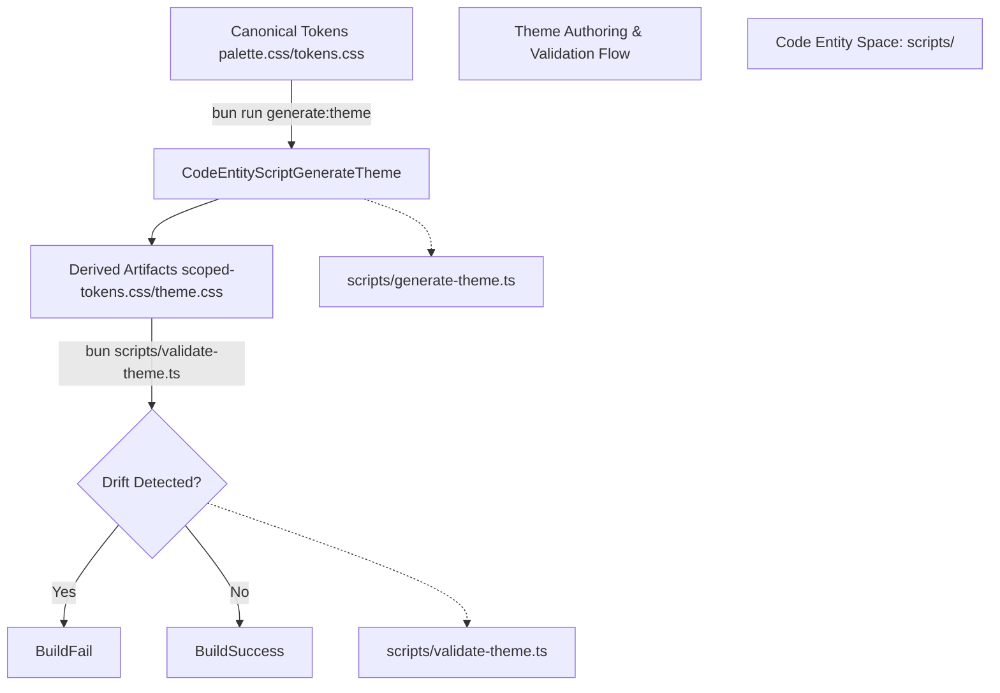
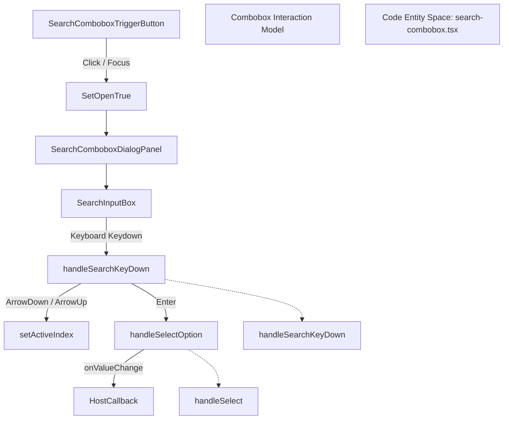

# @cline/ui Component Library

Relevant source files

The following files were used as context for generating this wiki page:

- [apps/examples/desktop-app/sidecar/session-data/messages.test.ts](apps/examples/desktop-app/sidecar/session-data/messages.test.ts)
- [apps/examples/desktop-app/sidecar/session-data/messages.ts](apps/examples/desktop-app/sidecar/session-data/messages.ts)
- [apps/examples/desktop-app/webview/components/views/chat/chat-messages.test.tsx](apps/examples/desktop-app/webview/components/views/chat/chat-messages.test.tsx)
- [apps/examples/desktop-app/webview/components/views/chat/chat-messages.tsx](apps/examples/desktop-app/webview/components/views/chat/chat-messages.tsx)
- [apps/examples/desktop-app/webview/components/views/chat/message-content.test.ts](apps/examples/desktop-app/webview/components/views/chat/message-content.test.ts)
- [apps/examples/desktop-app/webview/components/views/chat/message-content.ts](apps/examples/desktop-app/webview/components/views/chat/message-content.ts)
- [apps/examples/desktop-app/webview/components/views/chat/messages/group-messages.test.ts](apps/examples/desktop-app/webview/components/views/chat/messages/group-messages.test.ts)
- [apps/examples/desktop-app/webview/components/views/chat/messages/group-messages.ts](apps/examples/desktop-app/webview/components/views/chat/messages/group-messages.ts)
- [apps/examples/desktop-app/webview/components/views/chat/messages/message-bubble.tsx](apps/examples/desktop-app/webview/components/views/chat/messages/message-bubble.tsx)
- [apps/examples/desktop-app/webview/components/views/chat/messages/reasoning-block.tsx](apps/examples/desktop-app/webview/components/views/chat/messages/reasoning-block.tsx)
- [apps/examples/desktop-app/webview/components/views/chat/messages/work-block.tsx](apps/examples/desktop-app/webview/components/views/chat/messages/work-block.tsx)
- [apps/examples/desktop-app/webview/lib/provider-model-catalog.test.ts](apps/examples/desktop-app/webview/lib/provider-model-catalog.test.ts)
- [apps/examples/desktop-app/webview/lib/provider-model-catalog.ts](apps/examples/desktop-app/webview/lib/provider-model-catalog.ts)
- [apps/examples/desktop-app/webview/lib/run-error.ts](apps/examples/desktop-app/webview/lib/run-error.ts)
- [sdk/packages/ui/ADOPTION.md](sdk/packages/ui/ADOPTION.md)
- [sdk/packages/ui/README.md](sdk/packages/ui/README.md)
- [sdk/packages/ui/components.css](sdk/packages/ui/components.css)
- [sdk/packages/ui/components/agent-chat/agent-chat.css](sdk/packages/ui/components/agent-chat/agent-chat.css)
- [sdk/packages/ui/components/agent-chat/index.tsx](sdk/packages/ui/components/agent-chat/index.tsx)
- [sdk/packages/ui/components/button.tsx](sdk/packages/ui/components/button.tsx)
- [sdk/packages/ui/components/index.ts](sdk/packages/ui/components/index.ts)
- [sdk/packages/ui/components/search-combobox.css](sdk/packages/ui/components/search-combobox.css)
- [sdk/packages/ui/components/search-combobox.tsx](sdk/packages/ui/components/search-combobox.tsx)
- [sdk/packages/ui/package.json](sdk/packages/ui/package.json)
- [sdk/packages/ui/scripts/smoke-package.ts](sdk/packages/ui/scripts/smoke-package.ts)
- [sdk/packages/ui/stories/agent-chat.stories.tsx](sdk/packages/ui/stories/agent-chat.stories.tsx)
- [sdk/packages/ui/stories/search-combobox.stories.tsx](sdk/packages/ui/stories/search-combobox.stories.tsx)
- [sdk/packages/ui/tests/agent-chat.test.tsx](sdk/packages/ui/tests/agent-chat.test.tsx)
- [sdk/packages/ui/tests/button.test.tsx](sdk/packages/ui/tests/button.test.tsx)
- [sdk/packages/ui/tests/search-combobox.test.tsx](sdk/packages/ui/tests/search-combobox.test.tsx)

The `@cline/ui` package (`sdk/packages/ui/package.json`) provides the shared visual foundations, semantic theme tokens, and reusable React presentation primitives for Cline web and desktop applications (`sdk/packages/ui/README.md`). It allows consumers to adopt the Cline visual language and agent-chat presentation layer without coupling to a specific agent runtime or product route structure (`sdk/packages/ui/ADOPTION.md`).

---

## 1. Package Architecture and Entry Points

The package is structured as a modular ESM library with explicit subpath exports defined in `sdk/packages/ui/package.json`. Consumers can import root primitives, isolated tool utilities, theme sheets, or agent-chat components independently.

| Export Subpath | Target File / Dts | Description |
| --- | --- | --- |
| `.` | `dist/components/index.js` | Root React primitives (`Button`, `Switch`, `SearchCombobox`, etc.) `[sdk/packages/ui/package.json:16-20]()`. |
| `./components.css` | `components.css` | Namespaced Tailwind mappings and component source registrations `[sdk/packages/ui/package.json:21]()` (`[sdk/packages/ui/components.css:1-16]()`). |
| `./components/agent-chat` | `dist/components/agent-chat/index.js` | Conversation and message streaming primitives `[sdk/packages/ui/package.json:22-25]()`. |
| `./components/agent-chat/tool-summary` | `dist/components/agent-chat/tool-summary/index.js` | Framework-neutral tool summary builders `[sdk/packages/ui/package.json:26-29]()`. |
| `./components/agent-chat/tool-diff` | `dist/components/agent-chat/tool-diff.js` | Syntax-highlighted diff rendering primitives `[sdk/packages/ui/package.json:30-33]()`. |
| `./components/markdown` | `dist/components/markdown.js` | Markdown controls and streamdown/mermaid integration `[sdk/packages/ui/package.json:35-38]()`. |
| `./theme/tokens.css` | `theme/tokens.css` | Light and dark custom property definitions `[sdk/packages/ui/package.json:51]()`. |
| `./theme/scoped-tokens.css` | `theme/scoped-tokens.css` | Custom properties scoped to `.cline-ui-theme` `[sdk/packages/ui/package.json:50]()`. |

Sources: `[sdk/packages/ui/package.json:16-60]()`, `[sdk/packages/ui/README.md:26-43]()`, `[sdk/packages/ui/components.css:1-16]()`.

---

## 2. Theme Token Pipeline and Validation

The theme follows the shadcn semantic contract (`--background`, `--foreground`, `--primary`, `--border`, etc.) layered over 12-step solid and alpha palettes (Slate as neutral, Violet as accent, Ruby as error, Green as success, Amber as warning, Sky as info) (`[sdk/packages/ui/README.md:145-159]()`).

To prevent drift between canonical theme files (`palette.css`, `tokens.css`) and generated derived files (`scoped-tokens.css`, internal component mappings), the package runs strict build-time validation scripts `[sdk/packages/ui/package.json:132-134]()`.

Sources: `[sdk/packages/ui/package.json:131-141]()`, `[sdk/packages/ui/README.md:128-132]()`, `[sdk/packages/ui/scripts/smoke-package.ts:1-10]()`.

---

## 3. Agent-Chat and Interactive Primitives

The library exports specialized components designed for interactive agent sessions. These include `AgentAskQuestion`, `AgentApprovalCard`, `SearchCombobox`, `AgentPromptQueue`, and message scroller adapters `[sdk/packages/ui/components/index.ts:1-133]()`.

### AgentAskQuestion

The `AgentAskQuestion` component handles follow-up questions from the model. It supports:
- Single-choice selection (submits immediately upon option click).
- Multiple-choice selections via `multiple: true` with explicit array submission.
- Custom typed answers and keyboard interactions.

Sources: `[sdk/packages/ui/README.md:108-115]()`, `[sdk/packages/ui/components/index.ts:9-12]()`.

---

## 4. Search Combobox Component

`SearchCombobox` (`[sdk/packages/ui/components/search-combobox.tsx:83-225]`) provides an accessible, filterable dropdown selector for repositories, models, and configuration targets.

### Key Behaviors
- **Filtering & Highlighting**: Filters options by query string across label, description, and value, highlighting matching substrings (`[sdk/packages/ui/components/search-combobox.tsx:57-81]()`).
- **Keyboard Navigation**: Manages `ArrowDown`, `ArrowUp`, `Home`, `End`, `Escape`, `Tab`, and `Enter` keys, restoring focus to the trigger element upon selection or closure (`[sdk/packages/ui/components/search-combobox.tsx:171-224]()`).
- **Section Headers**: Groups options by `sections` identifiers while preserving visibility during active searches (`[sdk/packages/ui/components/search-combobox.tsx:24-55]()`).

Sources: `[sdk/packages/ui/components/search-combobox.tsx:1-225]`, `[sdk/packages/ui/README.md:62-64]()`.

---

## 5. Tool Summaries and File Diffs

To maintain identical tool inspection views across web, desktop, and extension products without coupling UI packages to `@cline/core`, `@cline/ui` exports framework-free utility functions and diff renderers (`[sdk/packages/ui/ADOPTION.md:55-64]()`).

- **Tool Summary Builders**: Pure functions (`buildToolSummary`, `buildGroupedToolLabel`) transforming raw `{ toolName, input, result }` payloads into clean human-readable summaries (`[sdk/packages/ui/scripts/smoke-package.ts:99-105]()`).
- **Tool File Diffs**: `ToolFileDiff`, a wrapper over `@pierre/diffs` rendering syntax-highlighted, theme-aware diffs for file edits (`[sdk/packages/ui/scripts/smoke-package.ts:47-48]`, `[sdk/packages/ui/scripts/smoke-package.ts:106-108]()`).

Sources: `[sdk/packages/ui/README.md:55-64]()`, `[sdk/packages/ui/ADOPTION.md:55-64]()`, `[sdk/packages/ui/scripts/smoke-package.ts:99-108]()`.

---

## 6. Markdown and Storybook Integration

Markdown rendering, Mermaid blocks, and Streamdown styling are encapsulated via dedicated exports (`[sdk/packages/ui/package.json:35-47]()`). Component states and interactive mocks are cataloged via Storybook stories (`[sdk/packages/ui/package.json:136-137]()`), allowing isolated visual testing across themes and viewports.

Sources: `[sdk/packages/ui/package.json:35-53]`, `[sdk/packages/ui/README.md:124-132]()`.