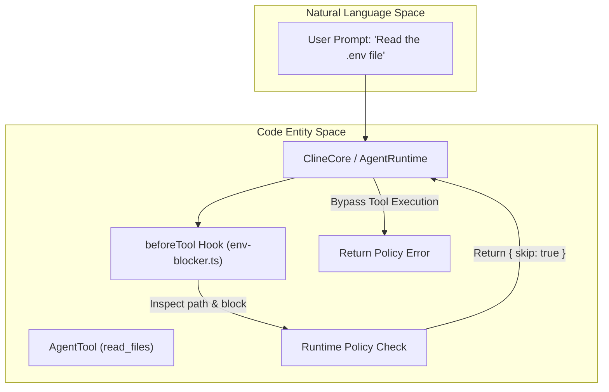
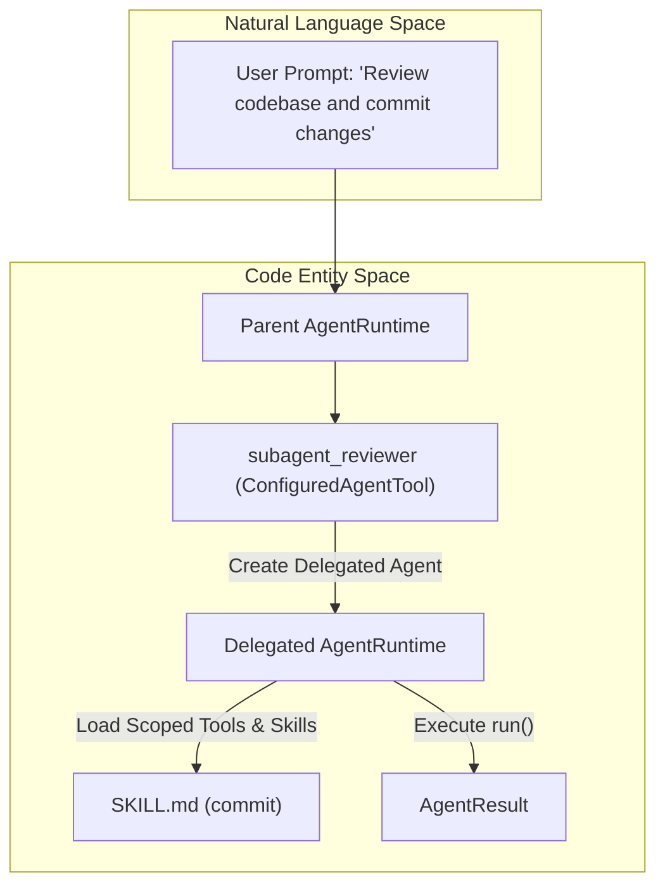

# SDK Examples

Relevant source files

The following files were used as context for generating this wiki page:

- [docs/cli/agent-teams.mdx](docs/cli/agent-teams.mdx)
- [docs/cli/connectors.mdx](docs/cli/connectors.mdx)
- [docs/cli/samples/github-integration.mdx](docs/cli/samples/github-integration.mdx)
- [docs/cli/samples/github-issue-rca.mdx](docs/cli/samples/github-issue-rca.mdx)
- [docs/cli/samples/github-pr-review.mdx](docs/cli/samples/github-pr-review.mdx)
- [docs/cli/samples/model-orchestration.mdx](docs/cli/samples/model-orchestration.mdx)
- [docs/cli/samples/supply-chain-alerts.mdx](docs/cli/samples/supply-chain-alerts.mdx)
- [docs/cli/scheduling.mdx](docs/cli/scheduling.mdx)
- [docs/features/subagents.mdx](docs/features/subagents.mdx)
- [docs/sdk/guides/multi-agent-teams.mdx](docs/sdk/guides/multi-agent-teams.mdx)
- [docs/sdk/guides/scheduled-agents.mdx](docs/sdk/guides/scheduled-agents.mdx)
- [docs/sdk/plugins.mdx](docs/sdk/plugins.mdx)
- [sdk/packages/core/src/extensions/plugin/plugin-config-loader.test.ts](sdk/packages/core/src/extensions/plugin/plugin-config-loader.test.ts)
- [sdk/packages/core/src/extensions/plugin/plugin-config-loader.ts](sdk/packages/core/src/extensions/plugin/plugin-config-loader.ts)
- [sdk/packages/core/src/extensions/plugin/plugin-contributions.ts](sdk/packages/core/src/extensions/plugin/plugin-contributions.ts)
- [sdk/packages/core/src/extensions/plugin/plugin-loader.test.ts](sdk/packages/core/src/extensions/plugin/plugin-loader.test.ts)
- [sdk/packages/core/src/extensions/plugin/plugin-loader.ts](sdk/packages/core/src/extensions/plugin/plugin-loader.ts)
- [sdk/packages/core/src/extensions/plugin/plugin-module-import.ts](sdk/packages/core/src/extensions/plugin/plugin-module-import.ts)
- [sdk/packages/core/src/extensions/plugin/plugin-registry.test.ts](sdk/packages/core/src/extensions/plugin/plugin-registry.test.ts)
- [sdk/packages/core/src/extensions/plugin/plugin-registry.ts](sdk/packages/core/src/extensions/plugin/plugin-registry.ts)
- [sdk/packages/core/src/extensions/plugin/plugin-sandbox-bootstrap.ts](sdk/packages/core/src/extensions/plugin/plugin-sandbox-bootstrap.ts)
- [sdk/packages/core/src/extensions/plugin/plugin-sandbox.test.ts](sdk/packages/core/src/extensions/plugin/plugin-sandbox.test.ts)
- [sdk/packages/core/src/extensions/plugin/plugin-sandbox.ts](sdk/packages/core/src/extensions/plugin/plugin-sandbox.ts)
- [sdk/packages/core/src/services/plugin-tools.ts](sdk/packages/core/src/services/plugin-tools.ts)
- [sdk/packages/shared/src/extensions/contribution-registry.ts](sdk/packages/shared/src/extensions/contribution-registry.ts)

The purpose of this page is to walk through the SDK example implementations located in `sdk/examples/` (plugins, hooks, cron) and `apps/examples/` (quickstart, cli-agent, code-review-bot, multi-agent, menubar, vscode), detailing their architecture, data flow, key classes, and integration with `@cline/core` and `@cline/sdk`.

Sources: [docs/sdk/plugins.mdx:1-8](), [sdk/packages/shared/src/extensions/contribution-registry.ts:125-144]()

## 1. SDK Plugin System and Examples

Plugins extend any Cline agent (CLI, Kanban, VS Code, or custom SDK hosts) by registering custom tools, hooking into the execution lifecycle, rewriting provider messages, or emitting automation events. The plugin system is organized under `sdk/examples/plugins/` and evaluated via core loaders [sdk/packages/core/src/extensions/plugin/plugin-config-loader.ts:188-225]().

### Key Plugin Capabilities & Examples
- **Tool Registration**: Adds custom tools via `api.registerTool` defined in `AgentExtensionApi` [sdk/packages/shared/src/extensions/contribution-registry.ts:125-127](). For instance, custom metrics or weather tools log workspace context, token usage, and cost.
- **Lifecycle & Hook Enforcement**: Intercepts tool calls and execution turns using `AgentRuntimeHooks` [sdk/packages/shared/src/agent.ts:1-30]() (such as `beforeTool` or `afterRun`). Plugins can block sensitive file reads or enforce workspace `.gitignore` rules [docs/sdk/plugins.mdx:55-62]().
- **Message Builders**: Rewrites oversized provider message history by registering custom builders via `api.registerMessageBuilder` [sdk/packages/shared/src/extensions/contribution-registry.ts:133-135]().
- **Multi-Agent Squads**: Spins up subagents with individual models, tool allowlists, and shared handoff stores [docs/sdk/plugins.mdx:7-18]().

Sources: [docs/sdk/plugins.mdx:7-18](), [sdk/packages/shared/src/extensions/contribution-registry.ts:125-144]()

### Diagram: Plugin Tool Execution & Hook Lifecycle
This diagram maps natural language user intents to plugin hooks and tool execution code entities.

Title: "Plugin Tool Execution and Hook Lifecycle"

Sources: [docs/sdk/plugins.mdx:55-64](), [sdk/packages/shared/src/extensions/contribution-registry.ts:1-25]()

## 2. Hooks, Cron, and Automation Examples

The SDK provides mechanisms for scheduled cron automation and lifecycle hooks under `sdk/examples/hooks/` and `sdk/examples/cron/`.

- **Cron Service (`CronService`)**: Backed by a SQLite cron store, the reconciler and runner manage scheduled agent executions, parsing markdown automation specifications and ingress events [docs/cli/samples/supply-chain-alerts.mdx:10-26]().
- **Custom Compaction Hooks**: Runtime hooks that intercept turn boundaries to compact chat history when token limits approach thresholds [docs/sdk/plugins.mdx:55-66]().

Sources: [docs/cli/samples/supply-chain-alerts.mdx:10-26](), [docs/sdk/plugins.mdx:55-66]()

## 3. Application Examples (`apps/examples/`)

The monorepo includes several standalone application blueprints under `apps/examples/`:

| Application | Description & Key Components |
| :--- | :--- |
| **quickstart** | Minimal bootstrap script demonstrating programmatic `ClineCore` initialization and session execution [docs/sdk/plugins.mdx:71-81](). |
| **cli-agent** | Standalone command-line agent utilizing OpenTUI and headless execution modes [docs/cli/connectors.mdx:10-18](). |
| **code-review-bot** | Automated PR code review agent utilizing GitHub connectors and custom rule evaluation [docs/cli/samples/github-pr-review.mdx:1-15](). |
| **multi-agent** | Orchestration example using `spawn_agent` and configured subagent tools with parallel execution modes [docs/cli/agent-teams.mdx:1-30](). |
| **menubar** | Lightweight native status bar / menubar application controlling background agent sessions. |
| **vscode** | Standalone VS Code extension template demonstrating Webview bridge communication and gRPC over postMessage. |

Sources: [docs/sdk/plugins.mdx:71-81](), [docs/cli/samples/github-pr-review.mdx:1-15]()

### Diagram: Multi-Agent Delegation Flow
Title: "Multi-Agent Delegation and Execution Flow"

Sources: [docs/cli/samples/github-pr-review.mdx:100-137](), [docs/sdk/plugins.mdx:40-64]()

## 4. Desktop App Reference Implementation & Connectors

The Desktop App (`apps/examples/desktop-app`) is a full-featured reference implementation combining Tauri, Next.js, and a Bun-based sidecar.

- **Sidecar & IPC**: The sidecar manages persistence, chat session state, and attachment materialization via RPC invocations [docs/cli/connectors.mdx:84-108]().
- **Chat Input Bar**: Supports `@mentions`, slash commands (`/team`, `/fork`), and reasoning effort parameters [docs/cli/connectors.mdx:187-193]().
- **Connector System**: Connectors bridge external platforms (Slack, Telegram, Discord, WhatsApp, Linear, Google Chat) to `ClineCore` sessions, normalizing incoming message events and managing human-in-the-loop tool approvals [docs/cli/connectors.mdx:20-30]().

Sources: [docs/cli/connectors.mdx:20-30](), [docs/cli/connectors.mdx:84-108]()