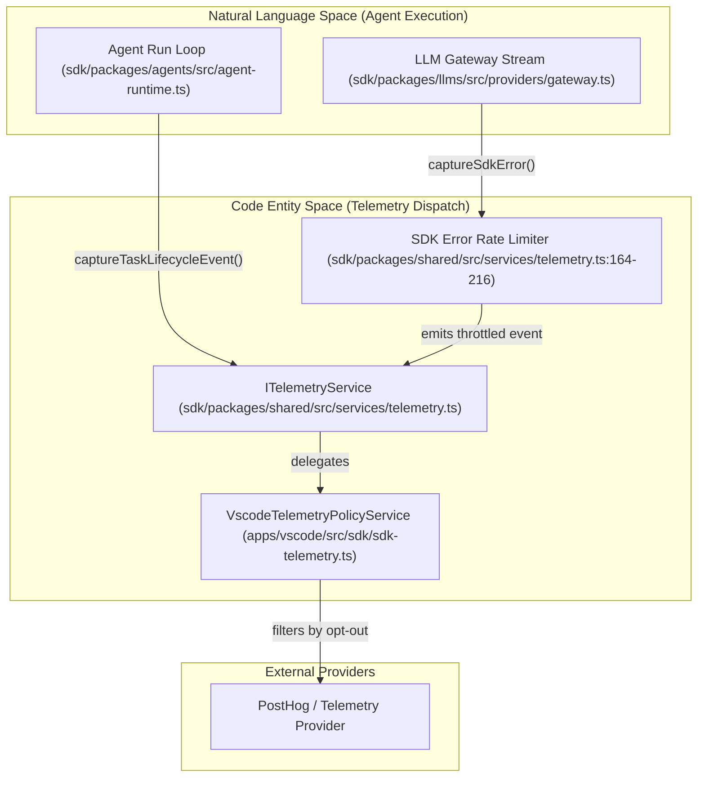
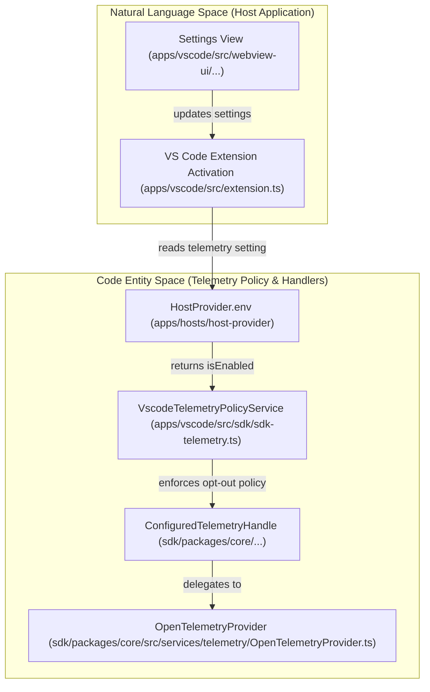
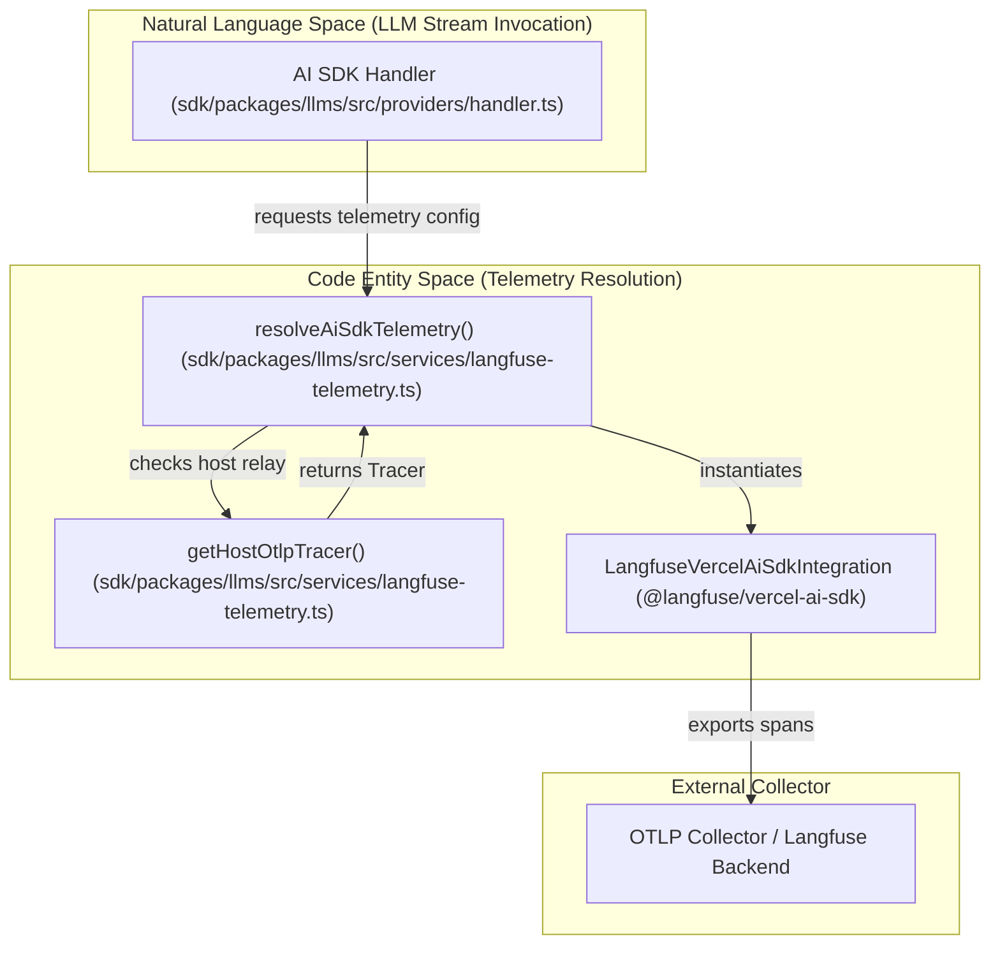

# SDK Telemetry and Observability

Relevant source files

The following files were used as context for generating this wiki page:

- [apps/examples/desktop-app/scripts/telemetry-define-args.test.ts](apps/examples/desktop-app/scripts/telemetry-define-args.test.ts)
- [apps/examples/desktop-app/scripts/telemetry-define-args.ts](apps/examples/desktop-app/scripts/telemetry-define-args.ts)
- [apps/vscode/src/services/telemetry/providers/opentelemetry/RUNBOOK.md](apps/vscode/src/services/telemetry/providers/opentelemetry/RUNBOOK.md)
- [sdk/packages/core/src/hub/daemon/telemetry.test.ts](sdk/packages/core/src/hub/daemon/telemetry.test.ts)
- [sdk/packages/core/src/hub/daemon/telemetry.ts](sdk/packages/core/src/hub/daemon/telemetry.ts)
- [sdk/packages/core/src/services/telemetry/OpenTelemetryAdapter.test.ts](sdk/packages/core/src/services/telemetry/OpenTelemetryAdapter.test.ts)
- [sdk/packages/core/src/services/telemetry/OpenTelemetryAdapter.ts](sdk/packages/core/src/services/telemetry/OpenTelemetryAdapter.ts)
- [sdk/packages/core/src/services/telemetry/OpenTelemetryProvider.ts](sdk/packages/core/src/services/telemetry/OpenTelemetryProvider.ts)
- [sdk/packages/llms/README.md](sdk/packages/llms/README.md)
- [sdk/packages/llms/src/providers/error-classification.test.ts](sdk/packages/llms/src/providers/error-classification.test.ts)
- [sdk/packages/llms/src/providers/error-classification.ts](sdk/packages/llms/src/providers/error-classification.ts)
- [sdk/packages/llms/src/services/langfuse-stream-telemetry.ts](sdk/packages/llms/src/services/langfuse-stream-telemetry.ts)
- [sdk/packages/llms/src/services/langfuse-telemetry.integration.test.ts](sdk/packages/llms/src/services/langfuse-telemetry.integration.test.ts)
- [sdk/packages/llms/src/services/langfuse-telemetry.test.ts](sdk/packages/llms/src/services/langfuse-telemetry.test.ts)
- [sdk/packages/llms/src/services/langfuse-telemetry.ts](sdk/packages/llms/src/services/langfuse-telemetry.ts)
- [sdk/packages/llms/src/tests/live-providers.reasoning-disabled.example.json](sdk/packages/llms/src/tests/live-providers.reasoning-disabled.example.json)
- [sdk/packages/llms/src/tests/provider-live-reasoning.test.ts](sdk/packages/llms/src/tests/provider-live-reasoning.test.ts)
- [sdk/packages/llms/src/tests/provider-live-runner.ts](sdk/packages/llms/src/tests/provider-live-runner.ts)
- [sdk/packages/llms/src/tests/provider-live-tools.test.ts](sdk/packages/llms/src/tests/provider-live-tools.test.ts)
- [sdk/packages/llms/src/tests/provider-live.test.ts](sdk/packages/llms/src/tests/provider-live.test.ts)
- [sdk/packages/shared/src/types/vcr.ts](sdk/packages/shared/src/types/vcr.ts)
- [sdk/packages/shared/src/vcr.test.ts](sdk/packages/shared/src/vcr.test.ts)
- [sdk/packages/shared/src/vcr.ts](sdk/packages/shared/src/vcr.ts)

## Purpose and Scope
This document details the telemetry and observability architecture within the Cline SDK monorepo. It covers core event contracts (`ITelemetryService`), metric recording, error rate limiting, the OpenTelemetry-based tracing and Langfuse integration in `@cline/llms`, hub daemon telemetry services, and deterministic VCR-based HTTP record/replay testing (`sdk/packages/shared/src/vcr.ts`).

---

## 1. Core Telemetry Events and Contracts (`ITelemetryService`)

The telemetry system abstracts analytics and metrics collection across different distribution channels (VS Code extension, CLI, Desktop, and SDK hosts). The core contract is defined by `ITelemetryService`.

### Key Contracts and Primitives
- `ITelemetryService`: Interface defining distinct user ID assignment, metadata updates, common property injection, event capture (`capture`, `captureRequired`), and metric recording (`recordCounter`, `recordHistogram`, `recordGauge`) [sdk/packages/shared/src/services/telemetry.ts:130-162]().
- **Task Lifecycle Events**: Standard events emitted during agent execution, such as `TASK_PROVIDER_REQUEST_STARTED_EVENT`, `TASK_PROVIDER_STREAM_STARTED_EVENT`, `TASK_FIRST_CHUNK_RECEIVED_EVENT`, `TASK_PROVIDER_STREAM_FAILED_EVENT`, and `TASK_CANCELLED_EVENT` [sdk/packages/shared/src/services/telemetry.ts:63-69]().
- **Error Rate Limiting**: To prevent telemetry flooding during failure loops (e.g., unattended agents hitting rate limits), `sdk.error` emissions are rate-limited per process. Up to 5 identical failures per hour are emitted normally; excess emissions are suppressed and counted, surfacing as `suppressed_count` upon window rollover [sdk/packages/shared/src/services/telemetry.ts:164-187]().

Title: "Telemetry Event Dispatch and Rate Limiting Architecture"

Sources: [sdk/packages/shared/src/services/telemetry.ts:63-187](), [apps/vscode/src/sdk/sdk-telemetry.ts:68-115]()

---

## 2. OpenTelemetryProvider and Host Telemetry Services

Telemetry services collect metrics and telemetry attributes from host extensions and SDK runtimes. In VS Code, `VscodeTelemetryPolicyService` wraps the core telemetry handle to enforce global telemetry opt-out policies and host settings [apps/vscode/src/sdk/sdk-telemetry.ts:68-115]().

### Host Policy Integration
- **Opt-Out Checking**: Verifies global settings (`telemetryOptOut`) and host-level telemetry configuration before permitting ordinary event or metric dispatch [apps/vscode/src/sdk/sdk-telemetry.ts:99-142]().
- **Required Telemetry**: Mandatory diagnostics bypass ordinary opt-out flags via `captureRequired` and required metric flags [apps/vscode/src/sdk/sdk-telemetry.ts:110-142]().
- **Deferred Events**: Construction-time `provider_created` events can be deferred until host identity metadata (`getHostVersion`) resolves [apps/vscode/src/sdk/sdk-telemetry.ts:54-58]().

`OpenTelemetryProvider` manages `MeterProvider`, `LoggerProvider`, and `NodeTracerProvider` instances [sdk/packages/core/src/services/telemetry/OpenTelemetryProvider.ts:165-194](). When telemetry is globally disabled, an `OptedOutTelemetryService` stub drops all captures and records without allocating buffers [sdk/packages/core/src/services/telemetry/OpenTelemetryProvider.ts:50-121]().

Title: "Host Telemetry Integration and Policy Enforcement"

Sources: [apps/vscode/src/sdk/sdk-telemetry.ts:68-195](), [apps/vscode/src/services/telemetry/TelemetryService.ts:1-21](), [sdk/packages/core/src/services/telemetry/OpenTelemetryProvider.ts:50-194]()

---

## 3. Langfuse Relay and Telemetry in `@cline/llms`

The `@cline/llms` package supports OpenTelemetry-based distributed tracing and LLM observability through Langfuse integration [sdk/packages/llms/src/services/langfuse-telemetry.ts:1-42]().

### Key Mechanisms
- `resolveAiSdkTelemetry(providerId, samplingKey)`: Determines whether to use a host OTLP relay tracer or direct Langfuse credentials for a given stream [sdk/packages/llms/src/services/langfuse-telemetry.ts:85-144]().
- **Relay Precedence**: A host OTLP trace relay takes precedence over direct credentials. Sampling percentages (configured via `CLINE_TRACE_SAMPLE_PERCENT`) determine inclusion using consistent hashing [sdk/packages/llms/src/services/langfuse-telemetry.ts:85-128]().
- `withLangfuseTraceAttributes(enabled, attributes, callback)`: Propagates trace-level attributes (`userId`, `sessionId`, `tags`, `metadata`, `traceName`) across asynchronous operations [sdk/packages/llms/src/services/langfuse-telemetry.ts:18-42]().
- **Environment Attribute Reading**: `readEnvTraceAttributes()` parses `CLINE_LANGFUSE_TAGS` and `CLINE_LANGFUSE_METADATA` from environment variables to inject benchmark or test run dimensions without touching call sites [sdk/packages/llms/src/services/langfuse-telemetry.ts:58-68]().

Title: "Langfuse AI SDK Integration Flow"

Sources: [sdk/packages/llms/src/services/langfuse-telemetry.ts:1-144]()

---

## 4. Hub Daemon Telemetry & Resource Attributes

The standalone hub daemon runs as a long-lived process hosting sessions across multiple clients (CLI, desktop app, connectors) [sdk/packages/core/src/hub/daemon/telemetry.ts:72-95](). 

### Daemon Telemetry Management
- `createHubDaemonTelemetry()`: Instantiates a dedicated OpenTelemetry service under the service name `cline-hub-daemon` to distinguish daemon traces from client-local processes [sdk/packages/core/src/hub/daemon/telemetry.ts:72-95]().
- **Periodic Identity Refresh**: Re-resolves cached Cline account credentials every 5 minutes (`IDENTITY_REFRESH_INTERVAL_MS`) to keep organization attributes current after account switches or logins [sdk/packages/core/src/hub/daemon/telemetry.ts:20-146]().
- **Launcher Resource Attribution**: `hubDaemonResourceAttributes()` stamps resource identifiers (`cline.hub.build_id`, `cline.hub.runtime`, `cline.hub.launcher.client`, `cline.hub.launcher.version`) onto every span to track which toolchain launched the daemon host [sdk/packages/core/src/hub/daemon/telemetry.ts:39-58]().

Sources: [sdk/packages/core/src/hub/daemon/telemetry.ts:1-177]()

---

## 5. VCR-Based Record/Replay Testing (`@cline/shared/vcr`)

To enable deterministic test execution without hitting live LLM vendor endpoints, `@cline/shared` provides an HTTP VCR (Video Cassette Recorder) implementation that patches `globalThis.fetch` [sdk/packages/shared/src/vcr.ts:1-35]().

### Architecture and Configuration
- **Fetch Interception**: Intercepts all outgoing `fetch` calls across OpenAI, Anthropic, Gemini, and Vercel AI SDKs [sdk/packages/shared/src/vcr.ts:1-12]().
- **Environment Controls**:
  - `CLINE_VCR`: Set to `"record"` to capture network traffic into cassettes, or `"playback"` to replay recorded responses [sdk/packages/shared/src/vcr.ts:12-14]().
  - `CLINE_VCR_CASSETTE`: Specifies the JSON file path for the cassette [sdk/packages/shared/src/vcr.ts:14]().
  - `CLINE_VCR_FILTER`: Substring filter; when set, only requests containing this path substring are intercepted [sdk/packages/shared/src/vcr.ts:15-19]().
  - `CLINE_VCR_INCLUDE_REQUEST_BODY`: Set to `"1"` to save and assert sanitized request bodies during playback [sdk/packages/shared/src/vcr.ts:20-21]().
- **Sanitization**: Automatically redacts sensitive parameters (exact keys such as `apiKey`, `authorization`, `password`, suffix-based keys like `*Id`, and regex patterns for AWS keys and local file paths) before writing cassettes [sdk/packages/shared/src/vcr.ts:62-167]().

Sources: [sdk/packages/shared/src/vcr.ts:1-197]()