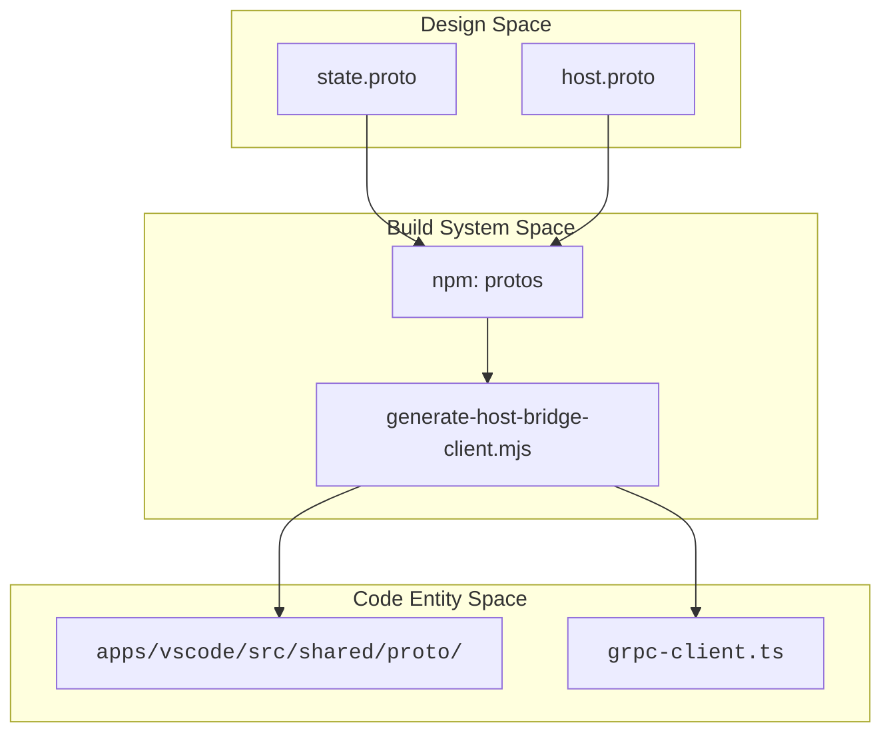

# Build System and Protocol Buffers

<details>
<summary>Relevant source files</summary>

The following files were used as context for generating this wiki page:

- [.gitignore](.gitignore)
- [.nvmrc](.nvmrc)
- [.tool-versions](.tool-versions)
- [.vscode/extensions.json](.vscode/extensions.json)
- [.vscode/launch.json](.vscode/launch.json)
- [.vscode/settings.json](.vscode/settings.json)
- [.vscode/tasks.json](.vscode/tasks.json)
- [apps/cli/script/build.ts](apps/cli/script/build.ts)
- [apps/cli/script/compile-binary.ts](apps/cli/script/compile-binary.ts)
- [apps/examples/desktop-app/scripts/build-desktop-runtime.ts](apps/examples/desktop-app/scripts/build-desktop-runtime.ts)
- [apps/vscode/scripts/clean-webview-vite-cache.mjs](apps/vscode/scripts/clean-webview-vite-cache.mjs)
- [apps/vscode/src/core/webview/WebviewProvider.ts](apps/vscode/src/core/webview/WebviewProvider.ts)
- [apps/vscode/webview-ui/src/utils/__tests__/hooks.spec.ts](apps/vscode/webview-ui/src/utils/__tests__/hooks.spec.ts)
- [apps/vscode/webview-ui/src/utils/__tests__/platformUtils.spec.ts](apps/vscode/webview-ui/src/utils/__tests__/platformUtils.spec.ts)
- [apps/vscode/webview-ui/src/utils/platformUtils.ts](apps/vscode/webview-ui/src/utils/platformUtils.ts)
- [apps/vscode/webview-ui/vite.config.ts](apps/vscode/webview-ui/vite.config.ts)
- [sdk/packages/agents/bun.mts](sdk/packages/agents/bun.mts)
- [sdk/packages/core/bun.mts](sdk/packages/core/bun.mts)
- [sdk/packages/core/tsconfig.build.json](sdk/packages/core/tsconfig.build.json)
- [sdk/packages/core/tsconfig.dev.json](sdk/packages/core/tsconfig.dev.json)
- [sdk/packages/core/tsconfig.json](sdk/packages/core/tsconfig.json)
- [sdk/packages/llms/bun.mts](sdk/packages/llms/bun.mts)
- [sdk/packages/shared/bun.mts](sdk/packages/shared/bun.mts)
- [sdk/packages/tsconfig.base.json](sdk/packages/tsconfig.base.json)
- [sdk/tsconfig.json](sdk/tsconfig.json)

</details>


This page documents the build pipeline for Cline, covering the compilation of the VS Code extension, the React webview, the Protocol Buffer and host-bridge generation workflow, Bun-based monorepo build scripts (`bun.mts`), and the VS Code tasks and launch configurations used during development.

---

## 1. Overview and Architecture

Cline utilizes a multi-stage build architecture centered around **Protocol Buffers** and **Bun workspace packages** to ensure type safety and consistent code sharing between the extension host (Node.js), the webview (React), and standalone runtime hosts (CLI and JetBrains plugins).

The build pipeline consists of several key layers:
1. **Protocol Buffer & Host-Bridge Generation**: `.proto` definitions are compiled into TypeScript models and client stubs for gRPC-over-postMessage communication `[.gitignore:41-43](), [.vscode/tasks.json:20-34]()`.
2. **SDK Bundling (`bun.mts`)**: Shared packages (`@cline/core`, `@cline/shared`, `@cline/llms`) use custom Bun build scripts targeting Node.js or browser runtimes `[sdk/packages/core/bun.mts:39-97](), [sdk/packages/shared/bun.mts:35-58]()`.
3. **Extension & Standalone Bundling**: `esbuild` compiles the VS Code extension host backend `[.vscode/tasks.json:148-185]()`, while `cline-core` packages provide standalone services `[apps/vscode/src/standalone/cline-core.ts:33-148]()`.
4. **Webview UI Build**: Vite builds the React frontend with target compatibility for modern and embedded webviews `[apps/vscode/webview-ui/vite.config.ts:83-114]()`.

Sources: `[.gitignore:41-43]()`, `[.vscode/tasks.json:20-185]()`, `[sdk/packages/core/bun.mts:39-97]()`, `[apps/vscode/webview-ui/vite.config.ts:83-114]()`

---

## 2. Protocol Buffers and Host-Bridge Generation

Protocol Buffers serve as the contract for gRPC service layers operating across process and extension boundaries.

### Compilation Workflow
The development environment triggers the `npm: protos` task to compile `.proto` files into shared data models and RPC client stubs `[.vscode/tasks.json:20-34]()`. Generated code outputs are git-ignored and populated into paths such as `apps/vscode/src/shared/proto/` and `apps/vscode/webview-ui/src/services/grpc-client.ts` `[.gitignore:42-43]()`. Additionally, host-bridge clients are generated for external host integrations.

### Protobuf Code Generation and Entity Mapping


Sources: `[.gitignore:41-43](), [.vscode/tasks.json:20-34]()`

---

## 3. SDK and Package Bundling with `bun.mts`

Workspace packages are compiled using Bun's native bundler via `bun.mts` entrypoint scripts. 

### Core Package Bundling
`sdk/packages/core/bun.mts` defines multi-target builds for entrypoints such as `remote-helper.ts`, `index.ts`, `hub/index.ts`, and daemon entry points `[sdk/packages/core/bun.mts:55-97]()`. It injects build-time constants like `__CLINE_CORE_RUNTIME_BUILD_ID__` and `__CLINE_CORE_RUNTIME_BUILD_EPOCH_MS__` while keeping declared runtime dependencies external `[sdk/packages/core/bun.mts:24-52]()`.

### Shared Package Bundling
`sdk/packages/shared/bun.mts` invokes `runBuild()` to output separate Node.js and browser-compatible bundles (`index.browser.ts`), supporting type declaration emission (`tsc --emitDeclarationOnly`) when `BUILD_MODE` is set to `package` `[sdk/packages/shared/bun.mts:14-73]()`.

```mermaid
graph TD
    subgraph "Build Scripts"
        B_CORE[""sdk/packages/core/bun.mts""]
        B_SHARED[""sdk/packages/shared/bun.mts""]
    end

    subgraph "Targets"
        T_NODE[""Node.js Bundles (dist/)""]
        T_BROWSER[""Browser Bundles (index.browser.ts)""]
        T_TYPES[""TypeScript Declarations""]
    end

    B_CORE --> T_NODE
    B_SHARED --> T_NODE
    B_SHARED --> T_BROWSER
    B_SHARED --> T_TYPES

    style B_CORE font-family:monospace
    style B_SHARED font-family:monospace
```
Sources: `[sdk/packages/core/bun.mts:24-97](), [sdk/packages/shared/bun.mts:14-73]()`

---

## 4. Extension and Standalone Core Bundling

The VS Code extension host code is compiled via `esbuild` tasks configured in package scripts and orchestrated through VS Code workspace tasks `[.vscode/tasks.json:148-185]()`. 

For standalone runtimes (such as JetBrains or CLI integrations), `apps/vscode/src/standalone/cline-core.ts` initializes process isolation, command-line arguments parsing, environment variable routing for protobus/hostbridge ports, and SQLite lock management.

Sources: `[.vscode/tasks.json:148-185]()`

---

## 5. Webview Build Configuration (Vite)

The React webview UI (`apps/vscode/webview-ui`) is built using Vite (`apps/vscode/webview-ui/vite.config.ts`) `[apps/vscode/webview-ui/vite.config.ts:48-50]()`.

* **Target & Compatibility**: Targets `chrome122` to accommodate both VS Code Electron runtimes and JetBrains JCEF embedded browsers `[apps/vscode/webview-ui/vite.config.ts:83-89]()`.
* **Environment Injection**: Injects flags such as `__PLATFORM__`, `IS_DEV`, and PostHog/OpenTelemetry environment variables via Vite's `define` block `[apps/vscode/webview-ui/vite.config.ts:131-150]()`.
* **React Deduplication**: Explicitly forces deduplication of `react` and `react-dom` to prevent multiple React instances from breaking hooks at runtime `[apps/vscode/webview-ui/vite.config.ts:151-167]()`.

Sources: `[apps/vscode/webview-ui/vite.config.ts:48-168]()`

---

## 6. VS Code Tasks and Launch Configurations

Development workflows rely on integrated tasks (`.vscode/tasks.json`) and debugger configurations (`.vscode/launch.json`).

* **Tasks (`.vscode/tasks.json`)**: Orchestrates prerequisites like `npm: protos` before initiating parallel watchers for the webview (`npm: dev:webview`), esbuild host code (`npm: watch:esbuild`), and TypeScript compilation (`npm: watch:tsc`) `[.vscode/tasks.json:36-244]()`.
* **Launch Configurations (`.vscode/launch.json`)**: Provides presets for launching the extension host in production, staging, local, or fresh install modes (`Run Extension (production)`), alongside debugging tasks for standalone core APIs (`Debug Test Standalone Core Api Server`) `[.vscode/launch.json:9-143]()`.

Sources: `[.vscode/tasks.json:36-244](), [.vscode/launch.json:9-143]()`

---

## 7. Summary of Key Build Tasks

| Label | Command | Purpose |
| :--- | :--- | :--- |
| `npm: protos` | `bun run protos` | Generates TypeScript code from `.proto` definitions. `[.vscode/tasks.json:20-34]()` |
| `npm: watch:esbuild` | `bun run watch:esbuild` | Incremental extension host compilation using esbuild. `[.vscode/tasks.json:148-185]()` |
| `npm: dev:webview` | `bun run dev:webview` | Starts the Vite development server for the React webview. `[.vscode/tasks.json:111-145]()` |
| `compile-standalone` | `bun run compile-standalone` | Compiles the standalone core service for testing. `[.vscode/tasks.json:7-18]()` |
| `watch` | (Composite Task) | Orchestrates protos, webview, esbuild, and tsc watchers. `[.vscode/tasks.json:36-51]()` |

Sources: `[.vscode/tasks.json:1-299]()`