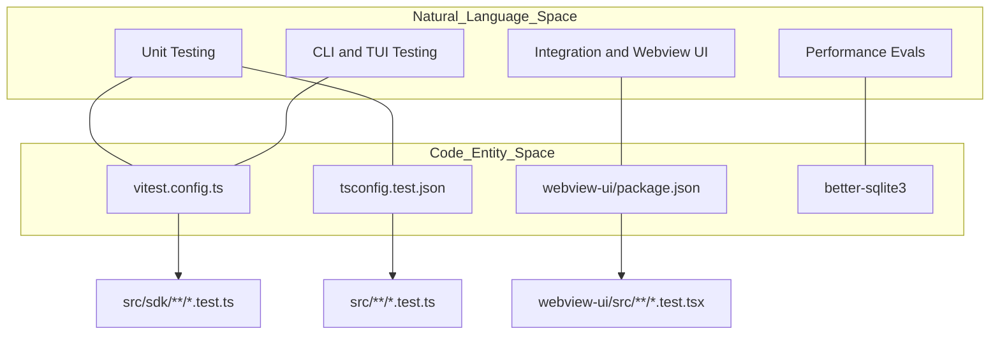
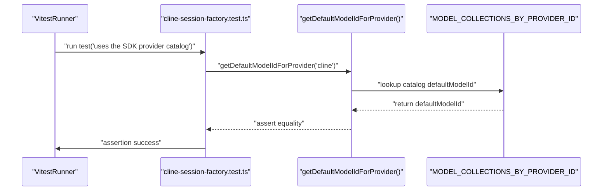

# Testing Infrastructure

Relevant source files

The following files were used as context for generating this wiki page:

- [.cline/skills/publish-extension/SKILL.md](.cline/skills/publish-extension/SKILL.md)
- [.github/workflows/cli-publish.yml](.github/workflows/cli-publish.yml)
- [.github/workflows/ext-vscode-ab-package.yml](.github/workflows/ext-vscode-ab-package.yml)
- [.github/workflows/ext-vscode-publish-legacy.yml](.github/workflows/ext-vscode-publish-legacy.yml)
- [.github/workflows/ext-vscode-publish-nightly.yml](.github/workflows/ext-vscode-publish-nightly.yml)
- [.github/workflows/ext-vscode-publish-stable.yml](.github/workflows/ext-vscode-publish-stable.yml)
- [.github/workflows/ext-vscode-publish.yml](.github/workflows/ext-vscode-publish.yml)
- [.github/workflows/ext-vscode-test-e2e.yml](.github/workflows/ext-vscode-test-e2e.yml)
- [.github/workflows/ext-vscode-test.yml](.github/workflows/ext-vscode-test.yml)
- [.github/workflows/sdk-publish.yml](.github/workflows/sdk-publish.yml)
- [.husky/pre-commit](.husky/pre-commit)
- [apps/vscode-rollout/scripts/set-version.mjs](apps/vscode-rollout/scripts/set-version.mjs)
- [apps/vscode-rollout/scripts/set-version.test.mjs](apps/vscode-rollout/scripts/set-version.test.mjs)
- [apps/vscode/.vscode-test.mjs](apps/vscode/.vscode-test.mjs)
- [apps/vscode/.vscodeignore](apps/vscode/.vscodeignore)
- [apps/vscode/scripts/interactive-playwright.ts](apps/vscode/scripts/interactive-playwright.ts)
- [apps/vscode/src/hosts/vscode/__tests__/commit-message-generator.test.ts](apps/vscode/src/hosts/vscode/__tests__/commit-message-generator.test.ts)
- [apps/vscode/src/hosts/vscode/commit-message-generator.ts](apps/vscode/src/hosts/vscode/commit-message-generator.ts)
- [apps/vscode/src/sdk/cline-request-client-context.test.ts](apps/vscode/src/sdk/cline-request-client-context.test.ts)
- [apps/vscode/src/sdk/cline-session-factory.test.ts](apps/vscode/src/sdk/cline-session-factory.test.ts)
- [apps/vscode/src/sdk/cline-session-factory.ts](apps/vscode/src/sdk/cline-session-factory.ts)
- [apps/vscode/src/sdk/legacy-task-handling.test.ts](apps/vscode/src/sdk/legacy-task-handling.test.ts)
- [apps/vscode/src/sdk/legacy-task-handling.ts](apps/vscode/src/sdk/legacy-task-handling.ts)
- [apps/vscode/src/sdk/sdk-api-handler.test.ts](apps/vscode/src/sdk/sdk-api-handler.test.ts)
- [apps/vscode/src/sdk/sdk-api-handler.ts](apps/vscode/src/sdk/sdk-api-handler.ts)
- [apps/vscode/src/sdk/slash-command-expansion.test.ts](apps/vscode/src/sdk/slash-command-expansion.test.ts)
- [apps/vscode/src/sdk/slash-command-expansion.ts](apps/vscode/src/sdk/slash-command-expansion.ts)
- [apps/vscode/src/shared/net.test.ts](apps/vscode/src/shared/net.test.ts)
- [apps/vscode/src/shared/net.ts](apps/vscode/src/shared/net.ts)
- [apps/vscode/src/test/cline-core-vitest-stub.ts](apps/vscode/src/test/cline-core-vitest-stub.ts)
- [apps/vscode/src/test/e2e/utils/build.mjs](apps/vscode/src/test/e2e/utils/build.mjs)
- [apps/vscode/src/test/e2e/utils/helpers.ts](apps/vscode/src/test/e2e/utils/helpers.ts)
- [apps/vscode/src/test/zod-vitest-stub.ts](apps/vscode/src/test/zod-vitest-stub.ts)
- [apps/vscode/tsconfig.test.json](apps/vscode/tsconfig.test.json)
- [apps/vscode/vitest.config.ts](apps/vscode/vitest.config.ts)
- [sdk/packages/core/src/extensions/config/runtime-commands.test.ts](sdk/packages/core/src/extensions/config/runtime-commands.test.ts)
- [sdk/packages/core/src/extensions/config/runtime-commands.ts](sdk/packages/core/src/extensions/config/runtime-commands.ts)
- [sdk/packages/core/src/extensions/config/user-instruction-plugin.ts](sdk/packages/core/src/extensions/config/user-instruction-plugin.ts)
- [sdk/packages/core/src/extensions/config/user-instruction-service.ts](sdk/packages/core/src/extensions/config/user-instruction-service.ts)
- [sdk/packages/core/src/hub/server/hub-capability-tool-executors.test.ts](sdk/packages/core/src/hub/server/hub-capability-tool-executors.test.ts)
- [sdk/packages/core/src/hub/server/hub-client-contributions.ts](sdk/packages/core/src/hub/server/hub-client-contributions.ts)
- [sdk/packages/core/src/hub/server/hub-event-log.test.ts](sdk/packages/core/src/hub/server/hub-event-log.test.ts)
- [sdk/packages/core/src/hub/server/hub-event-log.ts](sdk/packages/core/src/hub/server/hub-event-log.ts)
- [sdk/packages/core/src/hub/server/hub-user-instruction-rules.test.ts](sdk/packages/core/src/hub/server/hub-user-instruction-rules.test.ts)
- [sdk/packages/core/src/runtime/safety/rules.test.ts](sdk/packages/core/src/runtime/safety/rules.test.ts)
- [sdk/packages/core/src/runtime/safety/rules.ts](sdk/packages/core/src/runtime/safety/rules.ts)
- [sdk/packages/llms/src/providers/request-headers.test.ts](sdk/packages/llms/src/providers/request-headers.test.ts)
- [sdk/packages/llms/src/providers/request-headers.ts](sdk/packages/llms/src/providers/request-headers.ts)
- [sdk/packages/llms/src/providers/vendors/cline.test.ts](sdk/packages/llms/src/providers/vendors/cline.test.ts)

The purpose of this page is to describe the testing infrastructure across the Cline monorepo, covering Vitest and Mocha setups, configuration files and stubs, end-to-end (E2E) suites, Biome linting, coverage checks, and CI test workflows.

---

## Framework Overview

The repository uses separate testing stacks for different architectural layers.

| Layer | Framework | Assertion | Mocking | Configuration |
|:---|:---|:---|:---|:---|
| **Extension / Core** | Mocha + `ts-node` | `should` / `chai` | Sinon | `apps/vscode/tsconfig.test.json` |
| **SDK / Model Logic**| Vitest | `expect` | `vi.mock` | `apps/vscode/vitest.config.ts` |
| **CLI Core** | Vitest | `expect` | `vi.mock` | `apps/cli/vitest.config.ts` |
| **CLI E2E / TUI** | `tui-test` / `tuistory` | Custom | Mock APIs | `apps/cli/package.json` |
| **Webview UI** | Vitest + jsdom | Vitest `expect` | Vitest `vi` | `apps/vscode/webview-ui/package.json` |
| **Evals / Analysis** | `ts-node` | Custom Metrics | SQLite | `evals/package.json` |

Sources: [apps/vscode/tsconfig.test.json:8-17](), [apps/vscode/vitest.config.ts:7-27]()

---

## Unit Testing & Module Compatibility

### Mocha Integration
Tests in `src/` of the VS Code extension are executed using Mocha with `ts-node/register`. Because VS Code's test runner requires CommonJS modules while the main project uses ES Modules (ESM), `apps/vscode/tsconfig.test.json` re-declares the module system as `commonjs` [apps/vscode/tsconfig.test.json:9-10](). It also re-maps bare subpath imports like `@cline/shared/storage` to the built `dist` folder so the CommonJS runner can resolve them [apps/vscode/tsconfig.test.json:11-53]().

### Vitest for SDK and Models
Newer suites, particularly those involving the SDK adapter, model catalog, and controller state logic, use **Vitest** [apps/vscode/vitest.config.ts:4-6](). 
- **Aliases**: Vitest is configured with extensive aliases (e.g., `@api`, `@core`, `@shared`, `@generated`) to resolve source files during testing [apps/vscode/vitest.config.ts:43-68]().
- **Timeouts**: The `testTimeout` is increased to 20,000ms to account for heavy imports of `@cline/core`, `@cline/llms`, and `@cline/shared` on CI runners [apps/vscode/vitest.config.ts:33-37]().
- **Stubbing**: The environment uses stubs for VS Code APIs (`vscode-vitest-stub.ts`) and core logic (`cline-core-vitest-stub.ts`) [apps/vscode/vitest.config.ts:45-54](), [apps/vscode/src/test/cline-core-vitest-stub.ts:1-173]().

**Example Test Suite: Model Refresh Logic**
Tests verify that core routines handle session configuration inputs and defaults correctly [apps/vscode/src/sdk/cline-session-factory.test.ts:145-173]().

Sources: [apps/vscode/tsconfig.test.json:1-97](), [apps/vscode/vitest.config.ts:1-70](), [apps/vscode/src/sdk/cline-session-factory.test.ts:1-198]()

---

## E2E Suites and Test Harness

End-to-end (E2E) test suites validate complete integration paths, such as the VS Code extension loading inside a real VS Code instance via Playwright and `@vscode/test-electron` [apps/vscode/src/test/e2e/utils/helpers.ts:6-7]().

### E2ETestHelper
The `E2ETestHelper` class provides path resolution, window diagnostic collection, process cleanup (`rmForRetries`), and sidebar frame retrieval (`getSidebar`) [apps/vscode/src/test/e2e/utils/helpers.ts:22-138](). It resolves VS Code executables across platforms, handling timeout windows and diagnostic tracking.

Sources: [apps/vscode/src/test/e2e/utils/helpers.ts:1-200]()

---

## Biome Linting, Coverage Checks, and CI Test Workflows

Code quality and correctness are enforced via Biome linting and automated GitHub Actions workflows.

### CI Workflows
- **`ext-vscode-test-e2e.yml`**: Runs cross-platform E2E tests across Ubuntu, Windows, and macOS runners. It handles caching of Bun install caches, VS Code binaries, and Playwright browsers, builds SDK packages, checks for native binaries like `better-sqlite3`, and runs test suites.
- **`ext-vscode-ab-package.yml`** & **`ext-vscode-publish-nightly.yml`**: Coordinate packaging, testing next and legacy bundles, validation checks, and deployment staging.

Sources: [.github/workflows/ext-vscode-ab-package.yml:1-136](), [.github/workflows/ext-vscode-publish-nightly.yml:1-160]()

---

## Infrastructure Mapping

The following diagrams bridge high-level testing categories to the specific code entities that implement them.

**Diagram: Testing Infrastructure Mapping**

Sources: [apps/vscode/vitest.config.ts:9-26](), [apps/vscode/tsconfig.test.json:71-75]()

**Diagram: State and Policy Testing Flow**

Sources: [apps/vscode/src/sdk/cline-session-factory.test.ts:145-173]()

---

## Tool Policy and State Testing

The testing infrastructure includes specific validation for safety mechanisms, state transitions, and configuration builders.

### SDK Session Factory Tests
The `cline-session-factory.test.ts` suite validates session building logic, provider default mappings, and parameter translation between legacy configurations and SDK input structures [apps/vscode/src/sdk/cline-session-factory.test.ts:145-198]().

Sources: [apps/vscode/src/sdk/cline-session-factory.test.ts:1-198]()