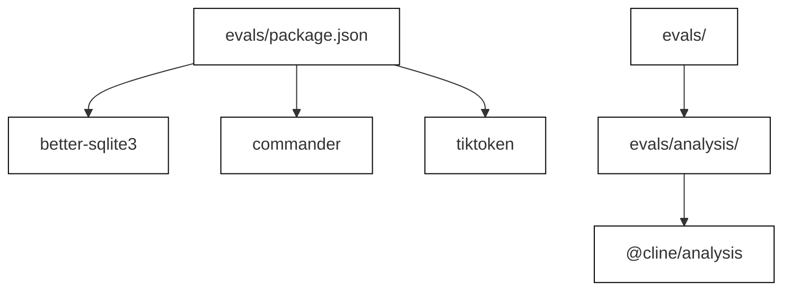
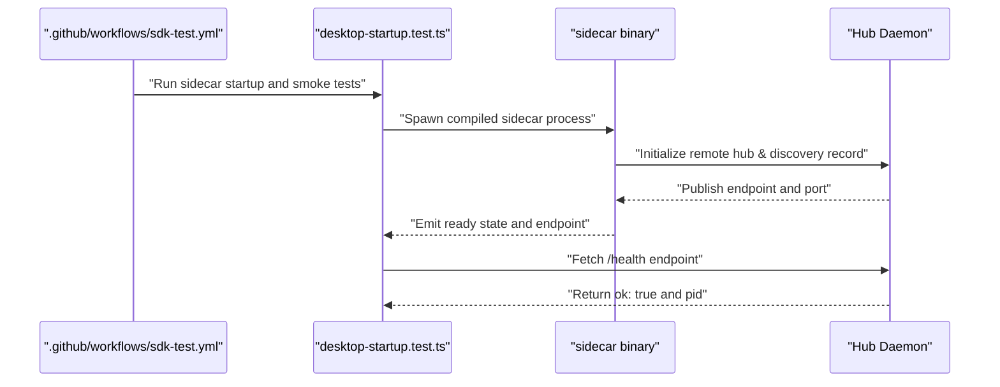
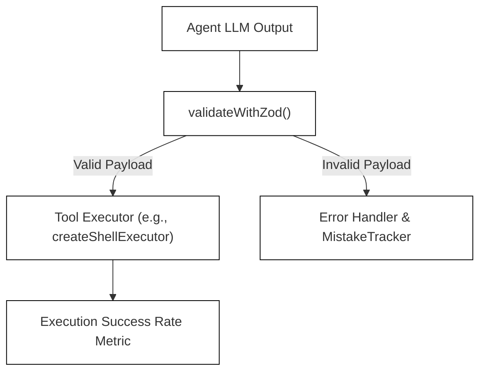
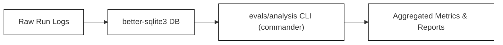

# Evals and Benchmarks

Relevant source files

The following files were used as context for generating this wiki page:

- [apps/vscode/src/sdk/vscode-run-commands-tool.test.ts](apps/vscode/src/sdk/vscode-run-commands-tool.test.ts)
- [apps/vscode/src/sdk/vscode-run-commands-tool.ts](apps/vscode/src/sdk/vscode-run-commands-tool.ts)
- [apps/vscode/src/test/shell.test.ts](apps/vscode/src/test/shell.test.ts)
- [apps/vscode/src/utils/shell.ts](apps/vscode/src/utils/shell.ts)
- [apps/vscode/standalone/runtime-files/package-lock.json](apps/vscode/standalone/runtime-files/package-lock.json)
- [apps/vscode/standalone/runtime-files/package.json](apps/vscode/standalone/runtime-files/package.json)
- [docs/package-lock.json](docs/package-lock.json)
- [docs/package.json](docs/package.json)
- [evals/package-lock.json](evals/package-lock.json)
- [evals/package.json](evals/package.json)
- [sdk/packages/core/src/extensions/tools/definitions.test.ts](sdk/packages/core/src/extensions/tools/definitions.test.ts)
- [sdk/packages/core/src/extensions/tools/definitions.ts](sdk/packages/core/src/extensions/tools/definitions.ts)
- [sdk/packages/core/src/extensions/tools/executors/bash.powershell.test.ts](sdk/packages/core/src/extensions/tools/executors/bash.powershell.test.ts)
- [sdk/packages/core/src/extensions/tools/executors/bash.test.ts](sdk/packages/core/src/extensions/tools/executors/bash.test.ts)
- [sdk/packages/core/src/extensions/tools/executors/bash.ts](sdk/packages/core/src/extensions/tools/executors/bash.ts)
- [sdk/packages/core/src/extensions/tools/executors/index.ts](sdk/packages/core/src/extensions/tools/executors/index.ts)
- [sdk/packages/core/src/extensions/tools/helpers.ts](sdk/packages/core/src/extensions/tools/helpers.ts)
- [sdk/packages/core/src/extensions/tools/index.test.ts](sdk/packages/core/src/extensions/tools/index.test.ts)
- [sdk/packages/core/src/extensions/tools/index.ts](sdk/packages/core/src/extensions/tools/index.ts)
- [sdk/packages/core/src/extensions/tools/schemas.ts](sdk/packages/core/src/extensions/tools/schemas.ts)
- [sdk/packages/shared/src/parse/shell.invocation.test.ts](sdk/packages/shared/src/parse/shell.invocation.test.ts)
- [sdk/packages/shared/src/parse/shell.test.ts](sdk/packages/shared/src/parse/shell.test.ts)
- [sdk/packages/shared/src/parse/shell.ts](sdk/packages/shared/src/parse/shell.ts)

## Purpose and Scope
This document details the evaluation and benchmarking framework housed within the `evals/` directory of the Cline monorepo [evals/package.json:1-22](). It covers smoke-test scenarios, the end-to-end (E2E) testing harness, tool-precision benchmarks, and the standalone analysis tooling (`evals/analysis`) used to measure agent performance, token utilization, and system behavior.

---

## 14.3.1 Evaluation Directory Structure and Tooling
The `cline-evals` package is configured as a standalone tooling environment managed via `package.json` [evals/package.json:1-22](). It relies on database storage (`better-sqlite3`), CLI argument parsing (`commander`), styled terminal outputs (`chalk`), environment configuration (`dotenv`), and token counting (`tiktoken`) [evals/package.json:9-15]().

*Figure 1: Evaluation framework package dependencies and structural layout mapping natural language concepts to package entities.*

**Sources:**
- `evals/package.json` [evals/package.json:1-22]()
- `evals/analysis/package-lock.json` [evals/analysis/package-lock.json:1-22]()

---

## 14.3.2 Smoke-Test Scenarios and Harness
Smoke tests validate core component integration, binary compilation, and runtime startup. For instance, the desktop sidecar startup test exercises the compiled entrypoint to ensure the embedded Hub daemon successfully publishes its endpoint and responds to health checks [apps/examples/desktop-app/scripts/desktop-startup.test.ts:14-99](). In CI workflows, Node-based SQLite smoke tests (`ci-node-smoke.ts`) are executed to guarantee native database bindings operate correctly across target operating systems [.github/workflows/sdk-test.yml:111-115]().

*Figure 2: Sequence flow of the sidecar startup smoke test verifying binary execution and Hub readiness.*

**Sources:**
- `apps/examples/desktop-app/scripts/desktop-startup.test.ts` [apps/examples/desktop-app/scripts/desktop-startup.test.ts:1-146]()
- `.github/workflows/sdk-test.yml` [.github/workflows/sdk-test.yml:111-115]()

---

## 14.3.3 End-to-End (E2E) Test Harness and CLI Integration
End-to-end tests exercise interactive flows, including Terminal User Interface (TUI) workflows. The CI test suites invoke CLI-specific E2E suites (`test:e2e:cli:tui`) on Linux environments to validate end-user command interactions and headless execution modes [.github/workflows/sdk-test.yml:116-119](). These harnesses mock provider interactions or run against live endpoints when test keys are provided.

**Sources:**
- `.github/workflows/sdk-test.yml` [.github/workflows/sdk-test.yml:1-122]()

---

## 14.3.4 Tool-Precision Benchmarks
Tool-precision benchmarks evaluate the agent's ability to select, parameterize, and execute tools (such as file editing via `EditFileInputSchema` [sdk/packages/core/src/extensions/tools/schemas.ts:194-209](), terminal commands via `RunCommandsInputSchema` [sdk/packages/core/src/extensions/tools/schemas.ts:149-153](), and workspace search via `SearchCodebaseInputSchema` [sdk/packages/core/src/extensions/tools/schemas.ts:111-115]()) accurately without hallucinating parameters or violating tool policies. 

Key metrics captured during tool-precision evaluation include:
* **Argument Correctness:** Validating whether generated JSON payloads match expected tool input schemas (`validateWithZod` [sdk/packages/core/src/extensions/tools/helpers.ts:1]()).
* **Execution Success Rate:** Tracking the ratio of successful tool completions versus tool errors or loop triggers.
* **Token Overhead:** Measuring prompt and completion token counts using `tiktoken` [evals/package.json:14]() across tool-use loops.

*Figure 3: Tool-precision evaluation pipeline bridging natural language agent output to validation code entities.*

**Sources:**
- `evals/package.json` [evals/package.json:1-22]()
- `sdk/packages/core/src/extensions/tools/schemas.ts` [sdk/packages/core/src/extensions/tools/schemas.ts:1-356]()
- `sdk/packages/core/src/extensions/tools/helpers.ts` [sdk/packages/core/src/extensions/tools/helpers.ts:1-207]()

---

## 14.3.5 Analysis Tooling (`evals/analysis`)
The `evals/analysis` sub-workspace provides command-line utilities built with `commander` [evals/analysis/package-lock.json:10-14]() and `better-sqlite3` to parse, aggregate, and report on evaluation run results stored in SQLite databases.

*Figure 4: Data flow through the analysis workspace, mapping log storage to commander-driven metric reporting.*

**Sources:**
- `evals/package.json` [evals/package.json:1-22]()
- `evals/analysis/package-lock.json` [evals/analysis/package-lock.json:1-22]()