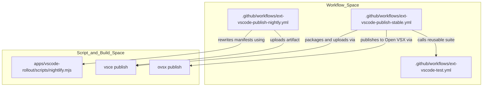
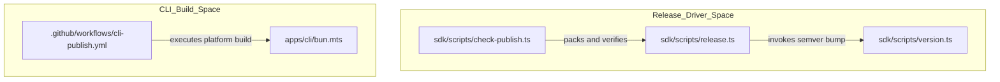

# Publishing and Release

Relevant source files

The following files were used as context for generating this wiki page:

- [.cline/skills/publish-extension/SKILL.md](.cline/skills/publish-extension/SKILL.md)
- [.github/workflows/cli-publish.yml](.github/workflows/cli-publish.yml)
- [.github/workflows/ext-vscode-ab-package.yml](.github/workflows/ext-vscode-ab-package.yml)
- [.github/workflows/ext-vscode-publish-legacy.yml](.github/workflows/ext-vscode-publish-legacy.yml)
- [.github/workflows/ext-vscode-publish-nightly.yml](.github/workflows/ext-vscode-publish-nightly.yml)
- [.github/workflows/ext-vscode-publish-stable.yml](.github/workflows/ext-vscode-publish-stable.yml)
- [.github/workflows/ext-vscode-publish.yml](.github/workflows/ext-vscode-publish.yml)
- [.github/workflows/ext-vscode-test-e2e.yml](.github/workflows/ext-vscode-test-e2e.yml)
- [.github/workflows/ext-vscode-test.yml](.github/workflows/ext-vscode-test.yml)
- [.github/workflows/sdk-publish.yml](.github/workflows/sdk-publish.yml)
- [.husky/pre-commit](.husky/pre-commit)
- [apps/vscode-rollout/scripts/set-version.mjs](apps/vscode-rollout/scripts/set-version.mjs)
- [apps/vscode-rollout/scripts/set-version.test.mjs](apps/vscode-rollout/scripts/set-version.test.mjs)
- [apps/vscode/.vscode-test.mjs](apps/vscode/.vscode-test.mjs)
- [apps/vscode/.vscodeignore](apps/vscode/.vscodeignore)
- [apps/vscode/scripts/interactive-playwright.ts](apps/vscode/scripts/interactive-playwright.ts)
- [apps/vscode/src/test/e2e/utils/build.mjs](apps/vscode/src/test/e2e/utils/build.mjs)
- [apps/vscode/src/test/e2e/utils/helpers.ts](apps/vscode/src/test/e2e/utils/helpers.ts)
- [sdk/scripts/check-publish.ts](sdk/scripts/check-publish.ts)
- [sdk/scripts/release.ts](sdk/scripts/release.ts)
- [sdk/scripts/version.ts](sdk/scripts/version.ts)

This document details the automated release infrastructure across the monorepo, covering GitHub Actions publish workflows for the VS Code extension, standalone CLI, SDK packages, and desktop applications, along with release driver scripts, pre-publish validation checks, and secure credential handling.

---

## 1. Extension Release Architecture

The VS Code extension distribution pipeline handles stable, nightly, and legacy hotfix releases. Following the completion of the legacy-to-SDK migration, stable releases ship as a clean build of `main`, while nightly builds and legacy branches retain specific compatibility and rollout paths [[.cline/skills/publish-extension/SKILL.md:12-16]]().

### Distribution Channels and Workflows

| Channel | Marketplace ID | Workflow File | Trigger Mechanism | Version Reference |
|---|---|---|---|---|
| **Stable** | `saoudrizwan.claude-dev` | `[.github/workflows/ext-vscode-publish-stable.yml]()` | `workflow_dispatch` from `main` | `apps/vscode/package.json` on `main`; tag `v<version>` [[.github/workflows/ext-vscode-publish-stable.yml:4-23]()] |
| **Nightly** | `saoudrizwan.cline-nightly` | `[.github/workflows/ext-vscode-publish-nightly.yml]()` | Manual dispatch only (`workflow_dispatch`) | Auto-generated `<major>.<minor>.<unix-ts>` [[.github/workflows/ext-vscode-publish-nightly.yml:23-34]()] |
| **Legacy Hotfix** | `saoudrizwan.claude-dev` | `[.github/workflows/ext-vscode-publish-legacy.yml]()` | `workflow_dispatch` from `legacy-extension` | `apps/vscode/package.json` on `legacy-extension` [[.github/workflows/ext-vscode-publish-legacy.yml:14-23]()] |
| **Combined A/B** | `saoudrizwan.claude-dev` | `[.github/workflows/ext-vscode-ab-package.yml]()` | `workflow_dispatch` | Union manifest and bundle manifests [[.github/workflows/ext-vscode-ab-package.yml:15-30]()] |

### Stable and Nightly Pipeline Execution

Stable publication is controlled by `[.github/workflows/ext-vscode-publish-stable.yml]()`, which runs the reusable test suite `[.github/workflows/ext-vscode-test.yml]()` before requiring explicit reviewer approval in the `publish` GitHub environment [[.github/workflows/ext-vscode-publish-stable.yml:35-43]]().

Title: Extension Publishing Code Entity Map

Sources: `[.github/workflows/ext-vscode-publish-stable.yml:1-45]`, `[.github/workflows/ext-vscode-publish-nightly.yml:48-70]`, `[.github/workflows/ext-vscode-test.yml:1-20]()`

**Key Implementation Details:**
- **Tag Validation:** The stable workflow verifies that input tags match `vX.Y.Z` semantics and aligns with `apps/vscode/package.json` [[.github/workflows/ext-vscode-publish-stable.yml:55-73]]().
- **Native Addon Checks:** Packaging jobs explicitly assert the presence of `better-sqlite3` native binaries at `node_modules/better-sqlite3/build/Release/better_sqlite3.node` prior to VSIX creation [[.github/workflows/ext-vscode-publish-stable.yml:150-159]]().

Sources: `[.cline/skills/publish-extension/SKILL.md:1-48]`, `[.github/workflows/ext-vscode-publish-stable.yml:1-162]`, `[.github/workflows/ext-vscode-publish-nightly.yml:1-160]()`

---

## 2. SDK and CLI Release Processes

The Cline SDK packages (`@cline/shared`, `@cline/llms`, `@cline/agents`, `@cline/core`, and `@cline/sdk`) and the CLI application (`apps/cli`) are orchestrated via Bun release drivers and automated OIDC-authenticated npm publishing [[sdk/scripts/release.ts:6-51](), [.github/workflows/cli-publish.yml:30-32]()].

### SDK Versioning and Topological Publication

- **Release Orchestration Script:** `[sdk/scripts/release.ts]()` manages validation, test runs, git tag creation, and publishing [[sdk/scripts/release.ts:6-16]]().
- **Workspace Version Bump:** `[sdk/scripts/version.ts]()` increments patch versions across all non-internal packages, removes stale lockfiles, runs `bun -F @cline/llms generate:models`, and formats code [[sdk/scripts/version.ts:35-120]]().
- **Topological Order:** `SDK_PUBLISH_ORDER` enforces strict publishing sequence: `shared` → `llms` → `agents` → `core` → `sdk` [[sdk/scripts/release.ts:77-77]]().
- **Pre-Publish Verification:** `[sdk/scripts/check-publish.ts]()` packs tarballs using `bun pm pack`, validates dependency alignment against exact workspace versions, verifies export maps lack development conditions, and performs isolated test installations [[sdk/scripts/check-publish.ts:81-221]()].

### CLI Binary Packaging (`cli-publish.yml`)

The CLI workflow compiles platform-specific binaries targeting multiple architectures [[.github/workflows/cli-publish.yml:1-195]()].
- **Build Integration:** `apps/cli/bun.mts` compiles standalone entrypoints targeting Node.js [[apps/cli/bun.mts:64-85]]().
- **Target Matrices:** Generates packages for `@cline/cli-darwin-arm64`, `@cline/cli-darwin-x64`, `@cline/cli-linux-arm64`, `@cline/cli-linux-x64`, `@cline/cli-windows-arm64`, and `@cline/cli-windows-x64` [[.github/workflows/cli-publish.yml:167-174]]().
- **Trusted Publishing:** Uses GitHub Actions `id-token: write` permissions with npm OIDC [[.github/workflows/cli-publish.yml:30-32]]().

Title: SDK and CLI Release Code Map

Sources: `[sdk/scripts/release.ts:1-80]`, `[sdk/scripts/version.ts:1-120]`, `[sdk/scripts/check-publish.ts:1-100]`, `[.github/workflows/cli-publish.yml:133-162]()`

Sources: `[sdk/scripts/release.ts:1-549]`, `[sdk/scripts/version.ts:1-120]`, `[sdk/scripts/check-publish.ts:1-352]`, `[.github/workflows/cli-publish.yml:1-195]()`

---

## 3. Secret and Security Management

- **Environment-Gated Secrets:** Sensitive tokens (such as `TAURI_SIGNING_PRIVATE_KEY` and code signing certificates) are restricted to protected environments like `PublishDesktop` and `publish` to prevent unauthorized workflow access.
- **Marketplace Tokens:** VS Code Marketplace and Open VSX uploads authenticate via `VSCE_PAT` and `OVSX_PAT` secrets.
- **Pre-Commit Secret Scanning:** Husky pre-commit hooks enforce local checks using `gitleaks` to prevent accidental credential leakage [.husky/pre-commit:1-11]().

Sources: `[.husky/pre-commit:1-11]()`