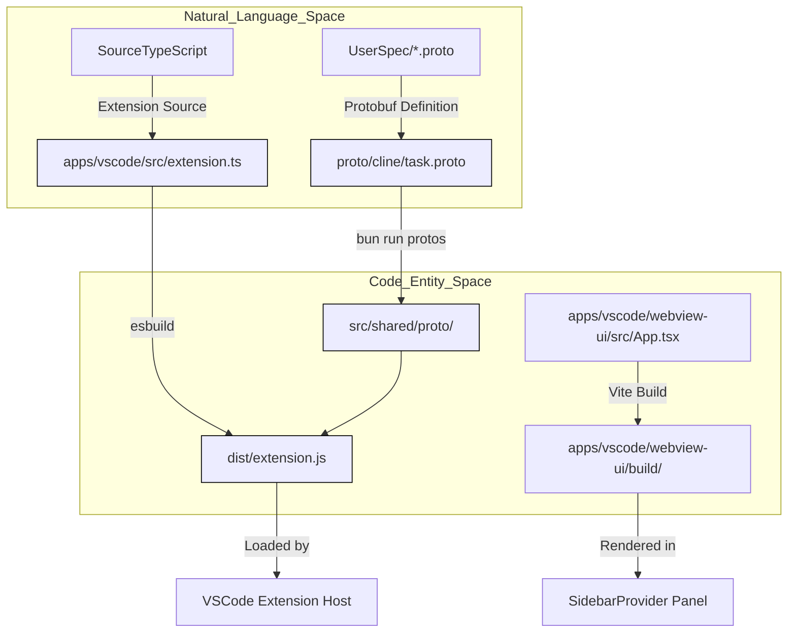
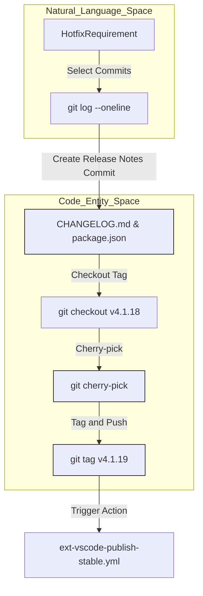

# Contributing and Agent Workflows

<details>
<summary>Relevant source files</summary>

The following files were used as context for generating this wiki page:

- [.claude/commands/hotfix-release.md](.claude/commands/hotfix-release.md)
- [.claude/commands/release.md](.claude/commands/release.md)
- [.claude/hooks/claude-code-for-web-setup.sh](.claude/hooks/claude-code-for-web-setup.sh)
- [.claude/settings.json](.claude/settings.json)
- [.clinerules/general.md](.clinerules/general.md)
- [.clinerules/workflows/address-pr-comments.md](.clinerules/workflows/address-pr-comments.md)
- [.clinerules/workflows/find-pr-reviewers.md](.clinerules/workflows/find-pr-reviewers.md)
- [.clinerules/workflows/hotfix-release.md](.clinerules/workflows/hotfix-release.md)
- [.clinerules/workflows/pr-review.md](.clinerules/workflows/pr-review.md)
- [.clinerules/workflows/release.md](.clinerules/workflows/release.md)
- [.github/CODEOWNERS](.github/CODEOWNERS)
- [.github/ISSUE_TEMPLATE/bug_report.yml](.github/ISSUE_TEMPLATE/bug_report.yml)
- [.github/ISSUE_TEMPLATE/config.yml](.github/ISSUE_TEMPLATE/config.yml)
- [.github/copilot-instructions.md](.github/copilot-instructions.md)
- [.github/pull_request_template.md](.github/pull_request_template.md)
- [.worktreeinclude](.worktreeinclude)
- [CHANGELOG.md](CHANGELOG.md)
- [CODE_OF_CONDUCT.md](CODE_OF_CONDUCT.md)
- [CONTRIBUTING.md](CONTRIBUTING.md)
- [README.md](README.md)
- [apps/vscode/package.json](apps/vscode/package.json)
- [package.json](package.json)

</details>


## Purpose and Scope

This page documents the processes, tools, and standards for contributing code, documentation, and agent workflows to the Cline project. It covers local development setup using Bun workspaces [package.json:4-14](), repository governance via CODEOWNERS [.github/CODEOWNERS:1-2](), pull request conventions [.github/pull_request_template.md:1-64](), code quality enforcement using Biome [package.json:32-35](), gRPC/Protobuf protocols [.clinerules/general.md:67-82](), testing infrastructure [package.json:26-29](), and the internal agent workflows, `.clinerules`, `.agents` skills, and `.claude` automation commands.

---

## Repository Setup and Workspace Architecture

### Initial Setup Steps

The repository is structured as a Bun monorepo managing multiple workspace packages under `sdk/packages/*`, `apps/*`, and example directories [package.json:4-14](). Contributors must ensure `git-lfs` is configured for large asset tracking [CONTRIBUTING.md:37-40]().

**Prerequisites:**
- Git with `git-lfs` enabled [CONTRIBUTING.md:37-40]().
- Node.js (version 22 or higher) [package.json:54-54]().
- [Bun](https://bun.com) (version 1.4.2) [package.json:53-53](), [package.json:91-91]().
- VS Code with required extensions (such as esbuild problem matchers and Biome) [CONTRIBUTING.md:52-52](), [CONTRIBUTING.md:69-74]().

**Setup Commands:**
```bash
# Clone the repository
git clone https://github.com/cline/cline.git
cd cline

# Install dependencies for extension and webview
cd apps/vscode && bun run install:all && cd ../..

# Build SDK packages
sdk && bun run build && cd ..

# Generate Protocol Buffer bindings (required before first build)
cd apps/vscode && bun run protos && cd ../..
```

Sources: [CONTRIBUTING.md:37-52](), [package.json:4-14](), [package.json:53-55](), [package.json:91-91]()

### Development Environment Diagram

This diagram maps natural language workflows and source artifacts to underlying code entities within the Bun monorepo build pipeline.



Sources: [package.json:15-38](), [CONTRIBUTING.md:75-82](), [.clinerules/general.md:67-82]()

---

## Contribution Workflow, CODEOWNERS, and Governance

### Issue and Pull Request Policy

All feature changes must originate from an approved GitHub Issue and discussion board entry:
1. **Feature Proposals**: Review the Feature Requests discussions board before implementation [CONTRIBUTING.md:17-18](), [.github/pull_request_template.md:5-5]().
2. **Approval**: Obtain explicit approval from core maintainers prior to starting PR implementation [CONTRIBUTING.md:20-20]().
3. **Bug Reports**: Ensure bugs are reproducible using Claude Sonnet via the bug report template [.github/ISSUE_TEMPLATE/bug_report.yml:8-8]().
4. **Codeowners**: Core paths (`/.github/`, `/README.md`) are governed by designated maintainers listed in `.github/CODEOWNERS` [.github/CODEOWNERS:1-2]().

Sources: [CONTRIBUTING.md:14-24](), [.github/ISSUE_TEMPLATE/bug_report.yml:1-22](), [.github/CODEOWNERS:1-2](), [.github/pull_request_template.md:4-13]()

### Pull Request Conventions

- **Focus**: Keep pull requests scoped to a single bugfix or feature [CONTRIBUTING.md:130-132](), [.github/pull_request_template.md:61-61]().
- **Formatting**: Execute `bun run format` to automatically format modified files before commit [CONTRIBUTING.md:139-139](), [.github/pull_request_template.md:62-62]().
- **Changelog**: Contributors **must not** create changelog-entry files; maintainers curate versions during release [CONTRIBUTING.md:92-94](), [.clinerules/general.md:20-20]().
- **Template**: Populate the Related Issue, Test Procedure, and Checklist sections [.github/pull_request_template.md:15-64]().

Sources: [CONTRIBUTING.md:129-149](), [.github/pull_request_template.md:1-79](), [.clinerules/general.md:20-20]()

---

## Code Quality Standards, Biome, and `.clinerules` Best Practices

### Biome Enforcement and Formatting

The repository utilizes **Biome** for strict linting and formatting compliance [package.json:57-57]().
- **Linting**: Run `bun run lint` to check syntax and formatting [package.json:34-34]().
- **Formatting**: Run `bun run format` across workspace packages [package.json:33-33]().
- **Auto-Fixing**: Run `bun run fix` to apply safe diagnostic corrections [package.json:35-35]().
- **Type Checking**: Run `bun run types` in parallel across packages [package.json:25-25]().

Sources: [package.json:25-38](), [CONTRIBUTING.md:135-142]()

### Tribal Knowledge and `.clinerules` Guidelines

Contributors and automated agents must adhere to tribal knowledge captured in `.clinerules/general.md`:
- **Package Manager**: Always use `bun run X`, `bun install`, or `bunx <bin>`. Never emit `npm` or `npx` commands [.clinerules/general.md:16-16]().
- **Provider Normalization**: Avoid ad-hoc provider string matching (e.g., `providerId === "..."`). Rely on shared catalogs, metadata, or protocol capabilities [.clinerules/general.md:17-17]().
- **BOM Handling**: When reading configuration files that users may edit, utilize `readFileStrippingUtf8Bom` or `stripUtf8Bom` from `@cline/shared/node` [.clinerules/general.md:19-19]().
- **Global State**: Adding new keys to global state requires registration in `src/shared/storage/state-keys.ts` and storage through `StateManager` (`setGlobalState()` / `getGlobalStateKey()`) [.clinerules/general.md:97-105]().

Sources: [.clinerules/general.md:1-110]()

### Codebase Searching Guidance

To avoid noisy results when querying the codebase via `search_files` or `grep`, exclude build outputs and generated artifacts [.clinerules/general.md:24-37]():
- Exclude `out/`, `dist/`, `dist-standalone/`, `src/generated/`, `src/shared/proto/`, and `node_modules/` [.clinerules/general.md:29-36]().
- Use explicit file patterns when searching (e.g., `file_pattern="*.ts"`) [.clinerules/general.md:40-45]().

Sources: [.clinerules/general.md:24-66]()

---

## gRPC, Protobuf, and State Plumbing Rules

Communication between the VS Code extension host and webview uses a gRPC-like protocol over VS Code message passing [.clinerules/general.md:67-68]().

- **Proto Definitions**: Located in `proto/cline/` (e.g., `task.proto`, `ui.proto`, `common.proto`) [.clinerules/general.md:70-73]().
- **Generation**: Executing `bun run protos` outputs TypeScript types and client stubs to `src/shared/proto/`, `src/generated/grpc-js/`, and `src/generated/nice-grpc/` [.clinerules/general.md:77-82]().
- **Mappings**: New enum values (such as `ClineSay` types) require corresponding conversion mappings in `src/shared/proto-conversions/cline-message.ts` [.clinerules/general.md:83-84]().

Sources: [.clinerules/general.md:67-96]()

---

## Testing, Debugging, and Development Watch Tasks

### Development Watch Tasks

- **`bun run dev`**: Automatically compiles protocol buffers and starts watch compilation for extension and webview targets [CONTRIBUTING.md:81-81]().
- **`bun run watch`**: Runs watch mode directly when proto files are already generated [CONTRIBUTING.md:81-81]().
- **F5 Debugging**: In VS Code, press `F5` or execute `Debug: Select and Start Debugging` to launch an extension host instance [CONTRIBUTING.md:52-52](), [CONTRIBUTING.md:80-80]().

### Test Execution Commands

- **Unit Tests**: Run `bun run test:unit` for parallelized execution across core packages [package.json:27-27]().
- **E2E Tests**: Run `bun run test:e2e` to build and execute Playwright-driven integration suites [CONTRIBUTING.md:151-160]().
- **Routine Verifications**: Run `bun run verify:routines` to validate cron and scheduling logic via Vitest [package.json:30-30]().

Sources: [package.json:26-30](), [CONTRIBUTING.md:52-82](), [CONTRIBUTING.md:151-160]()

---

## Agent Workflows, `.clinerules`, `.agents` Skills, and `.claude` Commands

Cline leverages internal structured rules and agent command files to guide automated execution, hotfixes, and release engineering:
- **`@.clinerules/general.md`**: Captures tribal knowledge, workspace rules, and gRPC plumbing protocols [.clinerules/general.md:1-15]().
- **`.clinerules/workflows/`**: Contains orchestration runbooks for release management and PR reviews [.clinerules/workflows/release.md:1-15]().
- **`.claude/commands/`**: Houses executable instruction scripts like `hotfix-release.md` which direct agents through cherry-picking commits, version bumping, and changelog updates [.claude/commands/hotfix-release.md:1-187]().

Sources: [.clinerules/general.md:1-15](), [.clinerules/workflows/release.md:1-15](), [.claude/commands/hotfix-release.md:1-187]()

---

## Release Engineering and Hotfix Workflows

Releases and hotfixes are governed by standardized workflows located in `.clinerules/workflows/release.md` and `.claude/commands/hotfix-release.md`.

### Hotfix Release Architecture

When executing hotfixes, commits are cherry-picked from `main` onto the latest version tag without breaking the main development branch history [.claude/commands/hotfix-release.md:3-11]().



Sources: [.claude/commands/hotfix-release.md:1-187](), [.clinerules/workflows/release.md:1-64]()