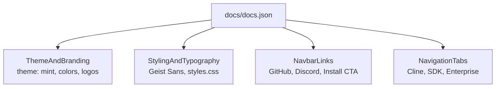
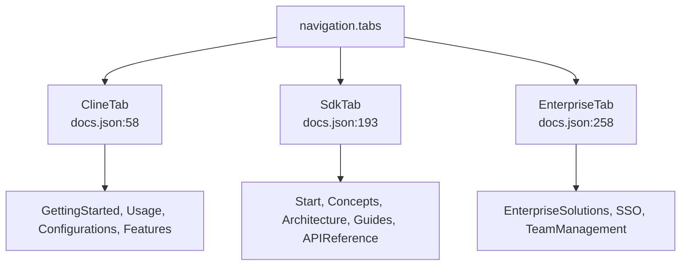
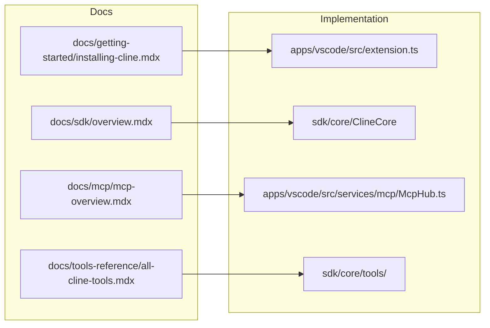
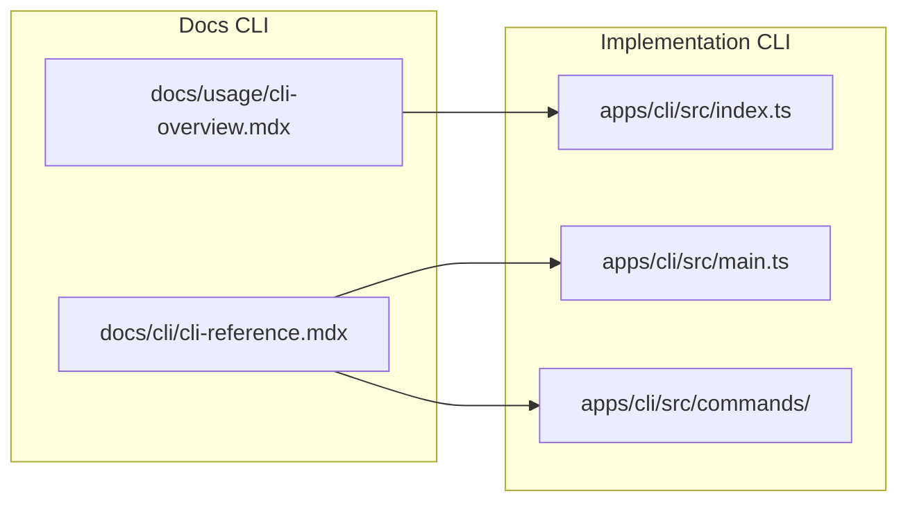

# Documentation Site

Relevant source files

The following files were used as context for generating this wiki page:

- [apps/vscode/README.marketplace.md](apps/vscode/README.marketplace.md)
- [apps/vscode/src/core/storage/utils/state-helpers.test.ts](apps/vscode/src/core/storage/utils/state-helpers.test.ts)
- [apps/vscode/standalone/runtime-files/package-lock.json](apps/vscode/standalone/runtime-files/package-lock.json)
- [apps/vscode/standalone/runtime-files/package.json](apps/vscode/standalone/runtime-files/package.json)
- [apps/vscode/webview-ui/src/components/settings/sections/TerminalSettingsSection.tsx](apps/vscode/webview-ui/src/components/settings/sections/TerminalSettingsSection.tsx)
- [docs/api/authentication.mdx](docs/api/authentication.mdx)
- [docs/api/chat-completions.mdx](docs/api/chat-completions.mdx)
- [docs/api/errors.mdx](docs/api/errors.mdx)
- [docs/api/getting-started.mdx](docs/api/getting-started.mdx)
- [docs/api/overview.mdx](docs/api/overview.mdx)
- [docs/api/sdk-examples.mdx](docs/api/sdk-examples.mdx)
- [docs/assets/free-models/free-models-cli-cline-provider.png](docs/assets/free-models/free-models-cli-cline-provider.png)
- [docs/assets/free-models/free-models-cli-clinepass-provider.png](docs/assets/free-models/free-models-cli-clinepass-provider.png)
- [docs/assets/free-models/free-models-vscode-cline-provider.png](docs/assets/free-models/free-models-vscode-cline-provider.png)
- [docs/assets/free-models/free-models-vscode-clinepass-provider.png](docs/assets/free-models/free-models-vscode-clinepass-provider.png)
- [docs/cli/cli-reference.mdx](docs/cli/cli-reference.mdx)
- [docs/docs.json](docs/docs.json)
- [docs/enterprise-solutions/api-reference.mdx](docs/enterprise-solutions/api-reference.mdx)
- [docs/getting-started/free-models.mdx](docs/getting-started/free-models.mdx)
- [docs/mcp/mcp-overview.mdx](docs/mcp/mcp-overview.mdx)
- [docs/package-lock.json](docs/package-lock.json)
- [docs/package.json](docs/package.json)
- [docs/sdk/architecture/hub-spoke.mdx](docs/sdk/architecture/hub-spoke.mdx)
- [docs/tools-reference/all-cline-tools.mdx](docs/tools-reference/all-cline-tools.mdx)
- [docs/usage/cli-overview.mdx](docs/usage/cli-overview.mdx)
- [docs/usage/cloud-agents.mdx](docs/usage/cloud-agents.mdx)
- [evals/package-lock.json](evals/package-lock.json)
- [evals/package.json](evals/package.json)
- [sdk/README.md](sdk/README.md)

## Purpose and Scope
This document details the architecture and organization of Cline's documentation site, powered by Mintlify. It covers the configuration defined in `docs/docs.json`, navigation structures, tabs, assets, styling options, and how user-facing documentation pages map directly to features and subsystems within the Cline monorepo codebase.

Sources: `docs/docs.json:1-268`, `docs/package.json:1-37`

---

## Mintlify Configuration & `docs.json` Structure
The documentation site is configured using Mintlify's JSON schema [docs/docs.json:1-37] (`$schema: "https://mintlify.com/docs.json"`). The root configuration file defines global visual properties, branding assets, custom CSS links, typography, and the primary top-level navigation model.

- **Theme & Branding**: Specifies the `mint` theme, custom primary colors (`#9D4EDD`), light/dark background themes, and brand wordmarks/favicons located in the documentation asset directories [docs/docs.json:3-25].
- **Typography & Styling**: Configures Geist Sans typography, breadcrumb eyebrows, system codeblocks, and custom CSS overrides (`styles.css`) [docs/docs.json:26-37].
- **Navbar Integration**: Defines external links to GitHub and Discord alongside a primary CTA button directing users to the installation portal [docs/docs.json:38-56].

Sources: `docs/docs.json:1-56`

---

## Navigation Tabs and Grouping
The site navigation is structured around top-level tabs that separate general user guides from developer SDK documentation and enterprise features [docs/docs.json:57-268].

1. **Cline Tab**: Focused on end-users, IDE extension users, and CLI operators.
   - *Getting Started*: Installation guides, provider setups, ClinePass, free model promotions [docs/docs.json:63-103].
   - *Usage & CLI*: Desktop app usage, IDE workflows, TUI, CLI reference, and command examples [docs/docs.json:106-137].
   - *Configurations & Features*: Tool references, rules, skills, plugins, MCP, hooks, plan-and-act workflows, and subagents [docs/docs.json:140-163].
2. **SDK Tab**: Dedicated to developers building custom agents on top of `@cline/sdk`.
   - *Concepts & Architecture*: Plugins, tools, scheduled agents, events, model providers, ClineCore, hub-spoke model [docs/docs.json:197-234].
   - *API Reference*: Core SDK, agent, gateway, tools API, events, and types [docs/docs.json:245-254].
3. **Enterprise Tab**: Tailored for enterprise administrators.
   - *Solutions & Setup*: Onboarding, SSO setup, team management, and member governance [docs/docs.json:261-268].

Sources: `docs/docs.json:57-268`

---

## Documentation-to-Feature Mapping (Natural Language to Code Space)
Documentation guides map directly to underlying packages, services, and execution runtimes in the monorepo. This bridge connects user-facing documentation files (`.mdx`) with their corresponding code entities.

Additionally, CLI execution commands and tool definitions link directly to parser and command runner modules across the CLI package.

Sources: `docs/getting-started/installing-cline.mdx:1-140`, `docs/docs.json:63-152`, `docs/usage/cli-overview.mdx:1-147`, `docs/cli/cli-reference.mdx:1-146`

---

## Assets, Redirects, and Static Resources
Static assets used across the Mintlify site are housed in the `docs/assets/` directory and referenced relative to the site root in `docs.json` [docs/docs.json:11-19].

- **Branding Assets**: Light and dark vector wordmarks (`cline-wordmark-black.svg`, `cline-wordmark-white.svg`) and icons (`cline-icon-dark.svg`, `cline-icon-white.svg`) [docs/docs.json:11-19].
- **Visual Guides**: Screenshots and operational GIFs stored under subdirectories like `docs/assets/free-models/` [docs/getting-started/free-models.mdx:33-56] to support installation and configuration walkthroughs.
- **Styling Hooks**: Custom CSS extensions (`styles.css`) applied via the `styling` block to tweak component rendering beyond default Mintlify themes [docs/docs.json:26-30].

Sources: `docs/docs.json:11-30`, `docs/getting-started/free-models.mdx:33-57`, `docs/package.json:1-37`