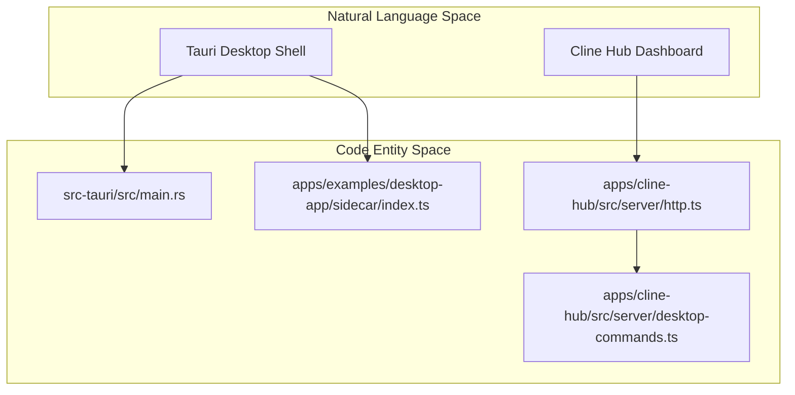
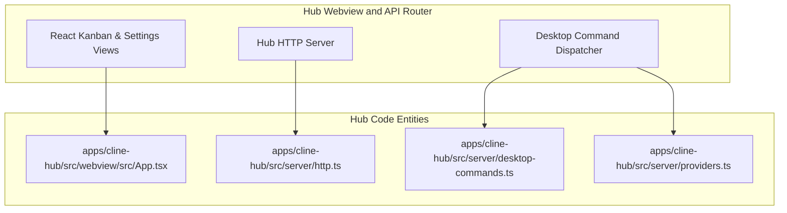

# Desktop App and Cline Hub Dashboard

Relevant source files

The following files were used as context for generating this wiki page:

- [.cline/skills/publish-desktop/SKILL.md](.cline/skills/publish-desktop/SKILL.md)
- [.github/workflows/desktop-publish.yml](.github/workflows/desktop-publish.yml)
- [.github/workflows/desktop-test.yml](.github/workflows/desktop-test.yml)
- [apps/cli/src/utils/plugin-chat-commands.ts](apps/cli/src/utils/plugin-chat-commands.ts)
- [apps/examples/desktop-app/CHANGELOG.md](apps/examples/desktop-app/CHANGELOG.md)
- [apps/examples/desktop-app/README.md](apps/examples/desktop-app/README.md)
- [apps/examples/desktop-app/bun.mts](apps/examples/desktop-app/bun.mts)
- [apps/examples/desktop-app/package.json](apps/examples/desktop-app/package.json)
- [apps/examples/desktop-app/scripts/generate-update-manifest.test.ts](apps/examples/desktop-app/scripts/generate-update-manifest.test.ts)
- [apps/examples/desktop-app/scripts/generate-update-manifest.ts](apps/examples/desktop-app/scripts/generate-update-manifest.ts)
- [apps/examples/desktop-app/scripts/package-desktop.ts](apps/examples/desktop-app/scripts/package-desktop.ts)
- [apps/examples/desktop-app/scripts/tauri-sign-windows.ps1](apps/examples/desktop-app/scripts/tauri-sign-windows.ps1)
- [apps/examples/desktop-app/scripts/windows-installer.test.ts](apps/examples/desktop-app/scripts/windows-installer.test.ts)
- [apps/examples/desktop-app/sidecar/chat-session.test.ts](apps/examples/desktop-app/sidecar/chat-session.test.ts)
- [apps/examples/desktop-app/sidecar/chat-session.ts](apps/examples/desktop-app/sidecar/chat-session.ts)
- [apps/examples/desktop-app/sidecar/commands.ts](apps/examples/desktop-app/sidecar/commands.ts)
- [apps/examples/desktop-app/sidecar/context.test.ts](apps/examples/desktop-app/sidecar/context.test.ts)
- [apps/examples/desktop-app/sidecar/context.ts](apps/examples/desktop-app/sidecar/context.ts)
- [apps/examples/desktop-app/sidecar/mcp.test.ts](apps/examples/desktop-app/sidecar/mcp.test.ts)
- [apps/examples/desktop-app/sidecar/plugin-commands.test.ts](apps/examples/desktop-app/sidecar/plugin-commands.test.ts)
- [apps/examples/desktop-app/sidecar/plugin-commands.ts](apps/examples/desktop-app/sidecar/plugin-commands.ts)
- [apps/examples/desktop-app/sidecar/remote-helper.test.ts](apps/examples/desktop-app/sidecar/remote-helper.test.ts)
- [apps/examples/desktop-app/sidecar/remote-helper.ts](apps/examples/desktop-app/sidecar/remote-helper.ts)
- [apps/examples/desktop-app/sidecar/types.ts](apps/examples/desktop-app/sidecar/types.ts)
- [apps/examples/desktop-app/src-tauri/Cargo.lock](apps/examples/desktop-app/src-tauri/Cargo.lock)
- [apps/examples/desktop-app/src-tauri/Cargo.toml](apps/examples/desktop-app/src-tauri/Cargo.toml)
- [apps/examples/desktop-app/src-tauri/src/main.rs](apps/examples/desktop-app/src-tauri/src/main.rs)
- [apps/examples/desktop-app/src-tauri/tauri.conf.json](apps/examples/desktop-app/src-tauri/tauri.conf.json)
- [apps/examples/desktop-app/webview/app/page.tsx](apps/examples/desktop-app/webview/app/page.tsx)
- [apps/examples/desktop-app/webview/components/views/chat/chat-input-bar.test.tsx](apps/examples/desktop-app/webview/components/views/chat/chat-input-bar.test.tsx)
- [apps/examples/desktop-app/webview/components/views/chat/chat-input-bar.tsx](apps/examples/desktop-app/webview/components/views/chat/chat-input-bar.tsx)
- [apps/examples/desktop-app/webview/components/views/settings/settings-view.tsx](apps/examples/desktop-app/webview/components/views/settings/settings-view.tsx)
- [apps/examples/desktop-app/webview/hooks/chat-session/helpers.test.ts](apps/examples/desktop-app/webview/hooks/chat-session/helpers.test.ts)
- [apps/examples/desktop-app/webview/hooks/chat-session/helpers.ts](apps/examples/desktop-app/webview/hooks/chat-session/helpers.ts)
- [apps/examples/desktop-app/webview/hooks/chat-session/types.ts](apps/examples/desktop-app/webview/hooks/chat-session/types.ts)
- [apps/examples/desktop-app/webview/hooks/use-chat-session.test.tsx](apps/examples/desktop-app/webview/hooks/use-chat-session.test.tsx)
- [apps/examples/desktop-app/webview/hooks/use-chat-session.ts](apps/examples/desktop-app/webview/hooks/use-chat-session.ts)
- [apps/examples/desktop-app/webview/lib/chat-schema.ts](apps/examples/desktop-app/webview/lib/chat-schema.ts)
- [sdk/packages/core/src/services/plugin-commands.test.ts](sdk/packages/core/src/services/plugin-commands.test.ts)
- [sdk/packages/core/src/services/plugin-commands.ts](sdk/packages/core/src/services/plugin-commands.ts)

This section provides an overview of the Tauri-based desktop application (`apps/examples/desktop-app`) and the Cline Hub web dashboard (`apps/cline-hub`), which serve as standalone runtime host applications for the Cline SDK. These platforms decouple Cline from IDE environments like VS Code, enabling multi-session management, background scheduling, remote environment connectivity, and web-based execution.

For detailed technical breakdowns, see the following child pages:
- [Desktop Shell and Sidecar](#15.1)
- [Desktop Chat and Session UI](#15.2)
- [Desktop Settings, Onboarding, and Cloud Sessions](#15.3)
- [Cline Hub Dashboard (apps/cline-hub)](#15.4)
- [Desktop Packaging and Distribution](#15.5)

---

## Architecture and Subsystem Overview

The desktop ecosystem partitions responsibilities between a native OS shell (built with Tauri in Rust), a background backend daemon (the Bun sidecar hosting the Cline Hub and SDK runtime), and a Next.js React frontend webview for user interactions.

Sources: `[apps/examples/desktop-app/src-tauri/src/main.rs:1-40]`, `[apps/examples/desktop-app/package.json:1-37]`, `[apps/cline-hub/src/server/http.ts:1-50]`

---

## 15.1 Desktop Shell and Sidecar

The Tauri desktop shell manages native OS integration, window lifecycles, system trays, application updates, and sidecar child process supervision. The sidecar runs a Bun-powered server that initializes the Cline Hub daemon, handles IPC commands, and exposes local or remote session execution capabilities.

For details, see [Desktop Shell and Sidecar](#15.1).

Sources: `[apps/examples/desktop-app/src-tauri/src/main.rs:1-199]`, `[apps/examples/desktop-app/src-tauri/tauri.conf.json:1-74]`

---

## 15.2 Desktop Chat and Session UI

The webview layer is implemented as a Next.js application providing the chat interface, session history navigation, tool execution views, markdown rendering, and workspace management. It communicates with the desktop sidecar through the Tauri desktop client bridge and WebSocket transports.

For details, see [Desktop Chat and Session UI](#15.2).

Sources: `[apps/examples/desktop-app/webview/app/page.tsx:1-192]`, `[apps/examples/desktop-app/webview/components/views/chat/chat-input-bar.tsx:1-125]`

---

## 15.3 Desktop Settings, Onboarding, and Cloud Sessions

Configuration views allow users to manage AI provider credentials, Model Context Protocol (MCP) servers, local extensions, routines, voice inputs, and account authentications. This subsystem also handles onboarding workflows, OAuth login loops, marketplace integrations, and cloud-backed session provisioning.

For details, see [Desktop Settings, Onboarding, and Cloud Sessions](#15.3).

Sources: `[apps/examples/desktop-app/CHANGELOG.md:1-31]`, `[apps/examples/desktop-app/webview/components/views/settings/settings-view.tsx:1-115]`

---

## 15.4 Cline Hub Dashboard (`apps/cline-hub`)

The `apps/cline-hub` package provides a standalone web dashboard server hosting HTTP endpoints, WebSocket communication channels, and rich React/Kanban views. It routes desktop commands for provider management, MCP setup, marketplace installations, and routine schedules.

For details, see [Cline Hub Dashboard (apps/cline-hub)](#15.4).

Sources: `[apps/examples/desktop-app/sidecar/commands.ts:1-100]`, `[apps/examples/desktop-app/package.json:1-39]`

---

## 15.5 Desktop Packaging and Distribution

Desktop build and publishing pipelines compile the Bun sidecar binary, bundle the web assets, configure Tauri target specifications (nightly, beta, and release channels), apply OS-specific NSIS installer hooks or DMG configurations, handle code signing, and generate automatic update manifests.

For details, see [Desktop Packaging and Distribution](#15.5).

Sources: `[.github/workflows/desktop-publish.yml:1-130]`, `[apps/examples/desktop-app/src-tauri/tauri.conf.json:1-90]`