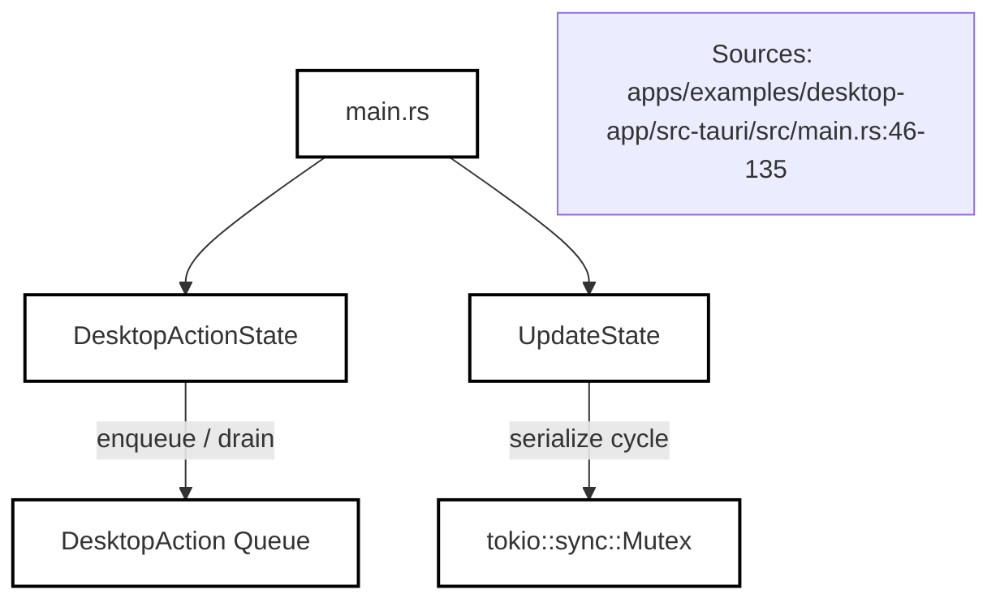
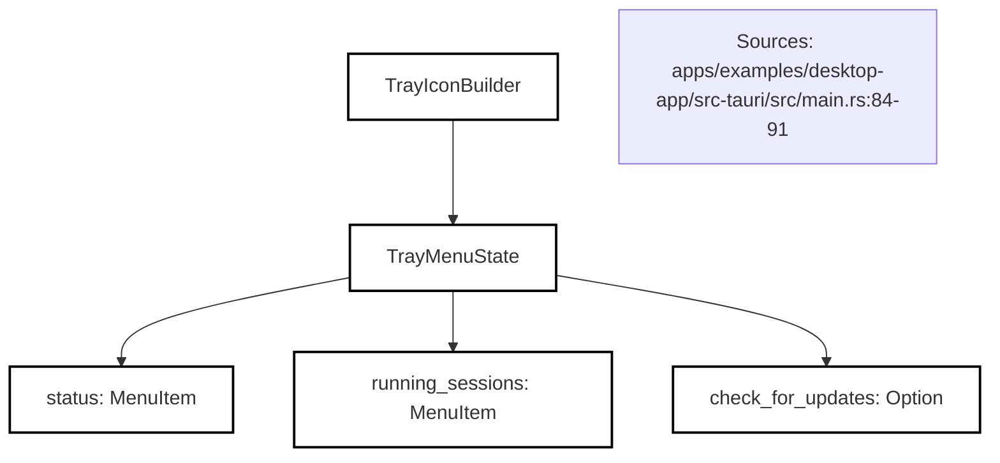
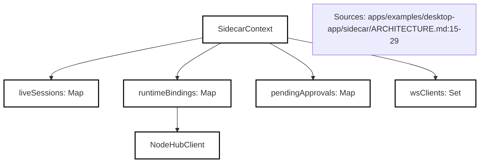
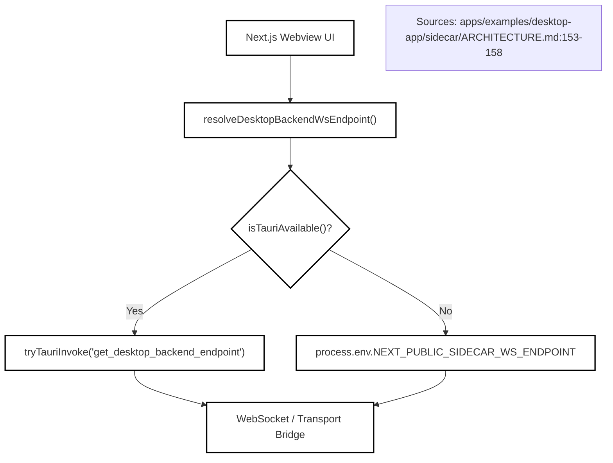

# Desktop Shell and Sidecar

Relevant source files

The following files were used as context for generating this wiki page:

- [.cline/skills/publish-desktop/SKILL.md](.cline/skills/publish-desktop/SKILL.md)
- [.github/workflows/desktop-publish.yml](.github/workflows/desktop-publish.yml)
- [.github/workflows/desktop-test.yml](.github/workflows/desktop-test.yml)
- [apps/cli/src/session/session.test.ts](apps/cli/src/session/session.test.ts)
- [apps/cli/src/session/session.ts](apps/cli/src/session/session.ts)
- [apps/examples/desktop-app/CHANGELOG.md](apps/examples/desktop-app/CHANGELOG.md)
- [apps/examples/desktop-app/README.md](apps/examples/desktop-app/README.md)
- [apps/examples/desktop-app/bun.mts](apps/examples/desktop-app/bun.mts)
- [apps/examples/desktop-app/package.json](apps/examples/desktop-app/package.json)
- [apps/examples/desktop-app/scripts/generate-update-manifest.test.ts](apps/examples/desktop-app/scripts/generate-update-manifest.test.ts)
- [apps/examples/desktop-app/scripts/generate-update-manifest.ts](apps/examples/desktop-app/scripts/generate-update-manifest.ts)
- [apps/examples/desktop-app/scripts/package-desktop.ts](apps/examples/desktop-app/scripts/package-desktop.ts)
- [apps/examples/desktop-app/scripts/tauri-sign-windows.ps1](apps/examples/desktop-app/scripts/tauri-sign-windows.ps1)
- [apps/examples/desktop-app/scripts/windows-installer.test.ts](apps/examples/desktop-app/scripts/windows-installer.test.ts)
- [apps/examples/desktop-app/sidecar/ARCHITECTURE.md](apps/examples/desktop-app/sidecar/ARCHITECTURE.md)
- [apps/examples/desktop-app/sidecar/cli-runtime.test.ts](apps/examples/desktop-app/sidecar/cli-runtime.test.ts)
- [apps/examples/desktop-app/sidecar/cli-runtime.ts](apps/examples/desktop-app/sidecar/cli-runtime.ts)
- [apps/examples/desktop-app/sidecar/commands-settings.test.ts](apps/examples/desktop-app/sidecar/commands-settings.test.ts)
- [apps/examples/desktop-app/sidecar/diagnostics.test.ts](apps/examples/desktop-app/sidecar/diagnostics.test.ts)
- [apps/examples/desktop-app/sidecar/diagnostics.ts](apps/examples/desktop-app/sidecar/diagnostics.ts)
- [apps/examples/desktop-app/sidecar/feature-flags.test.ts](apps/examples/desktop-app/sidecar/feature-flags.test.ts)
- [apps/examples/desktop-app/sidecar/feature-flags.ts](apps/examples/desktop-app/sidecar/feature-flags.ts)
- [apps/examples/desktop-app/sidecar/remote-helper.test.ts](apps/examples/desktop-app/sidecar/remote-helper.test.ts)
- [apps/examples/desktop-app/sidecar/remote-helper.ts](apps/examples/desktop-app/sidecar/remote-helper.ts)
- [apps/examples/desktop-app/src-tauri/Cargo.lock](apps/examples/desktop-app/src-tauri/Cargo.lock)
- [apps/examples/desktop-app/src-tauri/Cargo.toml](apps/examples/desktop-app/src-tauri/Cargo.toml)
- [apps/examples/desktop-app/src-tauri/src/main.rs](apps/examples/desktop-app/src-tauri/src/main.rs)
- [apps/examples/desktop-app/src-tauri/tauri.conf.json](apps/examples/desktop-app/src-tauri/tauri.conf.json)
- [apps/examples/desktop-app/webview/components/views/settings/export-diagnostics-dialog.tsx](apps/examples/desktop-app/webview/components/views/settings/export-diagnostics-dialog.tsx)
- [apps/examples/desktop-app/webview/components/views/settings/settings-view.test.tsx](apps/examples/desktop-app/webview/components/views/settings/settings-view.test.tsx)
- [sdk/packages/core/src/remote/remote-environments.test.ts](sdk/packages/core/src/remote/remote-environments.test.ts)
- [sdk/packages/core/src/remote/remote-environments.ts](sdk/packages/core/src/remote/remote-environments.ts)
- [sdk/packages/core/src/services/feature-flags/FeatureFlagsService.test.ts](sdk/packages/core/src/services/feature-flags/FeatureFlagsService.test.ts)
- [sdk/packages/core/src/services/feature-flags/FeatureFlagsService.ts](sdk/packages/core/src/services/feature-flags/FeatureFlagsService.ts)
- [sdk/packages/shared/src/feature-flags.ts](sdk/packages/shared/src/feature-flags.ts)
- [sdk/packages/shared/src/services/telemetry-selfcheck.test.ts](sdk/packages/shared/src/services/telemetry-selfcheck.test.ts)
- [sdk/packages/shared/src/services/telemetry-selfcheck.ts](sdk/packages/shared/src/services/telemetry-selfcheck.ts)

### Purpose and Scope
This document details the architecture of the Cline desktop application (`apps/examples/desktop-app`), which combines a native Tauri Rust shell (`src-tauri/src/main.rs`), a background Bun runtime sidecar (`sidecar/`), and a Next.js React frontend webview communicating over a robust WebSocket/Tauri transport bridge.

---

## 1. Tauri Rust Shell Architecture (`main.rs`)
The native application entry point is implemented in Rust (`apps/examples/desktop-app/src-tauri/src/main.rs`). It manages application windows, native menus, background thread synchronization, update cycles, and action routing through managed Tauri state structures.

* `DesktopAction` enum defines cross-thread and window actions such as `NewSession`, `OpenSettings`, `CheckForUpdates`, `ZoomIn`, `ZoomOut`, `ZoomReset`, and `OpenSession` [apps/examples/desktop-app/src-tauri/src/main.rs:46-60]().
* `DesktopActionState` wraps a thread-safe queue (`Mutex<VecDeque<DesktopAction>>`) to enqueue and drain pending UI operations [apps/examples/desktop-app/src-tauri/src/main.rs:62-82]().
* `UpdateState` serializes background update operations using `tokio::sync::Mutex` and holds update status snapshots [apps/examples/desktop-app/src-tauri/src/main.rs:118-135]().

Sources: `apps/examples/desktop-app/src-tauri/src/main.rs:46-135`

---

## 2. Tray Menu and Native System Integration
The Tauri shell registers a system tray instance (`TrayIconBuilder`) that provides persistent access to application status, running session counts, quick actions, and update prompts.

* `TrayMenuState` manages menu items like the connection status indicator (`status`), running sessions counter (`running_sessions`), and update triggers (`check_for_updates`) [apps/examples/desktop-app/src-tauri/src/main.rs:84-91]().
* Tooltip generation utilizes dynamic app identifiers and running session metrics to communicate backend health [apps/examples/desktop-app/src-tauri/src/main.rs:166-175]().

Sources: `apps/examples/desktop-app/src-tauri/src/main.rs:84-91`

---

## 3. Tauri Updater and Release Management
Application updates are governed by `tauri-plugin-updater` integrated directly into the Rust background loop.

* Background update checks execute at configured intervals (`UPDATE_CHECK_INTERVAL` of 2 hours, with an initial delay of 10 seconds) [apps/examples/desktop-app/src-tauri/src/main.rs:27-28]().
* `UpdateState` ensures check-download-stage cycles do not overlap concurrently by acquiring a tokio mutex lock [apps/examples/desktop-app/src-tauri/src/main.rs:118-135]().
* Windows platforms utilize `pending_install` buffers to hold downloaded binaries until the user explicitly approves an application restart, preventing file-lock collisions with running NSIS processes [apps/examples/desktop-app/src-tauri/src/main.rs:118-135]().

Sources: `apps/examples/desktop-app/src-tauri/src/main.rs:25-164`

---

## 4. Bun Sidecar Runtime and Core Initialization (`context.ts`, `types.ts`)
The desktop sidecar runs as a separate Bun process, hosting the `@cline/core` runtime engine and serving client webviews via WebSocket and HTTP endpoints.

* `SidecarContext` manages runtime state including live sessions, pending tool approvals, WebSocket clients, and runtime environment bindings [apps/examples/desktop-app/sidecar/ARCHITECTURE.md:15-29]().
* `getEnvironmentContext()` partitions session state across isolated local or remote execution workspaces while inheriting shared core services [apps/examples/desktop-app/sidecar/ARCHITECTURE.md:15-29]().

Sources: `apps/examples/desktop-app/sidecar/ARCHITECTURE.md:15-29`

---

## 5. Sidecar Server, Commands, and Event Broadcasting (`server.ts`, `chat-session.ts`)
The Bun sidecar listens on a configurable port (default `3126`) and coordinates chat interactions, queue management, and tool permissions.

* `ChatSessionCommandRequest` contracts define incoming operations such as `start`, `send`, `stop`, `abort`, `steer_prompt`, and `restore_checkpoint` [apps/examples/desktop-app/sidecar/ARCHITECTURE.md:31-38]().
* Slash commands are intercepted, validated against feature flags or tool availability lists, and rewritten into agent-executable prompt blocks [apps/examples/desktop-app/sidecar/ARCHITECTURE.md:39-90]().

Sources: `apps/examples/desktop-app/sidecar/ARCHITECTURE.md:31-90`

---

## 6. Desktop Client Transport and Webview Bridge (`desktop-client.ts`)
The React frontend communicates with the backend through a unified transport layer that automatically switches between Tauri native bindings and WebSocket communication.

* `resolveDesktopBackendWsEndpoint()` resolves the backend endpoint using window injection, Tauri invoke, or environment variables with fallback to `ws://127.0.0.1:3126/transport` [apps/examples/desktop-app/sidecar/ARCHITECTURE.md:153-158]().
* `isTauriAvailable()` inspects `window.__TAURI_INTERNALS__` to determine if the webview is running inside the native Tauri app shell or a browser environment [apps/examples/desktop-app/sidecar/ARCHITECTURE.md:153-158]().
* Diagnostics reports redact secret fields and capture process telemetry as specified in diagnostics tooling [apps/examples/desktop-app/sidecar/diagnostics.ts:24-39]().

Sources: `apps/examples/desktop-app/sidecar/ARCHITECTURE.md:153-158`, `apps/examples/desktop-app/sidecar/diagnostics.ts:24-39`