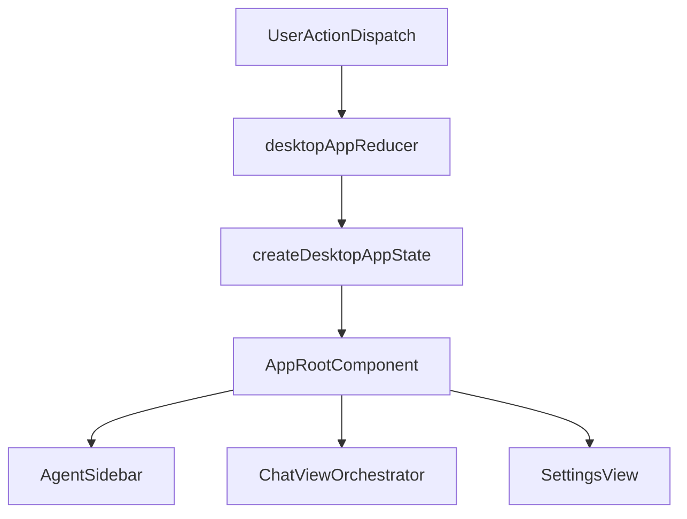
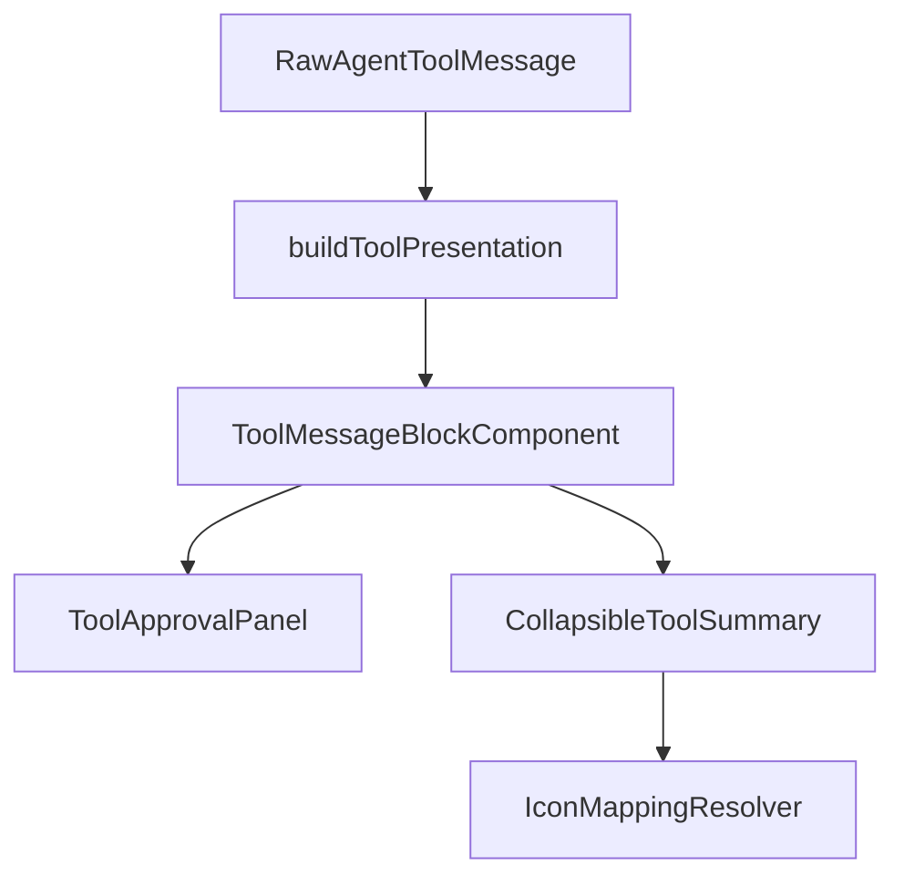

# Desktop Chat and Session UI

<details>
<summary>Relevant source files</summary>

The following files were used as context for generating this wiki page:

- [apps/cli/src/utils/plugin-chat-commands.ts](apps/cli/src/utils/plugin-chat-commands.ts)
- [apps/cline-hub/src/webview/src/components/ai-elements/streamdown.tsx](apps/cline-hub/src/webview/src/components/ai-elements/streamdown.tsx)
- [apps/examples/desktop-app/sidecar/chat-session.test.ts](apps/examples/desktop-app/sidecar/chat-session.test.ts)
- [apps/examples/desktop-app/sidecar/chat-session.ts](apps/examples/desktop-app/sidecar/chat-session.ts)
- [apps/examples/desktop-app/sidecar/commands.ts](apps/examples/desktop-app/sidecar/commands.ts)
- [apps/examples/desktop-app/sidecar/context.test.ts](apps/examples/desktop-app/sidecar/context.test.ts)
- [apps/examples/desktop-app/sidecar/context.ts](apps/examples/desktop-app/sidecar/context.ts)
- [apps/examples/desktop-app/sidecar/mcp.test.ts](apps/examples/desktop-app/sidecar/mcp.test.ts)
- [apps/examples/desktop-app/sidecar/plugin-commands.test.ts](apps/examples/desktop-app/sidecar/plugin-commands.test.ts)
- [apps/examples/desktop-app/sidecar/plugin-commands.ts](apps/examples/desktop-app/sidecar/plugin-commands.ts)
- [apps/examples/desktop-app/sidecar/types.ts](apps/examples/desktop-app/sidecar/types.ts)
- [apps/examples/desktop-app/webview/app/globals.css](apps/examples/desktop-app/webview/app/globals.css)
- [apps/examples/desktop-app/webview/app/page.tsx](apps/examples/desktop-app/webview/app/page.tsx)
- [apps/examples/desktop-app/webview/components/agent-sidebar.test.tsx](apps/examples/desktop-app/webview/components/agent-sidebar.test.tsx)
- [apps/examples/desktop-app/webview/components/agent-sidebar.tsx](apps/examples/desktop-app/webview/components/agent-sidebar.tsx)
- [apps/examples/desktop-app/webview/components/ui/markdown.interactions.test.tsx](apps/examples/desktop-app/webview/components/ui/markdown.interactions.test.tsx)
- [apps/examples/desktop-app/webview/components/ui/markdown.test.tsx](apps/examples/desktop-app/webview/components/ui/markdown.test.tsx)
- [apps/examples/desktop-app/webview/components/ui/markdown.tsx](apps/examples/desktop-app/webview/components/ui/markdown.tsx)
- [apps/examples/desktop-app/webview/components/views/chat/chat-input-bar.test.tsx](apps/examples/desktop-app/webview/components/views/chat/chat-input-bar.test.tsx)
- [apps/examples/desktop-app/webview/components/views/chat/chat-input-bar.tsx](apps/examples/desktop-app/webview/components/views/chat/chat-input-bar.tsx)
- [apps/examples/desktop-app/webview/components/views/chat/welcome-workspace-controls.test.tsx](apps/examples/desktop-app/webview/components/views/chat/welcome-workspace-controls.test.tsx)
- [apps/examples/desktop-app/webview/components/views/chat/welcome-workspace-controls.tsx](apps/examples/desktop-app/webview/components/views/chat/welcome-workspace-controls.tsx)
- [apps/examples/desktop-app/webview/components/views/chat/workspace-selector.test.tsx](apps/examples/desktop-app/webview/components/views/chat/workspace-selector.test.tsx)
- [apps/examples/desktop-app/webview/components/views/chat/workspace-selector.tsx](apps/examples/desktop-app/webview/components/views/chat/workspace-selector.tsx)
- [apps/examples/desktop-app/webview/components/views/sessions/sessions-view.test.tsx](apps/examples/desktop-app/webview/components/views/sessions/sessions-view.test.tsx)
- [apps/examples/desktop-app/webview/components/views/sessions/sessions-view.tsx](apps/examples/desktop-app/webview/components/views/sessions/sessions-view.tsx)
- [apps/examples/desktop-app/webview/components/views/settings/sections.ts](apps/examples/desktop-app/webview/components/views/settings/sections.ts)
- [apps/examples/desktop-app/webview/components/views/settings/settings-view.tsx](apps/examples/desktop-app/webview/components/views/settings/settings-view.tsx)
- [apps/examples/desktop-app/webview/hooks/chat-session/helpers.test.ts](apps/examples/desktop-app/webview/hooks/chat-session/helpers.test.ts)
- [apps/examples/desktop-app/webview/hooks/chat-session/helpers.ts](apps/examples/desktop-app/webview/hooks/chat-session/helpers.ts)
- [apps/examples/desktop-app/webview/hooks/chat-session/types.ts](apps/examples/desktop-app/webview/hooks/chat-session/types.ts)
- [apps/examples/desktop-app/webview/hooks/use-chat-session.test.tsx](apps/examples/desktop-app/webview/hooks/use-chat-session.test.tsx)
- [apps/examples/desktop-app/webview/hooks/use-chat-session.ts](apps/examples/desktop-app/webview/hooks/use-chat-session.ts)
- [apps/examples/desktop-app/webview/hooks/use-session-history.test.tsx](apps/examples/desktop-app/webview/hooks/use-session-history.test.tsx)
- [apps/examples/desktop-app/webview/hooks/use-session-history.ts](apps/examples/desktop-app/webview/hooks/use-session-history.ts)
- [apps/examples/desktop-app/webview/lib/chat-schema.ts](apps/examples/desktop-app/webview/lib/chat-schema.ts)
- [apps/examples/desktop-app/webview/lib/session-history.ts](apps/examples/desktop-app/webview/lib/session-history.ts)
- [apps/examples/desktop-app/webview/lib/sidebar-session-organization.test.ts](apps/examples/desktop-app/webview/lib/sidebar-session-organization.test.ts)
- [apps/examples/desktop-app/webview/lib/sidebar-session-organization.ts](apps/examples/desktop-app/webview/lib/sidebar-session-organization.ts)
- [apps/examples/desktop-app/webview/lib/workspace-paths.test.ts](apps/examples/desktop-app/webview/lib/workspace-paths.test.ts)
- [apps/examples/desktop-app/webview/lib/workspace-paths.ts](apps/examples/desktop-app/webview/lib/workspace-paths.ts)
- [sdk/packages/core/src/cline-core/automation.ts](sdk/packages/core/src/cline-core/automation.ts)
- [sdk/packages/core/src/services/plugin-commands.test.ts](sdk/packages/core/src/services/plugin-commands.test.ts)
- [sdk/packages/core/src/services/plugin-commands.ts](sdk/packages/core/src/services/plugin-commands.ts)
- [sdk/packages/ui/components/markdown.css](sdk/packages/ui/components/markdown.css)
- [sdk/packages/ui/components/markdown.ts](sdk/packages/ui/components/markdown.ts)
- [sdk/packages/ui/components/mermaid-block.tsx](sdk/packages/ui/components/mermaid-block.tsx)
- [sdk/packages/ui/components/mermaid-diagram.ts](sdk/packages/ui/components/mermaid-diagram.ts)

</details>


## Purpose and Scope
This document provides technical documentation for the Desktop Chat and Session UI of the Cline desktop application (`apps/examples/desktop-app/webview`) [apps/examples/desktop-app/webview/app/page.tsx:1](). It covers the Next.js webview application shell, page state reducer (`desktopAppReducer`), the chat composer (`ChatInputBar`), message rendering pipelines (`ChatMessages`, `MessageBubble`), tool blocks and summaries (`ToolMessageBlock`, `buildToolPresentation`), markdown rendering (`Markdown`), the agent sidebar (`AgentSidebar`), session history management (`use-session-history.ts`), and welcome/workspace controls.

---

## 1. Root Architecture and Page Reducer
The root view of the desktop webview is hosted in `apps/examples/desktop-app/webview/app/page.tsx` [apps/examples/desktop-app/webview/app/page.tsx:1](). It manages global layout integration, Tauri/sidecar communication, active session identification, view switching (`chat`, `sessions`, `settings`), and state persistence using `useReducer` with `desktopAppReducer` [apps/examples/desktop-app/webview/app/page.tsx:68]().

The following diagram maps the natural language concepts of page management to their corresponding code entities:


*Figure 1: Page Reducer and View Orchestration Architecture*

Sources: `apps/examples/desktop-app/webview/app/page.tsx:1-124`, `apps/examples/desktop-app/webview/lib/desktop-app-state.ts:1-72`

---

## 2. Chat Input Bar and Prompt Construction
The `ChatInputBar` component (`apps/examples/desktop-app/webview/components/views/chat/chat-input-bar.tsx`) handles user prompt composition, inline mention parsing (`@`), slash command autocomplete (`/fork`, `/team`, and runtime skills/workflows via `buildUserInstructionSlashCommands`) [apps/examples/desktop-app/webview/components/views/chat/chat-input-bar.tsx:1-141](), image attachments, and reasoning/thinking level configuration (`buildReasoningConfig`) [apps/examples/desktop-app/webview/components/views/chat/chat-input-bar.tsx:212-219]().

```typescript
// Key types and helpers in chat-input-bar.tsx
type ActiveMention = {
	start: number;
	end: number;
	query: string;
};

type ActiveSlash = {
	slashIndex: number;
	query: string;
};
```
[apps/examples/desktop-app/webview/components/views/chat/chat-input-bar.tsx:79-88]()

Sources: `apps/examples/desktop-app/webview/components/views/chat/chat-input-bar.tsx:1-227`

---

## 3. Chat Messages, Bubbles, and Grouping
Chat transcript rendering is managed by `ChatMessages` (`apps/examples/desktop-app/webview/components/views/chat/chat-messages.tsx`) [apps/examples/desktop-app/webview/components/views/chat/chat-messages.tsx:53](), which orchestrates message grouping (`groupChatMessages`), timestamps (`buildPreviousTimestampMap`), and conversational flows using `@cline/ui` primitives [apps/examples/desktop-app/webview/components/views/chat/chat-messages.tsx:3-41](). State synchronization with the backend sidecar is handled by `useChatSession` (`apps/examples/desktop-app/webview/hooks/use-chat-session.ts`) [apps/examples/desktop-app/webview/hooks/use-chat-session.ts:1-60]().

```typescript
type ChatMessagesProps = {
	sessionId: string | null;
	status: ChatSessionStatus;
	messages: ChatMessage[];
	error: string | null;
	streamingMessageId?: string | null;
	pendingToolApprovals: ToolApprovalRequestItem[];
	pendingAskQuestions: AskQuestionRequestItem[];
	onApproveToolApproval: (requestId: string) => void | Promise<void>;
	onRejectToolApproval: (requestId: string) => void | Promise<void>;
	onAnswerAskQuestion: (requestId: string, answer: string) => void | Promise<void>;
};
```
[apps/examples/desktop-app/webview/components/views/chat/chat-messages.tsx:53-76]()

Sources: `apps/examples/desktop-app/webview/components/views/chat/chat-messages.tsx:1-129`, `apps/examples/desktop-app/webview/hooks/use-chat-session.ts:1-60`

---

## 4. Tool Blocks and Summaries
Tool calls executed during agent turns are transformed into structured disclosure blocks by `ToolMessageBlock` and `buildToolPresentation` (`apps/examples/desktop-app/webview/components/views/chat/messages/tool-summaries.ts`) [apps/examples/desktop-app/webview/components/views/chat/chat-messages.tsx:48-49]().


*Figure 2: Natural Language Tool Presentation to Code Entities*

Sources: `apps/examples/desktop-app/webview/components/views/chat/chat-messages.test.tsx:86-133`, `apps/examples/desktop-app/webview/components/views/chat/chat-messages.tsx:45-50`

---

## 5. Markdown and Rich Output Formatting
Rich text, code blocks, and inline formatting inside assistant messages are rendered via the `@cline/ui` markdown pipeline integrated at `apps/examples/desktop-app/webview/components/ui/markdown.tsx`. It supports syntax highlighting, copy actions, and secure sanitization.

Sources: `apps/examples/desktop-app/webview/components/ui/markdown.tsx:1-50`

---

## 6. Agent Sidebar and Session History
The left-hand navigation sidebar (`AgentSidebar`, `apps/examples/desktop-app/webview/components/agent-sidebar.tsx`) integrates thread listing, project grouping (`groupThreadsByProject`), schedule grouping (`groupScheduledThreads`), and status filtering via `useSessionHistory` (`apps/examples/desktop-app/webview/hooks/use-session-history.ts`) [apps/examples/desktop-app/webview/components/agent-sidebar.tsx:1-110, apps/examples/desktop-app/webview/hooks/use-session-history.ts:30-54]().

```typescript
export interface SessionThread {
	id: string;
	origin?: "local" | "cloud";
	title: string;
	source?: string;
	codebase: string;
	workspacePath: string;
	time: string;
	provider: string;
	model: string;
	gitBranch?: string;
	status: SessionHistoryStatus;
	pinned?: boolean;
	isScheduled: boolean;
}
```
[apps/examples/desktop-app/webview/hooks/use-session-history.ts:30-47]()

Sources: `apps/examples/desktop-app/webview/components/agent-sidebar.tsx:1-117`, `apps/examples/desktop-app/webview/hooks/use-session-history.ts:30-54`

---

## 7. Welcome Screen and Workspace Controls
When no active session is selected, the application paints the welcome screen (`WelcomeScreen`, `apps/examples/desktop-app/webview/components/views/chat/welcome-chat.tsx`) accompanied by workspace path selection and environment configuration controls (`welcome-workspace-controls.tsx`, `environment-selector.tsx`) [apps/examples/desktop-app/webview/app/page.tsx:38-40]().

Sources: `apps/examples/desktop-app/webview/app/page.tsx:38-41`, `apps/examples/desktop-app/webview/components/views/chat/welcome-workspace-controls.tsx:1-30`