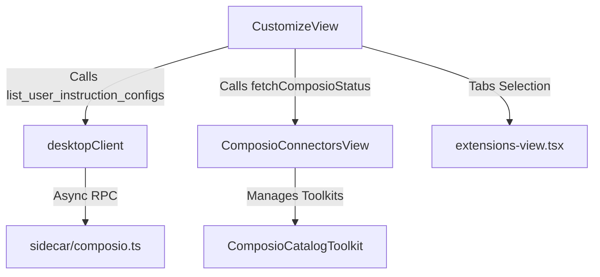
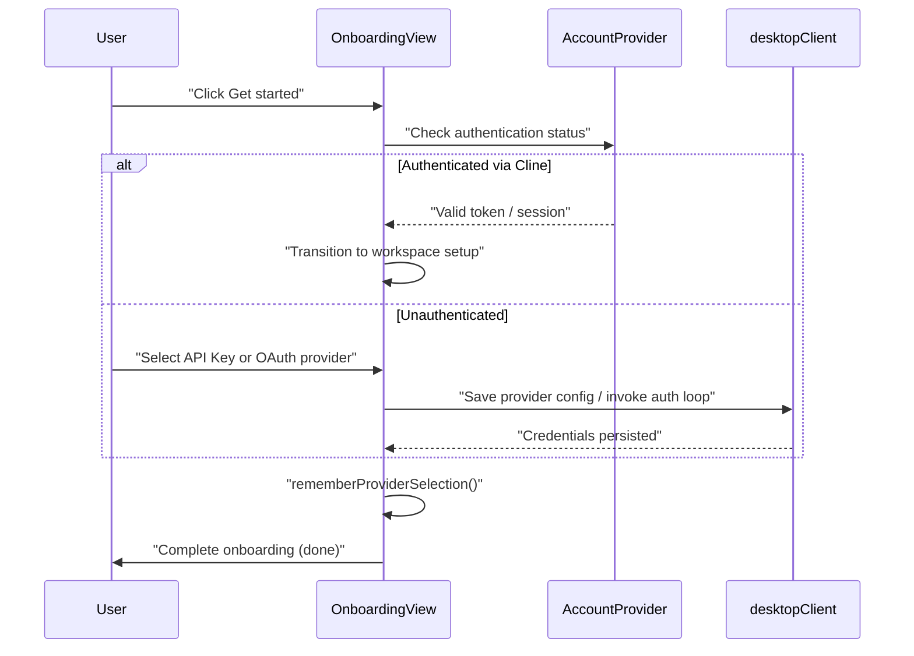
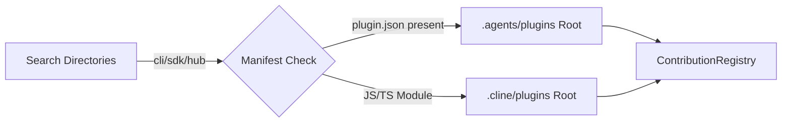
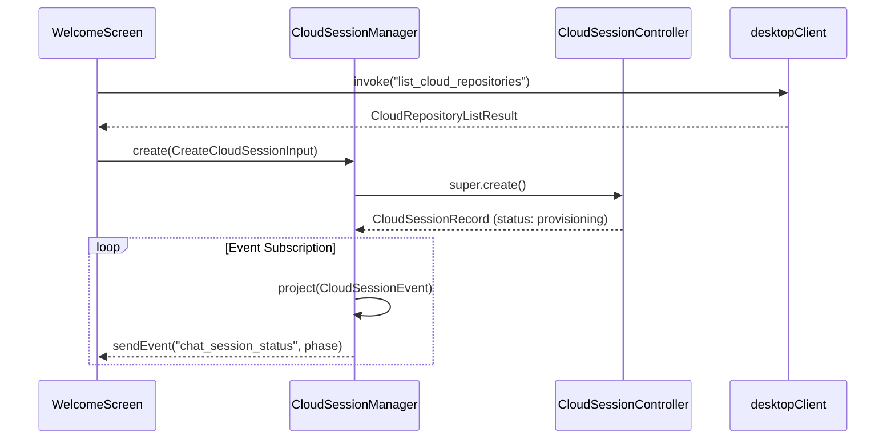

# Desktop Settings, Onboarding, and Cloud Sessions

<details>
<summary>Relevant source files</summary>

The following files were used as context for generating this wiki page:

- [apps/examples/desktop-app/sidecar/cline-connectors-api.test.ts](apps/examples/desktop-app/sidecar/cline-connectors-api.test.ts)
- [apps/examples/desktop-app/sidecar/cline-connectors-api.ts](apps/examples/desktop-app/sidecar/cline-connectors-api.ts)
- [apps/examples/desktop-app/sidecar/cloud-sessions-hub.test.ts](apps/examples/desktop-app/sidecar/cloud-sessions-hub.test.ts)
- [apps/examples/desktop-app/sidecar/cloud-sessions-lifecycle.test.ts](apps/examples/desktop-app/sidecar/cloud-sessions-lifecycle.test.ts)
- [apps/examples/desktop-app/sidecar/cloud-sessions-state.test.ts](apps/examples/desktop-app/sidecar/cloud-sessions-state.test.ts)
- [apps/examples/desktop-app/sidecar/cloud-sessions.test.ts](apps/examples/desktop-app/sidecar/cloud-sessions.test.ts)
- [apps/examples/desktop-app/sidecar/cloud-sessions.ts](apps/examples/desktop-app/sidecar/cloud-sessions.ts)
- [apps/examples/desktop-app/sidecar/composio.test.ts](apps/examples/desktop-app/sidecar/composio.test.ts)
- [apps/examples/desktop-app/sidecar/composio.ts](apps/examples/desktop-app/sidecar/composio.ts)
- [apps/examples/desktop-app/sidecar/oauth-login.test.ts](apps/examples/desktop-app/sidecar/oauth-login.test.ts)
- [apps/examples/desktop-app/sidecar/oauth-login.ts](apps/examples/desktop-app/sidecar/oauth-login.ts)
- [apps/examples/desktop-app/webview/components/ui/button.tsx](apps/examples/desktop-app/webview/components/ui/button.tsx)
- [apps/examples/desktop-app/webview/components/views/chat/cloud-onboarding.tsx](apps/examples/desktop-app/webview/components/views/chat/cloud-onboarding.tsx)
- [apps/examples/desktop-app/webview/components/views/chat/environment-selector.test.tsx](apps/examples/desktop-app/webview/components/views/chat/environment-selector.test.tsx)
- [apps/examples/desktop-app/webview/components/views/chat/environment-selector.tsx](apps/examples/desktop-app/webview/components/views/chat/environment-selector.tsx)
- [apps/examples/desktop-app/webview/components/views/chat/welcome-chat.test.tsx](apps/examples/desktop-app/webview/components/views/chat/welcome-chat.test.tsx)
- [apps/examples/desktop-app/webview/components/views/chat/welcome-chat.tsx](apps/examples/desktop-app/webview/components/views/chat/welcome-chat.tsx)
- [apps/examples/desktop-app/webview/components/views/marketplace-explorer-view.test.tsx](apps/examples/desktop-app/webview/components/views/marketplace-explorer-view.test.tsx)
- [apps/examples/desktop-app/webview/components/views/marketplace-explorer-view.tsx](apps/examples/desktop-app/webview/components/views/marketplace-explorer-view.tsx)
- [apps/examples/desktop-app/webview/components/views/marketplace-list-row.tsx](apps/examples/desktop-app/webview/components/views/marketplace-list-row.tsx)
- [apps/examples/desktop-app/webview/components/views/marketplace-view.tsx](apps/examples/desktop-app/webview/components/views/marketplace-view.tsx)
- [apps/examples/desktop-app/webview/components/views/onboarding/onboarding-view.test.tsx](apps/examples/desktop-app/webview/components/views/onboarding/onboarding-view.test.tsx)
- [apps/examples/desktop-app/webview/components/views/onboarding/onboarding-view.tsx](apps/examples/desktop-app/webview/components/views/onboarding/onboarding-view.tsx)
- [apps/examples/desktop-app/webview/components/views/settings/account-view.test.tsx](apps/examples/desktop-app/webview/components/views/settings/account-view.test.tsx)
- [apps/examples/desktop-app/webview/components/views/settings/account-view.tsx](apps/examples/desktop-app/webview/components/views/settings/account-view.tsx)
- [apps/examples/desktop-app/webview/components/views/settings/add-provider.tsx](apps/examples/desktop-app/webview/components/views/settings/add-provider.tsx)
- [apps/examples/desktop-app/webview/components/views/settings/composio-connectors-view.test.tsx](apps/examples/desktop-app/webview/components/views/settings/composio-connectors-view.test.tsx)
- [apps/examples/desktop-app/webview/components/views/settings/composio-connectors-view.tsx](apps/examples/desktop-app/webview/components/views/settings/composio-connectors-view.tsx)
- [apps/examples/desktop-app/webview/components/views/settings/customize-view.tsx](apps/examples/desktop-app/webview/components/views/settings/customize-view.tsx)
- [apps/examples/desktop-app/webview/components/views/settings/extensions-view.tsx](apps/examples/desktop-app/webview/components/views/settings/extensions-view.tsx)
- [apps/examples/desktop-app/webview/components/views/settings/mcp-view.tsx](apps/examples/desktop-app/webview/components/views/settings/mcp-view.tsx)
- [apps/examples/desktop-app/webview/components/views/settings/provider-list-view.test.tsx](apps/examples/desktop-app/webview/components/views/settings/provider-list-view.test.tsx)
- [apps/examples/desktop-app/webview/components/views/settings/provider-list-view.tsx](apps/examples/desktop-app/webview/components/views/settings/provider-list-view.tsx)
- [apps/examples/desktop-app/webview/components/views/settings/voice-input-view.test.tsx](apps/examples/desktop-app/webview/components/views/settings/voice-input-view.test.tsx)
- [apps/examples/desktop-app/webview/components/views/settings/voice-input-view.tsx](apps/examples/desktop-app/webview/components/views/settings/voice-input-view.tsx)
- [apps/examples/desktop-app/webview/components/views/settings/web-search-provider-guidance.test.tsx](apps/examples/desktop-app/webview/components/views/settings/web-search-provider-guidance.test.tsx)
- [apps/examples/desktop-app/webview/components/views/settings/web-search-provider-guidance.tsx](apps/examples/desktop-app/webview/components/views/settings/web-search-provider-guidance.tsx)
- [apps/examples/desktop-app/webview/contexts/account-context.test.tsx](apps/examples/desktop-app/webview/contexts/account-context.test.tsx)
- [apps/examples/desktop-app/webview/contexts/account-context.tsx](apps/examples/desktop-app/webview/contexts/account-context.tsx)
- [apps/examples/desktop-app/webview/hooks/chat-session/constants.ts](apps/examples/desktop-app/webview/hooks/chat-session/constants.ts)
- [apps/examples/desktop-app/webview/hooks/use-has-connected-provider.ts](apps/examples/desktop-app/webview/hooks/use-has-connected-provider.ts)
- [apps/examples/desktop-app/webview/lib/cline-account-state.ts](apps/examples/desktop-app/webview/lib/cline-account-state.ts)
- [apps/examples/desktop-app/webview/lib/cloud-repositories.test.ts](apps/examples/desktop-app/webview/lib/cloud-repositories.test.ts)
- [apps/examples/desktop-app/webview/lib/cloud-repositories.ts](apps/examples/desktop-app/webview/lib/cloud-repositories.ts)
- [apps/examples/desktop-app/webview/lib/composio-recipes.ts](apps/examples/desktop-app/webview/lib/composio-recipes.ts)
- [apps/examples/desktop-app/webview/lib/composio-types.ts](apps/examples/desktop-app/webview/lib/composio-types.ts)
- [apps/examples/desktop-app/webview/lib/desktop-client.test.ts](apps/examples/desktop-app/webview/lib/desktop-client.test.ts)
- [apps/examples/desktop-app/webview/lib/desktop-client.ts](apps/examples/desktop-app/webview/lib/desktop-client.ts)
- [apps/examples/desktop-app/webview/lib/marketplace.ts](apps/examples/desktop-app/webview/lib/marketplace.ts)
- [apps/examples/desktop-app/webview/lib/provider-connection.ts](apps/examples/desktop-app/webview/lib/provider-connection.ts)
- [apps/examples/desktop-app/webview/lib/use-composio-connections.ts](apps/examples/desktop-app/webview/lib/use-composio-connections.ts)
- [sdk/packages/core/src/cloud/api.test.ts](sdk/packages/core/src/cloud/api.test.ts)
- [sdk/packages/core/src/cloud/api.ts](sdk/packages/core/src/cloud/api.ts)

</details>


This page covers the architectural design and implementation details of the desktop application's user configuration surface, setup flows, customization views, update coordination, and remote cloud session provisioning. These features bridge the Tauri/Next.js desktop application (`apps/examples/desktop-app`) and Bun sidecar services with the broader `@cline/sdk` architecture.

---

## 1. Settings Sections & Customization

The desktop settings interface is partitioned into categorized views managed via component hubs like `apps/examples/desktop-app/webview/components/views/settings/customize-view.tsx` and standard preference panels. Settings sections are split into standard configuration panels and extensible customization inventories [apps/examples/desktop-app/webview/components/views/settings/customize-view.tsx:18-42]:

```
+-----------------------------------------------------------------+
|                    Desktop Settings UI                          |
+-----------------------------------------------------------------+
       |                                           |
       v                                           v
[Standard Sections]                         [Customization Hub]
- General                                   - Installed (CustomizeView)
- API Providers (`provider-list-view.tsx`)  - Marketplace (`marketplace-view.tsx`)
- Voice (`voice-input-view.tsx`)            - MCP Servers (`McpServersContent`)
- Connectors (`composio-connectors-view.tsx`)- Skills, Workflows, Rules, Hooks
```

### Key Subsystems:
* **API Providers**: Managed via `apps/examples/desktop-app/webview/components/views/settings/provider-list-view.tsx`, supporting credential entry, OAuth linkage, and vendor-specific model catalog mapping.
* **Customization & Extensions**: Implemented in `apps/examples/desktop-app/webview/components/views/settings/extensions-view.tsx` and `apps/examples/desktop-app/webview/components/views/settings/customize-view.tsx` (`CustomizeView`), parsing local instruction sets, tools, hooks, and extensions from search paths like `.cline/` and `.agents/plugins`.
* **Connectors (Composio Integration)**: Handled via `apps/examples/desktop-app/webview/components/views/settings/composio-connectors-view.tsx`, managing toolkits, installation states, and authentication bindings.

Title: Settings and Customization Data Flow (Code Entity Space)


Sources:
- `apps/examples/desktop-app/webview/components/views/settings/customize-view.tsx`
- `apps/examples/desktop-app/webview/components/views/settings/composio-connectors-view.tsx`
- `apps/examples/desktop-app/webview/components/views/settings/extensions-view.tsx`
- `apps/examples/desktop-app/webview/components/views/settings/provider-list-view.tsx`

---

## 2. Onboarding and OAuth Login

The first-run experience guides users through workspace authentication, model setup, and feature enablement via `apps/examples/desktop-app/webview/components/views/onboarding/onboarding-view.tsx`.

### Onboarding Steps & Data Flow:
1. **Welcome (`welcome`)**: Renders the welcome hero banner and feature overview [apps/examples/desktop-app/webview/components/views/onboarding/onboarding-view.tsx:71-76].
2. **Connect (`connect`)**: Prompts for Cline account authentication (`AccountProvider`) or bring-your-own-API key setup.
3. **Provider Sorting**: `sortProvidersForApiKeySetup` filters out OAuth-managed providers (e.g., ClinePass, ChatGPT) and non-key-only providers (e.g., AWS Bedrock, Google Vertex requiring structured credentials) [apps/examples/desktop-app/webview/components/views/onboarding/onboarding-view.tsx:126-138].
4. **GitHub & Import (`github`, `import`)**: Optional configuration steps for repository access and session migration from external tools [apps/examples/desktop-app/webview/components/views/onboarding/onboarding-view.tsx:71-76].

Title: Onboarding Authentication and Provider Selection Flow


Sources:
- `apps/examples/desktop-app/webview/components/views/onboarding/onboarding-view.tsx`
- `apps/examples/desktop-app/webview/components/views/onboarding/onboarding-view.test.tsx`
- `apps/examples/desktop-app/webview/contexts/account-context.tsx`

---

## 3. Marketplace & Extension Discovery

The marketplace catalog links users to installable primitives (MCP servers, skills, and agent plugins) located in `apps/examples/desktop-app/webview/components/views/marketplace-view.tsx`.

### Package Lanes & Discovery:
* **Agent Plugins**: Discriminated by the presence of `plugin.json` at their root, discovered under `.agents/plugins`.
* **Cline Plugins**: Discovered as JavaScript/TypeScript modules under `.cline/plugins`. Discovery halts when an agent plugin manifest is encountered, preventing cross-contamination of execution environments.

Title: Marketplace Primitive Discovery Architecture


Sources:
- `apps/examples/desktop-app/webview/components/views/marketplace-view.tsx`
- `apps/examples/desktop-app/webview/components/views/settings/extensions-view.tsx`

---

## 4. Hub-Update Dialogs

When protocol incompatibilities or outdated daemon versions are detected between the desktop UI and the Cline Hub backend, update dialogs interrupt execution to prompt binary refreshes.

### Implementation Logic:
* Evaluates daemon version requirements against client-side minimums and displays blocking modal alerts with action paths to trigger self-updates.

Sources:
- `apps/examples/desktop-app/webview/lib/desktop-client.ts`

---

## 5. Cloud Session Provisioning

The sidecar module `apps/examples/desktop-app/sidecar/cloud-sessions.ts` coordinates remote sandbox provisioning, repository cloning, and agent execution on managed cloud infrastructure via `CloudSessionManager` [apps/examples/desktop-app/sidecar/cloud-sessions.ts:31-34].

### Provisioning Lifecycle Phases:
* `provisioning` -> `cloning_repo` -> `agent_starting` -> `ready` | `failed` [apps/examples/desktop-app/sidecar/cloud-sessions.ts:150-162].
* **Security & Auth**: Egress proxies inject GitHub credentials transparently into container traffic. System prompts instruct the agent against executing `gh auth login` manually [apps/examples/desktop-app/sidecar/cloud-sessions.ts:47-53].

Title: Cloud Session Provisioning Architecture (Code Entity Space)


Sources:
- `apps/examples/desktop-app/sidecar/cloud-sessions.ts`
- `apps/examples/desktop-app/webview/components/views/chat/welcome-chat.tsx`
- `apps/examples/desktop-app/webview/lib/desktop-client.ts`