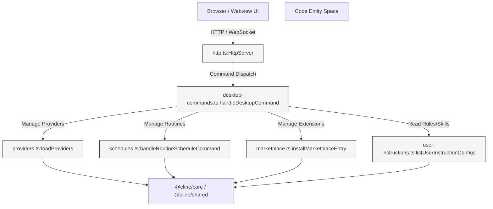
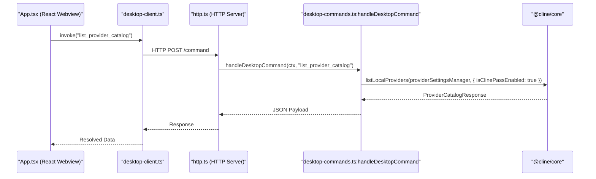
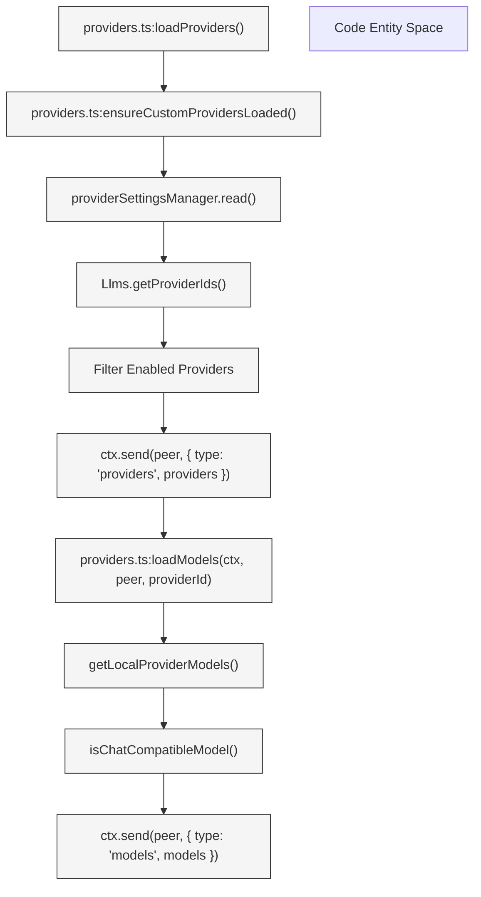
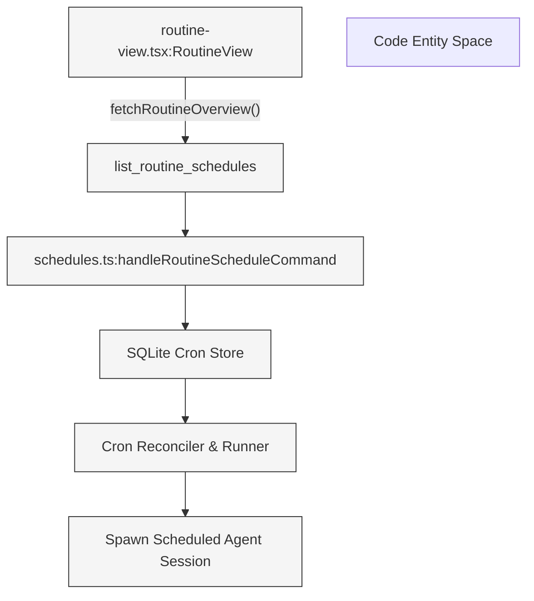
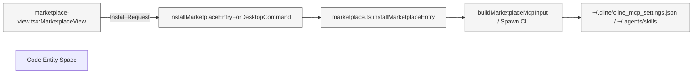
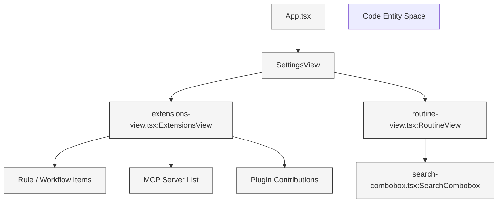

# Cline Hub Dashboard (apps/cline-hub)

Relevant source files

The following files were used as context for generating this wiki page:

- [.github/dependabot.yml](.github/dependabot.yml)
- [apps/cli/src/acp/acpAgent.ts](apps/cli/src/acp/acpAgent.ts)
- [apps/cli/src/acp/auth.ts](apps/cli/src/acp/auth.ts)
- [apps/cli/src/acp/auto-approve.test.ts](apps/cli/src/acp/auto-approve.test.ts)
- [apps/cli/src/acp/auto-approve.ts](apps/cli/src/acp/auto-approve.ts)
- [apps/cli/src/acp/index.ts](apps/cli/src/acp/index.ts)
- [apps/cli/src/acp/organizations.test.ts](apps/cli/src/acp/organizations.test.ts)
- [apps/cli/src/acp/organizations.ts](apps/cli/src/acp/organizations.ts)
- [apps/cli/src/acp/reasoning.test.ts](apps/cli/src/acp/reasoning.test.ts)
- [apps/cli/src/acp/session-load.test.ts](apps/cli/src/acp/session-load.test.ts)
- [apps/cli/src/acp/session-load.ts](apps/cli/src/acp/session-load.ts)
- [apps/cli/src/commands/skill.test.ts](apps/cli/src/commands/skill.test.ts)
- [apps/cli/src/commands/skill.ts](apps/cli/src/commands/skill.ts)
- [apps/cli/src/tui/hooks/use-runtime-dialog-bridge.tsx](apps/cli/src/tui/hooks/use-runtime-dialog-bridge.tsx)
- [apps/cli/src/utils/approval.ts](apps/cli/src/utils/approval.ts)
- [apps/cli/src/utils/cline-client-identity.ts](apps/cli/src/utils/cline-client-identity.ts)
- [apps/cli/src/utils/free-model-cost.test.ts](apps/cli/src/utils/free-model-cost.test.ts)
- [apps/cli/src/utils/free-model-cost.ts](apps/cli/src/utils/free-model-cost.ts)
- [apps/cline-hub/src/server/agent-events.test.ts](apps/cline-hub/src/server/agent-events.test.ts)
- [apps/cline-hub/src/server/agent-events.ts](apps/cline-hub/src/server/agent-events.ts)
- [apps/cline-hub/src/server/marketplace.test.ts](apps/cline-hub/src/server/marketplace.test.ts)
- [apps/cline-hub/src/server/marketplace.ts](apps/cline-hub/src/server/marketplace.ts)
- [apps/cline-hub/src/server/session-mapping.test.ts](apps/cline-hub/src/server/session-mapping.test.ts)
- [apps/cline-hub/src/webview/src/Chat.tsx](apps/cline-hub/src/webview/src/Chat.tsx)
- [apps/cline-hub/src/webview/src/components/views/page-layout.tsx](apps/cline-hub/src/webview/src/components/views/page-layout.tsx)
- [apps/cline-hub/src/webview/src/components/views/settings/provider-list-view.tsx](apps/cline-hub/src/webview/src/components/views/settings/provider-list-view.tsx)
- [apps/examples/desktop-app/sidecar/marketplace.test.ts](apps/examples/desktop-app/sidecar/marketplace.test.ts)
- [apps/examples/desktop-app/sidecar/marketplace.ts](apps/examples/desktop-app/sidecar/marketplace.ts)
- [apps/vscode/src/core/controller/marketplace/marketplace-helpers.ts](apps/vscode/src/core/controller/marketplace/marketplace-helpers.ts)
- [apps/vscode/src/hosts/vscode/terminal/VscodeTerminalManager.test.ts](apps/vscode/src/hosts/vscode/terminal/VscodeTerminalManager.test.ts)
- [apps/vscode/src/hosts/vscode/terminal/VscodeTerminalManager.ts](apps/vscode/src/hosts/vscode/terminal/VscodeTerminalManager.ts)
- [apps/vscode/src/hosts/vscode/terminal/VscodeTerminalProcess.test.ts](apps/vscode/src/hosts/vscode/terminal/VscodeTerminalProcess.test.ts)
- [apps/vscode/src/hosts/vscode/terminal/VscodeTerminalProcess.ts](apps/vscode/src/hosts/vscode/terminal/VscodeTerminalProcess.ts)
- [apps/vscode/src/hosts/vscode/terminal/VscodeTerminalRegistry.ts](apps/vscode/src/hosts/vscode/terminal/VscodeTerminalRegistry.ts)
- [apps/vscode/src/integrations/terminal/types.ts](apps/vscode/src/integrations/terminal/types.ts)
- [apps/vscode/src/sdk/tool-approval-denial.ts](apps/vscode/src/sdk/tool-approval-denial.ts)
- [apps/vscode/src/services/ClineClientIdentity.test.ts](apps/vscode/src/services/ClineClientIdentity.test.ts)
- [apps/vscode/src/services/ClineClientIdentity.ts](apps/vscode/src/services/ClineClientIdentity.ts)
- [apps/vscode/src/test/fixtures/mocha-unsupported-export.ts](apps/vscode/src/test/fixtures/mocha-unsupported-export.ts)
- [apps/vscode/src/test/mocha-shim.test.ts](apps/vscode/src/test/mocha-shim.test.ts)
- [apps/vscode/test-setup.js](apps/vscode/test-setup.js)
- [docs/usage/acp.mdx](docs/usage/acp.mdx)
- [sdk/packages/core/src/services/marketplace.test.ts](sdk/packages/core/src/services/marketplace.test.ts)
- [sdk/packages/core/src/services/marketplace.ts](sdk/packages/core/src/services/marketplace.ts)
- [sdk/packages/shared/src/llms/tools.ts](sdk/packages/shared/src/llms/tools.ts)

The Cline Hub Dashboard (`apps/cline-hub`) is a standalone web server and React-based dashboard application that exposes the full capabilities of the Cline agent runtime through a web browser or sidecar interface. It acts as a lightweight daemon and control center for managing providers, scheduled routines, project customizations, MCP servers, and marketplace extensions.

---

## 1. Hub Dashboard Server Architecture

The Hub server is structured around an HTTP server [apps/cline-hub/src/server/http.ts]() that upgrades incoming connections or communicates via a JSON/WebSocket webview protocol. It handles routing for desktop commands [apps/cline-hub/src/server/desktop-commands.ts](), provider settings [apps/cline-hub/src/server/providers.ts](), scheduled routines [apps/cline-hub/src/server/schedules.ts](), marketplace primitives [apps/cline-hub/src/server/marketplace.ts](), and user instruction configuration [apps/cline-hub/src/server/user-instructions.ts]().

*Sources: [apps/cline-hub/src/server/http.ts](), [apps/cline-hub/src/server/desktop-commands.ts](), [apps/cline-hub/src/server/providers.ts]()*

---

## 2. Desktop Commands and Protocol

The dashboard communicates via structured remote procedure calls (RPC) handled by `handleDesktopCommand` [apps/cline-hub/src/server/desktop-commands.ts:97-354](). These commands map directly to backend core functions in `@cline/core`.

### Core Command Categories
- **Provider Management**: `list_provider_catalog`, `list_provider_models`, `save_provider_settings`, `add_provider`, `run_provider_oauth_login` [apps/cline-hub/src/server/desktop-commands.ts:102-179]()
- **Account & Telemetry**: `cline_account`, `get_global_settings`, `set_telemetry_opt_out`, `set_auto_update_enabled` [apps/cline-hub/src/server/desktop-commands.ts:180-211]()
- **Routine Schedules**: `list_routine_schedules`, `create_routine_schedule`, `update_routine_schedule`, `pause_routine_schedule`, `resume_routine_schedule`, `trigger_routine_schedule`, `delete_routine_schedule` [apps/cline-hub/src/server/desktop-commands.ts:54-62]()
- **MCP & Marketplace**: Server management via `deleteMcpServer`, `upsertMcpServer`, and marketplace installations [apps/cline-hub/src/server/marketplace.ts:15-22]()

*Sources: [apps/cline-hub/src/server/desktop-commands.ts:97-107](), [apps/cline-hub/src/server/http.ts]()*

---

## 3. Provider Integration and Model Catalogs

Provider integration within `apps/cline-hub` handles setting up API keys, endpoints, and custom model lists.

- **`loadProviders`**: Iterates through available provider IDs using `Llms.getProviderIds()` and checks local persistence states via `providerSettingsManager` [apps/cline-hub/src/server/providers.ts:46-77]().
- **`loadModels`**: Filters local provider models using `isChatCompatibleModel` from `@cline/shared` to guarantee compatibility with the chat interface [apps/cline-hub/src/server/providers.ts:79-112]().
- **`saveProviderSettings`**: Persists changes using `saveLocalProviderSettings` and rebroadcasts updated catalogs to connected browser peers [apps/cline-hub/src/server/providers.ts:129-147]().

*Sources: [apps/cline-hub/src/server/providers.ts:46-112]()*

---

## 4. Schedules and Routine Management

Routine schedules are managed via `handleRoutineScheduleCommand` [apps/cline-hub/src/server/schedules.ts]() and surfaced through the settings and routines UI views [apps/cline-hub/src/webview/src/components/views/settings/routine-view.tsx]().

### Key Schedule Operations
- **Cron Pattern Parsing**: Supports standard cron strings as well as specialized metadata flags like `ONE_TIME_SCHEDULE_RUN_AT_METADATA_KEY` [apps/cline-hub/src/webview/src/components/views/settings/routine-view.tsx:5-6]().
- **Overview Synchronization**: Retrieves active executions, upcoming runs, and recent history through `fetchRoutineOverview()` [apps/cline-hub/src/webview/src/components/views/settings/routine-view.tsx:137-147]().

*Sources: [apps/cline-hub/src/webview/src/components/views/settings/routine-view.tsx:137-147](), [apps/cline-hub/src/server/desktop-commands.ts:54-62]()*

---

## 5. Marketplace and Customizations

The marketplace subsystem (`apps/cline-hub/src/server/marketplace.ts`) manages downloading, installing, and uninstalling plugins, MCP servers, skills, and workflows.

- **MCP Input Mapping**: `buildMarketplaceMcpInput` translates command line tokens or manifest configurations into standard JSON configuration formats (`stdio`, `streamableHttp`, `sse`) [apps/cline-hub/src/server/marketplace.test.ts:84-134]().
- **User Instructions Integration**: `listUserInstructionConfigs` aggregates rules (`.clinerules`), workflows, skills (`SKILL.md`), agents, plugins, tools, and hooks from the workspace and global configuration folders [apps/cline-hub/src/server/user-instructions.ts]().

*Sources: [apps/cline-hub/src/server/marketplace.ts](), [apps/cline-hub/src/server/marketplace.test.ts:84-134]()*

---

## 6. React App and Kanban Views

The webview application (`apps/cline-hub/src/webview/src/App.tsx`) provides a rich interface built with Tailwind CSS and Radix/Base UI components.

- **Extensions View**: Categorizes extensions into manageable sections including Rules, Hooks, MCP, Skills, Agents, Plugins, and Tools [apps/cline-hub/src/webview/src/components/views/settings/extensions-view.tsx:37-44]().
- **Search Combobox**: Implements a robust searchable dropdown (`SearchCombobox`) supporting keyboard navigation (Arrow keys, Home, End, Escape, Enter), custom sections, badges, and focus restoration [sdk/packages/ui/components/search-combobox.tsx:83-224]().

*Sources: [apps/cline-hub/src/webview/src/App.tsx](), [apps/cline-hub/src/webview/src/components/views/settings/extensions-view.tsx:37-44](), [sdk/packages/ui/components/search-combobox.tsx:83-224]()*

---

## Sources
- [apps/cline-hub/src/server/desktop-commands.ts]()
- [apps/cline-hub/src/server/http.ts]()
- [apps/cline-hub/src/server/marketplace.ts]()
- [apps/cline-hub/src/server/marketplace.test.ts]()
- [apps/cline-hub/src/server/providers.ts]()
- [apps/cline-hub/src/server/user-instructions.ts]()
- [apps/cline-hub/src/webview/src/App.tsx]()
- [apps/cline-hub/src/webview/src/components/views/settings/extensions-view.tsx]()
- [apps/cline-hub/src/webview/src/components/views/settings/routine-view.tsx]()
- [sdk/packages/ui/components/search-combobox.tsx]()