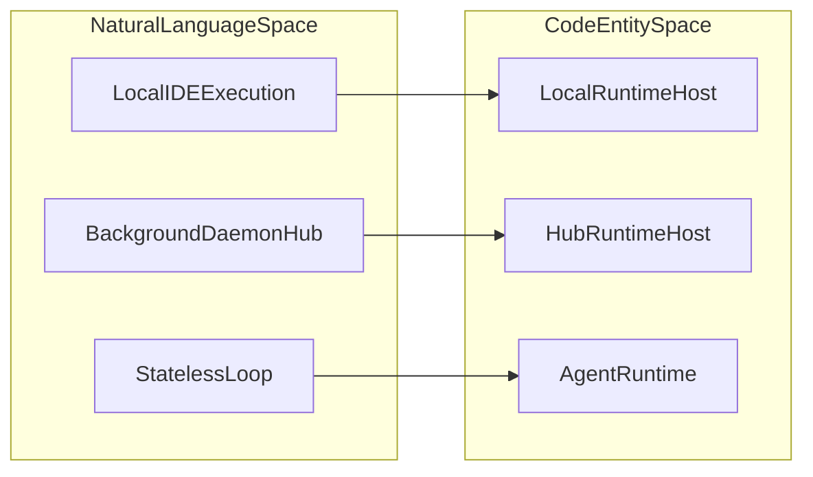

# Glossary

<details>
<summary>Relevant source files</summary>

The following files were used as context for generating this wiki page:

- [.github/ISSUE_TEMPLATE/bug_report.yml](.github/ISSUE_TEMPLATE/bug_report.yml)
- [.github/ISSUE_TEMPLATE/config.yml](.github/ISSUE_TEMPLATE/config.yml)
- [.github/pull_request_template.md](.github/pull_request_template.md)
- [CHANGELOG.md](CHANGELOG.md)
- [CODE_OF_CONDUCT.md](CODE_OF_CONDUCT.md)
- [CONTRIBUTING.md](CONTRIBUTING.md)
- [README.md](README.md)
- [apps/examples/desktop-app/webview/lib/provider-schema.ts](apps/examples/desktop-app/webview/lib/provider-schema.ts)
- [apps/vscode/package.json](apps/vscode/package.json)
- [package.json](package.json)
- [sdk/AGENTS.md](sdk/AGENTS.md)
- [sdk/ARCHITECTURE.md](sdk/ARCHITECTURE.md)
- [sdk/DOC.md](sdk/DOC.md)
- [sdk/packages/core/src/extensions/composio/composio-meta-tools.test.ts](sdk/packages/core/src/extensions/composio/composio-meta-tools.test.ts)
- [sdk/packages/core/src/extensions/composio/composio-meta-tools.ts](sdk/packages/core/src/extensions/composio/composio-meta-tools.ts)
- [sdk/packages/core/src/extensions/composio/composio-tools-extension.test.ts](sdk/packages/core/src/extensions/composio/composio-tools-extension.test.ts)
- [sdk/packages/core/src/extensions/composio/composio-tools-extension.ts](sdk/packages/core/src/extensions/composio/composio-tools-extension.ts)
- [sdk/packages/core/src/index.ts](sdk/packages/core/src/index.ts)
- [sdk/packages/core/src/services/llms/provider-defaults.test.ts](sdk/packages/core/src/services/llms/provider-defaults.test.ts)
- [sdk/packages/core/src/services/llms/provider-defaults.ts](sdk/packages/core/src/services/llms/provider-defaults.ts)
- [sdk/packages/core/src/services/local-runtime-bootstrap.test.ts](sdk/packages/core/src/services/local-runtime-bootstrap.test.ts)
- [sdk/packages/core/src/services/local-runtime-bootstrap.ts](sdk/packages/core/src/services/local-runtime-bootstrap.ts)
- [sdk/packages/core/src/services/providers/local-provider-registry.ts](sdk/packages/core/src/services/providers/local-provider-registry.ts)
- [sdk/packages/core/src/services/providers/local-provider-service.test.ts](sdk/packages/core/src/services/providers/local-provider-service.test.ts)
- [sdk/packages/core/src/services/providers/local-provider-service.ts](sdk/packages/core/src/services/providers/local-provider-service.ts)
- [sdk/packages/llms/src/index.browser.ts](sdk/packages/llms/src/index.browser.ts)
- [sdk/packages/llms/src/index.ts](sdk/packages/llms/src/index.ts)
- [sdk/packages/llms/src/models.ts](sdk/packages/llms/src/models.ts)
- [sdk/packages/llms/src/providers/builtins.test.ts](sdk/packages/llms/src/providers/builtins.test.ts)
- [sdk/packages/llms/src/providers/builtins.ts](sdk/packages/llms/src/providers/builtins.ts)
- [sdk/packages/shared/src/index.browser.ts](sdk/packages/shared/src/index.browser.ts)
- [sdk/packages/shared/src/index.ts](sdk/packages/shared/src/index.ts)
- [sdk/packages/shared/src/llms/gateway.ts](sdk/packages/shared/src/llms/gateway.ts)
- [sdk/packages/shared/src/rpc/runtime.ts](sdk/packages/shared/src/rpc/runtime.ts)

</details>


This page provides definitions for codebase-specific terms, jargon, abbreviations, and architectural entities used throughout the Cline monorepo. It is intended to help engineers navigate the domain-specific logic, abstractions, and core classes across the VS Code extension, CLI, desktop app, and SDK packages.

---

## 1. Core Architectural Terms & Jargon

### ClinePass
A subscription-based service providing access to optimized models and higher usage tiers across supported interfaces.
*   **Implementation**: Managed via subscription checks and error handlers in `@cline/llms` and `ClineAccountService` [sdk/packages/core/src/index.ts:131]().
*   **Data Flow**: Validates user tokens against backend billing/subscription endpoints before routing inference requests.

### Cline Hub
A background daemon process and shared service coordinator that manages agent states, routines, and multi-agent execution.
*   **Implementation**: Developed within `@cline/cline-hub` and coordinated via `HubRuntimeHost` [sdk/packages/core/src/hub/runtime-host/hub-runtime-host.ts:1-1](), [package.json:66]().
*   **Role**: Handles background task queues, WebSocket communication, and cross-client synchronization.

### RuntimeHost
An abstraction interface that defines how and where agent sessions are executed (locally within the extension/CLI or remotely via the Hub daemon).
*   **Implementation**: Defined by the `RuntimeHost` interface, with implementations like `LocalRuntimeHost` and `HubRuntimeHost` [sdk/packages/core/src/hub/runtime-host/hub-runtime-host.ts:1-1](), [sdk/packages/core/src/runtime/host/local-runtime-host.ts:1-1]().
*   **Role**: Decouples session orchestration from the concrete execution environment.

### AgentRuntime
The low-level, stateless execution loop responsible for communicating with LLMs, processing tool calls, and managing turn iterations.
*   **Implementation**: Located in `@cline/agents` [sdk/packages/agents/package.json:22]().
*   **Role**: Executes raw prompt-response loops without host-specific UI or storage logic.

### SessionRuntime
The stateful orchestration layer that wraps an `AgentRuntime` with history persistence, tool execution contexts, checkpoints, and event emission.
*   **Implementation**: Managed by `ClineCore` and session factories within `@cline/core` [sdk/packages/core/src/index.ts:202]().
*   **Role**: Manages active task state, user interaction loops, and recovery.

### Sidecar
The Tauri desktop application's background Bun-based server process that hosts the core agent engine and API endpoints.
*   **Implementation**: Packaged as part of `apps/examples/desktop-app` [package.json:6]().
*   **Role**: Powers the native Tauri UI by running the Node/Bun runtime side-by-side with the Rust native shell.

### Discovery Record
A metadata structure used by the Hub daemon to broadcast its availability, endpoint addresses, and authentication tokens to local clients.
*   **Implementation**: Defined in `@cline/shared` hub utilities [sdk/packages/shared/src/index.ts:142]().

Sources: [sdk/packages/core/src/index.ts:131](), [package.json:66](), [sdk/packages/core/src/hub/runtime-host/hub-runtime-host.ts:1](), [sdk/packages/agents/package.json:22](), [sdk/packages/shared/src/index.ts:142]()

---

## 2. Agent Execution & Orchestration

### Compaction Modes
Mechanisms for summarizing or trimming conversation history to ensure large tasks fit within an LLM's context window.
*   **Implementation**: Handled via `PreCompactHookPayload` and compaction services [sdk/packages/shared/src/index.ts:125]().
*   **Types**: Supports basic truncation and agentic summarization modes based on token budget projections and provider token counts [CHANGELOG.md:16]().

### Checkpoints
Git-backed versioning snapshots that record workspace file states before and after tool executions, enabling easy rollbacks.
*   **Implementation**: Managed via `CompareCheckpointInput`, `RestoreInput`, and git integration in `@cline/core` [sdk/packages/core/src/index.ts:223-228]().
*   **Role**: Provides fine-grained undo capabilities and version tracking for agent-driven edits [README.md:136]().

### Tool Policies
Fine-grained configuration rules that determine whether specific agent tools require manual user approval, are auto-approved, or are blocked entirely.
*   **Implementation**: Defined by the `ToolPolicy` type and auto-approval settings in `@cline/shared` [sdk/packages/core/src/index.ts:93]().

### Steer vs Queue
The strategy for handling incoming user prompts or messages while an agent turn is actively streaming or processing.
*   **Implementation**: Managed via `PendingPromptService` in `@cline/core` [sdk/packages/core/src/runtime/turn-queue/pending-prompt-service.ts:1-1]().
*   **Role**: Determines whether a new message should interrupt ("steer") the current generation or wait in line ("queue").

### Plugin Sandbox
An isolated execution environment and loader structure for running external agent plugins, custom tools, and hooks securely.
*   **Implementation**: Managed via `LoadAgentPluginFromPathOptions` and plugin diagnostic structures in `@cline/core` [sdk/packages/core/src/index.ts:239]().

Sources: [sdk/packages/shared/src/index.ts:125](), [sdk/packages/core/src/index.ts:93](), [sdk/packages/core/src/index.ts:223](), [sdk/packages/core/src/runtime/turn-queue/pending-prompt-service.ts:1]()

---

## 3. Protocols, Catalogs & Registries

### ContributionRegistry
A centralized registry that discovers and registers agent extensions, custom commands, hooks, rules, and MCP servers.
*   **Implementation**: Implemented via `ContributionRegistry` and `createContributionRegistry` in `@cline/shared` [sdk/packages/shared/src/index.ts:98-101]().

### MCP (Model Context Protocol)
An open standard protocol that enables AI models to securely connect to external data sources, databases, and tools.
*   **Implementation**: Integrated using `@modelcontextprotocol/sdk` wrapped by `McpHub` in `@cline/core` [sdk/packages/core/package.json:55]().
*   **Transports**: Supports `stdio`, `sse`, and `streamableHttp` [sdk/packages/shared/src/index.ts:83-85]().

### ACP (Agent Client Protocol)
A standardized communication protocol designed for interoperability between autonomous AI agents and diverse host applications/IDEs.
*   **Implementation**: Utilizes `@agentclientprotocol/sdk` in CLI and SDK apps [bun.lock:27]().

### Model Catalog
A structured, generated repository of supported AI models, vendor pricing, context windows, modal capabilities, and reasoning options.
*   **Implementation**: Generated by scripts into `GENERATED_PROVIDER_MODELS` within `@cline/llms` [sdk/packages/llms/src/catalog/catalog.generated.ts:13-18]().

### Provider Spec
Configuration definitions and vendor adapters that standardize how different LLM backends (Anthropic, OpenAI, Bedrock, Ollama, etc.) are instantiated and called.
*   **Implementation**: Managed across `@cline/llms` provider registries and handler factories.

Sources: [sdk/packages/shared/src/index.ts:83](), [sdk/packages/shared/src/index.ts:98](), [sdk/packages/core/package.json:55](), [sdk/packages/llms/src/catalog/catalog.generated.ts:13](), [bun.lock:27]()

---

## 4. Natural Language to Code Entity Mapping

The following diagrams illustrate how user-facing concepts map to concrete code entities within the monorepo architecture.

Title: "UI Concept to Core Service Mapping"
```mermaid
graph TD
    subgraph "NaturalLanguageSpace"
        A[""NewTask""]
        B[""Plan/ActToggle""]
        C[""CustomizationPlugins""]
        D[""MCPManager""]
    end

    subgraph "CodeEntitySpace"
        A1[""ClineCore.startSession()""]
        B1[""AgentMode""]
        C1[""ContributionRegistry""]
        D1[""McpHub""]
    end

    A -- "triggers" --> A1
    B -- "sets" --> B1
    C -- "registers via" --> C1
    D -- "controls via" --> D1
```
Sources: [sdk/packages/core/src/index.ts:38](), [sdk/packages/core/src/index.ts:104](), [sdk/packages/core/src/index.ts:202]()

Title: "Runtime and Execution Abstraction Mapping"

Sources: [sdk/packages/agents/package.json:22](), [sdk/packages/core/src/runtime/host/local-runtime-host.ts:1](), [sdk/packages/core/src/hub/runtime-host/hub-runtime-host.ts:1]()

---

## 5. Comprehensive Technical Glossary Table

| Term | Definition | Code Pointer |
| :--- | :--- | :--- |
| **ClinePass** | Subscription tier for optimized models and usage limits. | `ClinePass` [CHANGELOG.md:9]() |
| **Cline Hub** | Daemon service managing shared agent state and routines. | `@cline/cline-hub` [package.json:66]() |
| **RuntimeHost** | Abstraction interface for running sessions locally or remotely. | `RuntimeHost` [sdk/packages/core/src/runtime/host/runtime-host.ts:1-1]() |
| **AgentRuntime** | Stateless loop communicating with LLMs and executing tool calls. | `@cline/agents` [sdk/packages/agents/package.json:22]() |
| **SessionRuntime** | Stateful task orchestrator handling history, state, and events. | `SessionRuntime` [sdk/packages/core/src/types/session.ts:1-1]() |
| **Sidecar** | Bun background server process used by the Tauri desktop app. | `apps/examples/desktop-app` [package.json:6]() |
| **ContributionRegistry**| Registry for loading agent extensions, commands, and MCP servers. | `ContributionRegistry` [sdk/packages/shared/src/index.ts:98-101]() |
| **MCP** | Model Context Protocol standard for tool and resource integration. | `@modelcontextprotocol/sdk` [sdk/packages/core/package.json:55]() |
| **ACP** | Agent Client Protocol for agent-to-IDE communication. | `@agentclientprotocol/sdk` [bun.lock:27]() |
| **Compaction** | History truncation/summarization to fit context windows. | `PreCompactHookPayload` [sdk/packages/shared/src/index.ts:125]() |
| **Checkpoints** | Git-backed workspace snapshots for rollback and history. | `CompareCheckpointInput` [sdk/packages/core/src/index.ts:223-228]() |
| **Tool Policies** | Gating rules controlling manual vs auto-approved tool execution. | `ToolPolicy` [sdk/packages/core/src/index.ts:93]() |
| **Steer vs Queue** | Strategy for handling incoming prompts during active generation. | `PendingPromptService` [sdk/packages/core/src/runtime/turn-queue/pending-prompt-service.ts:1-1]() |
| **Plugin Sandbox** | Isolated loading framework for secure agent plugins and tools. | `LoadAgentPluginFromPathOptions` [sdk/packages/core/src/index.ts:239]() |
| **Model Catalog** | Generated list of supported models, pricing, and capabilities. | `GENERATED_PROVIDER_MODELS` [sdk/packages/llms/src/catalog/catalog.generated.ts:13-18]() |
| **Provider Spec** | Vendor configuration schema for LLM provider adapters. | `BUILTIN_SPECS` [sdk/packages/llms/package.json:4]() |

Sources: [CHANGELOG.md:9](), [package.json:66](), [sdk/packages/core/src/runtime/host/runtime-host.ts:1](), [sdk/packages/agents/package.json:22](), [sdk/packages/shared/src/index.ts:98](), [sdk/packages/core/package.json:55](), [bun.lock:27](), [sdk/packages/shared/src/index.ts:125](), [sdk/packages/core/src/index.ts:93](), [sdk/packages/core/src/index.ts:223](), [sdk/packages/core/src/runtime/turn-queue/pending-prompt-service.ts:1](), [sdk/packages/core/src/index.ts:239](), [sdk/packages/llms/src/catalog/catalog.generated.ts:13]()