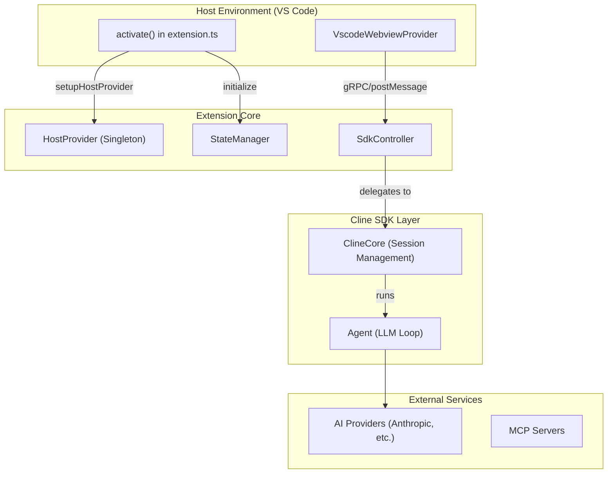
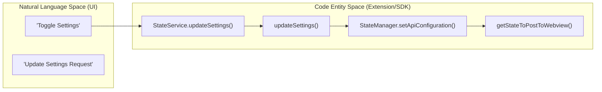

# Extension Architecture

Relevant source files

The following files were used as context for generating this wiki page:

- [apps/vscode/proto/cline/state.proto](apps/vscode/proto/cline/state.proto)
- [apps/vscode/scripts/generate-state-proto.mjs](apps/vscode/scripts/generate-state-proto.mjs)
- [apps/vscode/src/common.ts](apps/vscode/src/common.ts)
- [apps/vscode/src/core/controller/state/getStateToPostToWebview.ts](apps/vscode/src/core/controller/state/getStateToPostToWebview.ts)
- [apps/vscode/src/core/controller/state/updateSettings.ts](apps/vscode/src/core/controller/state/updateSettings.ts)
- [apps/vscode/src/core/controller/state/updateSettingsCli.ts](apps/vscode/src/core/controller/state/updateSettingsCli.ts)
- [apps/vscode/src/core/storage/__tests__/openai-base-url-migration.test.ts](apps/vscode/src/core/storage/__tests__/openai-base-url-migration.test.ts)
- [apps/vscode/src/core/storage/openai-base-url-migration.ts](apps/vscode/src/core/storage/openai-base-url-migration.ts)
- [apps/vscode/src/extension.ts](apps/vscode/src/extension.ts)
- [apps/vscode/src/hosts/vscode/commandUtils.ts](apps/vscode/src/hosts/vscode/commandUtils.ts)
- [apps/vscode/src/shared/ExtensionMessage.ts](apps/vscode/src/shared/ExtensionMessage.ts)
- [apps/vscode/src/shared/storage/__tests__/state-keys.test.ts](apps/vscode/src/shared/storage/__tests__/state-keys.test.ts)
- [apps/vscode/src/shared/storage/state-keys.ts](apps/vscode/src/shared/storage/state-keys.ts)
- [apps/vscode/src/standalone/cline-core.ts](apps/vscode/src/standalone/cline-core.ts)
- [apps/vscode/webview-ui/src/components/settings/sections/FeatureSettingsSection.spec.tsx](apps/vscode/webview-ui/src/components/settings/sections/FeatureSettingsSection.spec.tsx)
- [apps/vscode/webview-ui/src/components/settings/sections/FeatureSettingsSection.tsx](apps/vscode/webview-ui/src/components/settings/sections/FeatureSettingsSection.tsx)
- [apps/vscode/webview-ui/src/context/ExtensionStateContext.tsx](apps/vscode/webview-ui/src/context/ExtensionStateContext.tsx)

This page documents the internal structure of the Cline extension and its evolution toward a standalone core architecture. It covers the high-level orchestration between the host environment, the central controller, and the cross-platform abstraction layer.

## Overview

Cline is designed with a decoupled architecture that separates the agentic core logic from the host environment (VS Code, CLI, or standalone). This separation is achieved through a provider-based abstraction layer and a centralized controller that manages the lifecycle of AI tasks via the Cline SDK and shared services [apps/vscode/src/extension.ts:68-86](), [apps/vscode/src/common.ts:34-57](). The extension maintains cross-platform compatibility through shared file-backed storage and gRPC communication layers [apps/vscode/src/extension.ts:82-86]().

### System Components

**Sources:** [apps/vscode/src/extension.ts:67-91](), [apps/vscode/src/common.ts:34-57]()

---

## Key Subsystems

### 2.1 Extension Activation and Lifecycle
The extension entry point handles the transition from VS Code's activation events to a running agent [apps/vscode/src/extension.ts:68-72](). It orchestrates host setup, cleans up legacy storage patterns, migrates data to shared file-backed stores, and registers the webview provider for the sidebar [apps/vscode/src/extension.ts:76-126](). It also registers global commands such as the plus button and URI handlers [apps/vscode/src/extension.ts:133-134]().
For details, see [Extension Activation and Lifecycle](#2.1).

**Sources:** [apps/vscode/src/extension.ts:68-86](), [apps/vscode/src/extension.ts:123-134]()

### 2.2 Host Provider Abstraction
To support multiple environments (VS Code, CLI, Standalone), Cline uses the `HostProvider` singleton [apps/vscode/src/common.ts:5-6](). This interface abstracts platform-specific APIs for file systems, terminals, windowing, and diff views [apps/vscode/src/standalone/cline-core.ts:152-171](). The extension and standalone core initialize this during startup to unify capabilities across backends [apps/vscode/src/standalone/cline-core.ts:87-88](), [apps/vscode/src/common.ts:34-57]().
For details, see [Host Provider Abstraction](#2.2).

**Sources:** [apps/vscode/src/standalone/cline-core.ts:152-171](), [apps/vscode/src/common.ts:34-57]()

### 2.3 Controller and Orchestration
The controller subsystem serves as the bridge between the UI and the task engine. It owns the session lifecycle, state persistence, configuration updates, and MCP hub integration [apps/vscode/src/core/controller/state/getStateToPostToWebview.ts:23-34](), [apps/vscode/src/core/controller/state/updateSettings.ts:23-61](). It delegates core execution to `@cline/core` while streaming state updates back to the webview [apps/vscode/src/core/controller/state/getStateToPostToWebview.ts:23-34]().
For details, see [Controller and Orchestration](#2.3).

**Sources:** [apps/vscode/src/core/controller/state/getStateToPostToWebview.ts:23-34](), [apps/vscode/src/core/controller/state/updateSettings.ts:23-61]()

### 2.4 WebView Communication
Communication between the React-based UI and the TypeScript extension backend uses structured `ExtensionMessage` and `WebviewMessage` contracts over the webview message bridge [apps/vscode/src/shared/ExtensionMessage.ts:22-33](). State propagation and user actions are synchronized across the component tree through `ExtensionStateContext` and gRPC client stubs [apps/vscode/webview-ui/src/context/ExtensionStateContext.tsx:51-147]().
For details, see [WebView Communication](#2.4).

**Sources:** [apps/vscode/src/shared/ExtensionMessage.ts:22-33](), [apps/vscode/webview-ui/src/context/ExtensionStateContext.tsx:51-147]()

### 2.5 gRPC Service Layer
Cline uses gRPC-over-postMessage and protocol buffer definitions (such as `StateService` in `apps/vscode/proto/cline/state.proto`) for typed communication [apps/vscode/proto/cline/state.proto:12-40](). The handler dispatcher, streaming responses, and service methods manage remote procedure calls cleanly between the webview client stubs and core services [apps/vscode/proto/cline/state.proto:13-17]().
For details, see [gRPC Service Layer](#2.5).

**Sources:** [apps/vscode/proto/cline/state.proto:12-40]()

### 2.6 SDK Rollout and A/B Loading
The rollout package manages the controlled transition to the SDK-based architecture [apps/vscode/src/extension.ts:61-63](). It handles A/B loader cohort assignment, next versus legacy bundle selection, crash fallback routines, and telemetry capture for variant activations [apps/vscode/src/extension.ts:61-63]().
For details, see [SDK Rollout and A/B Loading](#2.6).

**Sources:** [apps/vscode/src/extension.ts:61-63]()

---

## Architectural Mapping

The following diagram maps high-level user actions in the UI to specific backend entities and service calls.

**Sources:** [apps/vscode/proto/cline/state.proto:22](), [apps/vscode/src/core/controller/state/updateSettings.ts:23-24](), [apps/vscode/src/core/controller/state/getStateToPostToWebview.ts:23-34]()

### Component Relationship Table

| Component | Responsibility | Primary Implementation |
|-----------|----------------|------------------------|
| `activate()` | Initializes VS Code extension state and hooks | [apps/vscode/src/extension.ts:68-72]() |
| `initialize()` | Common cross-platform initialization | [apps/vscode/src/common.ts:34-39]() |
| `HostProvider` | Platform-agnostic interface for host APIs | [apps/vscode/src/common.ts:5-6]() |
| `StateService` | Protocol buffer service definitions for state | [apps/vscode/proto/cline/state.proto:12-40]() |
| `StateManager` | Manages core extension state persistence | [apps/vscode/src/common.ts:57]() |
| `getStateToPostToWebview` | Builds `ExtensionState` snapshots for the webview | [apps/vscode/src/core/controller/state/getStateToPostToWebview.ts:23-34]() |

**Sources:** [apps/vscode/src/extension.ts:68-72](), [apps/vscode/src/common.ts:34-57](), [apps/vscode/proto/cline/state.proto:12-40](), [apps/vscode/src/core/controller/state/getStateToPostToWebview.ts:23-34]()