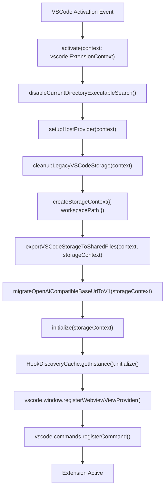
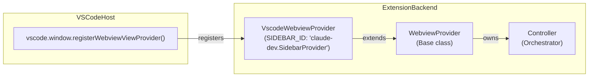
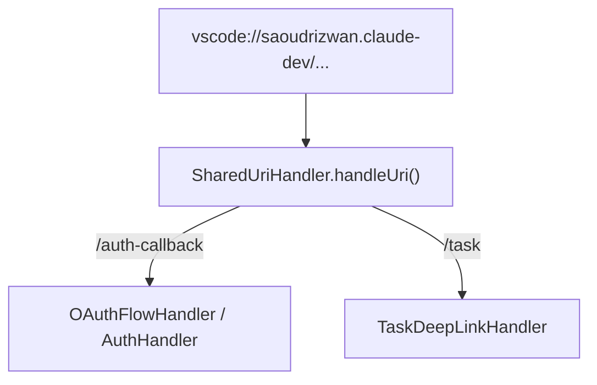
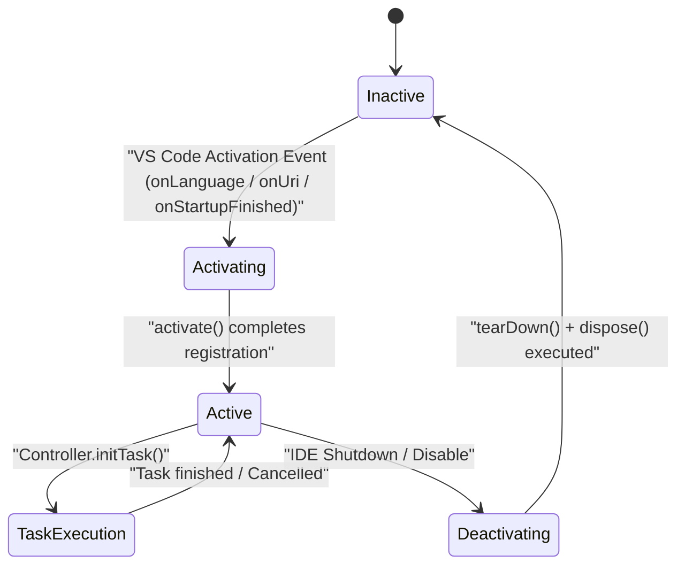

# Extension Activation and Lifecycle

Relevant source files

The following files were used as context for generating this wiki page:

- [.github/ISSUE_TEMPLATE/bug_report.yml](.github/ISSUE_TEMPLATE/bug_report.yml)
- [.github/ISSUE_TEMPLATE/config.yml](.github/ISSUE_TEMPLATE/config.yml)
- [.github/pull_request_template.md](.github/pull_request_template.md)
- [CHANGELOG.md](CHANGELOG.md)
- [CODE_OF_CONDUCT.md](CODE_OF_CONDUCT.md)
- [CONTRIBUTING.md](CONTRIBUTING.md)
- [README.md](README.md)
- [apps/vscode/package.json](apps/vscode/package.json)
- [apps/vscode/src/common.ts](apps/vscode/src/common.ts)
- [apps/vscode/src/core/storage/__tests__/openai-base-url-migration.test.ts](apps/vscode/src/core/storage/__tests__/openai-base-url-migration.test.ts)
- [apps/vscode/src/core/storage/openai-base-url-migration.ts](apps/vscode/src/core/storage/openai-base-url-migration.ts)
- [apps/vscode/src/extension.ts](apps/vscode/src/extension.ts)
- [apps/vscode/src/hosts/vscode/commandUtils.ts](apps/vscode/src/hosts/vscode/commandUtils.ts)
- [apps/vscode/src/standalone/cline-core.ts](apps/vscode/src/standalone/cline-core.ts)
- [package.json](package.json)

This document provides a full technical breakdown of the VS Code extension entry point (`apps/vscode/src/extension.ts`), detailing what triggers activation, the ordered sequence of initialization steps inside `activate()`, `WebviewProvider` creation, contributed commands, `SharedUriHandler` routing, and extension teardown. It focuses exclusively on the VS Code host environment and its bridge to the shared core and SDK-backed runtime.

For details on the shared `Controller` orchestrator and its owned services, see [Controller and Orchestration](2.3). For the `HostProvider` abstraction that decouples VS Code APIs from the core engine, see [Host Provider Abstraction](2.2). For the webview communication layer, see [WebView Communication](2.4).

---

## Activation Events

VS Code activates the extension based on the `activationEvents` declared in `apps/vscode/package.json`. These include handling language-specific files, incoming URIs, or the completion of the IDE startup sequence.

| Event | Trigger | Code Entity |
|---|---|---|
| `onLanguage` | Any file with a registered language ID is opened | `[apps/vscode/package.json:43-43]()` |
| `onUri` | A `vscode://` URI is dispatched to the extension | `[apps/vscode/package.json:44-44]()` |
| `onStartupFinished` | VS Code finishes its background startup sequence | `[apps/vscode/package.json:45-45]()` |

The compiled extension bundle output is `./dist/extension.js`, which maps directly to the TypeScript source file `[apps/vscode/src/extension.ts:1-1]()`.

Sources: `[apps/vscode/package.json:42-47]`, `[apps/vscode/src/extension.ts:1-1]()`

---

## Activation Sequence

When VS Code satisfies an activation event, it invokes the exported `activate(context: vscode.ExtensionContext)` function in `[apps/vscode/src/extension.ts]()`. This function executes a strict initialization sequence to establish host bindings, migrate legacy data structures, and spin up core services.

### Activation Code Entity Flow

*(Diagram bridges natural language execution stages to exact code identifiers in `[apps/vscode/src/extension.ts]()` and `[apps/vscode/src/common.ts]()`)*

Sources: `[apps/vscode/src/extension.ts:68-134]`, `[apps/vscode/src/common.ts:34-99]()`

### Step-by-Step Breakdown

1. **Host Provider Setup**: `setupHostProvider(context)` instantiates and registers the `HostProvider` singleton [apps/vscode/src/extension.ts:76-76](). This decouples VS Code concrete APIs (workspace folders, windows, terminals) from the architecture-agnostic core logic.
2. **Storage and State Migration**: `cleanupLegacyVSCodeStorage(context)` moves legacy workspace keys to global scope, migrates historical task logs to files, and converts custom instructions [apps/vscode/src/extension.ts:81-81](). Following this, `exportVSCodeStorageToSharedFiles(context, storageContext)` performs a one-time structural copy into the unified `~/.cline/data/` format [apps/vscode/src/extension.ts:87-87](), and `migrateOpenAiCompatibleBaseUrlToV1(storageContext)` updates stored endpoint paths [apps/vscode/src/extension.ts:88-88]().
3. **Common Initialization**: `initialize(storageContext)` sets up shared subsystems such as `StateManager`, `Logger`, and the webview provider framework [apps/vscode/src/common.ts:34-98](), returning a concrete `VscodeWebviewProvider` instance [apps/vscode/src/extension.ts:92-92]().
4. **Cache Optimization**: `HookDiscoveryCache.getInstance().initialize(...)` scans and indexes project workspace hooks to optimize runtime execution lookup [apps/vscode/src/extension.ts:96-122]().

Sources: `[apps/vscode/src/extension.ts:68-122]`, `[apps/vscode/src/common.ts:34-98]()`, `[apps/vscode/src/core/storage/state-migrations.ts:31-40]()`

---

## WebviewProvider Creation and Registration

The extension mounts its primary user interface as a sidebar webview panel using VS Code's extension API.

### Webview Provider Architecture

*(Diagram mapping sidebar registration to `VscodeWebviewProvider` and the base `WebviewProvider` orchestrator)*

The sidebar view is bound to the identifier `claude-dev.SidebarProvider` [apps/vscode/package.json:123-123](). Inside `[apps/vscode/src/extension.ts]()`, the `VscodeWebviewProvider` class is instantiated and registered via `vscode.window.registerWebviewViewProvider` [apps/vscode/src/extension.ts:125-128](). It inherits from the base `WebviewProvider` class, which manages message passing contracts and encapsulates the `Controller` lifecycle orchestrator instance [apps/vscode/src/hosts/vscode/VscodeWebviewProvider.ts:49-49]().

Sources: `[apps/vscode/package.json:123-123]`, `[apps/vscode/src/extension.ts:125-128]`, `[apps/vscode/src/hosts/vscode/VscodeWebviewProvider.ts:49-49]()`

---

## Contributed Commands

Commands declared in `[apps/vscode/package.json]()` are mapped to execution handlers during `activate()` [apps/vscode/src/extension.ts:133-232]() using `ExtensionRegistryInfo` mappings [apps/vscode/src/extension.ts:131-131]().

| Command ID | Title | Purpose / Handler Action |
|---|---|---|
| `cline.plusButtonClicked` | New Task | Resets webview state and initializes a clean task session. |
| `cline.mcpButtonClicked` | MCP Servers | Opens the Model Context Protocol management interface. |
| `cline.marketplaceButtonClicked` | Customize | Launches the marketplace view for custom Skills and Workflows. |
| `cline.historyButtonClicked` | History | Renders previous execution history and session logs. |
| `cline.accountButtonClicked` | Account | Opens account management and ClinePass configuration. |
| `cline.settingsButtonClicked` | Settings | Displays global settings and provider configuration forms. |
| `cline.generateGitCommitMessage` | Generate Commit Message | Triggers an AI agent turn to analyze staging changes and draft a commit message. |

Sources: `[apps/vscode/package.json:129-232]`, `[apps/vscode/src/extension.ts:131-131]()`

---

## URI Handling

The extension registers `SharedUriHandler` to intercept incoming `vscode://` deep links and protocol callbacks via VS Code's `vscode.window.registerUriHandler()` API.

### URI Routing Flow

*(Diagram illustrating URI dispatch through `SharedUriHandler`)*

This handler processes OAuth redirect flows required by external AI providers and cloud account login sequences, as well as cross-application task deep linking.

Sources: `[apps/vscode/src/extension.ts:57-57]`, `[apps/vscode/src/services/uri/SharedUriHandler.ts:1-100]()`

---

## Extension Teardown

When VS Code closes or unloads the extension, the `deactivate()` hook triggers `tearDown()` [apps/vscode/src/extension.ts:24-24]() to safely release system resources, close background connections, and flush metrics.

| Component | Teardown Handler | Action Performed |
|---|---|---|
| `TelemetryService` | `telemetryService.dispose()` | Flushes pending analytical payloads and shuts down export clients. |
| `McpHub` | `mcpHub.dispose()` | Terminates active child process transports and closes client sessions. |
| `HookDiscoveryCache` | `HookDiscoveryCache.dispose()` | Clears active filesystem watchers and in-memory caches. |
| `TerminalManager` | `terminalManager.dispose()` | Kills managed pseudo-terminals and background runner processes. |

Sources: `[apps/vscode/src/extension.ts:24-24]`, `[apps/vscode/src/common.ts:34-99]()`

---

## Full Lifecycle Summary

The extension transitions across well-defined states from initial load to complete teardown.

### Extension Lifecycle State Machine

*(State diagram tracking the extension lifecycle from initialization to teardown)*

Sources: `[apps/vscode/src/extension.ts:68-134]`, `[apps/vscode/src/common.ts:34-99]()`