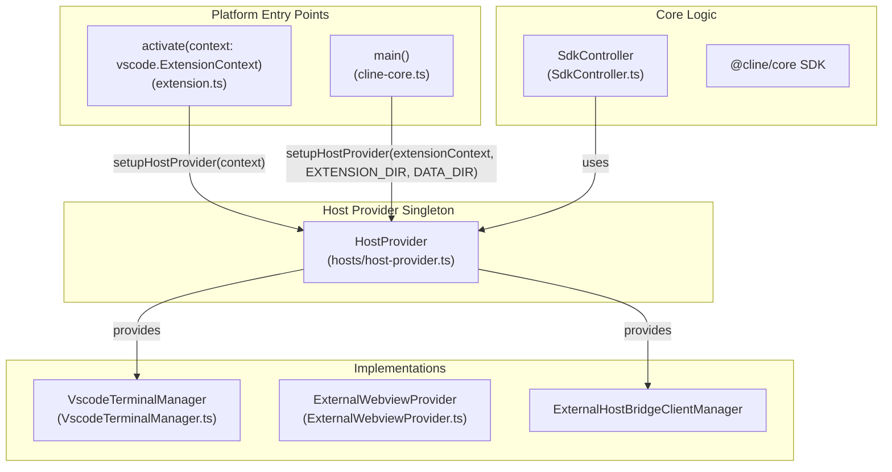
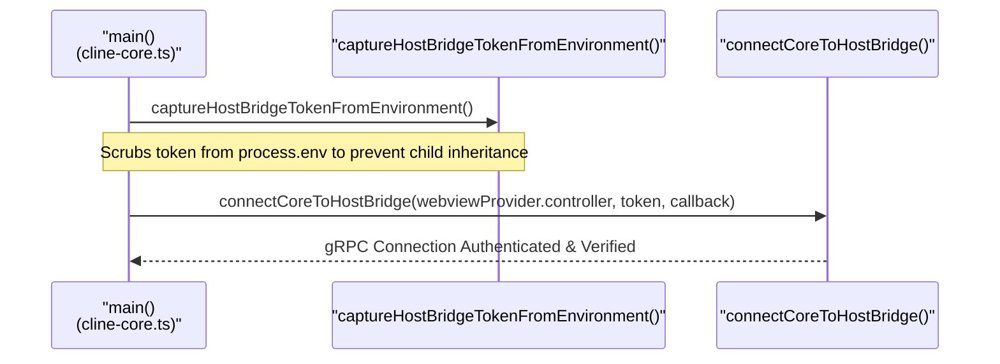

# Host Provider Abstraction

Relevant source files

The following files were used as context for generating this wiki page:

- [apps/cli/src/tui/hooks/use-runtime-dialog-bridge.tsx](apps/cli/src/tui/hooks/use-runtime-dialog-bridge.tsx)
- [apps/cli/src/utils/approval.ts](apps/cli/src/utils/approval.ts)
- [apps/cline-hub/src/server/agent-events.test.ts](apps/cline-hub/src/server/agent-events.test.ts)
- [apps/cline-hub/src/server/agent-events.ts](apps/cline-hub/src/server/agent-events.ts)
- [apps/cline-hub/src/webview/src/Chat.tsx](apps/cline-hub/src/webview/src/Chat.tsx)
- [apps/vscode/src/common.ts](apps/vscode/src/common.ts)
- [apps/vscode/src/core/storage/__tests__/openai-base-url-migration.test.ts](apps/vscode/src/core/storage/__tests__/openai-base-url-migration.test.ts)
- [apps/vscode/src/core/storage/openai-base-url-migration.ts](apps/vscode/src/core/storage/openai-base-url-migration.ts)
- [apps/vscode/src/extension.ts](apps/vscode/src/extension.ts)
- [apps/vscode/src/hosts/vscode/commandUtils.ts](apps/vscode/src/hosts/vscode/commandUtils.ts)
- [apps/vscode/src/hosts/vscode/terminal/VscodeTerminalManager.test.ts](apps/vscode/src/hosts/vscode/terminal/VscodeTerminalManager.test.ts)
- [apps/vscode/src/hosts/vscode/terminal/VscodeTerminalManager.ts](apps/vscode/src/hosts/vscode/terminal/VscodeTerminalManager.ts)
- [apps/vscode/src/hosts/vscode/terminal/VscodeTerminalProcess.test.ts](apps/vscode/src/hosts/vscode/terminal/VscodeTerminalProcess.test.ts)
- [apps/vscode/src/hosts/vscode/terminal/VscodeTerminalProcess.ts](apps/vscode/src/hosts/vscode/terminal/VscodeTerminalProcess.ts)
- [apps/vscode/src/hosts/vscode/terminal/VscodeTerminalRegistry.ts](apps/vscode/src/hosts/vscode/terminal/VscodeTerminalRegistry.ts)
- [apps/vscode/src/integrations/terminal/types.ts](apps/vscode/src/integrations/terminal/types.ts)
- [apps/vscode/src/sdk/tool-approval-denial.ts](apps/vscode/src/sdk/tool-approval-denial.ts)
- [apps/vscode/src/standalone/cline-core.ts](apps/vscode/src/standalone/cline-core.ts)
- [apps/vscode/src/test/fixtures/mocha-unsupported-export.ts](apps/vscode/src/test/fixtures/mocha-unsupported-export.ts)
- [apps/vscode/src/test/mocha-shim.test.ts](apps/vscode/src/test/mocha-shim.test.ts)
- [apps/vscode/test-setup.js](apps/vscode/test-setup.js)
- [sdk/packages/shared/src/llms/tools.ts](sdk/packages/shared/src/llms/tools.ts)

## Purpose and Scope

The Host Provider Abstraction is a platform abstraction layer that enables Cline to run on multiple host environments—the VS Code extension and the `cline-core` standalone service (used by the CLI, JetBrains, and desktop applications)—while sharing the same core logic. It defines a uniform interface for platform-specific capabilities such as file system access, terminal management, UI rendering, and system dialogs. This pattern allows the `Controller`, task execution systems, and other core services to operate independently of the underlying host platform.

Sources: `[apps/vscode/src/extension.ts:68-76]`, `[apps/vscode/src/standalone/cline-core.ts:80-88]()`

---

## Architecture Overview

The `HostProvider` acts as a singleton registry for factories and service clients that bridge the gap between the platform-agnostic core and the host environment.

Sources: `[apps/vscode/src/extension.ts:68-76]`, `[apps/vscode/src/standalone/cline-core.ts:152-167]()`

---

## The HostProvider Singleton

The `HostProvider` class manages host-specific providers for dependency injection. It must be initialized exactly once during the application startup sequence via `HostProvider.initialize()`.

### Key Members and Service Accessors

| Member / Accessor | Type / Client | Purpose |
| :--- | :--- | :--- |
| `createWebviewProvider` | `WebviewProviderCreator` | Factory for the platform's Webview implementation (VS Code Sidebar vs. External Window). |
| `createEditPreview` | `EditPreviewCreator` | Factory for showing file diffs and previews. |
| `createCommentReview` | `CommentReviewCreator` | Factory for host-specific comment/review UI. |
| `HostProvider.workspace` | `WorkspaceClientInterface` | Accesses workspace paths, file lists, and project metadata. |
| `HostProvider.env` | `EnvClientInterface` | Getting host version, machine ID, and handling OAuth callbacks. |
| `HostProvider.window` | `WindowClientInterface` | Accessing UI dialogs, notifications, and `ShowMessageRequest`. |
| `HostProvider.diff` | `DiffClientInterface` | Accessing file comparison operations. |
| `HostProvider.terminal` | `TerminalClientInterface` | Managing interactive and background terminal sessions. |

Sources: `[apps/vscode/src/standalone/cline-core.ts:152-167]`, `[apps/common.ts:34-38]()`

---

## VS Code vs. External/Standalone Implementations

### 1. VS Code Implementation
In the VS Code environment, the host provider utilizes native extension host APIs directly. The `VscodeTerminalManager` handles shell integration and terminal lifecycle within the IDE, while local webviews render inside VS Code webview panels.

### 2. Standalone Implementation (`cline-core`)
The standalone implementation (used by JetBrains, CLI, and desktop apps) uses `ExternalHostBridgeClientManager` and `ExternalWebviewProvider`. It communicates with the IDE host or sidecar via a gRPC-over-Protobuf "Host Bridge" connection.

* **Client Generation**: Client stubs and type definitions are generated automatically via build scripts, producing type-safe gRPC clients for each service defined in the protocol buffer specifications.
* **Lifecycle Binding**: In standalone startup routines, `setupHostProvider` configures external factories before launching core connection loops (`[apps/vscode/src/standalone/cline-core.ts:152-167]()`).

Sources: `[apps/vscode/src/standalone/cline-core.ts:152-167]`, `[apps/vscode/src/hosts/vscode/terminal/VscodeTerminalManager.ts:76-123]()`

---

## Sub-Interfaces: Diff, Workspace, Window, and Terminal

The host bridge architecture partitions functionality into specialized sub-interfaces, mapped via Protobuf service definitions:

1. **Workspace Sub-Interface**: Manages workspace folders, file resolution, directory traversals, and file watchers.
2. **Window Sub-Interface**: Handles user-facing notifications, modal dialogs, and progress indicators (e.g., `ShowMessageType` handling) `[apps/vscode/src/extension.ts:58-58]()`.
3. **Diff Sub-Interface**: Orchestrates side-by-side file comparisons, text decorations, and preview content providers (`ExternalEditPreview` vs. `VscodeEditPreview`) `[apps/vscode/src/standalone/cline-core.ts:8-10]()`.
4. **Terminal Sub-Interface**: Controls terminal execution environments, wrapping either `VscodeTerminalManager` (for IDE terminals with shell integration) or standalone subprocess shells `[apps/vscode/src/hosts/vscode/terminal/VscodeTerminalManager.ts:76-123]()`.

Sources: `[apps/vscode/src/extension.ts:58-58]`, `[apps/vscode/src/standalone/cline-core.ts:8-10]`, `[apps/vscode/src/hosts/vscode/terminal/VscodeTerminalManager.ts:76-123]()`

---

## Host-Bridge Authentication

Standalone cores communicating over the host bridge require secure authentication to prevent unauthorized process attachment.

* **Token Capture**: Standalone processes capture the per-spawn secret token via `captureHostBridgeTokenFromEnvironment()` during early initialization `[apps/vscode/src/standalone/cline-core.ts:41-43]()`.
* **Environment Scrubbing**: The token is immediately scrubbed from `process.env` before provider or MCP child processes are spawned, ensuring descendants never inherit the credential `[apps/vscode/src/standalone/cline-core.ts:37-43]()`.
* **Client Construction**: The captured token is injected into gRPC metadata headers when initializing channel connections.

Sources: `[apps/vscode/src/standalone/cline-core.ts:37-43]`, `[apps/vscode/src/standalone/cline-core.ts:127-139]()`