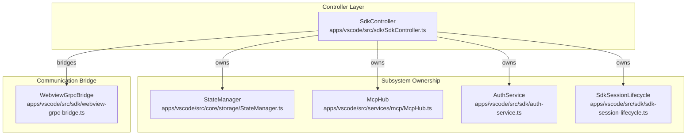
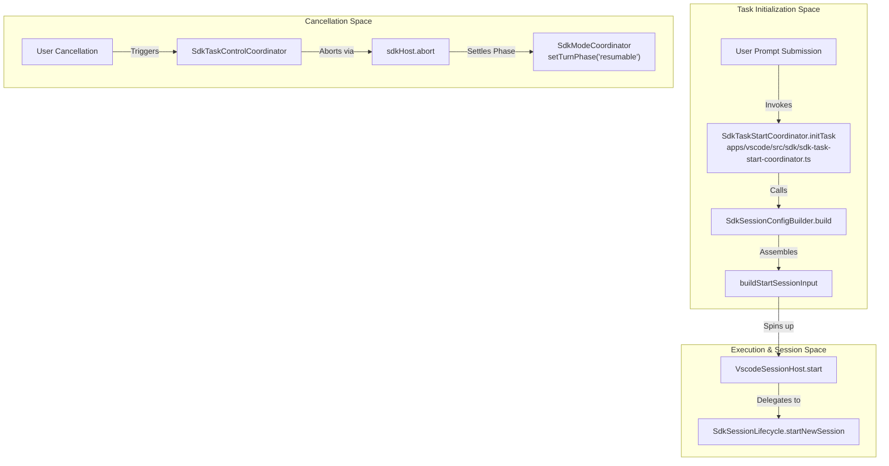

# Controller and Orchestration

Relevant source files

The following files were used as context for generating this wiki page:

- [apps/vscode/proto/cline/state.proto](apps/vscode/proto/cline/state.proto)
- [apps/vscode/scripts/generate-state-proto.mjs](apps/vscode/scripts/generate-state-proto.mjs)
- [apps/vscode/src/core/controller/state/getStateToPostToWebview.ts](apps/vscode/src/core/controller/state/getStateToPostToWebview.ts)
- [apps/vscode/src/core/controller/state/updateSettings.ts](apps/vscode/src/core/controller/state/updateSettings.ts)
- [apps/vscode/src/core/controller/state/updateSettingsCli.ts](apps/vscode/src/core/controller/state/updateSettingsCli.ts)
- [apps/vscode/src/sdk/SdkController.test.ts](apps/vscode/src/sdk/SdkController.test.ts)
- [apps/vscode/src/sdk/SdkController.ts](apps/vscode/src/sdk/SdkController.ts)
- [apps/vscode/src/sdk/sdk-mode-coordinator.test.ts](apps/vscode/src/sdk/sdk-mode-coordinator.test.ts)
- [apps/vscode/src/sdk/sdk-mode-coordinator.ts](apps/vscode/src/sdk/sdk-mode-coordinator.ts)
- [apps/vscode/src/sdk/sdk-session-config-builder.test.ts](apps/vscode/src/sdk/sdk-session-config-builder.test.ts)
- [apps/vscode/src/sdk/sdk-session-config-builder.ts](apps/vscode/src/sdk/sdk-session-config-builder.ts)
- [apps/vscode/src/sdk/sdk-session-event-coordinator.test.ts](apps/vscode/src/sdk/sdk-session-event-coordinator.test.ts)
- [apps/vscode/src/sdk/sdk-session-event-coordinator.ts](apps/vscode/src/sdk/sdk-session-event-coordinator.ts)
- [apps/vscode/src/sdk/sdk-session-lifecycle.test.ts](apps/vscode/src/sdk/sdk-session-lifecycle.test.ts)
- [apps/vscode/src/sdk/sdk-session-lifecycle.ts](apps/vscode/src/sdk/sdk-session-lifecycle.ts)
- [apps/vscode/src/sdk/sdk-task-start-coordinator.test.ts](apps/vscode/src/sdk/sdk-task-start-coordinator.test.ts)
- [apps/vscode/src/sdk/sdk-task-start-coordinator.ts](apps/vscode/src/sdk/sdk-task-start-coordinator.ts)
- [apps/vscode/src/sdk/sdk-user-message-mapping.test.ts](apps/vscode/src/sdk/sdk-user-message-mapping.test.ts)
- [apps/vscode/src/sdk/sdk-user-message-mapping.ts](apps/vscode/src/sdk/sdk-user-message-mapping.ts)
- [apps/vscode/src/shared/ExtensionMessage.ts](apps/vscode/src/shared/ExtensionMessage.ts)
- [apps/vscode/src/shared/storage/__tests__/state-keys.test.ts](apps/vscode/src/shared/storage/__tests__/state-keys.test.ts)
- [apps/vscode/src/shared/storage/state-keys.ts](apps/vscode/src/shared/storage/state-keys.ts)
- [apps/vscode/webview-ui/src/components/settings/sections/FeatureSettingsSection.spec.tsx](apps/vscode/webview-ui/src/components/settings/sections/FeatureSettingsSection.spec.tsx)
- [apps/vscode/webview-ui/src/components/settings/sections/FeatureSettingsSection.tsx](apps/vscode/webview-ui/src/components/settings/sections/FeatureSettingsSection.tsx)
- [apps/vscode/webview-ui/src/context/ExtensionStateContext.tsx](apps/vscode/webview-ui/src/context/ExtensionStateContext.tsx)

## Purpose and Scope

The Controller is the central orchestrator in the Cline extension architecture. It coordinates between the VS Code extension layer, the webview UI, the task execution system, and various background services. The Controller manages the complete lifecycle of AI-assisted tasks, handles state synchronization, coordinates service interactions, and ensures proper gRPC communication between all system components.

In the current SDK-backed architecture, `Controller` (implemented as `SdkController`) [apps/vscode/src/sdk/SdkController.ts:1-8]() serves as the main interface for task management, delegating specialized session lifecycle handling, command processing, and tool execution to the Cline SDK (`@cline/core`) and various domain-specific coordinators.

Sources: [apps/vscode/src/sdk/SdkController.ts:1-8]()

---

## Controller Architecture and Ownership

The `SdkController` class [apps/vscode/src/sdk/SdkController.ts:1-8]() is instantiated during extension activation and acts as the single source of truth for runtime orchestration. It maintains strict ownership boundaries across core domain concerns:

- **State Management**: Owns `StateManager` [apps/vscode/src/sdk/SdkController.ts:41]() for reading and persisting global and workspace configuration via typed storage keys.
- **Model Context Protocol (MCP)**: Owns `McpHub` [apps/vscode/src/sdk/SdkController.ts:51]() to manage MCP server lifecycles, transport connections, and tool discovery.
- **Authentication**: Owns `AuthService` [apps/vscode/src/sdk/SdkController.ts:61]() and `OcaAuthService` [apps/vscode/src/sdk/SdkController.ts:46]() for credential storage and token refresh loops.
- **Active Session and Task Control**: Delegates task execution and session lifecycles to `SdkSessionLifecycle` [apps/vscode/src/sdk/SdkController.ts:96]() and `TaskProxy` [apps/vscode/src/sdk/SdkController.ts:113]().

Sources: [apps/vscode/src/sdk/SdkController.ts:41-61](), [apps/vscode/src/sdk/SdkController.ts:96](), [apps/vscode/src/sdk/SdkController.ts:113]()

---

## Task Lifecycle Flow: `initTask` and `cancelTask`

The Controller manages task lifecycles through explicit coordination classes.

### Task Initialization (`initTask`)
When a user submits a prompt or starts a new task, the request flows through the gRPC layer to the Controller, which invokes `SdkTaskStartCoordinator`:
1. **Config Building**: `SdkSessionConfigBuilder.build` assembles provider configurations, model parameters, and environment context [apps/vscode/src/sdk/SdkController.ts:92]().
2. **Input Preparation**: `buildStartSessionInput` constructs the initial prompt, files, images, and workspace references [apps/vscode/src/sdk/SdkController.ts:63]().
3. **Mentions Resolution**: `@file` and `@url` mentions are parsed via `parseMentions` before being forwarded to the agent [apps/vscode/src/sdk/SdkController.ts:38]().
4. **Core Bootstrap**: `VscodeSessionHost.start` spins up the stateful session stream [apps/vscode/src/sdk/vscode-session-host.ts:1-118]().

### Task Cancellation (`cancelTask`)
When a user cancels a running task via the webview UI, the corresponding task cancellation logic is triggered:
1. **Control Signal**: `SdkTaskControlCoordinator` triggers the active abort signal on the executing SDK session [apps/vscode/src/sdk/SdkController.ts:98]().
2. **Phase Settlement**: `SdkModeCoordinator` settles the active turn phase to `resumable`, permitting prompt editing or task resumption [apps/vscode/src/sdk/sdk-mode-coordinator.ts:42-50]().

Sources: [apps/vscode/src/sdk/SdkController.ts:38](), [apps/vscode/src/sdk/SdkController.ts:63](), [apps/vscode/src/sdk/SdkController.ts:92](), [apps/vscode/src/sdk/SdkController.ts:98](), [apps/vscode/src/sdk/sdk-mode-coordinator.ts:42-50]()

---

## State Synchronization and `postStateToWebview`

The Controller maintains strict synchronization between the extension host's state and the React webview UI via gRPC streaming (`StateService.subscribeToState`) [apps/vscode/proto/cline/state.proto:17]() and debounced state pushes.

### State Building (`getStateToPostToWebview`)
The standalone function `getStateToPostToWebview` extracts active settings, task history, feature flags, and active message buffers into an authoritative `ExtensionState` payload [apps/vscode/src/core/controller/state/getStateToPostToWebview.ts:23-34]().
- **Debouncing**: `StatePostDebouncer` throttles state updates to prevent UI lockups during rapid agent turn generation [apps/vscode/src/sdk/SdkController.ts:112]().
- **Turn State Tracking**: `TurnStateTracker` enforces monotonic sequencing of turn phases (`idle`, `streaming`, `awaiting_approval`, `awaiting_followup`, `completed`, `error`, `resumable`) [apps/vscode/src/sdk/SdkController.ts:115](), [apps/vscode/src/shared/ExtensionMessage.ts:167-175]().

```mermaid
graph LR
    User["User Action / Event"] -->|Triggers| Controller["SdkController<br/>apps/vscode/src/sdk/SdkController.ts"]
    Controller -->|Calls| StateBuilder["getStateToPostToWebview<br/>apps/vscode/src/core/controller/state/getStateToPostToWebview.ts"]
    StateBuilder -->|Reads| StateManager["StateManager<br/>apps/vscode/src/core/storage/StateManager.ts"]
    StateBuilder -->|Builds| ExtState["ExtensionState<br/>apps/vscode/src/shared/ExtensionMessage.ts"]
    ExtState -->|Debounced by| Debouncer["StatePostDebouncer<br/>apps/vscode/src/sdk/state-post-debouncer.ts"]
    Debouncer -->|Streams via gRPC| WebviewBridge["WebviewGrpcBridge<br/>apps/vscode/src/sdk/webview-grpc-bridge.ts"]
    WebviewBridge -->|Renders via Context| WebviewUI["ExtensionStateContextProvider<br/>apps/vscode/webview-ui/src/context/ExtensionStateContext.tsx"]
```

Sources: [apps/vscode/src/core/controller/state/getStateToPostToWebview.ts:23-34](), [apps/vscode/src/sdk/SdkController.ts:112-115](), [apps/vscode/src/shared/ExtensionMessage.ts:167-175](), [apps/vscode/webview-ui/src/context/ExtensionStateContext.tsx:13-15]()

---

## Settings Updates & Management (`updateSettings` & `updateSettingsCli`)

User preferences and configuration modifications made in the webview settings UI are transmitted to the Controller via the `StateService.updateSettings` [apps/vscode/proto/cline/state.proto:22]() and `updateSettingsCli` [apps/vscode/proto/cline/state.proto:23]() RPC handlers.

- **`updateSettings`**: Validates and normalizes incoming `UpdateSettingsRequest` payloads, updating `StateManager`, handling API provider config changes, and synchronizing feature flags.
- **`updateSettingsCli`**: Processes batch updates from CLI or headless invocation environments while preserving untouched schema defaults.

Sources: [apps/vscode/proto/cline/state.proto:22-23]()

---

## Key Functions and Classes

| Entity | File | Description |
| :--- | :--- | :--- |
| `SdkController` | `apps/vscode/src/sdk/SdkController.ts` | Main orchestration class bridging session lifecycles, state, MCP, and gRPC [apps/vscode/src/sdk/SdkController.ts:1-8]() |
| `getStateToPostToWebview` | `apps/vscode/src/core/controller/state/getStateToPostToWebview.ts` | Assembles authoritative `ExtensionState` snapshots for the webview [apps/vscode/src/core/controller/state/getStateToPostToWebview.ts:23-34]() |
| `updateSettings` | `apps/vscode/proto/cline/state.proto` | Protocol buffer RPC handling webview settings mutations [apps/vscode/proto/cline/state.proto:22]() |
| `updateSettingsCli` | `apps/vscode/proto/cline/state.proto` | Protocol buffer RPC handling batch CLI configuration updates [apps/vscode/proto/cline/state.proto:23]() |
| `StateService` | `apps/vscode/proto/cline/state.proto` | Protocol buffer service defining state subscription and mutation RPCs [apps/vscode/proto/cline/state.proto:12-40]() |
| `SdkTaskStartCoordinator` | `apps/vscode/src/sdk/sdk-task-start-coordinator.ts` | Coordinates task startup, configuration building, and initial message emission [apps/vscode/src/sdk/sdk-task-start-coordinator.ts:61-70]() |

Sources: [apps/vscode/src/sdk/SdkController.ts:1-8](), [apps/vscode/src/core/controller/state/getStateToPostToWebview.ts:23-34](), [apps/vscode/proto/cline/state.proto:12-40](), [apps/vscode/src/sdk/sdk-task-start-coordinator.ts:61-70]()